<style>
/* a figure alone in its paragraph is centered, and so is every table */
section p:has(> img:only-child) { text-align: center; }
section table { margin-left: auto; margin-right: auto; }

/* the first bullet is static (-) and the rest animate (*): keep the two lists as one */
section ul:has(+ ul) { margin-bottom: 0; }
section ul + ul { margin-top: 0; }

.cols { display: grid; gap: 1.1em; align-items: center; }
.cols-even { grid-template-columns: 1fr 1fr; }
.cols-lc { grid-template-columns: 1.25fr 1fr; }
.cols-cl { grid-template-columns: 1fr 1.25fr; }
.cols-top { align-items: start; }
.cards { display: grid; grid-template-columns: repeat(3, 1fr); gap: 16px; margin-top: 0.3em; }
.cards.four { grid-template-columns: repeat(4, 1fr); }
.cards.two { grid-template-columns: repeat(2, 1fr); }
.card { background: #f7f7f7; border-top: 5px solid #c41230; border-radius: 6px; padding: 10px 12px; font-size: 0.66em; }
.card:nth-child(2) { border-top-color: #1f5c99; }
.card:nth-child(3) { border-top-color: #b07d12; }
.card:nth-child(4) { border-top-color: #2e7d32; }
.card h4 { margin: 4px 0 6px; font-size: 1.25em; }
.card p { margin: 0.3em 0; }
.card img { width: 100%; display: block; margin: 0.2em 0; }
.card .big { font-size: 1.9em; font-weight: 700; line-height: 1.1; }
.card blockquote { margin: 0.4em 0 0.2em; padding: 0.3em 0.6em; border-left: 4px solid #c8c8c8; color: #3c3c3c; font-style: italic; }
.card blockquote p { margin: 0; }

/* a box that says how to read a figure, and a closing line under it */
.readbox { background: #f7f7f7; border-left: 5px solid #1f5c99; border-radius: 0 6px 6px 0;
  padding: 0.35em 0.8em; font-size: 0.7em; line-height: 1.35; }
.readbox ul { margin: 0; padding-left: 1.1em; }
.readbox li { margin: 0.25em 0; }
.readbox p { margin: 0.2em 0; }
section p.takeaway { text-align: center; font-weight: 700; font-size: 0.82em; margin: 0.5em 0 0; }
.small { font-size: 0.72em; }
.smaller { font-size: 0.62em; }
.source { font-size: 0.6em; color: #5c5c5c; }
.red { color: #c41230; }
.blue { color: #1f5c99; }
.gold { color: #b07d12; }
.green { color: #2e7d32; }

/* code with callouts that appear one at a time: each .lay is a fragment holding a
   highlight over some lines and the note that explains them */
.ca { display: grid; grid-template-columns: 1fr 380px; gap: 22px; align-items: start; position: relative; }
.ca pre { font-size: 15px; line-height: 21px; margin: 0; padding: 8px 12px; position: relative; z-index: 1; }
.ca pre code { font-size: 15px; line-height: 21px; }
.ca.out pre, .ca.out pre code { font-size: 19px; line-height: 27px; }
.ca .lay { position: absolute; inset: 0; pointer-events: none; z-index: 3; }
.ca .hl { position: absolute; left: 0; right: 402px; border-radius: 4px; box-sizing: border-box; }
.ca .cn { position: absolute; left: calc(100% - 380px); width: 360px; font-size: 16px; line-height: 1.3;
  background: #f7f7f7; border-left: 5px solid #1f5c99; border-radius: 0 6px 6px 0; padding: 5px 10px; }
.ca.out .cn { font-size: 19px; }
.ca .cn p { margin: 0.15em 0; }
.ca .cn .MathJax { margin: 0.3em 0 !important; }
.cn::before { content: ''; position: absolute; left: -22px; top: var(--ay, 9px); border: 8px solid transparent; border-right: 12px solid #1f5c99; }
.cn.c2 { border-left-color: #2e7d32; } .cn.c2::before { border-right-color: #2e7d32; }
.cn.c3 { border-left-color: #b07d12; } .cn.c3::before { border-right-color: #b07d12; }
.cn.c4 { border-left-color: #c41230; } .cn.c4::before { border-right-color: #c41230; }
.hl.c1 { background: rgba(31, 92, 153, 0.10); border: 2px solid rgba(31, 92, 153, 0.6); }
.hl.c2 { background: rgba(46, 125, 50, 0.10); border: 2px solid rgba(46, 125, 50, 0.6); }
.hl.c3 { background: rgba(176, 125, 18, 0.10); border: 2px solid rgba(176, 125, 18, 0.6); }
.hl.c4 { background: rgba(196, 18, 48, 0.08); border: 2px solid rgba(196, 18, 48, 0.55); }

/* big numbers */
.kpis { display: grid; gap: 18px; margin-top: 0.4em; }
.kpi { background: #f7f7f7; border-radius: 8px; padding: 10px 14px; text-align: center; border-top: 6px solid #8a8a8a; }
.kpi .v { font-size: 1.5em; font-weight: 700; line-height: 1.15; }
.kpi .l { font-size: 0.62em; color: #5c5c5c; }
.kpi img { width: 100%; display: block; margin-bottom: 4px; }
.kpis.big .kpi { padding: 16px 14px; }
.kpis.big .v { font-size: 2.0em; }
.kpis.big .l { font-size: 0.72em; }

/* a chain of species, the toaster, the roadmap, a flow */
.chain { display: flex; align-items: center; justify-content: center; gap: 10px; margin: 0.2em 0 0.4em; }
.chain .sp { border-radius: 8px; padding: 6px 16px; font-weight: 700; font-size: 1.05em; color: #fff; }
.chain .arr { font-size: 1.3em; color: #5c5c5c; }
.sp.a { background: #1f5c99; } .sp.b { background: #2e7d32; } .sp.c { background: #8a8a8a; }
.toast { display: grid; grid-template-columns: repeat(3, 1fr); gap: 18px; margin-top: 0.3em; }
.toast > div { border-radius: 10px; padding: 14px; text-align: center; font-size: 0.72em; }
.toast .raw { background: #f3ead2; } .toast .good { background: #d9a441; color: #2b1b00; } .toast .burnt { background: #3b2a1a; color: #f3ead2; }
.toast .t { font-size: 1.6em; font-weight: 700; }
.road { display: grid; grid-template-columns: repeat(4, 1fr); gap: 14px; margin-top: 0.3em; }
.road > div { background: #f7f7f7; border-radius: 10px; padding: 10px; font-size: 0.66em; border-top: 6px solid #1f5c99; }
.road > div:nth-child(2) { border-top-color: #2e7d32; }
.road > div:nth-child(3) { border-top-color: #c41230; }
.road > div:nth-child(4) { border-top-color: #b07d12; }
.road img { width: 100%; height: 170px; object-fit: contain; background: #fff; border-radius: 6px; display: block; margin-bottom: 6px; }
.road .n { font-size: 1.5em; font-weight: 700; color: #5c5c5c; }
.flow { display: flex; align-items: center; justify-content: center; gap: 12px; margin: 0.5em 0; font-size: 0.75em; }
.flow .box { background: #f7f7f7; border-radius: 8px; padding: 10px 16px; border: 2px solid #c8c8c8; text-align: center; }
.flow .box.dark { background: #2b2b2b; color: #fff; border-color: #2b2b2b; }
.flow .arr { font-size: 1.5em; color: #5c5c5c; }

/* the BO loop: four steps in a row, and an arrow that returns to the first */
.loop { display: grid; grid-template-columns: 1fr 44px 1fr 44px 1fr 44px 1fr; align-items: stretch; margin-top: 0.4em; }
.loop .node { background: #fff; border: 2px solid #c8c8c8; border-radius: 10px; padding: 6px 8px; font-size: 0.56em; text-align: center; }
.loop .node img { width: 100%; display: block; }
.loop .node p { margin: 0.15em 0; }
.loop .node .MathJax { margin: 0.1em 0 !important; }
.loop .node.s1 { border-color: #1f5c99; } .loop .node.s2 { border-color: #2e7d32; }
.loop .node.s3 { border-color: #c41230; } .loop .node.s4 { border-color: #b07d12; }
.loop .ar { align-self: center; text-align: center; font-size: 1.0em; color: #5c5c5c; font-weight: 700; }
.loopback { position: relative; height: 22px; margin: 0 12.5% 0 12.5%; border: 3px solid #5c5c5c; border-top: none; border-radius: 0 0 10px 10px; }
.loopback::before { content: ''; position: absolute; left: -10px; top: -14px; border: 8px solid transparent; border-bottom: 13px solid #5c5c5c; }
.loopback span { position: absolute; left: 50%; bottom: -14px; transform: translateX(-50%); background: #eaf7ee; padding: 0 10px; font-size: 0.55em; color: #3c3c3c; font-weight: 700; white-space: nowrap; }

/* Bayes' rule: each card lights up its term */
.bayes { display: flex; justify-content: center; align-items: center; gap: 18px; margin: 0.1em 0 0.3em; }
.bayes .term { border-radius: 10px; padding: 2px 14px; text-align: center; border: 3px solid transparent; transition: background 0.3s, border-color 0.3s; }
.bayes .term p { margin: 0; }
.bayes .term .lab { font-size: 0.6em; color: #5c5c5c; }
.bayes .op p { margin: 0; }
.card.c-prior { border-top-color: #b07d12; } .card.c-lik { border-top-color: #1f5c99; } .card.c-post { border-top-color: #c41230; }
section:has(.card.c-prior[data-bespoke-marp-fragment="active"]) .term.t-prior { background: rgba(176, 125, 18, 0.15); border-color: #b07d12; }
section:has(.card.c-lik[data-bespoke-marp-fragment="active"]) .term.t-lik { background: rgba(31, 92, 153, 0.12); border-color: #1f5c99; }
section:has(.card.c-post[data-bespoke-marp-fragment="active"]) .term.t-post { background: rgba(196, 18, 48, 0.10); border-color: #c41230; }

/* EI: each card lights up its terms */
.eqrow { display: flex; justify-content: center; align-items: center; gap: 6px; margin: 0.1em 0 0.2em; flex-wrap: nowrap; }
.eqrow .term { border-radius: 8px; padding: 0 6px; border: 3px solid transparent; transition: background 0.3s, border-color 0.3s; }
.eqrow p { margin: 0; }
.eqrow .sep { width: 34px; }
.card.c-gain { border-top-color: #b07d12; } .card.c-avg { border-top-color: #1f5c99; }
.card.c-exploit { border-top-color: #2e7d32; } .card.c-explore { border-top-color: #c41230; }
section:has(.card.c-gain[data-bespoke-marp-fragment="active"]) .term.t-gain { background: rgba(176, 125, 18, 0.15); border-color: #b07d12; }
section:has(.card.c-avg[data-bespoke-marp-fragment="active"]) .term.t-avg { background: rgba(31, 92, 153, 0.12); border-color: #1f5c99; }
section:has(.card.c-exploit[data-bespoke-marp-fragment="active"]) .term.t-exploit { background: rgba(46, 125, 50, 0.12); border-color: #2e7d32; }
section:has(.card.c-explore[data-bespoke-marp-fragment="active"]) .term.t-explore { background: rgba(196, 18, 48, 0.10); border-color: #c41230; }
.cards.tight2 { grid-template-columns: 1fr 1fr; gap: 10px; }
.cards.tight2 .card { font-size: 0.58em; padding: 7px 10px; }

/* the history: years above a line, a dot on it, the work below */
.timeline { position: relative; display: flex; gap: 10px; margin-top: 0.8em; }
.timeline::before { content: ''; position: absolute; left: 0; right: 0; top: 45px; height: 4px; background: #c8c8c8; }
.timeline .ev { flex: 1; position: relative; font-size: 0.66em; }
.timeline .yr { height: 36px; line-height: 36px; font-weight: 700; font-size: 1.45em; color: #1f5c99; text-align: center; }
.timeline .dot { width: 18px; height: 18px; border-radius: 50%; background: #1f5c99; margin: 2px auto 8px; position: relative; z-index: 1; }
.timeline .ev.key .yr { color: #c41230; }
.timeline .ev.key .dot { background: #c41230; }
.timeline .eq { background: #f7f7f7; border-radius: 6px; padding: 8px 4px; margin: 10px 0 8px; text-align: center; min-height: 44px; }
.timeline .eq p { margin: 0; }

/* the libraries under BoTorch */
.stack { display: grid; gap: 8px; width: 92%; margin: 0.3em auto; font-size: 0.8em; text-align: center; }
.stack > div { border-radius: 8px; padding: 14px; color: #fff; }

/* limitations: what goes wrong, and what to do */
.fix { display: grid; grid-template-columns: 1fr 1fr; gap: 8px 46px; align-items: center; font-size: 0.66em; margin-top: 0.2em; }
.fix .good { position: relative; }
.fix .good::before { content: '→'; position: absolute; left: -36px; top: 50%; transform: translateY(-50%); font-size: 1.4em; color: #5c5c5c; }
.fix .hd + .hd::before { content: none; }
.fix .bad { background: rgba(196, 18, 48, 0.08); border-left: 5px solid #c41230; border-radius: 0 6px 6px 0; padding: 7px 10px; }
.fix .good { background: rgba(46, 125, 50, 0.08); border-left: 5px solid #2e7d32; border-radius: 0 6px 6px 0; padding: 7px 10px; }
.fix .to { text-align: center; font-size: 1.4em; color: #5c5c5c; }
.fix .hd { font-weight: 700; color: #5c5c5c; font-size: 1.05em; }

/* recap tiles */
.tiles { display: grid; grid-template-columns: repeat(3, 1fr); gap: 14px; }
.tile { background: #f7f7f7; border-radius: 10px; padding: 8px 12px; font-size: 0.6em; border-left: 6px solid #1f5c99; }
.tile h4 { margin: 2px 0 4px; font-size: 1.3em; }
.tile p { margin: 0.2em 0; }
.tile img { width: 100%; max-height: 110px; object-fit: contain; display: block; }
.tile .row { display: grid; grid-template-columns: repeat(4, 1fr); gap: 4px; }
.tile:nth-child(2) { border-left-color: #2e7d32; } .tile:nth-child(3) { border-left-color: #c41230; }
.tile:nth-child(4) { border-left-color: #b07d12; } .tile:nth-child(6) { border-left-color: #2e7d32; }
</style>

<!-- _class: title -->

# Lecture 15: Bayesian optimization

## Week 8, Machine learning and deep learning

---

## Today

<div class="road">
<div>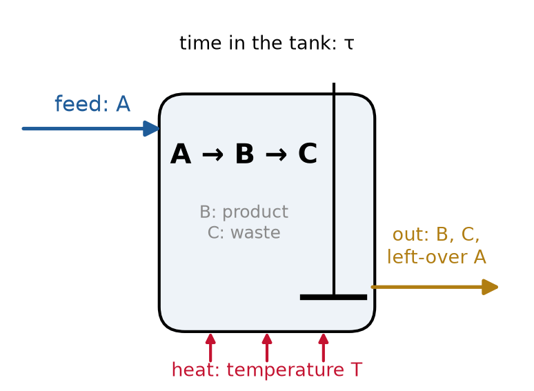<div class="n">1</div><b>The problem</b><br>A reaction, a few expensive experiments</div>
<div data-marpit-fragment>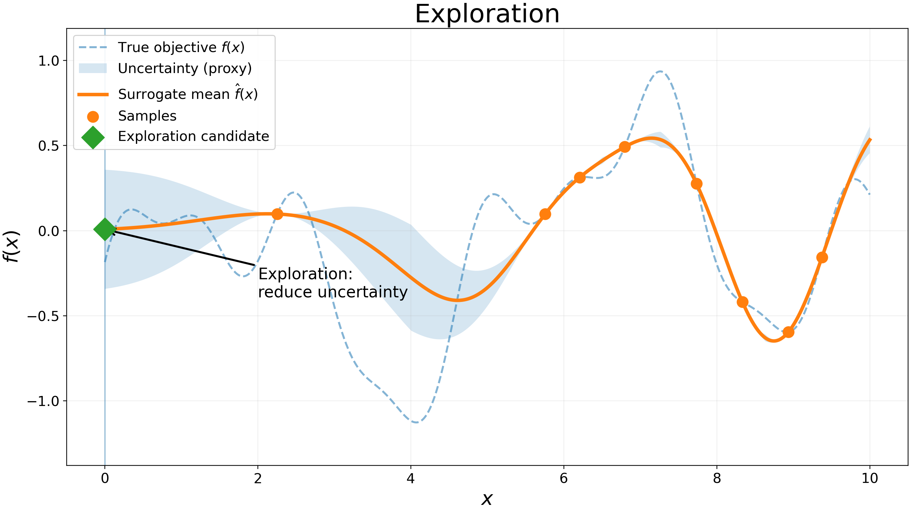<div class="n">2</div><b>Gen 1 and Bayes</b><br>A model that "knows what it does not know"</div>
<div data-marpit-fragment>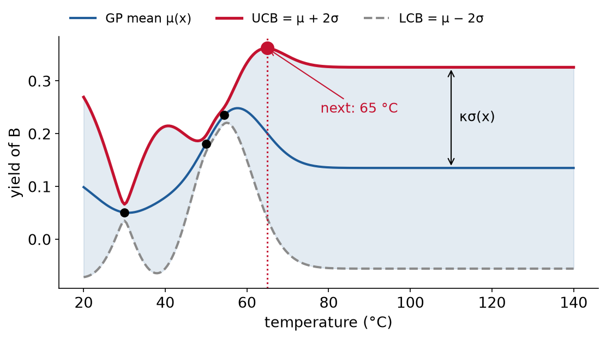<div class="n">3</div><b>The loop</b><br>Explore, exploit, acquisition functions</div>
<div data-marpit-fragment>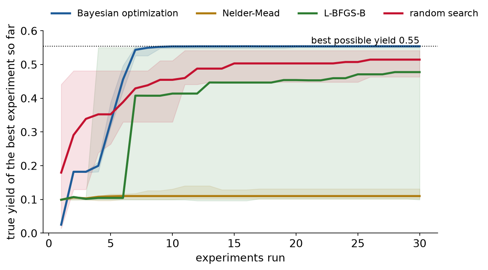<div class="n">4</div><b>In practice</b><br>BoTorch, when to use it, where it is used</div>
</div>

<!--
90 minutes of deck, 20 for the notebook. One example all the way: the reactor.
-->

---

<!-- _class: section -->

# The problem

---

## The problem, a reaction

<div class="cols cols-cl">
<div>


</div>
<div>

<div class="chain"><span class="sp a">A</span><span class="arr">→</span><span class="sp b">B</span><span class="arr">→</span><span class="sp c">C</span></div>

- A raw material **A** turns into the product we sell, **B**

* B keeps reacting into a waste, **C**
* Heat speeds up both steps, but the **second one more**
* Two knobs: the **temperature** T, and the **time in the tank** τ

</div>
</div>

---

## The problem, a simple toaster example

<div class="toast">
<div class="raw"><div class="t">Too cold</div>Bread stays bread<br><br><b>A barely reacts</b><br>Little B</div>
<div class="good" data-marpit-fragment><div class="t">Just right</div>Golden toast<br><br><b>Most of A becomes B</b><br>Before it goes further</div>
<div class="burnt" data-marpit-fragment><div class="t">Too hot</div>Burnt<br><br><b>B burns into C</b><br>Little B again</div>
</div>

<p class="takeaway" data-marpit-fragment>Somewhere in between is a best temperature. Where?</p>

<!--
Coffee roasting works too: green, roasted, burnt.
-->

---

## The problem, the yield curve

<div class="cols cols-lc">
<div>

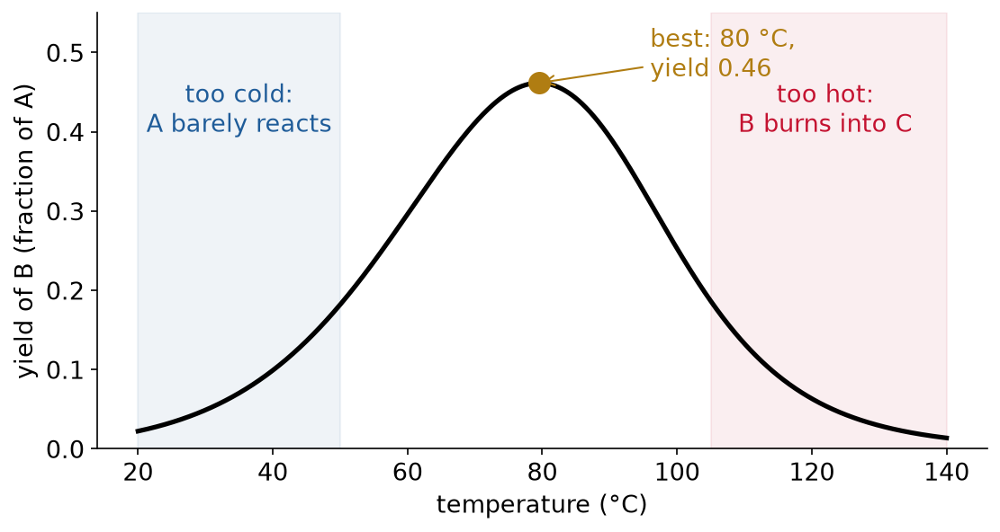

</div>
<div>

<div class="readbox">

- **Yield**: the fraction of A that leaves as B
- Best: **0.46 at 80 °C**, with 10 min in the tank
- Each point on this curve is **one experiment**
- In the lab, **nobody sees this curve**

</div>

</div>
</div>

<!--
We built the curve from the kinetics only to play the lab and check the answer. The optimizer never sees it.
-->

---

## The problem, the same shape in industry

<div class="cards">
<div class="card">
<h4>Ethylene oxide</h4>
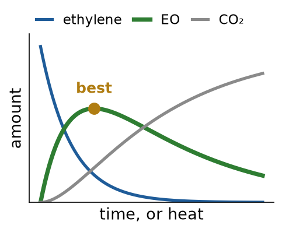
<p>Raw material for antifreeze and plastics. On the silver catalyst, over-oxidation burns the product (<a href="https://par.nsf.gov/servlets/purl/10189546">Pu et al., 2019</a>)</p>
</div>
<div class="card" data-marpit-fragment>
<h4>Sugar from wood</h4>
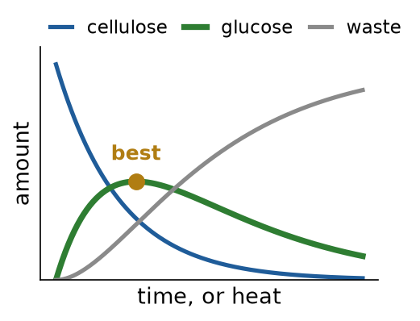
<p>Acid makes the sugar, then destroys it. <a href="https://doi.org/10.1021/ie50421a009">Saeman's 1945 model</a> is exactly A → B → C</p>
</div>
<div class="card" data-marpit-fragment>
<h4>Drug synthesis</h4>
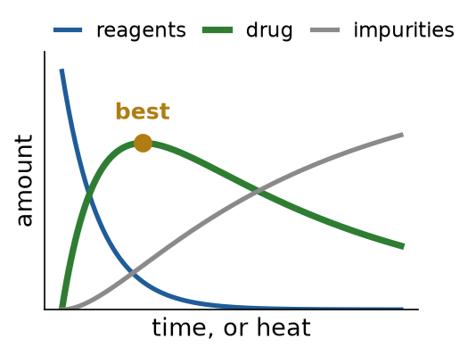
<p>The drug is an intermediate. Choosing its reaction conditions is a BO problem (<a href="https://doi.org/10.1038/s41586-021-03213-y">Shields et al., 2021</a>)</p>
</div>
</div>

<p class="takeaway" data-marpit-fragment>Made in the middle of a chain, destroyed by going further.</p>

<!--
The curves are sketches of first-order kinetics, A -> B -> C, not data. Saeman's paper is behind the ACS paywall.
-->

---

## The problem, what an experiment costs

<div class="kpis big" style="grid-template-columns: repeat(4, 1fr);">
<div class="kpi"><div class="v">hours</div><div class="l">per experiment: heat up, reach steady state, sample, analyze</div></div>
<div class="kpi" data-marpit-fragment><div class="v">121</div><div class="l">experiments for a 1 °C grid from 20 to 140 °C: weeks of lab time</div></div>
<div class="kpi" data-marpit-fragment><div class="v">thousands</div><div class="l">for a grid over two knobs</div></div>
<div class="kpi" style="border-top-color:#c41230" data-marpit-fragment><div class="v red">10 to 30</div><div class="l">the budget a lab can afford</div></div>
</div>

<div class="cols cols-even" style="margin-top: 0.5em;">
<div data-marpit-fragment>

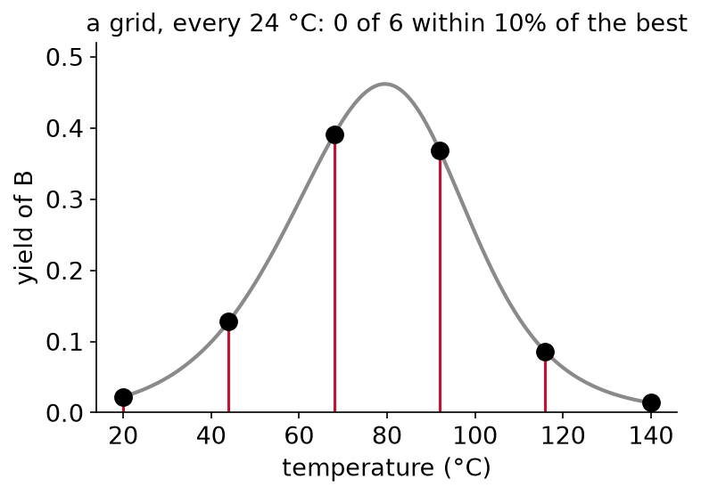

</div>
<div class="small" data-marpit-fragment>

- A grid that fits the budget is coarse: 6 runs, every 24 °C
- It misses the peak: 0 of 6 within 10% of the best yield

</div>
</div>

---

<!-- _class: definition -->

## Black-box objective

<div class="flow">
<div class="box">Inputs<br><b>T, τ</b></div><div class="arr">→</div>
<div class="box dark">The lab<br>(or a slow simulation)</div><div class="arr">→</div>
<div class="box">One noisy number<br><b>yield</b></div>
</div>

**Black-box objective**: a function you can only evaluate. Set the inputs, run the experiment, read one noisy number. No formula, no gradient.

---

## The problem, grid and random search

<div class="cols cols-even">
<div>


</div>
<div data-marpit-fragment>

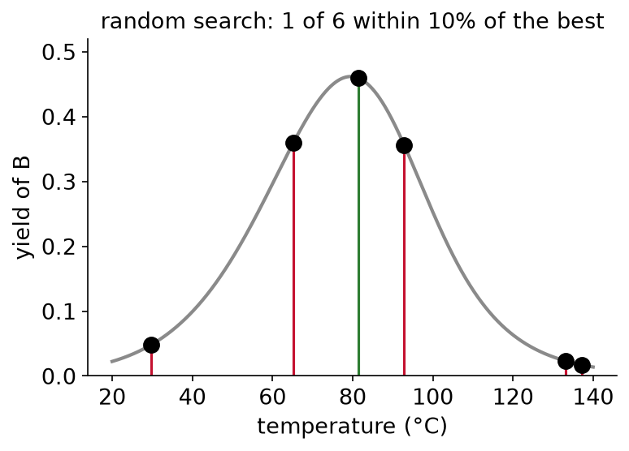

</div>
</div>

<div class="readbox" data-marpit-fragment>

- Six experiments each. Green: within 10% of the best yield. Red: wasted
- Neither strategy **learns** from the experiments it already ran

</div>

---

<!-- _class: section -->

# Gen 0 and Gen 1

---

## Gen 0 and Gen 1, the surrogate

<div class="cols cols-lc">
<div>

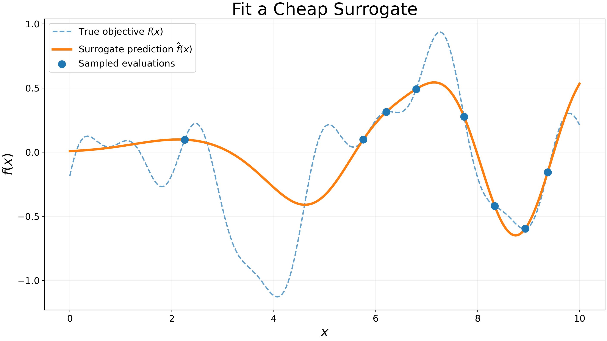

</div>
<div>

**Gen 0: the surrogate model**

- A cheap model replaces an expensive simulator or experiment
- It **predicts**. That is all

<div class="definition" data-marpit-fragment>

**Surrogate model**: a cheap model of the objective, fitted to the evaluations so far.

</div>

</div>
</div>

<!--
From my seminar, as in Lecture 13.
-->

---

## Gen 0 and Gen 1, machine learning with intention

<div class="cols cols-lc">
<div>


</div>
<div>

**Gen 1: the surrogate "knows what it does not know"**

- The surrogate also says how **uncertain** it is

* That uncertainty decides **where to run the next experiment**
* [Kushner (1964)](https://doi.org/10.1115/1.3653121), [Močkus (1975)](https://doi.org/10.1007/3-540-07165-2_55), [Jones, Schonlau and Welch (1998)](https://www.stat.ubc.ca/~will/docs/JonSchWel1998_global_optimization.pdf)

</div>
</div>

<p class="takeaway" data-marpit-fragment>Bayesian optimization is Gen 1.</p>

<!--
The green diamond: where the uncertainty is largest.
-->

---

<!-- _class: section -->

# Why "Bayesian"?

---

## Why "Bayesian", Bayes' rule

<div class="bayes">
<div class="term t-post">

$p(f \mid \text{data})$

<div class="lab">posterior</div>
</div>
<div class="op">

$\propto$

</div>
<div class="term t-lik">

$p(\text{data} \mid f)$

<div class="lab">likelihood</div>
</div>
<div class="op">

$\cdot$

</div>
<div class="term t-prior">

$p(f)$

<div class="lab">prior</div>
</div>
</div>

<div class="cards">
<div class="card c-prior" data-marpit-fragment><h4>Prior, p(f)</h4><p>What we believe about the yield curve <b>before</b> any experiment</p><p><b>Reactor:</b> "the yield is around 0.25, and changes smoothly over about 20 °C"</p></div>
<div class="card c-lik" data-marpit-fragment><h4>Likelihood, p(data | f)</h4><p>How well a candidate curve f explains the measurements, given the noise (0.01)</p><p><b>Reactor:</b> we measured 0.181 at 50 °C. A curve through 0.18 there fits; a curve through 0.40 does not</p></div>
<div class="card c-post" data-marpit-fragment><h4>Posterior, p(f | data)</h4><p>What we believe <b>after</b> the experiments: only curves that fit the data remain</p><p><b>Reactor:</b> after 30 and 50 °C, every curve passes near 0.05 and 0.18. At 110 °C, still anything</p></div>
</div>

<p class="takeaway" data-marpit-fragment>The unknown is the whole curve, f. Each experiment updates our belief about it.</p>

---

## Why "Bayesian", a Gaussian process

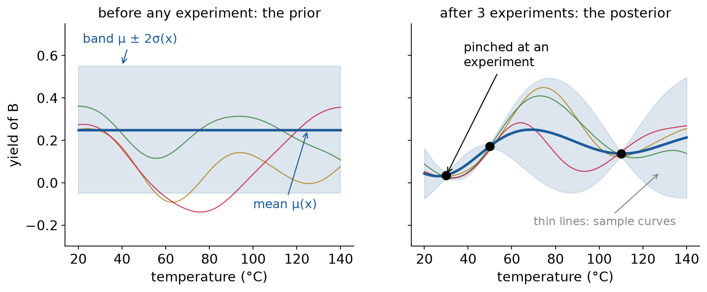

<div class="cols cols-even smaller" style="margin-top: 0.2em;">
<div>

- Lecture 14: exact and cheap to update; the posterior is again a GP

* Smoothness and noise fitted by marginal likelihood

</div>
<div>

<div class="definition">

**Gaussian process (GP)**: a prior over functions. After the data, a mean μ(x) and an uncertainty σ(x) at every input.

</div>

</div>
</div>

---

## Why "Bayesian", the posterior, one experiment at a time

<!--
How do you draw one of these random curves from the GP, in practice?
Evaluate the GP on a grid of temperatures (here 241 of them). That gives a mean vector mu and a covariance matrix K.
Factor K = L L^T (Cholesky). Draw a vector z of standard normal random numbers. The curve is mu + L z.
In BoTorch the same thing is gp.posterior(T_grid).rsample().
-->

<div class="cw compact" data-widget="bo-posterior" data-source="l15">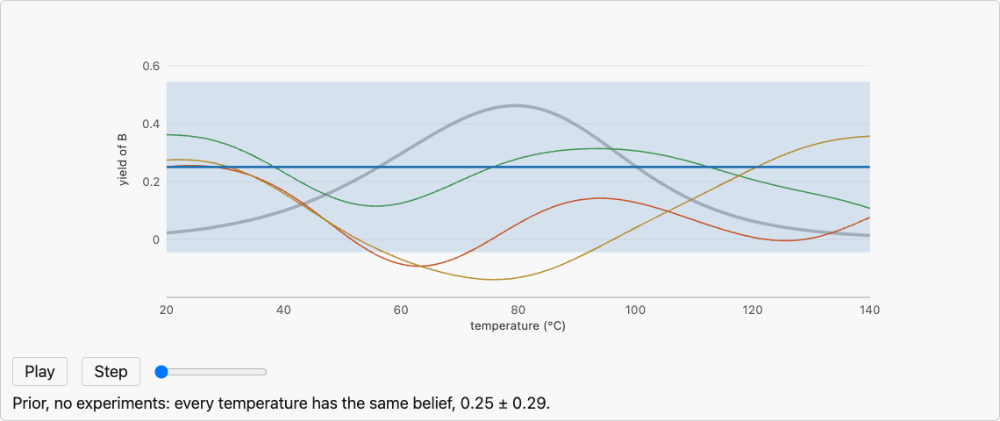</div>

<!--
Play. Prior first: same belief everywhere. Then 30, 50, 110, 80, 65 °C. The sample curves agree where we measured.
-->

---

## Why "Bayesian", the decision

<!--
Where is Mockus in Shahriari et al. (2016)? The review spells him Močkus, with a caron, and names him only in the reference list. Page 17 of the PDF: "The term Bayesian optimization was coined in the seventies [115]". Reference [115] is J. Močkus, V. Tiesis and A. Žilinskas, "The application of Bayesian methods for seeking the extremum", 1978. The link opens that page.
-->

<div class="flow">
<div class="box">Prior<br>over curves</div><div class="arr">→</div>
<div class="box">Experiments</div><div class="arr">→</div>
<div class="box">Posterior<br>μ(x), σ(x)</div><div class="arr">→</div>
<div class="box dark">Decision:<br>where next?</div>
</div>

- Bayesian **statistics**: update the belief with data

* Bayesian **decision**: choose the next experiment on that belief
* Both together: **Bayesian optimization**. "The term Bayesian optimization was coined in the seventies", citing Močkus, Tiesis and Žilinskas (1978) ([Shahriari et al., 2016, p. 17](https://www.cs.ox.ac.uk/people/nando.defreitas/publications/BayesOptLoop.pdf#page=17))

---

<!-- _class: section -->

# The loop

---

<!-- _class: definition -->

## Bayesian optimization

**Bayesian optimization (BO)**: maximize a black-box objective in few evaluations. Fit a surrogate to every evaluation so far, choose the next input by maximizing an acquisition function, evaluate it, and repeat.

<div class="loop">
<div class="node s1">
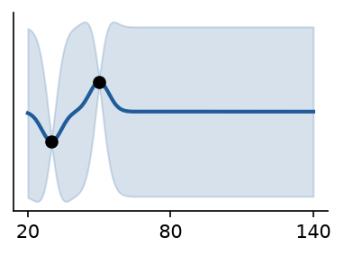

**1. Fit** a GP to all data

$\mu(x),\ \sigma(x)$

</div>
<div class="ar" data-marpit-fragment>→</div>
<div class="node s2" data-marpit-fragment>
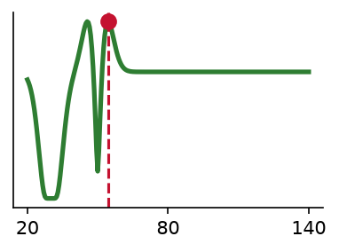

**2. Score** with an **acquisition function**, cheap

$a(x) = \text{EI}(x)$

</div>
<div class="ar" data-marpit-fragment>→</div>
<div class="node s3" data-marpit-fragment>
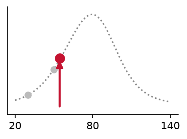

**3. Run** the best candidate

$x_{n+1} = \arg\max_x a(x)$

</div>
<div class="ar" data-marpit-fragment>→</div>
<div class="node s4" data-marpit-fragment>
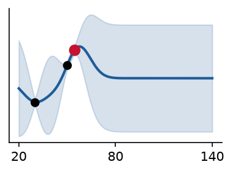

**4. Add** it to the data

$\mathcal{D}_{n+1} = \mathcal{D}_n \cup \{(x_{n+1}, y_{n+1})\}$

</div>
</div>
<div class="loopback" data-marpit-fragment><span>repeat until the budget is spent</span></div>

<!--
The four panels are the first pass of the worked example: two old runs, EI peaks at 54 °C, run it, refit.
-->

---

## The loop, terminology

<div class="cols cols-lc">
<div>

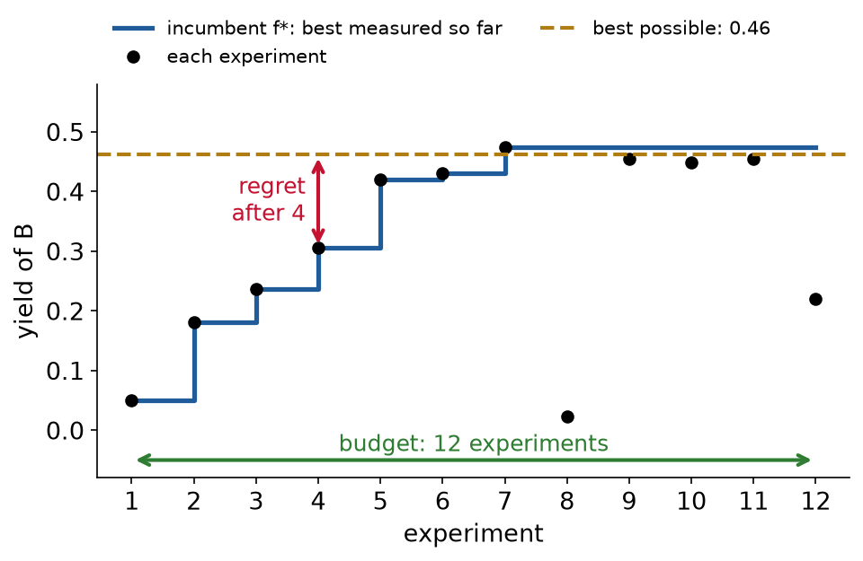

</div>
<div>

<div class="readbox" style="font-size: 0.78em;">

- **Incumbent f\***: the best value measured so far. Here 0.474, at experiment 7

</div>
<div class="readbox" style="font-size: 0.78em; margin-top: 0.4em;" data-marpit-fragment>

- **Budget**: the number of experiments we can afford. Here 12

</div>
<div class="readbox" style="font-size: 0.78em; margin-top: 0.4em;" data-marpit-fragment>

- **Regret**: best possible value minus the best found. After 4 experiments: 0.46 − 0.31 = 0.16

</div>

<p class="takeaway" data-marpit-fragment>The goal: small regret, small budget.</p>

</div>
</div>

---

## The loop, step by step

<div class="cw compact" data-widget="bo-loop" data-source="l15">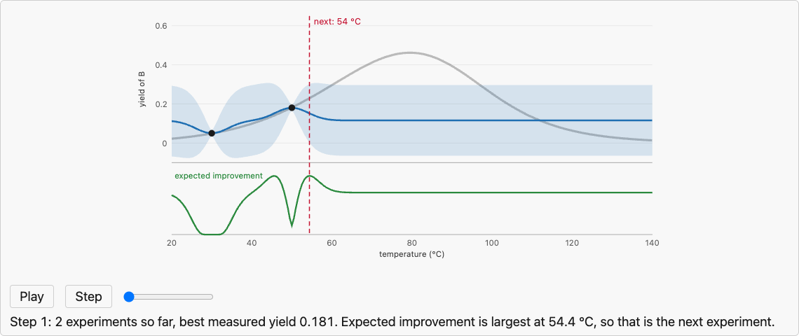</div>

<!--
Step through slowly. Step 6: the jump to 140 °C, where the GP is unsure. After that it never goes back there.
-->

---

## The loop, what it did

<div class="flow">
<div class="box">30, 50 °C<br><span class="small">two old runs</span></div><div class="arr">→</div>
<div class="box" data-marpit-fragment>54, 61, 72, 87, 81 °C<br><span class="small">climbing</span></div><div class="arr" data-marpit-fragment>→</div>
<div class="box" style="border-color:#c41230" data-marpit-fragment>140 °C<br><span class="small">explores: still unsure there</span></div><div class="arr" data-marpit-fragment>→</div>
<div class="box" style="border-color:#2e7d32" data-marpit-fragment>80 °C<br><span class="small">settled</span></div>
</div>

<div class="kpis" style="grid-template-columns: repeat(3, 1fr);">
<div class="kpi" data-marpit-fragment><div class="v">7</div><div class="l">experiments to 98% of the best yield, the two old runs included</div></div>
<div class="kpi" data-marpit-fragment><div class="v">0.474</div><div class="l">best measured yield, at 80.5 °C (true there: 0.461)</div></div>
<div class="kpi" data-marpit-fragment><div class="v">0.462</div><div class="l">best possible: 79.5 °C</div></div>
</div>

---

<!-- _class: section -->

# Exploration and exploitation

---

<!-- _class: definition -->

## Exploitation and exploration

**Exploitation**: run the next experiment where the surrogate predicts a good value (high μ).

**Exploration**: run it where the surrogate is unsure (high σ).

---

## Exploration and exploitation, tonight's dinner

<div class="cards two">
<div class="card"><h4>Your favorite restaurant</h4><p>You know it is good. You will never find out if the new place is better</p><p class="blue"><b>Exploitation</b></p></div>
<div class="card" data-marpit-fragment><h4>The new place</h4><p>Could be great, could be awful. You learn something either way</p><p class="red"><b>Exploration</b></p></div>
</div>

<p class="takeaway" data-marpit-fragment>A good acquisition function does some of both.</p>

---

## Exploration and exploitation, the two extremes

<div class="cards two">
<div class="card">
<h4>Pure exploitation</h4>
<p>Keeps sampling next to the best point so far</p>
<p>Can sit on a <b>local optimum</b> forever: it never looks elsewhere</p>
</div>
<div class="card" data-marpit-fragment>
<h4>Pure exploration</h4>
<p>Samples wherever the band is widest</p>
<p>Learns the <b>whole curve</b>, ignores the goal: close to a careful random search</p>
</div>
</div>

<p class="takeaway" data-marpit-fragment>Every acquisition function is a recipe for the balance, with a knob.</p>

---

## Exploration and exploitation, one knob

<!--
What is kappa, the number on the slider?
It is the weight on uncertainty in the upper confidence bound, mu(x) + kappa sigma(x): how many standard deviations of optimism we add to the GP mean.
Kappa = 0: the score is just the mean, so the next run goes right next to the best point so far (58 °C).
As kappa grows, the uncertainty term takes over and the pick moves to where the band is widest.
-->

<div class="cw compact" data-widget="bo-explore" data-source="l15">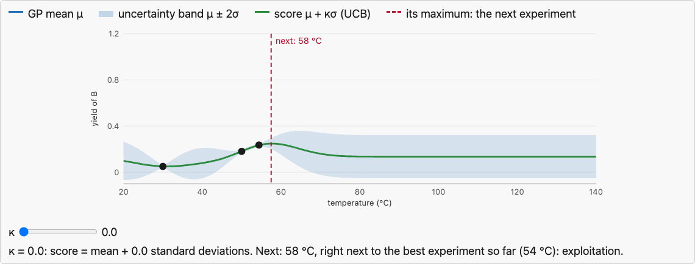</div>

<!--
Slide κ from 0 up. At 0 it sits next to 54 °C. Around 2 it moves out. At 5 it goes where the band is widest.
-->

---

<!-- _class: section -->

# Acquisition functions

---

## Acquisition functions, the z-score

<!--
What are the Greek letters?
Xi (ξ) is the margin. It is in z. In plain terms, the smallest gain that counts: with xi = 0.01, a temperature counts as an improvement only if it beats 0.236 by more than 0.01. A larger xi ignores tiny gains right next to f*, so the search moves away from it. We use xi = 0.
Capital and lowercase phi (Φ, φ) are NOT in z. They take z as input in PI and EI: Φ is the standard normal cumulative distribution, φ its density. They are defined on the next two slides.
-->

<div class="definition">

**z-score**: how many GP standard deviations the predicted yield μ(x) sits above the best so far, f\*. z > 0: the GP expects to beat f\*. z < 0: it expects to fall short.

</div>

$$
z = \frac{\overbrace{\mu(x)}^{\text{GP mean}} - \overbrace{f^*}^{\text{best so far}} - \overbrace{\xi}^{\text{margin}}}{\underbrace{\sigma(x)}_{\text{GP uncertainty}}}
$$

<div class="small">

- **Reactor**, at 60 °C after 3 experiments: μ = 0.242, σ = 0.046, f\* = 0.236, so z = (0.242 − 0.236) / 0.046 = 0.13

* **ξ (xi), the margin**: the smallest gain that counts. With ξ = 0.01, a temperature counts only if it beats 0.236 by more than 0.01
* ξ > 0 ignores tiny gains right next to f\*, so the search moves away from it: more exploration. The worked example uses ξ = 0

</div>

---

## Acquisition functions, probability of improvement (PI)

<!--
PI in plain words.
At 60 °C the GP does not give one yield. It gives a bell of possible yields, centred at 0.242, spread 0.046.
The best yield so far is 0.236.
PI is the share of the bell above 0.236: 55%. A 55% chance that 60 °C beats the best so far.
Phi(z) is the same number reached through z. Shifting and rescaling the bell to a standard one turns the share above 0.236 into the share left of z = 0.13, and Phi(0.13) = 0.55.
The weakness: a point right next to f*, with a narrow bell, gets PI near 1 for a gain of almost nothing. That is why EI weighs each gain by its size.
-->

<div class="definition">

**Probability of improvement (PI)**: the probability that the yield at x beats the best so far, f\*, by more than ξ.

</div>

<div class="cols cols-even cols-top">
<div>

$$
\text{PI}(x) = P\big(f(x) > f^* + \xi\big) = \Phi(z)
$$

<div class="small">

- **1.** At 60 °C the GP gives a **bell** of possible yields: mean 0.242, sd 0.046

* **2.** The best yield so far: **f\* = 0.236**
* **3.** PI = the **share of the bell above f\***: 0.55
* **4.** Same number from z: **Φ(z)** is the share of a standard bell left of z. Φ(0.13) = 0.55

</div>

</div>
<div>

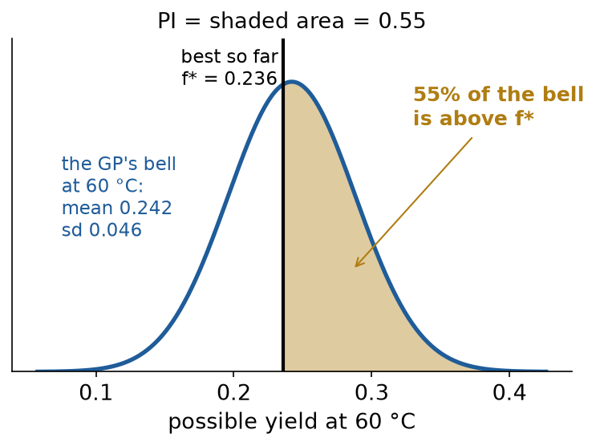

</div>
</div>

<p class="takeaway" style="font-size: 0.72em;" data-marpit-fragment>In short: PI runs the experiment most likely to beat the best so far, however small the gain.</p>

---

## Acquisition functions, expected improvement (EI)

<!--
What is the gain f minus f*?
If we ran the experiment at 60 °C and the yield came out f, the gain over the best so far would be f minus f*. If f is below f*, we gain nothing: the gain is 0, not negative.
Bottom panel: the gain for every possible yield. Top panel: how likely each yield is.
EI averages the gain over the bell: 0.022 at 60 °C.
Each card lights up its term in the equation as it appears.
-->

<div class="definition">

**Expected improvement (EI)**: the average amount by which the yield at x beats the best so far, counting a miss as zero.

</div>

<div class="eqrow">
<div class="term t-gain">

$I(x) = \max\big(f(x) - f^*, 0\big)$

</div>
<div class="sep"></div>
<div>

$\text{EI}(x) =$

</div>
<div class="term t-avg">

$\mathbb{E}\big[I(x)\big]$

</div>
<div>

$=$

</div>
<div class="term t-exploit">

$(\mu - f^*)\,\Phi(z)$

</div>
<div>

$+$

</div>
<div class="term t-explore">

$\sigma\,\phi(z)$

</div>
</div>

<div class="cols cols-even cols-top">
<div class="cards tight2">
<div class="card c-gain" data-marpit-fragment><h4>The gain, I(x)</h4><p>If the yield at x turns out to be f, the gain is f − f*. Below f*, the gain is 0</p></div>
<div class="card c-avg" data-marpit-fragment><h4>The average, 𝔼</h4><p>Average the gain over the GP's bell of possible yields</p></div>
<div class="card c-exploit" data-marpit-fragment><h4>Exploitation term</h4><p>How far the mean is above f*, times Φ(z), the chance of beating f*. Large where <b>μ is high</b></p></div>
<div class="card c-explore" data-marpit-fragment><h4>Exploration term</h4><p>The bell's width σ times φ(z), the bell's height at z. Large where <b>σ is large</b></p></div>
</div>
<div>

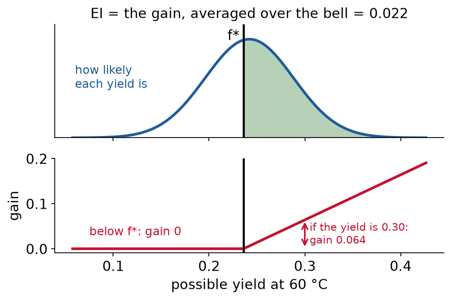

</div>
</div>

---

## Acquisition functions, LogEI

<!--
Why LogEI was created.
Far from the data, EI is so small that the computer rounds it to exactly 0 (underflow; below about 1e-324 in double precision). Here, after 12 experiments, that happens at 12% of the temperatures (red).
Where EI is exactly 0, its slope is 0 too, so the optimizer that follows the slope has no direction.
Log EI is about -1000 there instead: a normal number with a slope. The log does not move the peak, so the next experiment is the same.
Ament et al. (2023): EI's values "vanish numerically in many regions".
-->

<div class="definition">

**LogEI**: compute log EI directly, with formulas that stay accurate where EI is tiny. Same maximizer as EI: the log does not move the peak.

</div>

<div class="cols cols-even cols-top">
<div class="smaller">

- **Why**: far from the data, EI is so small that the computer rounds it to 0. EI's values "vanish numerically in many regions" ([Ament et al., 2023](https://arxiv.org/abs/2310.20708))

* **Top**: EI after the 12 experiments. One narrow peak near 80 °C, about 10⁻⁸ high
* **Red**: where the computer stores EI as exactly 0. Flat: the optimizer finds no slope to follow
* **Bottom**: log EI. A finite number everywhere, sloping up toward 80 °C
* Both peak at the **same temperature**: the same next experiment

</div>
<div>

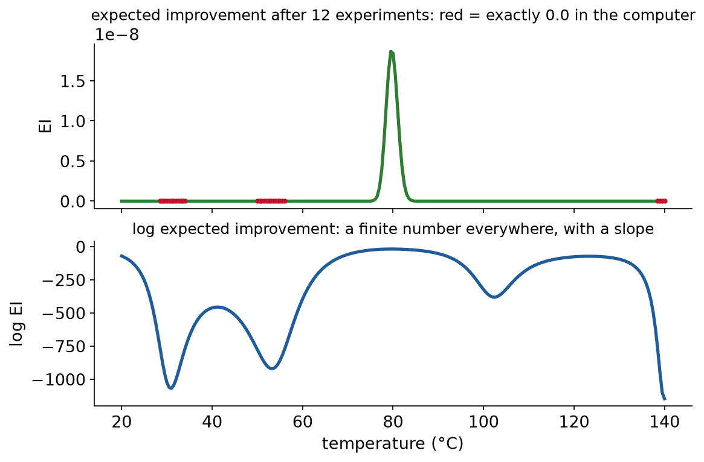

</div>
</div>

---

## Acquisition functions, upper and lower confidence bounds

<!--
What is kappa exactly, besides the knob?
How many standard deviations of optimism. UCB scores each temperature by the top of its band, mu + kappa sigma. Kappa = 2 is the top of the 95% band.
What is beta in BoTorch? UpperConfidenceBound(gp, beta) computes mu + sqrt(beta) sigma, so beta = kappa squared: beta = 4 means kappa = 2.
Not on this slide on purpose: BoTorch comes later. It is in the notes' BoTorch section.
-->

<div class="definition">

**Upper confidence bound (UCB)**: an optimistic score, the GP mean plus κ standard deviations. **LCB**, μ − κσ, is the same idea for minimizing.

</div>

<div class="cols cols-even cols-top">
<div>

$$
\text{UCB}(x) = \underbrace{\mu(x)}_{\text{expected yield}} + \underbrace{\kappa}_{\text{knob}}\,\underbrace{\sigma(x)}_{\text{uncertainty}}
$$

<div class="small">

- **κ (kappa)**: how many standard deviations of optimism. UCB scores each temperature by the top of its band, μ + κσ

* **κ = 0**: the mean only. Pure exploitation
* **κ = 2**: the top of the 95% band. On the reactor: next experiment at 65 °C
* **Large κ**: the band wins. Exploration

</div>

</div>
<div>


</div>
</div>

---

## Acquisition functions, one GP, three choices

<div class="cols cols-even">
<div>

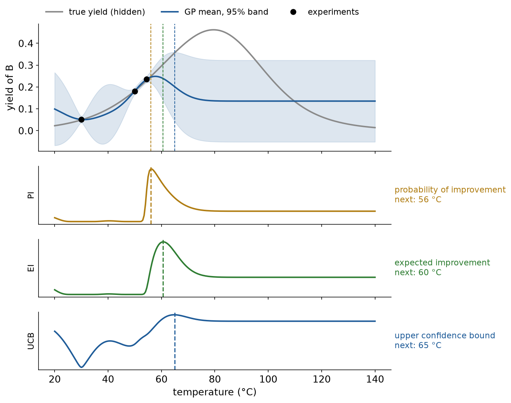

</div>
<div>

<div class="readbox">

- The same GP, after three experiments (30, 50, 54 °C)
- **PI** 56 °C: closest to the best so far
- **EI** 61 °C
- **UCB, κ = 2**: 65 °C, the furthest into the unknown

</div>

<p class="takeaway" data-marpit-fragment>Same data, same GP: the acquisition function alone sets the next experiment.</p>

</div>
</div>

---

## Acquisition functions, where the ideas come from

<div class="timeline">
<div class="ev"><div class="yr">1964</div><div class="dot"></div><b>Kushner</b><br>Probability of improvement, for a noisy curve<div class="eq">

$\Phi(z)$

</div><a href="https://doi.org/10.1115/1.3653121">J. Basic Eng.</a></div>
<div class="ev" data-marpit-fragment><div class="yr">1970s</div><div class="dot"></div><b>Šaltenis, Močkus</b><br>Expected improvement; "Bayesian"<div class="eq">

$\mathbb{E}[\max(f - f^*, 0)]$

</div><a href="https://doi.org/10.1007/3-540-07165-2_55">Močkus 1975</a></div>
<div class="ev key" data-marpit-fragment><div class="yr">1998</div><div class="dot"></div><b>Jones, Schonlau, Welch</b><br>EGO: EI on a kriging model<div class="eq">

kriging + EI

</div><a href="https://www.stat.ubc.ca/~will/docs/JonSchWel1998_global_optimization.pdf">J. Global Optim.</a></div>
<div class="ev" data-marpit-fragment><div class="yr">2001</div><div class="dot"></div><b>Jones</b><br>A taxonomy of response-surface methods<div class="eq">

which work, which fail

</div><a href="https://research.cs.wisc.edu/areas/ai/airg/jones01taxonomy.pdf">J. Global Optim.</a></div>
<div class="ev" data-marpit-fragment><div class="yr">2010</div><div class="dot"></div><b>Srinivas et al.</b><br>UCB on a GP: GP-UCB<div class="eq">

$\mu + \kappa\sigma$

</div><a href="https://arxiv.org/abs/0912.3995">ICML</a></div>
<div class="ev" data-marpit-fragment><div class="yr">2012</div><div class="dot"></div><b>Snoek et al.</b><br>BO for machine learning<div class="eq">

hyper­parameters

</div><a href="https://arxiv.org/abs/1206.2944">NeurIPS</a></div>
<div class="ev" data-marpit-fragment><div class="yr">2020</div><div class="dot"></div><b>BoTorch</b><br>On PyTorch; LogEI in 2023<div class="eq">

$\log \text{EI}$

</div><a href="https://arxiv.org/abs/1910.06403">NeurIPS</a></div>
</div>

---

## Acquisition functions, Donald Jones and EGO

<div class="definition">

**Efficient global optimization (EGO)**: fit a kriging model (a GP), sample where expected improvement is largest, refit, repeat ([Jones, Schonlau and Welch, 1998](https://www.stat.ubc.ca/~will/docs/JonSchWel1998_global_optimization.pdf)).

</div>

<div class="cols cols-lc cols-top">
<div>

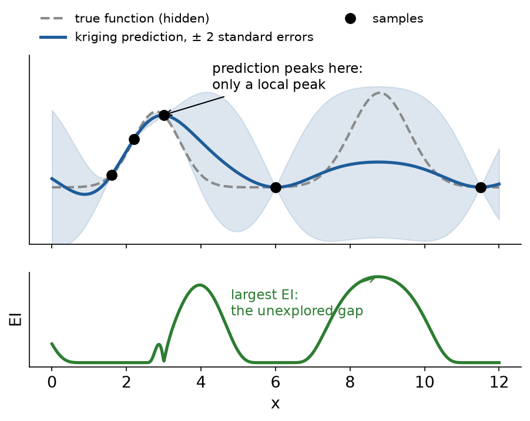

</div>
<div class="smaller">

- **Start**: a space-filling design, about 10 points per input

* **Fit** the kriging model; check it by cross-validation
* **Loop**: maximize EI; sample there; refit
* **Stop** when EI is below 1% of the best value
* **Kriging**: named after Danie Krige, a South African mining engineer who estimated gold grades from samples ([NAE](https://www.nationalacademies.org/read/21785/chapter/35))

</div>
</div>

<!--
The figure redraws the idea of the paper's Figs. 8 to 11 on our own function: the prediction alone only refines the local peak near the cluster; EI is largest in the gap. Jones (2001) is the follow-up taxonomy.
-->

---

<!-- _class: section -->

# Bayesian optimization in BoTorch

---

## BoTorch

<!--
Is "automatic differentiation" true for BoTorch?
Yes. Checked in the BoTorch 0.18.1 source: optimize_acqf calls gen_candidates_scipy, which runs SciPy's L-BFGS-B, and the gradients come from torch.autograd.grad.
The GP is a formula, so the acquisition has exact gradients. Only the experiment itself has none.
-->

<div class="cols cols-even">
<div>

<div class="stack">
<div style="background:#c41230">BoTorch: acquisition functions, optimizing them</div>
<div style="background:#1f5c99">GPyTorch: Gaussian processes</div>
<div style="background:#5c5c5c">PyTorch: tensors, automatic differentiation</div>
</div>

</div>
<div>

<div style="text-align:center; font-size: 2.2em; font-weight: 700; margin: 0.1em 0 0.3em;">BoTorch</div>

- A Bayesian optimization library from Meta ([Balandat et al., 2020](https://arxiv.org/abs/1910.06403))

* `optimize_acqf` maximizes the acquisition with **L-BFGS-B**, a gradient method. PyTorch's **automatic differentiation** supplies the gradients
* Docs and tutorials: [botorch.org](https://botorch.org)

</div>
</div>

---

## BoTorch, the experiment

<div class="ca">
<div>

```python
R = 8.314                     # J/(mol K)


def rate(T, k_ref, E):
    # Arrhenius: rate constant (1/min) at T (degC), relative to 80 degC
    T = T + 273.15
    return k_ref * np.exp(-E / R * (1 / T - 1 / 353.15))


def yield_B(T, tau):
    # steady-state yield of B in the tank, for A -> B -> C
    k1 = rate(T, 0.15, 60e3)      # A -> B
    k2 = rate(T, 0.03, 110e3)     # B -> C: needs more heat
    return k1 * tau / ((1 + k1 * tau) * (1 + k2 * tau))


rng = np.random.default_rng(0)


def run_experiment(T):
    # one experiment per row of T (degC): 10 min in the tank, noise 0.01
    y = yield_B(T.numpy().ravel(), 10.0)
    y = y + 0.01 * rng.standard_normal(T.shape[0])
    return torch.tensor(y).unsqueeze(-1)
```

</div>
<div></div>
<div class="lay" data-marpit-fragment><div class="hl c1" style="top:69px; height:88px"></div><div class="cn c1" style="top:62px">

Arrhenius' law: heat speeds up each step

$$k_i = k_{i,\text{ref}} \exp\!\left[-\frac{E_i}{R}\left(\frac{1}{T} - \frac{1}{T_\text{ref}}\right)\right]$$

</div></div>
<div class="lay" data-marpit-fragment><div class="hl c2" style="top:195px; height:109px"></div><div class="cn c2" style="top:190px">

Yield of B at steady state. E₂ > E₁: the waste step needs more heat

$$y = \frac{k_1 \tau}{(1 + k_1 \tau)(1 + k_2 \tau)}$$

</div></div>
<div class="lay" data-marpit-fragment><div class="hl c4" style="top:405px; height:109px"></div><div class="cn c4" style="top:395px">

The "lab": one noisy yield per temperature. The optimizer sees only this

$$y_\text{meas} = y(T) + \varepsilon, \quad \varepsilon \sim \mathcal{N}(0,\, 0.01^2)$$

</div></div>
</div>

---

## BoTorch, two old runs

<div class="ca">
<div>

```python
bounds = torch.tensor([[20.0], [140.0]])      # temperature from 20 to 140 degC
torch.manual_seed(0)

# two old runs from the lab notebook
T = torch.tensor([[30.0], [50.0]])
y = run_experiment(T)
```

</div>
<div></div>
<div class="lay" data-marpit-fragment><div class="hl c1" style="top:6px; height:25px"></div><div class="cn c1" style="top:4px">Where BO may search: 20 to 140 °C</div></div>
<div class="lay" data-marpit-fragment><div class="hl c3" style="top:69px; height:67px"></div><div class="cn c3" style="top:76px">The starting data: two cold runs. Each row is one experiment</div></div>
</div>

---

## BoTorch, the loop, the surrogate

<div class="ca">
<div>

```python
for i in range(10):
    # 1. the surrogate: a GP fitted to every experiment so far
    gp = SingleTaskGP(
        T,
        y,
        input_transform=Normalize(d=1),
        outcome_transform=Standardize(m=1),
    )
    mll = ExactMarginalLogLikelihood(gp.likelihood, gp)
    fit_gpytorch_mll(mll)
```

</div>
<div></div>
<div class="lay" data-marpit-fragment><div class="hl c1" style="top:6px; height:25px"></div><div class="cn c1" style="top:4px">Ten more experiments: the budget</div></div>
<div class="lay" data-marpit-fragment><div class="hl c2" style="top:48px; height:130px"></div><div class="cn c2" style="top:76px">The GP. <code>Normalize</code>: temperature to [0, 1]. <code>Standardize</code>: yields to mean 0, standard deviation 1</div></div>
<div class="lay" data-marpit-fragment><div class="hl c3" style="top:174px; height:46px"></div><div class="cn c3" style="top:174px">Fit its settings (smoothness, noise) by marginal likelihood, as in Lecture 14</div></div>
</div>

---

## BoTorch, the loop, acquire and run

<div class="ca">
<div>

```python
    # 2. the acquisition: expected improvement over the best yield so far
    acq = LogExpectedImprovement(gp, best_f=y.max())

    # 3. the next experiment: where the acquisition is largest
    T_next, _ = optimize_acqf(
        acq,
        bounds=bounds,
        q=1,
        num_restarts=10,
        raw_samples=200,
    )

    # 4. run it, and add it to the data
    y_next = run_experiment(T_next)
    T = torch.cat([T, T_next])
    y = torch.cat([y, y_next])
```

</div>
<div></div>
<div class="lay" data-marpit-fragment><div class="hl c2" style="top:6px; height:46px"></div><div class="cn c2" style="top:6px">LogEI, with the incumbent: the best yield so far</div></div>
<div class="lay" data-marpit-fragment><div class="hl c3" style="top:69px; height:172px"></div><div class="cn c3" style="top:111px">Maximize it: score 200 random candidates, start 10 gradient searches from the best. <code>q=1</code>: one experiment at a time</div></div>
<div class="lay" data-marpit-fragment><div class="hl c4" style="top:258px; height:88px"></div><div class="cn c4" style="top:271px">The only expensive line: the experiment. Then add it to the data</div></div>
</div>

---

## BoTorch, what it ran

<div class="ca out">
<div>

```text
experiment  1: T =  30.0 C, yield 0.050
experiment  2: T =  50.0 C, yield 0.181
experiment  3: T =  54.4 C, yield 0.236
experiment  4: T =  60.7 C, yield 0.306
experiment  5: T =  71.5 C, yield 0.419
experiment  6: T =  86.9 C, yield 0.430
experiment  7: T =  80.5 C, yield 0.474
experiment  8: T = 140.0 C, yield 0.023
experiment  9: T =  80.0 C, yield 0.454
experiment 10: T =  80.0 C, yield 0.449
experiment 11: T =  80.1 C, yield 0.455
experiment 12: T = 102.5 C, yield 0.219
```

</div>
<div></div>
<div class="lay" data-marpit-fragment><div class="hl c1" style="top:60px; height:139px"></div><div class="cn c1" style="top:100px"><b>Climbs</b> from the cold side: 54, 61, 72, 87, 81 °C</div></div>
<div class="lay" data-marpit-fragment><div class="hl c4" style="top:195px; height:31px"></div><div class="cn c4" style="top:192px"><b>Experiment 8</b>: 140 °C, where the GP was still unsure. Yield 0.023: nothing there</div></div>
<div class="lay" data-marpit-fragment><div class="hl c2" style="top:222px; height:112px"></div><div class="cn c2" style="top:262px"><b>Settles</b> at 80 °C, with a check at 102.5 °C</div></div>
</div>

---

## BoTorch, check the answer

<div class="cols cols-lc">
<div>

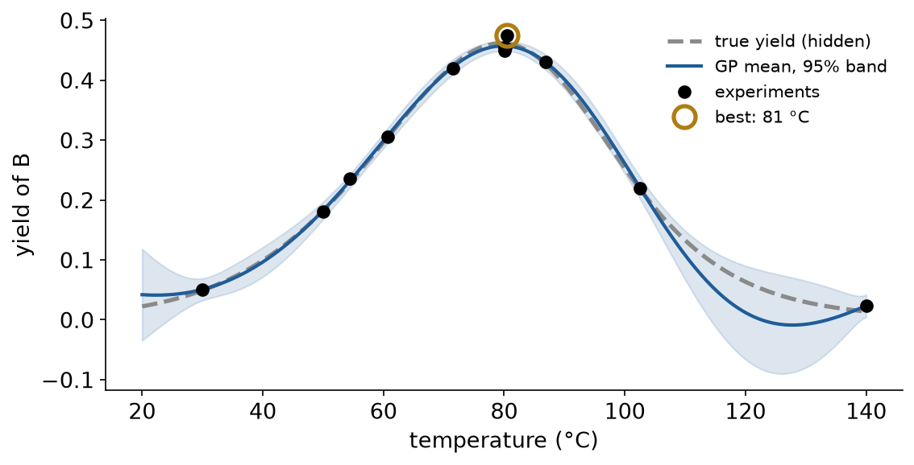

</div>
<div>

<div class="readbox">

- Only now do we look at the true curve
- Best experiment: **80.5 °C**, measured 0.474, true 0.461
- True best: **79.5 °C, 0.462**
- The band is wide between 105 and 135 °C, where BO ran no experiment

</div>

</div>
</div>

---

## BoTorch, a second knob: the time in the tank

<div class="cols cols-cl">
<div>

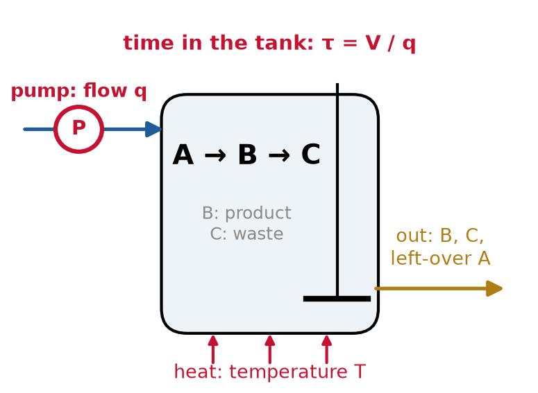

</div>
<div>

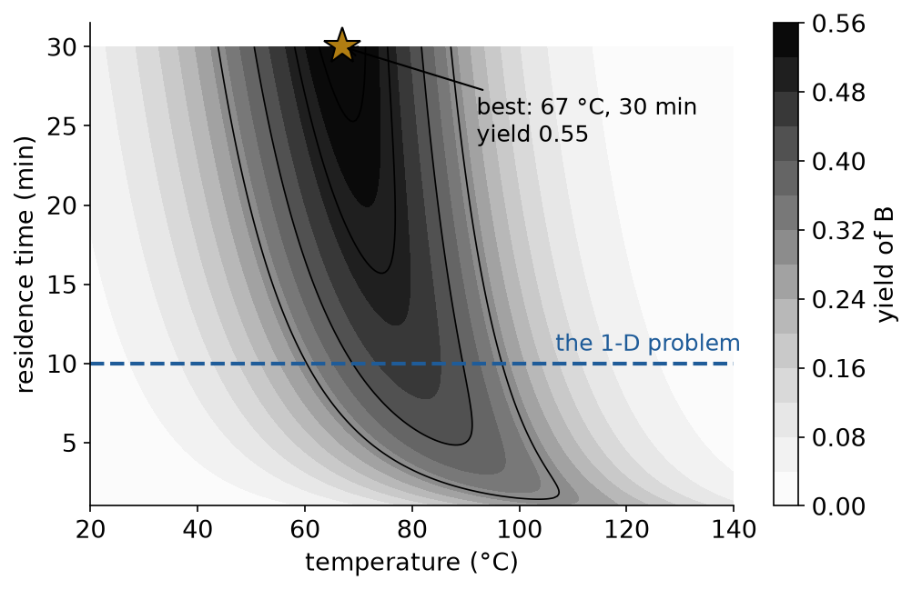

</div>
</div>

<div class="small">

- The pump sets the flow q, so the **time in the tank τ = V / q**: from 1 to 30 min

* The knobs **interact**: with 30 min, the best temperature drops from 80 to **67 °C**, and the best yield rises from 0.46 to **0.55**

</div>

---

## BoTorch, comparing optimizers: what to report

<div class="cards four">
<div class="card"><h4>Several seeds</h4><p>BO is random: the noise, the random candidates. One run is one sample</p></div>
<div class="card" data-marpit-fragment><h4>A baseline</h4><p>Random search at least. Also try a classic optimizer, if possible</p></div>
<div class="card" data-marpit-fragment><h4>Best so far</h4><p>Against experiments, with its spread across seeds</p></div>
<div class="card" data-marpit-fragment><h4>The budget</h4><p>Count every experiment, the old runs included</p></div>
</div>

---

## BoTorch, ten seeds


<div class="readbox">

- Median over 10 seeds, shaded from the worst to the best seed
- **BO:** 98% of the best possible yield in **all 10 seeds**, after **8 experiments** (median)

</div>

---

<!-- _class: section -->

# When to use it

---

## When to use it, four optimizers with the same 30 experiments

<div class="cw compact" data-widget="bo-race" data-source="l15">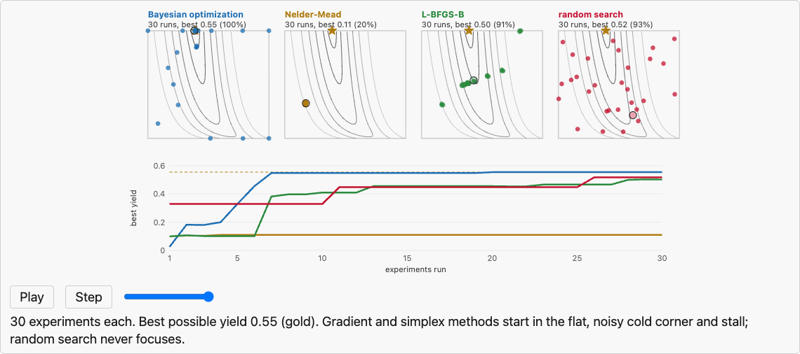</div>

<!--
Play. Watch Nelder-Mead and L-BFGS-B sit in the cold corner. Random search sprays points everywhere.
-->

---

## When to use it, ten seeds

<div class="kpis" style="grid-template-columns: repeat(4, 1fr);">
<div class="kpi" style="border-top-color:#1f5c99">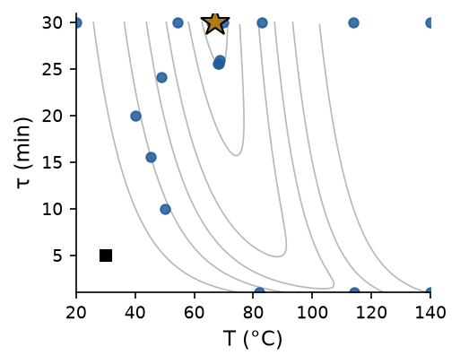<div class="v blue">10 / 10</div><div class="l"><b>Bayesian optimization</b><br>reached 98% of the best yield, median 8 experiments</div></div>
<div class="kpi" style="border-top-color:#2e7d32" data-marpit-fragment>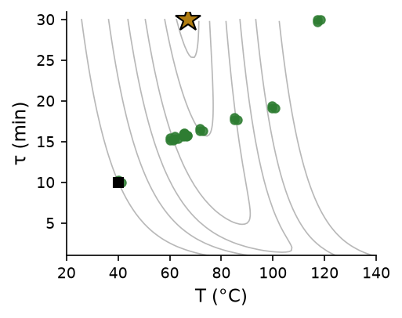<div class="v green">2 / 10</div><div class="l"><b>L-BFGS-B</b><br>median 86% after 30 experiments</div></div>
<div class="kpi" style="border-top-color:#b07d12" data-marpit-fragment>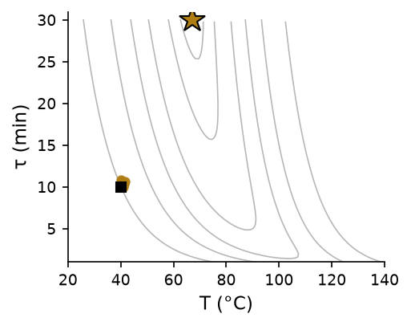<div class="v gold">0 / 10</div><div class="l"><b>Nelder–Mead</b><br>stuck near 20% of the best</div></div>
<div class="kpi" style="border-top-color:#c41230" data-marpit-fragment>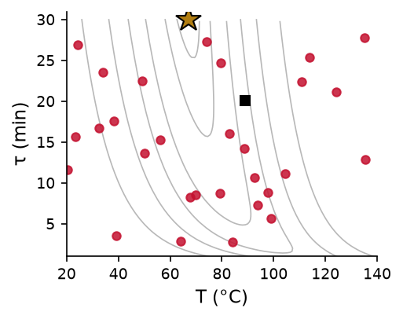<div class="v red">0 / 10</div><div class="l"><b>Random search</b><br>median 93% after 30 experiments</div></div>
</div>

<p class="takeaway" data-marpit-fragment>All four: the same reactor, noise, budget of 30 and cold start. Maps: seed 0; star: the best.</p>

---

## When to use it, why gradient methods stall here

<div class="cols cols-even">
<div>

$$
\frac{\partial y}{\partial T} \approx \frac{y(T + h) - y(T)}{h}
$$

<div class="small">

- Each y is an **experiment**, with noise 0.01

* A gradient by finite differences costs **an experiment per input**
* Cold side, h = 1.2 °C: true change **0.008**, noise in the difference **±0.028**
* Nelder–Mead needs no gradient, but it is **local**: it shuffles around where it started

</div>

</div>
<div>

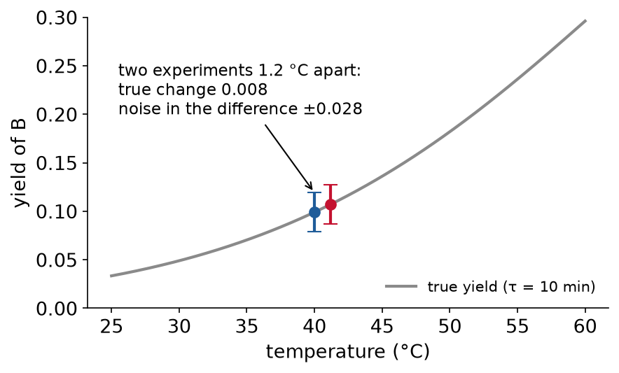

</div>
</div>

<p class="takeaway" data-marpit-fragment>Finite differences need cheap, noise-free evaluations. Lab experiments are expensive and noisy.</p>

---

## When to use it, BO or gradient-based?

<!--
BO comes with no guarantee of finding the global optimum. It explores the whole range, which helps it avoid getting stuck, but nothing promises the best point. We do not call it "global".
-->

<div class="cols cols-lc">
<div>

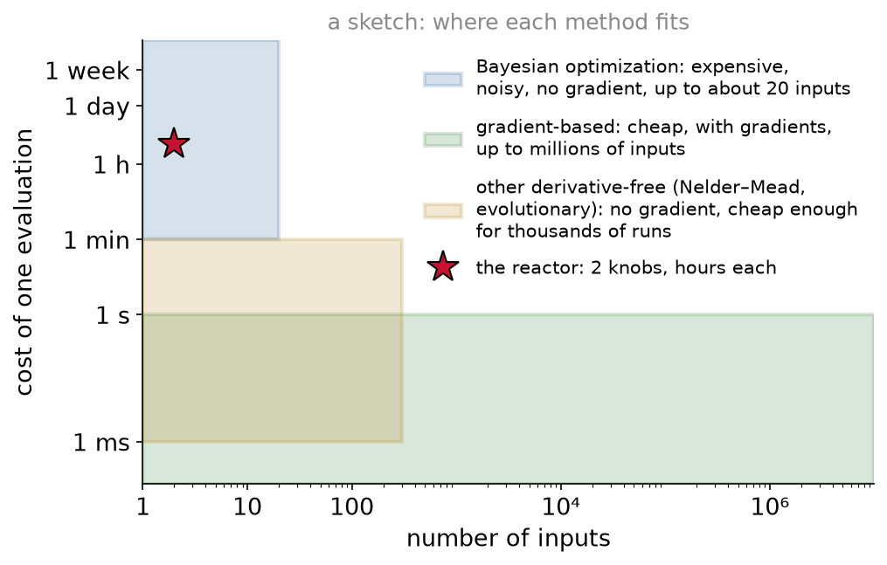

</div>
<div class="small">

- **Gradient-based** (Newton, L-BFGS, IPOPT): cheap evaluations, gradients available, up to millions of inputs. A **local** optimum, fast

* **Bayesian optimization**: expensive (minutes to weeks), noisy, no gradients, up to about **20 inputs**, tens to hundreds of evaluations
* **Other derivative-free** (Nelder–Mead, evolutionary): no gradients, but cheap enough for thousands of evaluations

</div>
</div>

<p class="takeaway" data-marpit-fragment>Choose by the cost of one evaluation, the noise, and the number of inputs.</p>

---

<!-- _class: section -->

# Where it is used

---

## Where it is used, chemistry and materials

<!--
The Shields et al. quote: the paper spells it "decisionmaking", one word. The slide writes "decision making".
-->

<div class="cards">
<div class="card"><h4>Reaction optimization</h4><p>50 expert chemists and engineers against BO, choosing reaction conditions</p>
<blockquote>

"Bayesian optimization outperforms human decision making in both average optimization efficiency (number of experiments) and consistency"

</blockquote>
<p class="source"><a href="https://doi.org/10.1038/s41586-021-03213-y">Shields et al., Nature (2021)</a></p></div>
<div class="card" data-marpit-fragment><h4>A self-driving lab</h4><p>A mobile robot searching for a better photocatalyst</p>
<blockquote>

"operated autonomously over eight days, performing 688 experiments within a ten-variable experimental space, driven by a batched Bayesian search algorithm"

</blockquote>
<p class="source"><a href="https://doi.org/10.1038/s41586-020-2442-2">Burger et al., Nature (2020)</a></p></div>
<div class="card" data-marpit-fragment><h4>Fast-charging batteries</h4><p>BO with early predictions of battery life</p>
<blockquote>

"among 224 candidates in 16 days (compared with over 500 days using exhaustive search without early prediction)"

</blockquote>
<p class="source"><a href="https://doi.org/10.1038/s41586-020-1994-5">Attia et al., Nature (2020)</a></p></div>
</div>

---

## Where it is used, engineering

<div class="cards">
<div class="card"><h4>Process design</h4><p>Flowsheet optimization when each unit is an expensive black box</p>
<blockquote>

"The black box modules are substituted by metamodels based on a kriging interpolation"

</blockquote>
<p class="source"><a href="https://doi.org/10.1002/aic.11579">Caballero and Grossmann, AIChE J. (2008)</a></p></div>
<div class="card" data-marpit-fragment><h4>Engineering design</h4><p>Wings and other shapes, each evaluated by an expensive simulation</p>
<blockquote>

"Surrogate models expedite the search for promising designs by standing in for expensive design evaluations or simulations"

</blockquote>
<p class="source"><a href="https://doi.org/10.1002/9780470770801">Forrester, Sóbester and Keane (2008)</a></p></div>
<div class="card" data-marpit-fragment><h4>Controller tuning</h4><p>An automotive throttle valve, tuned on the test bench</p>
<blockquote>

"BO achieves on par or better performance than hand tuning with only around ten experimental evaluations"

</blockquote>
<p class="source"><a href="https://arxiv.org/abs/1812.06325">Neumann-Brosig et al., IEEE TCST (2020)</a></p></div>
</div>

---

## Where it is used, machine learning and beyond

<!--
Online experiments, in plain words.
Facebook tuned two systems. A ranking system: the order in which items are shown to users. And its server software: the compiler flags, settings of the compiler that change how fast the servers run.
Each try is a live test on real traffic, so every result is noisy (Letham et al., 2019).
-->

<div class="cards four">
<div class="card"><h4>Hyperparameters</h4><p>Choosing a model's settings, such as the learning rate, when each training run takes hours</p><p class="source"><a href="https://arxiv.org/abs/1206.2944">Snoek et al. (2012)</a></p></div>
<div class="card" data-marpit-fragment><h4>AlphaGo</h4><p>Tuning the Go program's settings, where each test is many games. Win rate against its old self: 50% to 66.5%</p><p class="source"><a href="https://arxiv.org/abs/1812.06855">Chen et al. (2018)</a></p></div>
<div class="card" data-marpit-fragment><h4>Online experiments</h4><p>Facebook tuned the settings of a ranking system and of its server software. Each try is a live test with noisy results</p><p class="source"><a href="https://arxiv.org/abs/1706.07094">Letham et al. (2019)</a></p></div>
<div class="card" data-marpit-fragment><h4>Cookies</h4><p>Google tuned a chocolate chip cookie recipe (sugar, salt, vanilla, chips) by taste tests, in 144 experiments</p><p class="source"><a href="https://research.google.com/pubs/archive/46507.pdf">Solnik et al. (2017)</a></p></div>
</div>

<p class="takeaway" data-marpit-fragment>Anywhere one evaluation is expensive and there is no formula.</p>

---

## Where it is used, what engineers also need

<!--
Constraints, in plain words.
The best yield may need a temperature the reactor cannot take, for example a hot spot above its limit. We can only find out by running the experiment.
So a second GP learns that limit from the same experiments, and the acquisition is multiplied by the probability of staying within it. BO then proposes only runs likely to be safe.
-->

<div class="cards four">
<div class="card"><h4>Constraints</h4>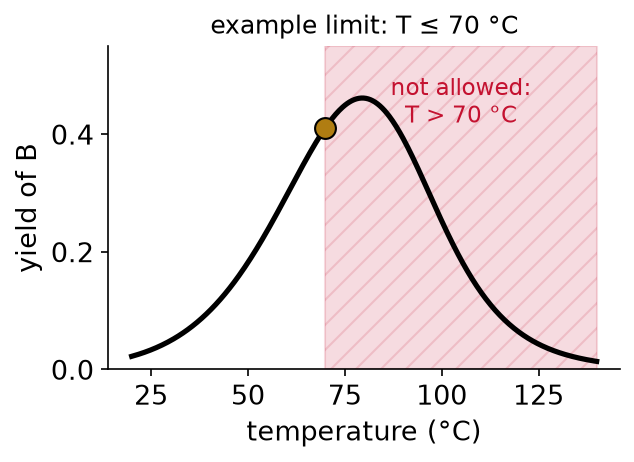<p>The best yield may need a temperature the reactor cannot take. A second GP learns that limit from the same experiments, and BO proposes only runs likely to respect it</p></div>
<div class="card" data-marpit-fragment><h4>Batches</h4>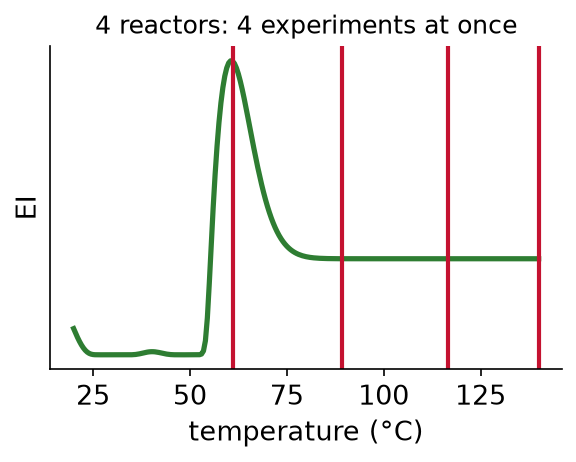<p>Four reactors: four experiments at once (<code>q=4</code>, qLogEI)</p></div>
<div class="card" data-marpit-fragment><h4>Several objectives</h4>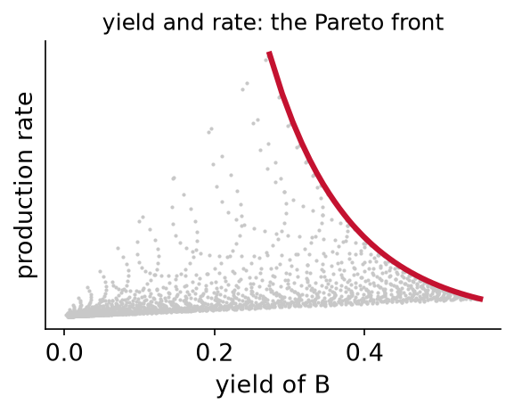<p>Yield and rate: the <b>Pareto front</b>, the best trade-offs (qEHVI)</p></div>
<div class="card" data-marpit-fragment><h4>Several fidelities</h4>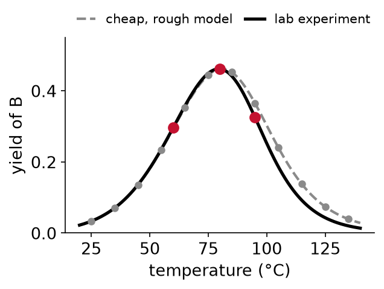<p>Many cheap, rough runs and a few exact ones: BO picks which, and where</p></div>
</div>

<p class="takeaway" data-marpit-fragment>All four are in BoTorch.</p>

<!--
The 70 °C limit and the rough model are made-up examples on the reactor. The batch is qLogEI on the GP after three experiments. The Pareto front is computed from the kinetics.
-->

---

## Limitations and trade-offs

<div class="fix">
<div class="hd">What goes wrong</div><div class="hd">What to do</div>
<div class="bad"><b>Many inputs</b>: beyond about 20, the GP needs far more data</div><div class="good">Fewer knobs, or methods built for high dimension</div>
<div class="bad" data-marpit-fragment><b>Many evaluations</b>: fitting the GP grows as n³</div><div class="good" data-marpit-fragment>Fine for hundreds. For thousands of cheap runs, use something else</div>
<div class="bad" data-marpit-fragment><b>Jumps and cliffs</b>: the kernel assumes smoothness, so the band is wrong</div><div class="good" data-marpit-fragment>Check the GP against held-out runs; change the kernel</div>
<div class="bad" data-marpit-fragment><b>Cold start</b>: with two or three points, the band is not trustworthy</div><div class="good" data-marpit-fragment>Start from a small, spread-out set of experiments</div>
<div class="bad" data-marpit-fragment><b>A noisy incumbent</b>: 0.474 measured, 0.461 true</div><div class="good" data-marpit-fragment>Repeat the best experiment, or report the GP's best</div>
<div class="bad" data-marpit-fragment><b>One run</b> of a random method</div><div class="good" data-marpit-fragment>Several seeds and a baseline</div>
</div>

---

## Active learning, the same loop, a different goal

<!--
What is x_{n+1} = argmax_x sigma(x) doing?
It reads: the next experiment is the input where the GP's uncertainty sigma(x) is largest, the widest point of the band.
No mean in it at all: active learning does not care where the yield is high, only where the model is unsure.
-->

<div class="definition">

**Active learning**: choose each next experiment to make the **model** good everywhere, usually where it is most uncertain.

</div>

$$
\underbrace{x_{n+1}}_{\text{next experiment}} = \underbrace{\arg\max_x}_{\text{the input that maximizes}}\; \underbrace{\sigma(x)}_{\text{GP uncertainty}}
$$

<div class="cols cols-lc">
<div>

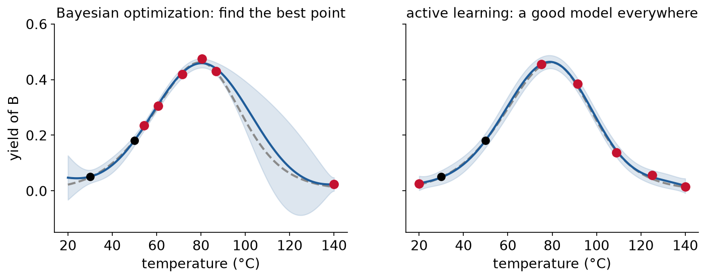

</div>
<div class="small">

- The next experiment goes where the band is **widest**

* **BO** (EI), 6 more runs: crowds around 80 °C. The best point, found
* **Active learning**, 6 more runs: spread from 20 to 140 °C. A narrow band everywhere

</div>
</div>

---

## Recap

<div class="tiles">
<div class="tile"><h4>When</h4><p>Expensive, noisy, no gradients, few inputs</p></div>
<div class="tile" data-marpit-fragment><h4>Why "Bayesian"</h4>

$p(f \mid \text{data}) \propto p(\text{data} \mid f)\, p(f)$

<p>A GP prior over the curve, updated by every experiment</p></div>
<div class="tile" data-marpit-fragment><h4>The loop</h4><div class="row"></div><p>Fit, score, run, add</p></div>
<div class="tile" data-marpit-fragment><h4>The balance</h4><p>Exploit high μ, explore high σ</p></div>
<div class="tile" data-marpit-fragment><h4>Acquisition functions</h4>

$\text{PI} = \Phi(z)$

$\text{EI} = (\mu - f^*)\Phi(z) + \sigma\phi(z)$

$\text{UCB} = \mu + \kappa\sigma$

</div>
<div class="tile" data-marpit-fragment><h4>BoTorch</h4><p><code>SingleTaskGP</code>: the GP</p><p><code>LogExpectedImprovement</code>: the score</p><p><code>optimize_acqf</code>: the next experiment</p></div>
</div>

---

<!-- _class: demo -->

# Worked example

`l15-bayesian-optimization.ipynb`: BoTorch on the reactor, one knob then two

---

## Before next time

- **Assignment 5**, four models of a bioreactor: released today, due Wednesday 10-28
- **Practice module** for this session, for participation credit

<script src="l15-widget-data.js"></script>
<script src="widgets.js"></script>
