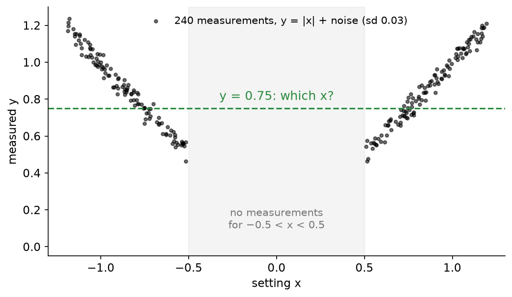
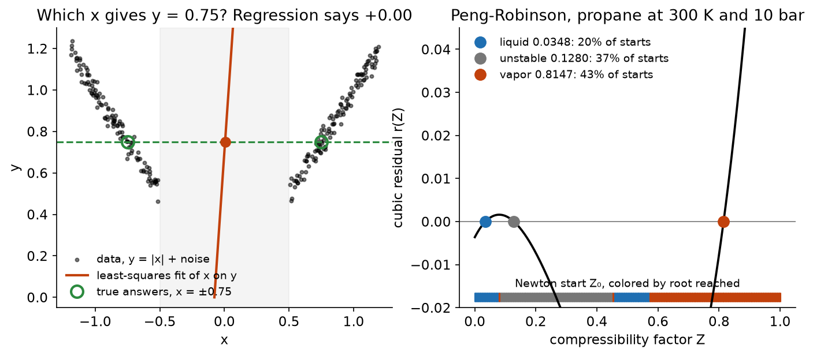
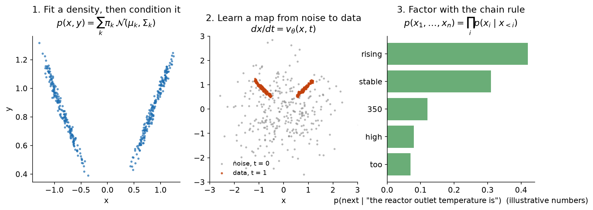
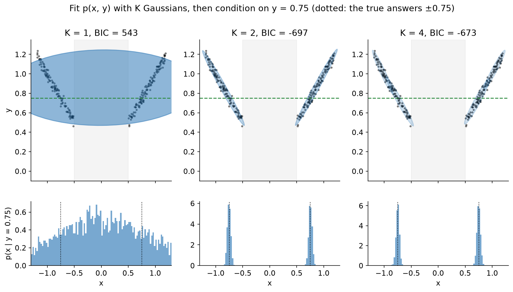
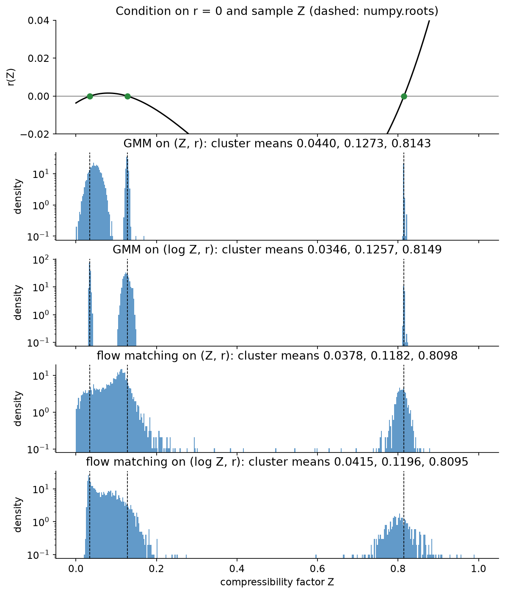
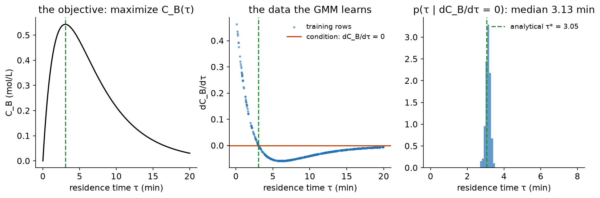
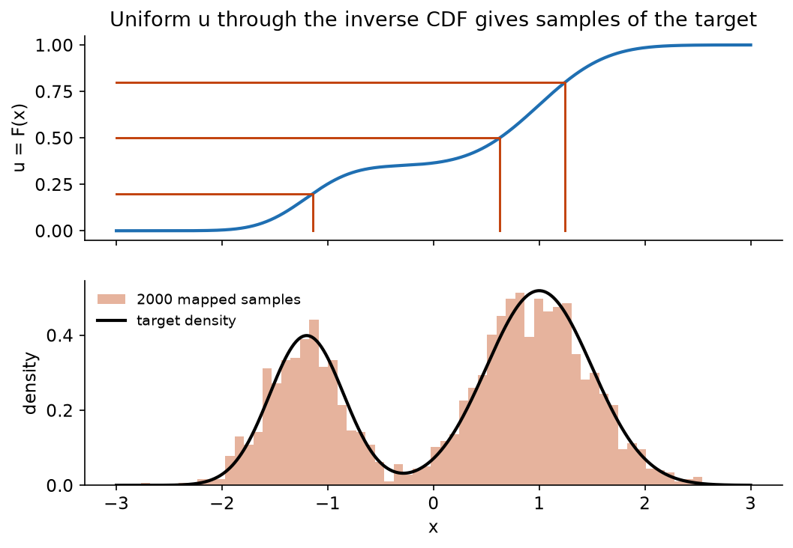
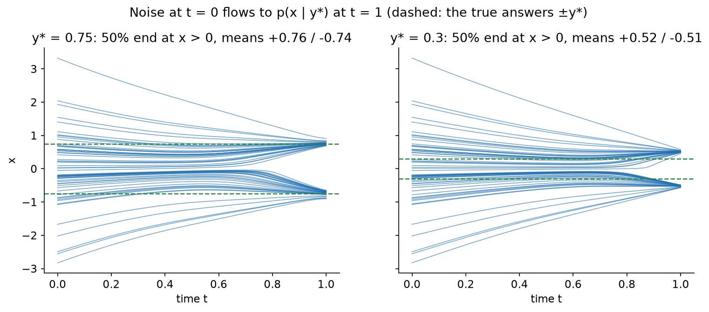
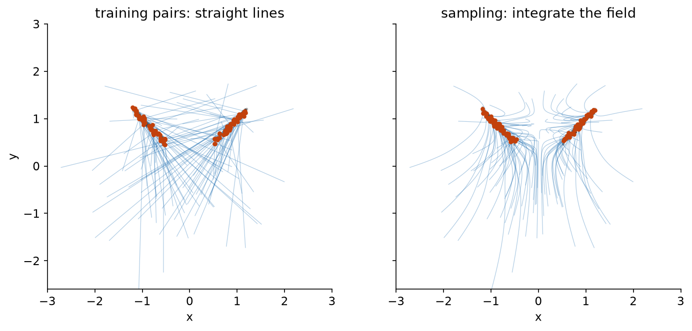

<!-- _class: title -->

# Lecture 16: Generative AI, learning a distribution and sampling from it

## Week 8, Machine learning and deep learning

<!-- 70 minutes of lecture, then the notebook and questions. -->

---

## Roadmap

1. An inverse question regression gets wrong
2. What a generative model learns
3. Approach 1: learn the joint, then condition it (Gaussian mixtures)
4. Approach 2: transform noise into data (flows, diffusion, flow matching)
5. Where generative models fit in machine learning
6. Generative models in science and engineering
7. Limitations and trade-offs

Anchor reading: [Alves and Kitchin, *Generative machine learning approaches to optimization*, ChemRxiv 2026](https://chemrxiv.org/doi/full/10.26434/chemrxiv-2025-hk886/v3)

---

<!-- _class: section -->

# An inverse question regression gets wrong

<!-- 5 min -->

---

## An inverse question, the data

- ▶ one value of $y$ comes from two settings, so this inverse question has two answers

<!-- Let the room read the plot before the clicker. Do not say the answer. -->

---

## An inverse question, a question

**Data: y = |x| + noise, none for −0.5 < x < 0.5. You fit x as a function of y by least squares. What does it predict at y = 0.75?**

<ol class="clicker-opts">
<li>+0.75</li>
<li>−0.75</li>
<li>About 0</li>
<li>Both −0.75 and +0.75</li>
</ol>

<aside class="clicker-panel">

clicker.f26-06763.workers.dev

<button class="clicker-start">Start voting</button>

40

no votes yet

</aside>

<!-- D is the answer people want; regression cannot give two numbers. -->

---

## An inverse question

- Left: least squares returns **E[x | y]** ≈ 0, the mean of the answers. Right: a cubic with three roots; Newton finds one
- ▶ a question with several answers needs a model that can return several answers

---

<!-- _class: section -->

# What a generative model learns

<!-- 10 min -->

---

<!-- _class: definition -->

## Generative model

**Generative model**: a model of the probability distribution of the data, good enough to draw new samples from it, and sometimes to evaluate the density at a point.

- Each row of data is a draw from an unknown $p(x, y)$
- An image is a vector too: 512 × 512 × 3 = 786,432 numbers
- A row of (inputs, outputs, derivatives) is the same kind of vector, only short enough to check
- ▶ anything you can write as a vector, an image or a row of plant data, is generated the same way

---

## What a generative model learns, joint and conditional

- **Joint** $p(x, y)$: inputs and outputs together
- **Marginal** $p(y)$: one variable, ignoring the rest
- **Conditional** $p(x \mid y = 0.75)$: fix some variables, sample the rest
- Fix outputs, sample inputs: an **inverse problem**
- Fix inputs, sample outputs: a **forward prediction**, with its spread
- Fix some of each: a question regression cannot pose
- ▶ conditioning turns one fitted distribution into a solver for forward, inverse and mixed questions

---

## What a generative model learns, discriminative against generative

| | Discriminative (L8–L14) | Generative |
|---|---|---|
| Learns | $E[y \mid x]$ or $p(y \mid x)$ | $p(x, y)$, or a way to sample it |
| Asks | inputs → outputs | any variables given any others |
| Returns | a number, or one distribution | samples, every mode included |
| Must model | how $y$ depends on $x$ | that, and how $x$ is distributed |

- ▶ a generative model answers more questions because it models more, including how $x$ is spread

---

## What a generative model learns, three ways to make it learnable

1. **Fit a density**, then condition it: Gaussian mixtures
2. **Learn a map** from noise to data: flows, diffusion, flow matching
3. **Chain rule**, "what comes next": autoregressive models (language models)

- ▶ every generative model uses one of these three; today covers the first two

<!-- Name family 3 and leave it. Do not preview a later lecture. -->

---

<!-- _class: section -->

# Approach 1: learn the joint, then condition it

<!-- 15 min -->

---

<!-- _class: definition -->

## Gaussian mixture models

**Gaussian mixture model**: a density written as a weighted sum of $K$ Gaussians, $p(\mathbf{z}) = \sum_k \pi_k\,\mathcal{N}(\mathbf{z}; \boldsymbol{\mu}_k, \boldsymbol{\Sigma}_k)$.

- One Gaussian over $(x, y)$: its conditional mean is a linear regression, slope $\Sigma_{xy}/\Sigma_{yy}$
- $K$ Gaussians: $K$ locally linear pieces of a curved relationship
- $|x|$ data: two tilted ellipses, one per branch
- ▶ a few Gaussians can follow a curved relationship, and each one is easy to condition

---

## Gaussian mixture models, fitting by EM

- **E-step**: each point's *responsibility* for each component
- **M-step**: weights, means, covariances as responsibility-weighted averages
- Likelihood never decreases; converges to a **local** maximum → several starts (`n_init`)
- k-means with soft assignments and shaped clusters
- **Choose K by BIC**: $|x|$ data, BIC 543 (K = 1), **−697 (K = 2)**, −673 (K = 4)
- ▶ EM fits the mixture and BIC picks $K$; here $K = 2$, one component per branch

Dempster, Laird and Rubin (1977), [doi:10.1111/j.2517-6161.1977.tb01600.x](https://doi.org/10.1111/j.2517-6161.1977.tb01600.x); [Bishop, PRML ch. 9](https://www.microsoft.com/en-us/research/wp-content/uploads/2006/01/Bishop-Pattern-Recognition-and-Machine-Learning-2006.pdf)

---

## Gaussian mixture models, conditioning

Fix the known block $k$ at $\mathbf{v}$, want block $u$:

$$\boldsymbol{\mu}_{u|k} = \boldsymbol{\mu}_u + \boldsymbol{\Sigma}_{uk}\boldsymbol{\Sigma}_{kk}^{-1}(\mathbf{v} - \boldsymbol{\mu}_k)
\qquad
\boldsymbol{\Sigma}_{u|k} = \boldsymbol{\Sigma}_{uu} - \boldsymbol{\Sigma}_{uk}\boldsymbol{\Sigma}_{kk}^{-1}\boldsymbol{\Sigma}_{ku}$$

- Second term: the **Schur complement**
- Mixture: condition each component $j$, reweight by $\pi_j\,\mathcal{N}(\mathbf{v}; \boldsymbol{\mu}_{k,j}, \boldsymbol{\Sigma}_{kk,j})$
- Result is again a mixture: exact samples, instantly
- **Which columns are known is chosen after training**
- ▶ conditioning is a closed-form formula, so one fitted mixture answers questions about any columns

---

## Gaussian mixture models, live

- ▶ $p(x \mid y = 0.75)$ has two peaks at $\pm 0.75$, where the regression gives one wrong number

<!-- Play the EM iterations at K = 2 (the default, BIC's choice). Then K = 4 and K = 1. Then drag y* into the gap (below 0.5). -->

---

## Gaussian mixture models, root finding

- **The problem**: the Peng–Robinson equation of state is a cubic in the compressibility factor $Z = PV/RT$
- For propane at 300 K and 10 bar it has three real roots: **liquid** (0.0348), **unstable** (0.1280), **vapor** (0.8147)
- **The recipe**:
  1. sample $Z$ uniformly on $[0.01, 0.99]$ and compute the cubic's residual $r(Z)$
  2. fit a GMM to the 2,000 rows $(Z, r)$
  3. condition on $r = 0$ and sample $Z$
- ▶ a root is an input whose output is zero, so root finding is an inverse question

---

## Gaussian mixture models, root finding results

- Top: the cubic. Below: samples of $Z$ given $r = 0$, four models; dashed: true roots
- ▶ conditioning on $r = 0$ gives all three roots in one set of samples

<!-- Talk through the two GMM panels here; come back to the flow-matching panels later. -->

---

## Gaussian mixture models, root finding results

- Paper, Table 1: 0.035, 0.128, 0.814 (true 0.0348, 0.1280, 0.8147)
- Our GMM, $K = 12$ on $(Z, r)$: **0.0440**, 0.1273, 0.8143 → liquid root 26% high, sensitive to fitting choices
- Same GMM on $(\log Z, r)$: **0.0346**, 0.1257, 0.8149 → the representation is a modeling choice
- Newton's method from each cluster center → 0.0348, 0.1280, 0.8147, exact
- ▶ the generator finds every root at once; a few Newton steps make each one exact

---

## Gaussian mixture models, optimization

- **The problem**: batch reactor, A → B → C. B builds up, then is consumed. How long to run for the most B?
- **The recipe**: sample $\tau$, compute $dC_B/d\tau$ (autodiff), fit a GMM to $(\tau, dC_B/d\tau)$, condition on 0

- Median 3.13 min against $\tau^* = 3.05$; then check it is a maximum, not a minimum
- ▶ an optimum is a root of the derivative, so optimization is root finding on $dC_B/d\tau$

---

## Gaussian mixture models, constraints and estimation

- **Constrained optimization**: blend reformate, isomerate and alkylate as close as possible to a 0.4 / 0.4 / 0.2 recipe while meeting octane 87
  - add the Lagrange multipliers as columns, condition on every derivative of the Lagrangian being 0
  - samples average (0.284, 0.607, 0.109), the same blend `scipy`'s SLSQP finds
- **Parameter estimation**: A → B → C in a plug-flow reactor with unknown rate constants $k_1, k_2$
  - simulate many $(k_1, k_2)$, record exit flows $(F_A, F_B)$, fit the joint of all four
  - condition on the measured flows → a *distribution* of $(k_1, k_2)$, not one fitted pair
- ▶ root finding, optimization and estimation are one recipe: build rows, fit the joint, condition on what you know

---

## Gaussian mixture models, where they stop

- Full covariance: $D(D+1)/2$ entries per component; EM cost $\sim D^3$
- Good for **tens** of variables; hopeless for a 786,432-number image
- Sharp or strongly curved structure needs many components
- ▶ Gaussian mixtures suit tens of variables; images and molecules need the transformation approach

---

<!-- _class: section -->

# Approach 2: transform noise into data

<!-- 20 min -->

---

## Transforming a distribution, inverse CDF

$x = F^{-1}(u)$ with $u \sim U(0, 1)$; **change of variables** $p_X(x) = p_Z(z)\,|\det \partial z / \partial x|$

- ▶ a generator is a map from a simple distribution to the data

---

## Transforming a distribution, the family

| Method | The map | Trained by | Catch |
|---|---|---|---|
| Normalizing flow | stack of invertible layers | max likelihood | layers must be invertible, cheap Jacobian |
| Continuous flow | ODE $dx/dt = v_\theta(x, t)$ (L13) | max likelihood | ODE solve every training step |
| Diffusion | learned reverse of a noising process | denoising regression | many sampling steps |
| **Flow matching** | ODE $dx/dt = v_\theta(x, t)$ | **plain regression** | sampling still integrates an ODE |

- ▶ flow matching keeps the flexible ODE map and trains it by plain regression

[Papamakarios et al. 2021](https://jmlr.org/papers/v22/19-1028.html) · [Chen et al. 2018](https://arxiv.org/abs/1806.07366) · [Ho et al. 2020](https://arxiv.org/abs/2006.11239) · [Song et al. 2021](https://arxiv.org/abs/2011.13456) · [Lipman et al. 2023](https://arxiv.org/abs/2210.02747)

---

<!-- _class: definition -->

## Flow matching

**Flow matching**: regress a velocity field onto the velocities of straight lines from noise to data, then generate by integrating it from noise.

1. Draw data $x_1$, noise $x_0 \sim \mathcal{N}(0, I)$, time $t \sim U(0, 1)$
2. $x_t = (1 - t)\,x_0 + t\,x_1$
3. Loss: $\lVert v_\theta(x_t, t) - (x_1 - x_0) \rVert^2$ (MSE, as in L9 and L11)
4. Sample: Euler steps $x \leftarrow x + v_\theta(x, t)\,\Delta t$, 100 steps from $t = 0$ to 1
5. Conditional: $v_\theta(x_t, c, t)$

- ▶ training is regression on straight lines; sampling integrates an ODE from noise

---

## Flow matching, live

- ▶ with the condition as an input, the flow carries noise to both answers, $\pm y^*$

<!-- The field is the exact minimizer of the loss for these points (kernel-weighted in y); a network learns a smooth version. Then set y* = 0.3: the exact field snaps to the nearest data, near y = 0.5; the trained network in the notebook gives -0.41 / +0.33. -->

---

## Flow matching, why the paths curve

- ▶ the field averages straight training lines, so sampling paths curve yet reach the same distribution

<!-- Same cloud at every t (readout), different paths. Rectified flow and OT pairing straighten them. -->

---

## Flow matching, the same problems

- Same tests as the GMM (3-layer network, ~10 s on a CPU). $|x|$ at $y = 0.75$: −0.74 and +0.76
- Inside the data gap, $y = 0.3$ (truth ±0.30): GMM −0.31 / +0.31, flow −0.41 / +0.33, **no warning from either**
- Peng–Robinson: vapor root found; liquid and unstable roots **blurred into one band** (bottom panels, root-finding figure)
- Between them $|r| \le 0.0016$ (3.6% of its spread); the paper's flow, trained longer, resolves them
- ▶ flow matching solves the same problems, but it learns the conditioning, so close roots can blur

---

## Choosing between the two

| | Gaussian mixture | Conditional flow matching |
|---|---|---|
| Learns | density | velocity field (network) |
| Training | EM, seconds | gradient descent: seconds here, hours at scale |
| Sampling | exact draw | ODE, ~100 network calls |
| Conditioning | **any variables, after training** | **only what the network was trained on** |
| Density at a point | exact | not directly |
| Dimension | tens | up to millions |

- ▶ a GMM conditions on anything but stays small; flow matching scales but answers one question

---

## Choosing between the two, a question

**You trained a GMM and a conditional flow-matching model to sample reactor inputs given outputs. Now you need outputs given inputs. Which can answer without retraining?**

<ol class="clicker-opts">
<li>Both</li>
<li>Only the GMM</li>
<li>Only flow matching</li>
<li>Neither</li>
</ol>

<aside class="clicker-panel">

clicker.f26-06763.workers.dev

<button class="clicker-start">Start voting</button>

45

no votes yet

</aside>

---

<!-- _class: section -->

# Where generative models fit in machine learning

<!-- 5 min -->

---

## Where generative models fit, the map

- **Supervised**: inputs → labeled outputs (L8–L12)
- **Unsupervised**: structure, clusters, densities; the GMM started here
- **Conditional generative**: trained on pairs like supervised, learns the whole $p(x \mid c)$
- **Self-supervised**: the "label" is another piece of the same data
- Next to **Bayesian inversion**: same kind of answer, no likelihood at inference, cost moved to training
- ▶ generative models are statistical models fitted to data, on the same map as every model since L8

---

## Where generative models fit, still data-driven

- A generative model **is a surrogate** of the data: L9 and L14 apply in full
- **Needs more data** than regression for the same job: it also models how $x$ is distributed
- **Valid only where the data are**: the gap answers came back confidently
- **Inherits the data's flaws**: a historian model learns the plant *as operated*
- **Answers for the surrogate**: check samples with the real model
- **Still has hyperparameters**: K, network, steps, representation ($\log Z$)
- ▶ a generative model is only as good as the data it was fitted to

---

## Where generative models fit, against the alternatives

| | Solver on a model | Discriminative surrogate | Generative model |
|---|---|---|---|
| Needs | a model | data | data |
| Direction | as posed | inputs → outputs | any |
| Several solutions | one per start | averages them | all, as samples |
| Accuracy | solver tolerance | surrogate error | surrogate error + sampling |
| New value of the condition | new solve | one evaluation | one batch of samples |
| Optimality certificate | KKT | none | none |

- ▶ with a model, use a solver; use a generative model to find every solution, work from data, or seed a solver

<!-- The paper says plainly it does not replace mathematical programming. -->

---

<!-- _class: section -->

# Generative models in science and engineering

<!-- 10 min. For each: what is generated, conditioned on what, checked how? -->

---

## Science and engineering, images

- **GAN** (generator vs discriminator) and **VAE** (decode a latent space): maps from simple to data
- **Latent diffusion**: diffusion in an autoencoder's latent space → Stable Diffusion, conditioned on text
- **Stable Diffusion 3**: rectified flow, i.e. flow matching at scale
- Same objective as today's 2-D figures; different scale, architecture, condition
- ▶ image generators use the training objective of today's 2-D examples, at far larger scale

[Goodfellow et al. 2014](https://arxiv.org/abs/1406.2661) · [Kingma and Welling 2013](https://arxiv.org/abs/1312.6114) · [Rombach et al. 2022](https://arxiv.org/abs/2112.10752) · [Esser et al. 2024](https://arxiv.org/abs/2403.03206)

---

## Science and engineering, molecules and proteins

- **Molecular VAE**: SMILES (molecules as text strings) → continuous latent space → gradient search; latent "dead areas" decode to **invalid** SMILES
- **3-D equivariant diffusion**; **DiffDock** for docking poses
- **RFdiffusion**: hundreds of designs characterized in the lab; cryo-EM binder "nearly identical to the design model"
- **AlphaFold 3**: "substantially updated diffusion-based architecture"
- ▶ generated molecules and proteins count only after a validity check or a lab measurement

[Gómez-Bombarelli et al. 2018](https://pmc.ncbi.nlm.nih.gov/articles/PMC5833007/) · [Hoogeboom et al. 2022](https://arxiv.org/abs/2203.17003) · [Corso et al. 2023](https://arxiv.org/abs/2210.01776) · [Watson et al. 2023](https://pmc.ncbi.nlm.nih.gov/articles/PMC10468394/) · [Abramson et al. 2024](https://pmc.ncbi.nlm.nih.gov/articles/PMC11168924/)

---

## Science and engineering, materials

- **MatterGen**: diffusion for crystals, fine-tuned to a target property
- 8,192 candidates per target → 4 chosen for synthesis → **1 succeeded**: TaCr₂O₆, disordered
- Target bulk modulus 200 GPa; DFT 222 GPa; estimated from nanoindentation "up to 169 GPa after four measurements (158 ± 11 GPa)"
- "Within 20%" holds at **169**, the top of the range; at 158 it is 21% below
- Perspective: *Has generative AI solved inverse materials design?*
- ▶ read the measurement behind a headline; this claim depends on which end of the range you quote

[Zeni et al. 2025](https://pmc.ncbi.nlm.nih.gov/articles/PMC11922738/) · [Park, Li and Walsh 2024](https://doi.org/10.1016/j.matt.2024.05.017)

---

## Science and engineering, weather and process engineering

- **GenCast**: conditional diffusion, $p(X_{t+1} \mid X_t, X_{t-1})$ with $X_t$ the global weather state; samples = an ensemble = UQ (L14)
- 15 days at 0.25° in ~8 min on one TPU v5; better than ECMWF ENS on **97.2% of 1,320** targets; trained 1979–2018, tested 2019
- **Evaporator flowsheet** (anchor paper): minimum operating cost under 12 process equations, from noisy plant-like data; best samples within 1.61% (GMM), 5.83% (flow) of SLSQP
- **Invertible networks** for engineering inverse problems ([Ardizzone et al. 2019](https://arxiv.org/abs/1808.04730))
- ▶ generated samples can serve as an ensemble or a design, and they are scored against reality

[Price et al. 2025](https://pmc.ncbi.nlm.nih.gov/articles/PMC11666454/) · [Alves and Kitchin 2026](https://chemrxiv.org/doi/full/10.26434/chemrxiv-2025-hk886/v3)

---

## Science and engineering, the pattern

- Every success: **the generator proposes, something else verifies**
  - the lab, a held-out year of weather, DFT, the physical model
- Read the measurement behind the headline number
- Validity checks are part of the method
- ▶ plan how you will verify the samples before you train the generator

---

<!-- _class: section -->

# Limitations and trade-offs

<!-- 5 min -->

---

## Limitations and trade-offs

- **Surrogate, not system**: our GMM's liquid root 0.0440 vs the true 0.0348
- **Out-of-data conditioning** returns confident output, no warning
- **Sharp structure** blurred: flow matching merged two close roots
- **Validity** not built in, and **no single metric**: check samples with the physical model
- **Memorization**: **94** training images extracted from 175 M Stable Diffusion samples
- **Model collapse**: training on generated data loses the tails, in LLMs, VAEs *and GMMs*
- ▶ every limitation comes from one fact: a generative model is a fitted surrogate, sampled at random

[Carlini et al. 2023](https://arxiv.org/abs/2301.13188) · [Shumailov et al. 2024](https://pmc.ncbi.nlm.nih.gov/articles/PMC11269175/)

---

<!-- _class: demo -->

# Worked example

- `l16-generative-optimization.ipynb`: regression failure, GMM chosen by BIC and conditioned by hand, conditional flow matching in PyTorch, the gap, Peng–Robinson roots by three models with Newton polishing, and the batch-reactor optimum

---

## Recap

- A generative model learns **the distribution**; conditioning answers in any direction, every mode included
- **GMM**: EM to fit, Schur complement to condition, any variables, tens of dimensions
- **Flow matching**: regress straight-line velocities, integrate an ODE to sample, scales, fixed conditioning
- GMM: all three Peng–Robinson roots at once; Newton polishing made them exact
- **Still data-driven**: needs coverage, valid only near the data, answers for the surrogate
- In science: the generator proposes, a lab or a physical model verifies

---

## Standings

Nicknames only. Everyone who skipped one still counted in every bar you saw.

---

## Before next time

- Practice module for this session: on the course site
- Run the worked example; it needs `torch` and `scikit-learn`, both already on Colab
- Read Alves and Kitchin, §1–2, §3.1–3.5 and §3.9 (limitations)
- Notes: `lectures/l16/notes.md`

