

<!-- _class: title -->

# Lecture 17: Large language models

## What they are, and how they are trained

---

## A chatbot, from the inside

- **What we did:** asked a real chat model one question, on a laptop: Qwen2.5-0.5B-Instruct, a small open model from Alibaba (0.49 billion parameters), built like a GPT
- **What you see:** the chat app (left), the text the model really reads and continues token by token (middle), its top guesses (right). Press play
- **The gray tags,** `<|im_start|>` and `<|im_end|>`: special tokens that open and close each message, so the model knows who speaks. The app hides them

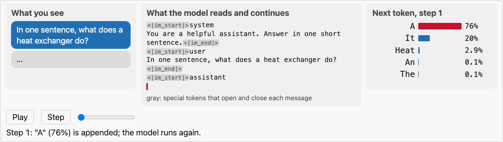

<!--
Picture a movie script with the AI's reply torn off, and a machine that predicts the next word. Run it again and again and the reply writes itself. That is all a chatbot is. The model was trained on chats written with these tags, so it expects them. How this was made: Hugging Face transformers, the model taking its most likely token at every step; the numbers come from figures/make_figures.py (group chat).
-->

---

## Today

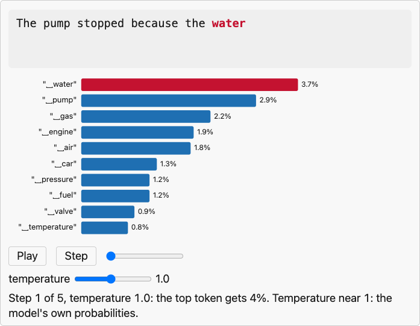

1
<b>From generative models to text</b> Text, one token at a time

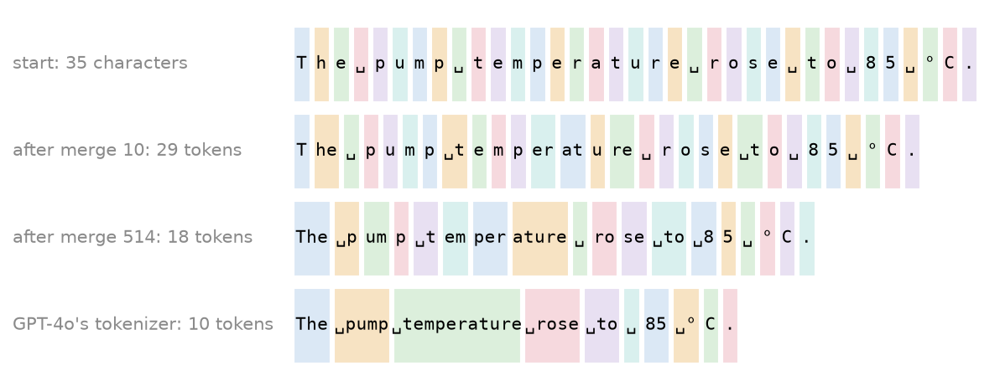

2
<b>Tokens</b> What the model reads, and what it costs

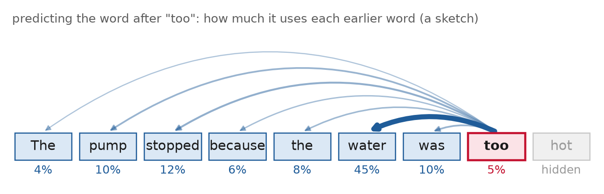

3
<b>The model</b> A transformer that only looks back

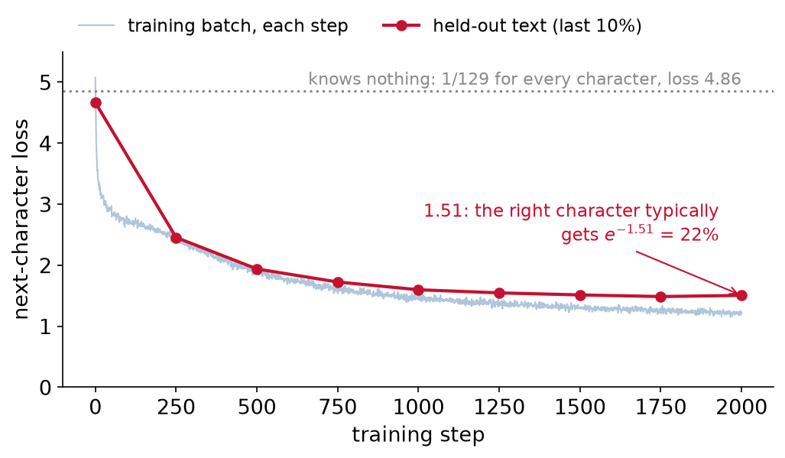

4
<b>Training</b> Predict the next token, everywhere

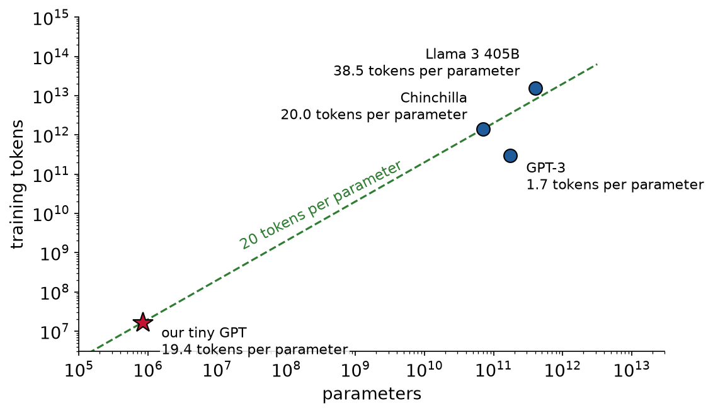

5
<b>Data and scale</b> From our notes to trillions of tokens

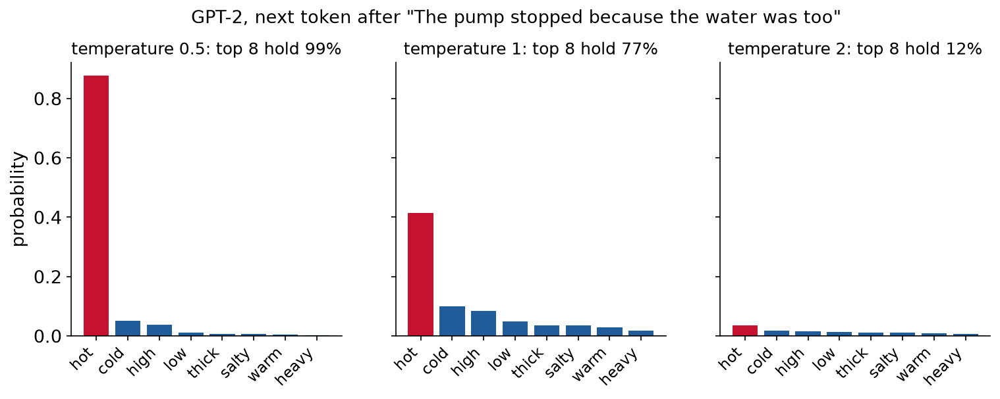

6
<b>Sampling</b> Temperature, and why fluent is not true

---

## Today, our running example: a tiny GPT

Our notes <b>Lectures 1 to 16</b> 668,651 characters

→

Train <b>2,000 steps</b> about 2 minutes on a laptop GPU

→

A tiny GPT <b>842,881 parameters</b> writes like our notes

- **GPT**, generative pretrained transformer: the model family behind ChatGPT. Ours is tiny, and we train it from scratch

* It reads and writes **one character at a time**
* Same recipe as GPT-3, about 200,000 times smaller. We trained it for this lecture, and it appears on many slides

<b>Before training</b>, it writes: <code>The model l₂4zé&#x27;-(u↑Ly°⁷)aQ8d¹₆−wZ²t,&gt;zü4i{₂YGIkt└TR&gt;P×−t_ …</code>

<b>After training</b>, given the start of one term from each lecture, it finishes <b>15 of 16</b>: <code>Parqu<b>et</b></code> <code>regres<b>sion</b></code> <code>Bayesian opti<b>mization</b></code> <code>physics-in<b class=no>to a s</b></code>

<!--
GPU: graphics processing unit, the graphics card. 116 s on an Apple-silicon laptop. On Colab, choose a GPU runtime.
-->

---

<!-- _class: section -->

# From generative models to text

---

## From generative models to text, where Lecture 16 left us

Data <b>x</b>

→

Learn the distribution <b>p(x)</b>

→

Fix what you know, sample the rest

- **Lecture 16:** a generative model learns the distribution of the data, then samples new data from it

* There, x was a point in two dimensions: Gaussian mixtures, flows, diffusion
* **Today, x is a text:** a sequence of tokens $x_1, x_2, \dots, x_T$. For now, a token is a word or a piece of a word
* **A large language model (LLM) is a generative model of text.** Your prompt is the part you fix; it samples the rest

---

## From generative models to text, one variable at a time

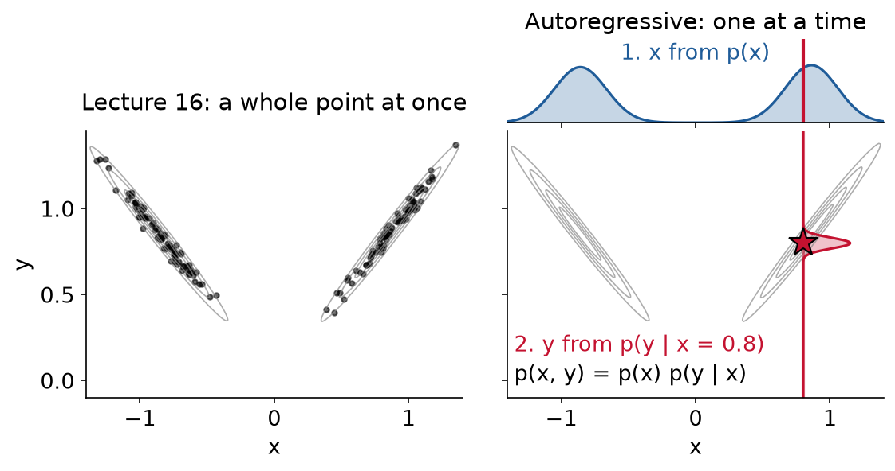

- **Left, Lecture 16:** draw a whole point (x, y) at once

* **Right, the same distribution, one variable at a time:** first draw x, then y given that x. Same result: p(x, y) = p(x) p(y | x)
* **Text has too many possibilities to draw at once.** A 10-token text has 10 slots, each holding any of 50,257 tokens: 50,257 × 50,257 × … ten times = 50,257¹⁰ ≈ 10⁴⁷ texts. One token at a time, each step is one choice among 50,257

---

## From generative models to text, the chain rule

$p(x_1, \dots, x_T)$

$=$

$\displaystyle\prod_{t=1}^{T}$

$p(x_t \mid x_1, \dots, x_{t-1})$

<h4>The whole text</h4>
How likely this exact text is, all T tokens together

<h4>One factor per token</h4>
Multiply: the 1st token, times the 2nd given the 1st, times the 3rd given the first two, and so on to the last

<h4>One next-token probability</h4>
How likely token <i>t</i> is, given all the tokens before it. <b>This is the only thing an LLM learns</b>

**Example: we ran GPT-2** (OpenAI, 2019, 124 million parameters) on "The pump stopped" and read its probability for each token, given the ones before it:

p("The pump stopped")  = p("The") × p("␣pump" | "The") × p("␣stopped" | "The pump") = 0.038 × 8.5 × 10-6 × 0.0019 = 5.9 × 10-10

<!--
The chain rule is exact: no assumption about which earlier tokens matter. ␣ marks a space: GPT-2's tokens carry their leading space. The product is tiny because so many texts are possible; "pump" right after "The" is the surprise, 8 in a million.
-->

---

<!-- _class: definition -->

## Language model

**Language model**: a model that gives the probability of the next token, $p(x_t \mid x_1, \dots, x_{t-1})$, from the tokens before it. By the chain rule, that is enough to score a whole text, and to write one.

**Large language model (LLM)**: a language model with billions of parameters, trained on trillions of tokens.

---

## From generative models to text, the generation loop

1

**Predict** the last factor of the chain rule, for every possible next token:

$p(x_{t+1} \mid x_1, \dots, x_t)$

"The pump stopped because the" → ␣water 3.7% · ␣pump 2.9% · ␣gas 2.2% · …

2
<b>Pick</b> One token from that distribution
Here, the most likely: <b>␣water</b>. Other ways to pick: Sampling section

3
<b>Append</b> Add it to the end of the text
"The pump stopped because the <b>water</b>"

4
<b>Repeat</b> Predict again, from the longer text
→ ␣was → ␣too → ␣hot → .

The pump stopped because the␣water␣was␣too␣hot.

Each red token is one trip round the loop: GPT-2 predicted it, it was appended, and the next prediction started from the longer text. A model that uses its own outputs as its next inputs is <b>autoregressive</b>.

<!--
How this was made: we ran GPT-2 (124 million parameters, Hugging Face transformers) on "The pump stopped because the" and, five times, took its single most likely next token and appended it. The probabilities on the cards are GPT-2's. The code: figures/make_figures.py, group gpt2. Click once per token: each click is one trip round the loop. The Sampling section steps through the same loop with GPT-2's real probabilities, and a temperature slider.
-->

---

## From generative models to text, autoregressive as in Lecture 8

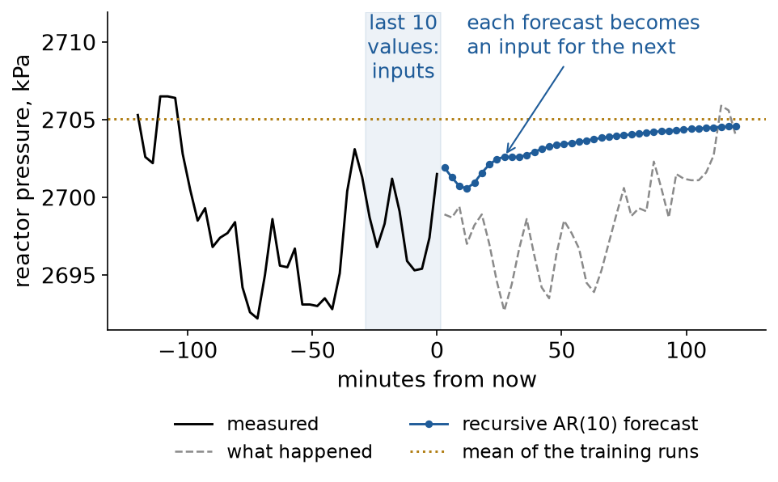

Lecture 8's AR(10), reactor pressure, 2 hours ahead on one test run

<table class="cmp build">
<tr><th></th><th>Lecture 8: AR(10)</th><th>An LLM</th></tr>
<tr data-marpit-fragment><td>Predicts</td><td>the next pressure</td><td>the next token</td></tr>
<tr data-marpit-fragment><td>From</td><td>the last 10 values</td><td>all the text so far</td></tr>
<tr data-marpit-fragment><td>Output</td><td>one number</td><td>a probability for every token</td></tr>
<tr data-marpit-fragment><td>Model</td><td>11 coefficients</td><td>billions of parameters</td></tr>
<tr data-marpit-fragment><td>Long outputs</td><td>feed each forecast back in</td><td>append each token: the same</td></tr>
</table>

**Same weakness:** both feed their own outputs back in, so an early mistake becomes an input for every later step. Lecture 8: after 2 hours, the forecast was worse than the plain mean. An LLM: one wrong token steers the rest of the answer

<!--
The analogy is between Lecture 8's autoregressive forecaster and an LLM writing text: same word, same idea. It is not a claim about RNNs, nor that LLMs lose accuracy over the years. Bengio et al. (2015) described the same effect for RNN text generators: trained on true previous tokens, run on their own, "errors that can accumulate quickly along the generated sequence".
-->

---

<!-- _class: section -->

# Tokens

---

## Tokens, what the model actually reads

**Token**: a piece of text the model reads and writes: a character, a word, or part of a word.

**Vocabulary**: the list of every token the model knows, each with a number, its **token id**.

**Tokenizer**: the program that cuts text into tokens and looks up their ids.

<table class="pipe"><tr><td class="lab">Text</td><td class="txt" colspan="4">The pump stopped.</td></tr><tr class="arrow" data-marpit-fragment><td></td><td class="al" colspan="4">↓ the tokenizer cuts the text into tokens</td></tr><tr data-marpit-fragment><td class="lab">Tokens</td><td>The</td><td>␣pump</td><td>␣stopped</td><td>.</td></tr><tr class="arrow" data-marpit-fragment><td></td><td class="al" colspan="4">↓ and looks up each token in the vocabulary</td></tr><tr data-marpit-fragment><td class="lab">Token ids</td><td>464</td><td>8901</td><td>5025</td><td>13</td></tr></table>

GPT-2's vocabulary, real ids (50,257 in all)

0!

1&quot;

2#

⋮

13.

⋮

464The

⋮

5025␣stopped

⋮

8901␣pump

⋮

---

## Tokens, three ways to cut the same text

<b>Characters</b> 29 tokens

The␣pump␣overheated␣at␣85␣°C.

<b>Words</b> 6 tokens

Thepumpoverheatedat85°C.

<b>Subwords</b> 9 tokens GPT-2

The␣pump␣overheated␣at␣85␣°C.

<h4>Characters</h4>
One token per letter, digit, space or symbol. A tiny vocabulary (our tiny GPT: <b>129</b>), but long sequences

<h4>Words</h4>
One token per word. The vocabulary needs every word ever written, and a new one has no token: a pump tag like P-101A, a steel grade like AISI 4140

<h4>Subwords</h4>
Pieces of words. Common words stay whole ("␣pump"), rarer ones split ("␣overhe" + "ated"), so any new word can be built. GPT-2: <b>50,257</b> tokens

---

## Tokens, byte-pair encoding

**Byte-pair encoding (BPE)**: how a subword vocabulary is built. Find the pair of neighboring tokens that appears most often, merge it into one new token, repeat.

start: one token per characteraaabdaaabac11 tokens

1. most frequent pair: a + a (4 times)aaabdaaabac9 tokens

2. most frequent pair: a + b (2 times)aaabdaaabac7 tokens

3. most frequent pair: aa + ab (2 times)aaabdaaabac5 tokens

<h4>Why: fewer tokens</h4>
Frequent pieces become one token. Shorter sequences: more text fits in the context window, fewer steps to write

<h4>Why: nothing is unknown</h4>
A new word can always be built from smaller pieces, down to single characters

<h4>Why: learned from data</h4>
The merges come from the training text, so its frequent words become single tokens

Example from Wikipedia, <a href="https://en.wikipedia.org/wiki/Byte-pair_encoding">Byte-pair encoding</a>. The algorithm is Gage's (1994), adapted to building subword vocabularies by <a href="https://aclanthology.org/P16-1162/">Sennrich et al. (2016)</a>; GPT-2 starts from bytes and stops after 50,000 merges.

<!--
Step 2 is a tie: "aa" + "a" also appears twice. Wikipedia's example takes "a" + "b". A real tokenizer learns its merges once, from a large text, and then applies them in the same order to any new text: the next slide.
-->

---

## Tokens, byte-pair encoding learned from our notes

- **What we did:** learned **600 merges** by BPE from our notes (Lectures 1 to 16), then applied them, in order, to one sentence. Press play. The last row is GPT-4o's tokenizer, learned the same way from far more text

* **The takeaway:** each merge makes tokens longer and fewer. 35 characters become **18 tokens** with our 600 merges, **10** with GPT-4o's. Fewer tokens: more text fits in the context window, and writing it takes fewer steps

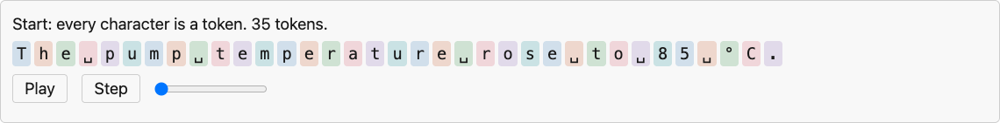

<!--
The first merges our notes learn: " t", " a", "he", "in", "re". More merges, longer tokens, fewer of them.
-->

---

## Tokens, numbers and units cost more than words

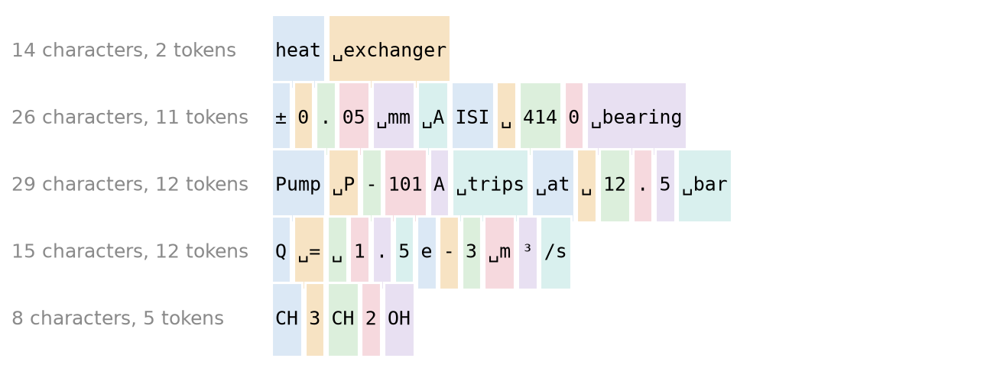

- **Same length, very different cost:** "heat exchanger" is 14 characters and **2 tokens**. "Q = 1.5e-3 m³/s" is 15 characters and **12 tokens**

* **The model reads numbers in pieces:** the tokenizer cuts "4140" (a steel grade) into two tokens, "414" and "0", the way it cuts a word into pieces. The model never sees the quantity four thousand one hundred forty
* **So numbers, units and part numbers (P-101A: a pump tag) are where LLMs slip.** Check them, and do the arithmetic in code

GPT-4o's tokenizer (o200k_base, in <code>tiktoken</code>).

---

<!-- _class: definition -->

## Context window

**Context window**: the most tokens a model can take in at once: your prompt, any documents, and everything it has written so far. Text beyond it is not seen at all.

128

characters: our tiny GPT about one sentence

2,048

tokens: GPT-3 (<a href="https://arxiv.org/abs/2005.14165">Brown et al., 2020</a>) a few pages

128,000

tokens: Llama 3 (<a href="https://arxiv.org/abs/2407.21783">Llama Team, 2024</a>) a long report, but not all our notes: <b>164,779 tokens</b>

Too long to fit: cut it, summarize it, or search for the part that matters.

GPT-3: "a context window of nctx = 2048 tokens". Llama 3: "a context window of up to 128K tokens". Our notes counted with GPT-4o's tokenizer (tiktoken, o200k_base).

---

<!-- _class: section -->

# The model

---

## The model, the big picture

- **The case:** we gave GPT-2 the prompt "The plant shut down for maintenance" and asked for the next token. Watch "plant": alone, it could be a tree or a factory. The final probabilities are GPT-2's; the vectors and the map are a sketch. Press play

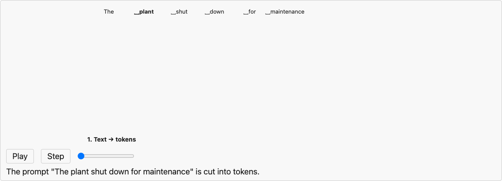

In Lecture 12 the tokens were cycles of a sensor window; the machinery is the same.

<!--
Attention: the vectors talk to each other. MLP: each vector, alone, through the same small network. Repeat. Only the last vector predicts the next token. The next two slides open the two boxes: the attention equation and the final softmax.
-->

---

## The model, attention looks back

<h4>1. Score</h4>
The word "too" asks every earlier word: how useful are you for guessing what comes next?

<h4>2. Mix</h4>
It takes a weighted average of what those words carry. Here, mostly "water"

<h4>3. No peeking</h4>
Later words are hidden: the <b>causal mask</b>. In training the next word is the answer, so it must stay hidden

In symbols, as in Lecture 12: softmax(QKᵀ/√dk + M) V. QKᵀ/√dk are the scores; the mask M is −∞ for later words, which sets their weight to 0. The weights in the picture are a sketch.

---

<!-- _class: section -->

# Training

---

## Training, tuning the dials

- **One training step:** show the model some text with the next character hidden; it guesses; compare its guess with the true character; nudge every dial a little so the true one gets more likely. Repeat 2,000 times
- **What you see:** our tiny GPT on one example, "…learns the proba?". The true answer is "b". Press play

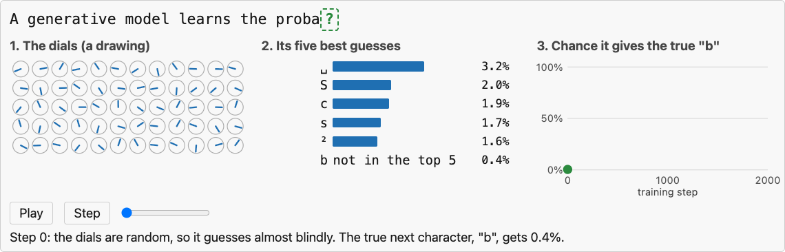

A straight-line fit (Lecture 9) has 2 dials; our tiny GPT has 842,881; GPT-3 has 175 billion. The nudge is a gradient step, with the gradient from backpropagation (Lecture 11).

<!--
How this was made: we trained the tiny GPT for 2,000 steps and saved its guesses every 250 steps; the bars and the chart are those checkpoints. The dials are a drawing.
-->

---

## Training, the objective

- **Training makes real text likely.** By the chain rule, a text's log-probability is a sum over its tokens. We want it large, so we minimize its negative

$\mathcal{L}(\theta) =$

$-\dfrac{1}{T}\displaystyle\sum_{t=1}^{T}$

$\log p_\theta(x_{t+1} \mid x_1, \dots, x_t)$

<h4>log p of the true next token</h4>
How much probability the model gave the token that really came next. θ: the dials

<h4>The minus, and the average</h4>
The minus makes it a loss: near 0 when right and sure, large when surprised (the plot). 1/T Σ: the average over T positions. This is the cross-entropy of Lecture 10

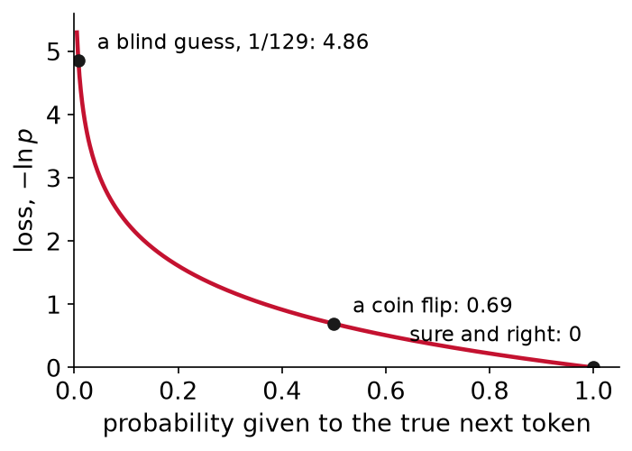

---

## Training, every position at once

- **What you see:** one sentence of 10 tokens turned into 9 guesses. Guess 1: from "The" alone, guess the next token. Guess 2: from "The pump". Each answer is just the next token of the text: nobody labels anything. Press play

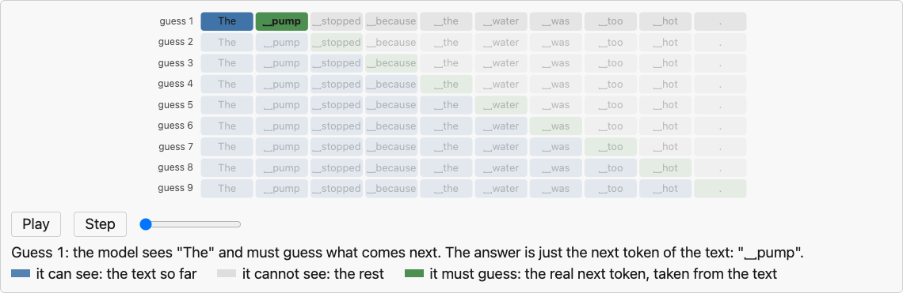

**The point:** one sentence gives 9 training examples, all done at once, in one pass: **self-supervised** learning. Each guess sees only the tokens before it (the causal mask); otherwise the answer would be in plain sight

---

## Training, an optimization problem

$$
\min_{\theta}\;\; \mathcal{L}(\theta) = -\frac{1}{N} \sum_{n=1}^{N} \log p_\theta\big(\text{next token}_n \mid \text{the tokens before it}\big)
$$

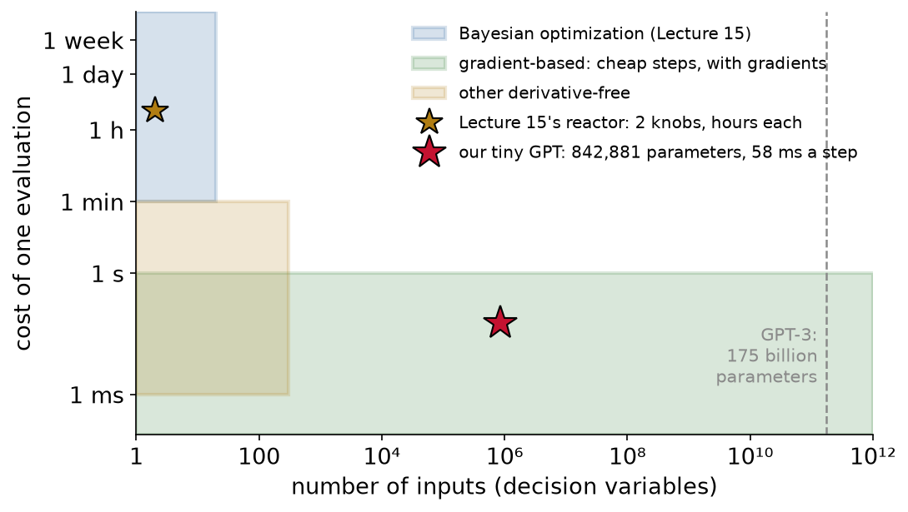

<h4>Decision variables</h4>
The parameters θ: <b>842,881</b> in our tiny GPT, 175 billion in GPT-3

<h4>Objective</h4>
The loss over all N predictions: the same kind of data loss we minimized in Lecture 13

<h4>Method</h4>
Gradient-based, by Lecture 15's map. AdamW (Lecture 12) for our tiny GPT and <a href="https://arxiv.org/abs/2407.21783">Llama 3</a>; Adam for <a href="https://arxiv.org/abs/2005.14165">GPT-3</a>

<!--
The reactor of Lecture 15 had 2 knobs and hours per experiment: Bayesian optimization. Our tiny GPT has 842,881 knobs and 58 ms per step: gradient descent. The map is Lecture 15's, with the tiny GPT added.
-->

---

## Training, reading the loss

**At the start, the dials are random:** each of the 129 characters gets about the same chance, 1/129. A blind guess has a loss of −ln(1/129) = 4.86: the dotted line

**To read a loss, undo the ln.** The loss is the average of −ln p, so e−loss is the typical p. At the end, e−1.51 = 0.22: the true next character typically gets **22%**

losstypical p = e−loss

4.86<i style="width:1%"></i>0.8%a blind guess, 1/129

1.51<i style="width:22%"></i>22%our tiny GPT, at the end

0.69<i style="width:50%"></i>50%a coin flip

0.00<i style="width:100%"></i>100%sure and right

<!--
"Typical" is the geometric mean of the probabilities given to the true characters. The blue curve, the training batches, ends lower (1.22) than the red, held-out text (1.51): it predicts text it has seen better than new text, the overfitting of Lecture 9.
-->

---

## Training, what it writes as it learns

- **What you see:** the loss (top), what it writes after "The model " at that step, and what changed. Press play. Trained only on our notes, it copies their style, LaTeX included: far more text and a bigger model turn style into meaning

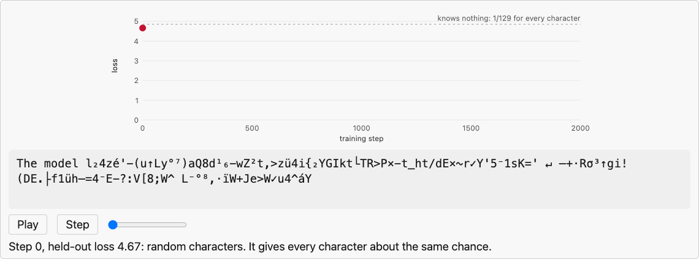

<!--
Random symbols, then letters and spaces, then short words, then the course's vocabulary, then LaTeX copied from our notes. It learns the style long before any meaning.
-->

---

## Training, what our tiny GPT learned

Give it the first 60% of one term from each lecture; it picks the most likely next character until the term ends.

L1toolch<b>ain</b>

L2environ<b>ment</b>

L3datab<b>ase</b>

L4Parqu<b>et</b>

L5datafr<b>ame</b>

L6valida<b>tion</b>

L7steady s<b>tate</b>

L8forec<b>ast</b>

L9regres<b>sion</b>

L10classific<b>ation</b>

L11gradi<b>ent</b>

L12convolu<b>tion</b>

L13physics-in<b>to a s</b>

L14uncerta<b>inty</b>

L15Bayesian opti<b>mization</b>

L16distribu<b>tion</b>

- **15 of 16 right:** it learned our spelling and our vocabulary. The miss: "physics-in" → "to a s", because "into a" appears 58 times in our notes and "physics-informed" only 8

* **No sentences with meaning:** ask for one and it writes "and the same step of the same samples". Meaning takes far more parameters and data, next

---

<!-- _class: section -->

# Data and scale

---

## Data and scale, models over the years

- **What you see:** language models by year and size (log scale: each labeled line is 1,000 times the one below). Press play. Closed models (GPT-4 to GPT-6, Claude) publish no size: the strip at the top

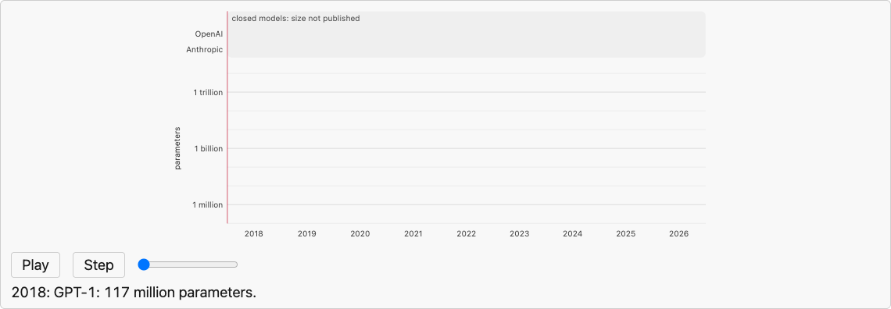

Sizes from each model's paper or card: <a href="https://cdn.openai.com/better-language-models/language_models_are_unsupervised_multitask_learners.pdf">GPT-1, GPT-2</a> · <a href="https://arxiv.org/abs/2005.14165">GPT-3</a> · <a href="https://arxiv.org/abs/2112.11446">Gopher</a> · <a href="https://arxiv.org/abs/2203.15556">Chinchilla</a> · <a href="https://arxiv.org/abs/2204.02311">PaLM</a> · <a href="https://arxiv.org/abs/2307.09288">Llama 2</a> · <a href="https://arxiv.org/abs/2407.21783">Llama 3.1</a> · <a href="https://arxiv.org/abs/2412.19437">DeepSeek-V3</a> · <a href="https://arxiv.org/abs/2507.20534">Kimi K2</a> · <a href="https://api-docs.deepseek.com/news/news260424">DeepSeek-V4</a> · <a href="https://huggingface.co/moonshotai/Kimi-K3">Kimi K3</a>. No size given: <a href="https://arxiv.org/abs/2303.08774">GPT-4</a> · <a href="https://openai.com/index/gpt-6-astra/">GPT-6 Astra</a> · <a href="https://www.anthropic.com/news/claude-3-family">Claude 3</a> · <a href="https://www.anthropic.com/claude-opus-5-5">Claude Opus 5.5</a>.

<!--
The GPT-4 technical report "contains no further details about the architecture (including model size)". Anthropic's model cards give no parameter counts. The mixture-of-experts models (DeepSeek, Kimi) only use a fraction of their parameters for each token: the hollow dots.
-->

---

## Data and scale, in human terms

<h4>Their data</h4>
Mostly filtered web text, plus books, code and papers. Llama 3: "about 15T multilingual tokens"

<h4>Our data</h4>
The notes of Lectures 1 to 16: 668,651 characters, each seen about 27 times in 2,000 steps

<h4>Reading it</h4>
Our notes: about <b>7 hours</b> at 250 words a minute. GPT-3's training text: <b>about 1,300 years</b>, non-stop

<h4>Computing it</h4>
Our tiny GPT needed about 8 × 10¹³ operations: 2 minutes on a laptop GPU (about 700 billion a second), but <b>23 hours</b> at a billion a second. GPT-3 needed 3.14 × 10²³: <b>about 10 million years</b> at a billion a second

<!--
GPT-3's reading time uses our notes' 0.58 words per GPT-2 token (GPT-3 uses the same vocabulary) for its 300 billion tokens. GPT-3's compute is Table D.1 of Brown et al. (2020); ours is about 6 operations per parameter per token, 6 × 842,881 × 16.4 million. Same objective and same kind of model: Llama 3 has about 500,000 times the parameters of ours.
-->

---

## Data and scale, after pretraining

1. Pretraining

Learns to <b>continue</b> text, from trillions of tokens

"What is the boiling point of water?" → "The boiling point of water is the point at which the water boils. …"

→

2. SFT

<b>Supervised fine-tuning</b>: more training on examples of good answers, written by people

→

3. RLHF or DPO

People pick the better of two answers, and the model learns their preference: by <b>reinforcement learning from human feedback</b> (RLHF) or <b>direct preference optimization</b> (DPO)

→

Result: a chat model

The same network, now <b>answering</b>

"In one sentence, what does a heat exchanger do?" → "A heat exchanger transfers heat from one medium to another."

Still how it is done: each round of Llama 3's post-training was SFT, then DPO (<a href="https://arxiv.org/abs/2407.21783">Llama Team, 2024</a>). InstructGPT "hired a team of about 40 contractors" to write and rank answers (<a href="https://arxiv.org/abs/2203.02155">Ouyang et al., 2022</a>). Examples: GPT-2, a pretrained model, and Qwen2.5-0.5B-Instruct, a chat model, both run by us.

---

<!-- _class: section -->

# Sampling

---

## Sampling, temperature

**Temperature**: a knob for how adventurous the model is when it picks the next token.

**Low**: it almost always takes the most likely token.

**High**: less likely tokens get a real chance.

$p_\tau(v) = \mathrm{softmax}\Big($

$z$

$/$

$\tau$

$\Big)_v$

<h4>z: the logits</h4>
The model's raw score for each token, before the softmax turns them into probabilities

<h4>τ (tau): the temperature</h4>
Divide every logit by τ, then softmax. τ = 1: the model's own probabilities

**Two logits, 2 and 1.** τ = 1: 73% and 27%. τ = 0.5 doubles the gap: 88% and 12%. τ = 2 halves it: 62% and 38%.

We ran GPT-2 on "…the water was too": "␣hot" gets <b>88%</b> at τ = 0.5, <b>42%</b> at τ = 1, <b>4%</b> at τ = 2.

"Using a higher value for T produces a softer probability distribution over classes" (<a href="https://arxiv.org/abs/1503.02531">Hinton, Vinyals and Dean, 2015</a>).

---

## Sampling, spin the wheel

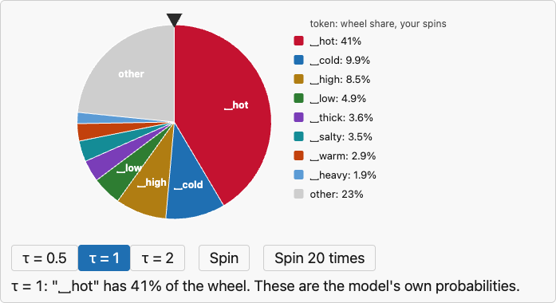

**What you see:** GPT-2's next token after "…the water was too" as a wheel, one slice per token. Picking a token is a spin. Change τ, then spin

**τ changes the wheel, the spin stays fair:** at τ = 0.5 "␣hot" takes 88% of it; at τ = 2, only 4%

**Why "temperature":** the softmax is Boltzmann's distribution from thermodynamics.

$$p(\text{token } v) = \frac{e^{z_v/\tau}}{\sum_u e^{z_u/\tau}} \qquad p(\text{state } i) = \frac{e^{-E_i/k_BT}}{\sum_j e^{-E_j/k_BT}}$$

A logit $z$ plays minus an energy, and $\tau$ plays $k_BT$. Hot: every state gets visited. Cold: the lowest energy wins

"In statistical mechanics, the softmax function is known as the Boltzmann distribution" (<a href="https://en.wikipedia.org/wiki/Softmax_function">Wikipedia</a>, after <a href="http://yann.lecun.com/exdb/publis/pdf/lecun-06.pdf">LeCun et al., 2006</a>).

<!--
For chemical engineers this is exactly the Boltzmann distribution, with the logit as minus an energy in units of k_B T.
-->

---

## Sampling, the loop with a temperature knob

**What you see:** GPT-2's ten most likely next tokens at each step of the loop. Red: the one appended. Step through, then move τ

**τ = 1:** GPT-2's own probabilities. At step 1, "␣water" gets 3.7%: many words could follow

**Slide τ to 0.1:** "␣water" jumps to **89%**. Low temperature: nearly the same text every time

**Slide τ to 2:** every bar flattens. At step 4, even "␣hot" falls to 4%: almost anything can come next

---

## Sampling, our tiny GPT at three temperatures

<h4>τ = 0.3</h4><pre>A Gaussian process in the data and a different statistical models.&#10;### A file section and layers&#10;A **fitted of stead of a column store and a strain of the same data is the same offf the same way th …</pre>
Safe and repetitive: "the same … the same …", and a Markdown heading copied from our notes

<h4>τ = 0.8</h4><pre>A Gaussian process and the default does not exact the band file coefficients the wide, vector plant. The discipline for a strong by an Lecture 9.&#10;The log quantition and can we course at have you been …</pre>
Varied words in our style, with no meaning

<h4>τ = 1.5</h4><pre>A Gaussian process cructor arNive,&quot; and a brieful mini-bassed flrecash uncaged defaularing most-is carryied outue: chan `y[desy&#x27;&#x27;](h✓dds#p.01├x, lipproduce.&#10;- [Slagáni lipyndbof/Jagimaus.ipynb) answer …</pre>
Broken words and rare symbols (✓, ├): the tail of the distribution

All three start from the same prompt, "A Gaussian process", and the same model. Only τ changed.

---

<!-- _class: definition -->

## Hallucination

**Hallucination**: fluent, confident text that is false: an invented number, unit, citation or fact.

What is the boiling point of water at sea level?The boiling point of water at sea level is 100 degrees Fahrenheit.

After "…100 degrees", the next token:

␣Fahrenheit<i style="width:100%"></i><em>58.6%</em>

␣Celsius<i style="width:70%"></i><em>40.8%</em>

␣F<i style="width:0%"></i><em>0.3%</em>

- **What happened:** we ran a chat model on a laptop (Qwen2.5-0.5B-Instruct, 0.49 billion parameters, trained on 18 trillion tokens) and asked. It got the number right and the unit wrong: after "…100 degrees" it gave Fahrenheit 58.6% and Celsius 40.8%, and took the more likely one

* **Why:** the training loss rewards the likely next token. Nothing in it checks whether a sentence is true
* **So:** treat every number and unit from an LLM as unchecked. Check it against a measurement, a handbook or a calculation

---

## Limitations and trade-offs

What goes wrong

What to do

<b>Invents sources and packages.</b> 5.2% of packages in GPT models' code do not exist; 21.7% for open models (<a href="https://arxiv.org/abs/2406.10279">Spracklen et al., 2025</a>)

Check that each source and package exists before you cite or install it

<b>Coding agents act on their guesses:</b> they edit files, install packages and run commands

Review the diff and run the tests before you merge; keep secrets out of reach

<b>Knows only its training data:</b> nothing after its cutoff date, nothing about your plant

Put the documents it needs in the prompt. Do not ask it for current values

<b>Long inputs:</b> answers get worse as inputs grow, well inside the advertised window (<a href="https://arxiv.org/abs/2404.06654">Hsieh et al., 2024</a>; <a href="https://arxiv.org/abs/2510.05381">Du et al., 2025</a>)

Send only what matters: retrieve the relevant parts, ask it to quote its evidence, repeat the main instructions

<b>Numbers and units:</b> it reads 4140 as two text pieces, "414" and "0", never as a quantity

Do arithmetic and unit conversions in code

<b>Not reproducible:</b> the same prompt can give another answer, even at temperature 0

Save the output you used, with the model's name and the date

<b>Your prompt leaves your machine</b> for the provider's servers

Check your company's rules first, or run an open model locally

<!--
The first two rows go together: an agent that installs what it writes can install a package an attacker registered under a hallucinated name (Spracklen et al. describe this attack).
-->

---

## Recap

<b>Text</b>
"The pump stopped"

→

<b>Tokens</b>
The ␣pump ␣stopped

→

<b>Transformer</b>

→

<b>Next-token probabilities</b>

␣water<i style="width:74%"></i>

␣pump<i style="width:59%"></i>

␣gas<i style="width:44%"></i>

→

<b>Sample, append, repeat</b>
␣water ␣was …

temperature τ

#### A generative model of text

$p(x_1, \dots, x_T) = \prod_t p(x_t \mid x_{<t})$

One token at a time, like Lecture 8's recursive forecast

#### Trained by

$\min_\theta\, -\frac{1}{T}\sum_t \log p_\theta(x_{t+1} \mid x_{\le t})$

#### At scale

Billions of parameters, trillions of tokens

#### Fluent is not true

␣about 1,000 degrees Fahrenheit

GPT-2 on water's boiling point (true: 212 °F). Check every number that matters

---

## Resources

With thanks to 3Blue1Brown

This lecture is built on Grant Sanderson's lessons on large language models, the clearest visual explanation of them we know. The chatbot as a script it completes, training as tuning dials, vectors that talk to each other and the temperature knob all come from there. Watch them before anything else on this slide.

<a href="https://www.3blue1brown.com/lessons/mini-llm/">Large Language Models explained briefly</a> (8 min) · <a href="https://www.3blue1brown.com/lessons/gpt/">Transformers, the tech behind LLMs</a> · <a href="https://www.youtube.com/watch?v=eMlx5fFNoYc">Attention in transformers</a> · <a href="https://www.youtube.com/watch?v=9-Jl0dxWQs8">How might LLMs store facts</a>

<h4>Watch</h4>
<a href="https://www.youtube.com/watch?v=zjkBMFhNj_g">Karpathy, Intro to LLMs</a> (1 h)

<a href="https://www.youtube.com/watch?v=kCc8FmEb1nY">Karpathy, Let's build GPT</a> (2 h)

<h4>Play</h4>
<a href="https://poloclub.github.io/transformer-explainer/">Transformer Explainer</a>: GPT-2 in your browser

<a href="https://bbycroft.net/llm">LLM Visualization</a>: every computation, in 3D

<a href="https://tiktokenizer.vercel.app/">Tiktokenizer</a>: see your text as tokens

<h4>Read</h4>
<a href="https://jalammar.github.io/illustrated-gpt2/">The Illustrated GPT-2</a>

<a href="https://web.stanford.edu/~jurafsky/slp3/">Jurafsky and Martin, SLP3</a>, Chapters 2, 7, 8

<a href="https://huggingface.co/learn/llm-course/chapter1/1">Hugging Face LLM Course</a>

---

## Before next time

- **Final project**: released today. Team agreement due Friday 10-30, proposal due Wednesday 11-04
- **Practice module** for this session, for participation credit

