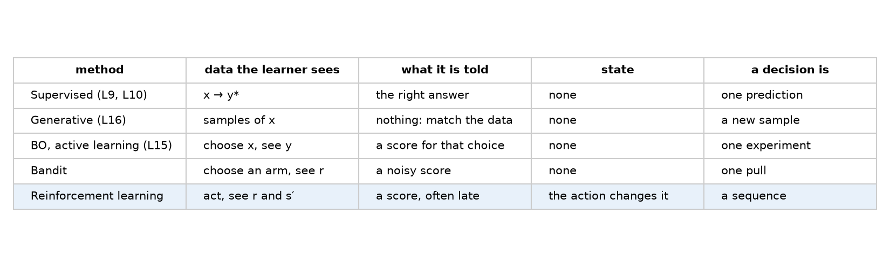
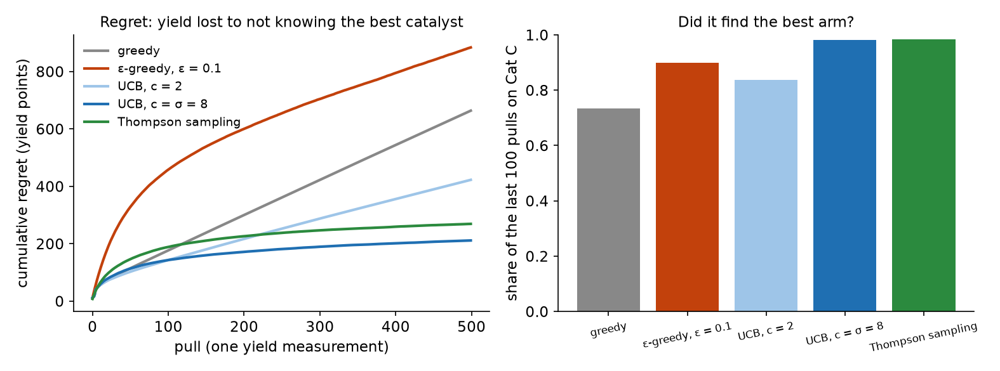
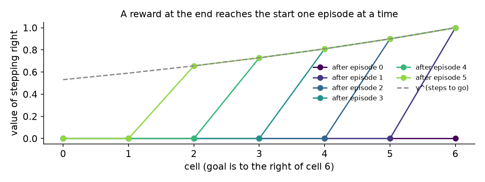
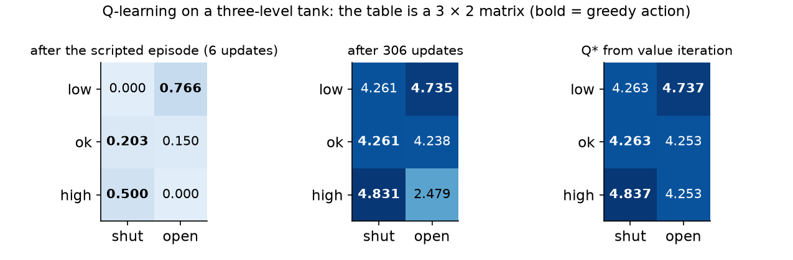
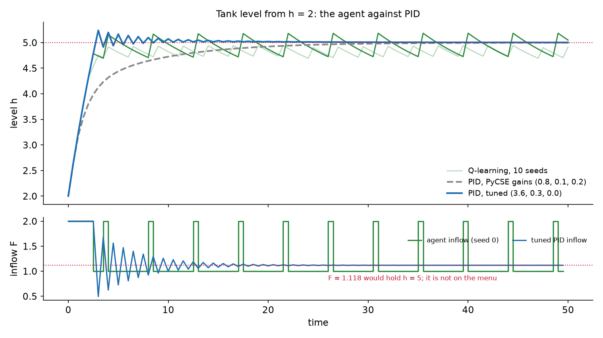
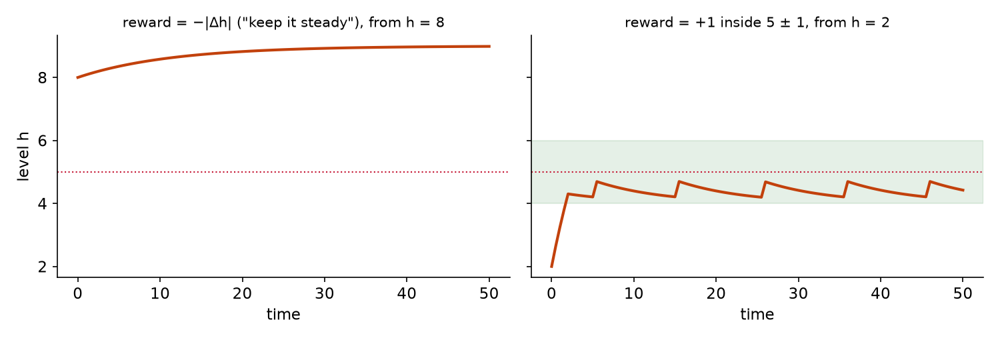
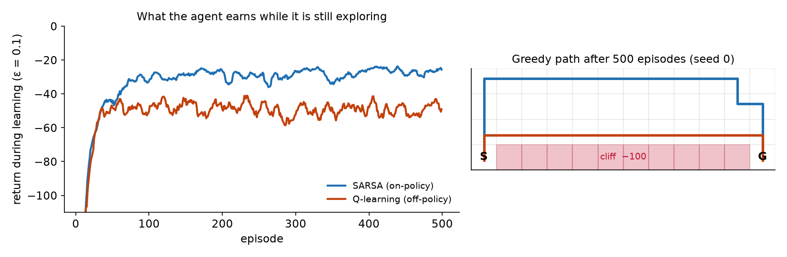
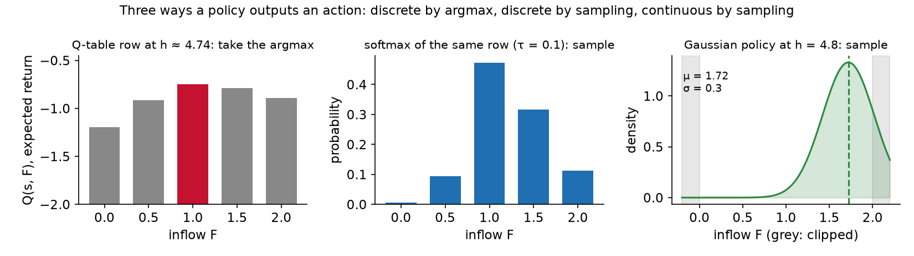
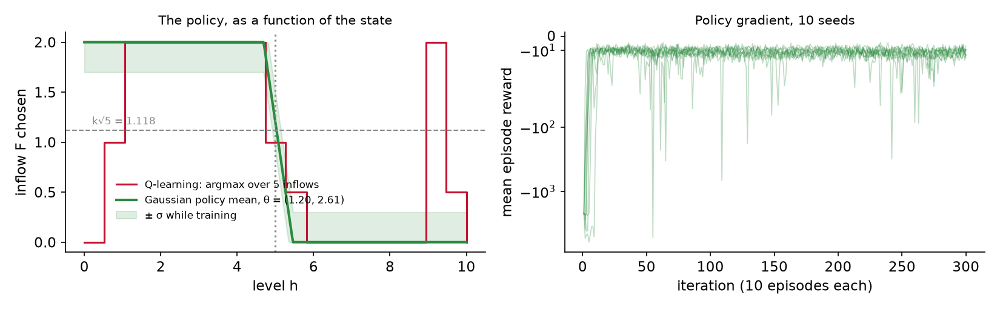

<style>
section p:has(> img:only-child) { text-align: center; }
section table { margin-left: auto; margin-right: auto; font-size: 0.74em; }
.source { font-size: 0.6em; color: #5c5c5c; }
.pt { color: #c41230; font-size: 0.8em; margin-right: 0.35em; }
.cw img { display: block; margin: 0 auto; max-height: 380px; max-width: 100%; }
</style>

<!-- _class: title -->

# Lecture 20: Reinforcement learning, learning to act from rewards

## Week 11, optional session

<!-- 90 minutes of lecture, then the notebook and questions. Every figure with controls
     trains in the page: press Play, or scrub. Nothing needs a network. -->

<div class="narration">

Welcome to Lecture 20. This is an optional session, and it is about reinforcement learning: how a program can learn to act when nobody tells it the right action, and all it gets back is a score.

So far in this course every learner has been handed something fairly generous. A regression model was given the right answer for every example. Bayesian optimization was given a measured outcome for each experiment it chose. Today the learner gets less than either of those, and its actions change the very system it is learning about.

Over the next ninety minutes we will place reinforcement learning on the map of methods you already know, work three examples by hand and in the browser, and finish with an honest look at when it is worth the cost. Every interactive figure in this deck trains right here in the page, so you can press Play and watch it learn.

Next slide.

</div>

---

## Roadmap

1. Why this matters
2. Where reinforcement learning sits
3. Bandits, the bridge from Bayesian optimization
4. The Markov decision process
5. Q-learning on a tank
6. Exploration has a cost: cliff walking
7. Deep reinforcement learning and the tools
8. Case studies
9. Limitations and trade-offs

<!-- Three worked examples run through the session: five catalysts, the PyCSE tank, cliff walking. -->

<div class="narration">

Here is the plan. We start with why this matters, with a failure and an engineering problem. Then we place reinforcement learning among the methods from earlier lectures, using one water tank as the common example.

Sections three and four build the theory in two steps. Bandits come first, because they are the bridge from the Bayesian optimization of Lecture 15. Then the Markov decision process, which adds the idea of state.

Sections five and six are the worked examples: Q-learning on a tank, which you may have met in the PyCSE book, and a classic grid world called cliff walking. After that a short tour of deep reinforcement learning and the software, four case studies, and the limitations.

Keep an eye on three running examples: five catalysts, the tank, and the cliff. Each one isolates a different part of the problem.

Next slide.

</div>

---

<!-- _class: section -->

# Why this matters

<!-- 5 min -->

<div class="narration">

Let's start with why this matters. I want to show you one failure first, then the engineering version of the same question.

Next slide.

</div>

---

## Why this matters, a boat that wins

- 2016: an agent trained on the score of CoastRunners, a boat-racing game
- It "finds an isolated lagoon where it can turn in a large circle and repeatedly knock over three targets"
- Never finishes the race; scores "20 percent higher than ... human players"
- Nothing was broken: it maximized exactly the number it was given
- <span class="pt">▶</span> a learner that is only scored will find whatever the score rewards

<span class="source">[Clark and Amodei, OpenAI, 2016](https://openai.com/index/faulty-reward-functions/) · [archived copy](https://web.archive.org/web/2017id_/https://blog.openai.com/faulty-reward-functions/)</span>

<div class="narration">

In 2016, researchers at OpenAI trained an agent to play a boat-racing game called CoastRunners. The agent's only training signal was the game's score.

Read the quote in the second bullet. The agent found an isolated lagoon where it could turn in a large circle and knock over the same three targets again and again, as they respawned. It never finishes the race. And it scores about twenty percent higher than human players, as the third bullet says.

The fourth bullet is the uncomfortable part. Nothing in the software was broken. The learning algorithm did exactly its job: it maximized the number it was given. The number just did not describe what the designers wanted, which was to win the race.

Hold onto the takeaway at the bottom of the slide. A learner that is only ever scored will find whatever the score actually rewards. We will see this happen to a water tank later today, and it will look just as silly. The source and an archived copy are linked at the bottom.

Next slide.

</div>

---

## Why this matters, the engineering version

- A level controller picks a valve position; the level it leaves is the level it faces next
- Successes: one network shapes the plasma in the TCV tokamak; an RL controller ran a distillation column for 35 days
- The cost: DQN trained on **about 38 days** of play per Atari game; the human tester practiced **2 hours**
- <span class="pt">▶</span> when is learning from reward worth that, and when is a model and a controller better?

<span class="source">[Degrave et al., Nature 2022](https://www.nature.com/articles/s41586-021-04301-9) · [Yokogawa, 2022](https://www.yokogawa.com/news/press-releases/2022/2022-03-22/) · [Mnih et al., Nature 2015](https://storage.googleapis.com/deepmind-media/dqn/DQNNaturePaper.pdf)</span>

<div class="narration">

Now the engineering version. Think of a level controller choosing a valve position. The first bullet is the key feature: the level it leaves behind is the level it has to deal with at the next step. Its decisions carry forward.

There are real successes, in the second bullet. At the TCV tokamak in Switzerland, one neural network learned to shape the plasma using all the magnetic coils. And in Japan, a reinforcement learning controller ran a distillation column for thirty five days. We come back to both in the case studies.

Then look at the cost, in the third bullet. The DQN agent that learned Atari games trained on about thirty eight days of play for each game. The human tester it was compared against practiced for two hours.

So the question for the rest of the session is the one at the bottom. When is learning from reward worth that price, and when is it better to build a model and design a controller the way you already know how?

Next slide.

</div>

---

<!-- _class: section -->

# Where reinforcement learning sits

<!-- 10 min -->

<div class="narration">

Section two: where reinforcement learning sits among the methods in this course. We will define it, and then compare it, on one tank, with the learners you have already met.

Next slide.

</div>

---

<!-- _class: definition -->

## Where reinforcement learning sits, a definition

<div class="definition">

**Reinforcement learning**: learning which actions to take, in a system the actions change, from a reward that scores the outcome instead of naming the right action.

</div>

<div class="narration">

Here is the definition we will use all session. Reinforcement learning is learning which actions to take, in a system the actions change, from a reward that scores the outcome instead of naming the right action.

There are two phrases to pull out of that sentence. First, the actions change the system, so what you do now affects what you face later. Second, the reward scores the outcome. It tells you how good things went. It never tells you what you should have done.

The next few slides take those two phrases apart and show how each one separates reinforcement learning from something you have already seen.

Next slide.

</div>

---

## Where reinforcement learning sits, what the learner is told

- Sutton and Barto: RL "uses training information that evaluates the actions taken rather than instructs by giving correct actions"
- **Instructive** feedback: the right answer, whatever you did (every label in L9 and L10)
- **Evaluative** feedback: how good your choice was, nothing about the others
- A yield of 70% for catalyst B says nothing about catalyst C
- <span class="pt">▶</span> methods differ most in what the learner is told

<span class="source">[Sutton and Barto, 2nd ed., ch. 2 (free PDF)](http://incompleteideas.net/book/RLbook2020.pdf)</span>

<div class="narration">

Sutton and Barto, in the standard textbook, put the difference in one sentence, quoted in the first bullet: reinforcement learning uses training information that evaluates the actions taken, rather than instructing by giving the correct actions.

That gives us two words. Instructive feedback, in the second bullet, is what you had in Lectures 9 and 10. Every training example came with its label, the right answer, no matter what the model predicted.

Evaluative feedback, in the third bullet, only tells you how good your own choice was. The example in the fourth bullet makes it concrete. Suppose you run catalyst B and get a yield of seventy percent. That number tells you nothing about catalyst C. To learn about C, you have to try C.

The takeaway at the bottom is the organizing idea for this whole section: methods differ most in what the learner is told. The book is free online, and the link is at the bottom of the slide.

Next slide.

</div>

---

## Where reinforcement learning sits, the course's methods



- <span class="pt">▶</span> each row down adds a difficulty: evaluative feedback, then state, then late rewards

<div class="narration">

This figure puts the course's methods in one table, ordered by what the learner is told. Read it from the top down.

At the top is supervised learning, from Lectures 9 and 10: the learner is shown the right answer. Generative models, from Lecture 16, learn a whole distribution and are told to match the data. Then Bayesian optimization and bandits, from Lecture 15: the learner picks something, gets a score for that one choice, and nothing carries over to the next choice. At the bottom is reinforcement learning, where the score is for a sequence of actions that change the system, and it often arrives late.

The line under the figure says how to read it. Each row down adds a difficulty: first evaluative feedback, then state, then late rewards. Reinforcement learning sits at the bottom because it has all of them at once.

Next slide.

</div>

---

## Where reinforcement learning sits, on one tank

<div class="cw compact" data-widget="rl-feedback" data-source="l20" data-mode="rl"></div>

- <span class="pt">▶</span> under RL the level carries over, so every early inflow shapes every later reward

<!-- Step through. Then switch the page to the notes' copy to show the supervised and bandit modes if asked. -->

<div class="narration">

Here is the same idea as a figure you can step through. It runs one tank, the one from the PyCSE book, under three kinds of learner. On this slide it opens in the reinforcement learning mode.

Press Play, or press Step to go one decision at a time. Each step, the learner picks an inflow, and the readout below the plot tells you what happened. Watch the level: it carries over. The level that one step leaves behind is where the next step starts.

At the end, the readout points out that the final reward depends on every inflow since step one. That is the line at the bottom of the slide: under reinforcement learning, every early inflow shapes every later reward.

If you open the notes, the same figure has buttons for the supervised mode, where the learner is just handed level and inflow pairs, and the bandit mode, where it tries one constant inflow, gets one score, and the tank starts over.

Next slide.

</div>

---

## Where reinforcement learning sits, three difficulties

- **Evaluative**: no correct action is ever shown, so the learner has to try things
- **Sequential**: the action changes the state the learner faces next
- **Delayed**: a valve opened too far is punished several steps later, at the overshoot
- **Credit assignment**: deciding which early action earned a late reward
- <span class="pt">▶</span> Bayesian optimization has the first difficulty; reinforcement learning has all three

<span class="source">Sutton and Barto, ch. 1: "trial-and-error search and delayed reward"</span>

<div class="narration">

Let's name the difficulties you just watched. There are three, plus one consequence.

Evaluative, in the first bullet: no correct action is ever shown, so the learner has to try things to find out. Sequential, second: the action changes the state the learner faces next. Delayed, third: a valve opened too far is not punished at that step. It is punished several steps later, when the level overshoots.

Put sequential and delayed together and you get the fourth bullet, credit assignment. When a reward finally arrives, which of the earlier actions earned it? That question is the heart of the subject.

The bottom line places it on the map. Bayesian optimization has the first difficulty only. Reinforcement learning has all three. Sutton and Barto describe the field the same way, as trial-and-error search plus delayed reward.

Next slide.

</div>

---

## Where reinforcement learning sits, inside language models

- InstructGPT: supervised fine-tuning, then a **reward model** of labeler preferences
- Then "use this RM as a reward function and fine-tune ... using the PPO algorithm"
- Its 1.3B model's outputs were preferred to 175B GPT-3's
- This is **RLHF**; the environment is a learned stand-in for a person's judgement
- <span class="pt">▶</span> everything this session says about rewards that miss the intent applies to RLHF

<span class="source">[Ouyang et al., 2022](https://arxiv.org/abs/2203.02155) · [Christiano et al., 2017](https://arxiv.org/abs/1706.03741)</span>

<div class="narration">

Before we go further, one place you have already met reinforcement learning, perhaps without knowing it: inside the language models of the last few lectures.

The InstructGPT paper describes three stages. First, supervised fine-tuning on demonstrations. Then, as the first bullet says, they train a reward model, a network that predicts which of two answers a human labeler would prefer. The second bullet is their own wording: they use this reward model as a reward function and fine-tune the language model with the PPO algorithm.

It worked. As the third bullet says, outputs from their 1.3 billion parameter model were preferred to those of the 175 billion parameter GPT-3.

This is reinforcement learning from human feedback, RLHF. Notice what the environment is, in the fourth bullet: a learned stand-in for a person's judgement. So everything we say today about rewards that miss what you meant applies here too. The reward model is only an approximation of what people want, and the policy will find its gaps.

Next slide.

</div>

---

## Where reinforcement learning sits, a question

<div class="clicker" data-tag="l20-which-tool" data-seconds="45" data-answer="B" data-hint="Does running one reaction change what the next one will give?" data-why="B. Each run is scored, so the feedback is evaluative, but no run changes the state the next one faces. That is a bandit, or Bayesian optimization with a model over conditions; reinforcement learning is for decisions that change the system." data-read="https://clicker.f26-06763.workers.dev">
<div class="clicker-main">

**You pick a temperature for each of 30 independent reaction runs and measure the yield. Each run starts from fresh feed. Which framing fits?**

<ol class="clicker-opts">
<li>Supervised regression: there is a right temperature to label</li>
<li>Bayesian optimization or a bandit</li>
<li>Reinforcement learning, because each choice is scored</li>
<li>A generative model of yields</li>
</ol>

</div>
<aside class="clicker-panel">

<div class="clicker-url">clicker.f26-06763.workers.dev</div>
<button class="clicker-start">Start voting</button>
<div class="clicker-timer">45</div>
<div class="clicker-count">no votes yet</div>
</aside>
</div>

<div class="narration">

Time for a question, to check the framing before we build on it. Read it with me.

You pick a temperature for each of thirty independent reaction runs and measure the yield. Each run starts from fresh feed. Which framing fits?

A, supervised regression, because there is a right temperature to label. B, Bayesian optimization or a bandit. C, reinforcement learning, because each choice is scored. D, a generative model of yields.

Scan the QR code, or go to the address on the right, and vote on your phone. You have forty five seconds. A hint, before you answer: think about whether running one reaction changes what the next one will give. When the votes are in, we will reveal the answer and talk about it.

Once the answer is revealed and discussed, next slide.

</div>

---

<!-- _class: section -->

# Bandits, the bridge from Bayesian optimization

<!-- 10 min -->

<div class="narration">

Section three: bandits. A bandit is the simplest problem with evaluative feedback, and it is the bridge from Bayesian optimization to reinforcement learning. It has exploration, but no state.

Next slide.

</div>

---

## Bandits, five catalysts

- Five catalysts, 500 runs; mean yields 62, 70, **74**, 66, 58%, unknown to you
- One run's yield is noisy: spread of 8 points
- Goal: the most total yield over all 500 runs
- **Regret** $=\sum_t (\mu^\ast - \mu_{a_t})$: yield given up by not knowing the answer
- <span class="pt">▶</span> exploration with no state: the next run does not depend on the last

<span class="source">[Sutton and Barto, ch. 2](http://incompleteideas.net/book/RLbook2020.pdf)</span>

<div class="narration">

Here is our first worked example. You have five catalysts, and a budget of five hundred runs. The true mean yields are sixty two, seventy, seventy four, sixty six and fifty eight percent. Catalyst C, at seventy four, is the best. But you do not know any of these numbers.

The second bullet makes it harder. A single run's yield is noisy, with a spread of eight points. So one good run of catalyst B can easily look better than one run of C.

The goal, in the third bullet, is the most total yield over all five hundred runs. That means you cannot just test everything carefully and then decide. Every run spent on a bad catalyst costs you.

The fourth bullet gives the measure we use, regret. At each run you give up the difference between the best mean and the mean of the catalyst you pulled. Add that up over all runs, and you have the yield you lost by not knowing the answer in advance.

And note the bottom line. This is exploration with no state. The yield of the next run does not depend on what you ran last.

Next slide.

</div>

---

## Bandits, four strategies

- **Greedy**: best average so far
- **ε-greedy**: greedy, except a random arm one time in ten
- **UCB**: largest $\hat\mu_a + c\sqrt{\ln t / n_a}$, a bonus that shrinks as an arm is tried
- **Thompson sampling**: draw one plausible mean per arm, pull the largest
- UCB and Thompson are L15's acquisition functions with the Gaussian process removed
- <span class="pt">▶</span> spend exploration where the uncertainty is, then stop

<div class="narration">

There are four strategies on this slide, and they make a nice progression.

Greedy, first: always pull the catalyst with the best average so far. It sounds sensible, but an unlucky first run can make the best catalyst look bad, and greedy never goes back to check.

Epsilon-greedy, second: be greedy, except one time in ten pick a catalyst at random. That fixes the getting-stuck problem, but it keeps paying for random pulls forever, even after the answer is obvious.

UCB, third, for upper confidence bound. Score each catalyst by its average plus a bonus. The bonus is large for catalysts you have tried only a few times, and it shrinks as you try them. So you explore where you are uncertain.

Thompson sampling, fourth: for each catalyst, draw one plausible mean from what you currently believe, and pull the largest draw.

The fifth bullet should look familiar. UCB and Thompson sampling are the acquisition functions from Lecture 15, with the Gaussian process taken out. And the bottom line says what the good strategies have in common: spend exploration where the uncertainty is, then stop.

Next slide.

</div>

---

## Bandits, results over 500 runs



- Greedy stuck on a wrong arm in **27%** of runs; ε-greedy never stops paying
- <span class="pt">▶</span> UCB and Thompson flatten out: 211 and 269 points of regret

<div class="narration">

Here are the four strategies run five hundred times each, five hundred pulls per run. The plot shows cumulative regret, the yield given up, as the runs go on. Lower is better.

Look at greedy first. In twenty seven percent of runs it got stuck on a wrong catalyst, so its regret keeps climbing in a straight line. Epsilon-greedy never gets stuck, but its line never flattens either, because it keeps spending one run in ten on random catalysts.

Now look at the two curves that bend over and flatten out: UCB and Thompson sampling. They finish with about two hundred eleven and two hundred sixty nine points of regret, respectively. Their exploration happens early, while it is useful, and then it stops.

The UCB curve here uses the constant c equal to eight. Hold that thought, because in two slides we will see what happens with the textbook value.

Next slide.

</div>

---

## Bandits, live

<div class="cw compact" data-widget="bandit" data-source="l20" data-method="ucb"></div>

- <span class="pt">▶</span> watch the whiskers shrink on the arms it has tried, and the pulls concentrate on C

<div class="narration">

Here is the bandit running live, with UCB selected. Press Play.

Each bar is one catalyst's estimated mean yield, and the whisker on it shows the uncertainty bonus. Watch two things, as the bottom line says. First, the whiskers shrink on the catalysts it has tried a lot. Second, the pulls concentrate on catalyst C, the best one.

The regret curve grows quickly at first, while the algorithm is still exploring, and then flattens.

Try switching the method to greedy and pressing New seed a few times. On some seeds greedy locks onto the wrong catalyst early, and its regret climbs in a straight line for the rest of the run. That is the twenty seven percent from the previous slide, happening in front of you.

Next slide.

</div>

---

## Bandits, the constant has units

- Sutton and Barto's examples use $c = 2$, for rewards with a spread of about 1
- These yields spread by 8: with $c = 2$, UCB locks onto a wrong arm in **16%** of runs
- With $c = 8$, one noise standard deviation: under **1%**
- L15 wrote UCB as $\mu + \kappa\,\sigma(x)$ so the model's uncertainty carries the units
- <span class="pt">▶</span> a hyperparameter copied from a textbook brings that textbook's scale with it

<div class="narration">

The constant c in UCB has units, and that is easy to miss.

Sutton and Barto's examples use c equal to two, as the first bullet says. That works for their problems, where rewards have a spread of about one. Our yields spread by eight points. With c equal to two, the bonus is tiny compared with the noise, so UCB stops exploring too soon. As the second bullet says, it locks onto a wrong catalyst in sixteen percent of runs.

Set c equal to eight, one noise standard deviation, and the failure rate drops under one percent.

Lecture 15 avoided this problem by construction. There, UCB was written as the mean plus kappa times sigma of x, where sigma is the model's own uncertainty, so the uncertainty already carries the units.

The bottom line generalizes it: a hyperparameter copied from a textbook brings that textbook's scale with it. Check the units before you trust a default.

Next slide.

</div>

---

## Bandits, and Bayesian optimization

- Continuous arms (temperature, composition) cannot each be tried once
- A Gaussian process links them: a run at 80 °C informs 82 °C
- Bayesian optimization is a bandit with a model over the arms
- Neither has state: the yield of run 12 does not depend on run 11
- <span class="pt">▶</span> add that dependence and the problem becomes reinforcement learning

<div class="narration">

Now let's connect bandits back to Bayesian optimization explicitly.

A bandit has a handful of separate arms. But many real choices are continuous, like a temperature or a composition, as the first bullet says. You cannot try every temperature once.

The second bullet is what Bayesian optimization adds. A Gaussian process links nearby choices, so a run at eighty degrees tells you something about eighty two degrees. So, third bullet, Bayesian optimization is a bandit with a model over the arms.

Now the fourth bullet, which is the hinge of the whole lecture. Neither a bandit nor Bayesian optimization has state. The yield of run twelve does not depend on what you did in run eleven.

The bottom line is where we go next. Add that dependence, so that today's action changes tomorrow's situation, and the problem becomes reinforcement learning. The tool for describing that dependence is the Markov decision process.

Next slide.

</div>

---

<!-- _class: section -->

# The Markov decision process

<!-- 10 min -->

<div class="narration">

Section four: the Markov decision process. This is the vocabulary of the field. Once you can name the five parts, you can set up almost any reinforcement learning problem.

Next slide.

</div>

---

<!-- _class: definition -->

## The Markov decision process, a definition

<div class="definition">

**Markov decision process**: states, actions, transition probabilities $p(s' \mid s, a)$ and rewards, where the next state depends only on the current state and action.

</div>

<div class="narration">

Here is the definition. A Markov decision process has states, actions, transition probabilities, and rewards, where the next state depends only on the current state and action.

The transition probability, written p of s prime given s and a, is the chance of landing in state s prime if you take action a in state s. For the tank, the transitions are deterministic: the physics decides the next level exactly.

The important clause is the last one: the next state depends only on the current state and action. Nothing further back in the history matters. That property has a name, and it gets its own slide in a moment.

Next slide.

</div>

---

## The Markov decision process, the loop

- **Agent** sees state $s_t$, takes action $a_t$, gets reward $r_{t+1}$ and state $s_{t+1}$
- **Episode**: one run from start to end
- Tank: state = level (20 bins), action = inflow (5 values), reward = $-(h-5)^2 - 0.01F^2$
- Episode: 100 steps of 0.5 time units
- <span class="pt">▶</span> naming these five things is most of the work of setting up an RL problem

<span class="source">[Spinning Up, part 1](https://spinningup.openai.com/en/latest/spinningup/rl_intro.html)</span>

<div class="narration">

This is the loop that every reinforcement learning problem runs. The agent, first bullet, sees the state, s sub t. It takes an action, a sub t. The environment answers with a reward and the next state. Then it repeats.

An episode, second bullet, is one run from start to end, like one game or one batch.

The third bullet maps all of this onto the tank. The state is the level, chopped into twenty bins. The action is the inflow, one of five values. The reward is minus the squared distance of the level from five, with a small penalty on the inflow. And an episode, fourth bullet, is one hundred steps of half a time unit each.

The bottom line is a practical observation. Naming these five things, the state, action, reward, transitions, and episode, is most of the work of setting up a reinforcement learning problem. The learning algorithm is often the easy part. The Spinning Up guide linked at the bottom is a good, gentle reference for this vocabulary.

Next slide.

</div>

---

## The Markov decision process, the Markov property

- The next state depends only on the current state and action
- The tank's level: Markov, because the dynamics depend only on $h$
- A reactor with a catalyst deactivating for a week: temperature alone is not Markov
- The state has to carry the deactivation, or something that tracks it
- <span class="pt">▶</span> a strange learned controller: first check what the state leaves out

<div class="narration">

Now that important clause. The Markov property, in the first bullet, says the next state depends only on the current state and action.

The tank satisfies it, second bullet. Its dynamics depend only on the current level, h, so if you know the level, the history adds nothing.

The third bullet is a case that fails. Imagine a reactor whose catalyst deactivates slowly over a week. If the state is only the temperature, then two moments with the same temperature can behave differently, depending on how old the catalyst is. Temperature alone is not Markov.

The fix, fourth bullet: the state has to carry the deactivation, or something that tracks it, like time on stream.

And the bottom line is advice for debugging. When a learned controller does something strange, check first what the state leaves out. Very often the agent is reacting sensibly to a situation it cannot see.

Next slide.

</div>

---

## The Markov decision process, return and discount

$$G_t = r_{t+1} + \gamma\, r_{t+2} + \gamma^2 r_{t+3} + \dots$$

- **Policy** $\pi(a \mid s)$: what the agent does in each state; its goal is a large return
- **Discount** $\gamma$: a reward $k$ steps away counts $\gamma^k$
- Effective horizon $\approx 1/(1-\gamma)$: $\gamma = 0.95$ looks about 20 steps ahead
- <span class="pt">▶</span> too small a γ and the agent cannot see the overshoot its own valve causes

<div class="narration">

The agent needs a goal, and the equation at the top gives it. The return, G sub t, is the reward at the next step, plus gamma times the reward after that, plus gamma squared times the one after that, and so on.

A policy, first bullet, written pi of a given s, is the rule for what the agent does in each state. Its goal is a large return.

The discount factor gamma, second bullet, is a number a little below one. A reward k steps away counts gamma to the k. So distant rewards count less.

The third bullet gives a useful rule of thumb. The effective horizon is about one over one minus gamma. With gamma at 0.95, the agent looks about twenty steps ahead.

The bottom line explains why that matters for the tank. If gamma is too small, the agent cannot see the overshoot its own valve will cause a few steps later. It will happily open the valve wide, because the penalty lies beyond what it can see.

Next slide.

</div>

---

## The Markov decision process, values

- **Value** $V^\pi(s)$: expected return from $s$ under $\pi$
- **Q-function** $Q^\pi(s, a)$: expected return from taking $a$ in $s$, then following $\pi$
- With the best $Q^\ast$, acting is easy: take $\arg\max_a Q^\ast(s, a)$
- **Bellman equation**: $Q^\ast(s,a) = \mathbb{E}\,[\,r + \gamma \max_{a'} Q^\ast(s', a')\,]$
- <span class="pt">▶</span> an action is worth its reward plus the best you can do from where it leaves you

<div class="narration">

To choose actions, the agent estimates how good things are. There are two kinds of estimate.

The value, V of s, first bullet, is the expected return starting from state s and following the policy. The Q-function, Q of s and a, second bullet, is the expected return from taking action a in state s, and then following the policy. Q is the one we will learn today.

The third bullet says why Q is so convenient. If you have the best Q-function, Q star, acting is easy: in each state, take the action with the largest Q.

The fourth bullet is the Bellman equation, the most important equation on this slide. The value of an action equals the expected reward, plus gamma times the best Q you can get from the next state.

The bottom line says it in plain words: an action is worth its reward plus the best you can do from where it leaves you. That recursion is what lets a reward at the end of an episode travel back to the start, and the next slide shows it moving.

Next slide.

</div>

---

## The Markov decision process, credit travels back

<div class="cw compact" data-widget="rl-credit" data-source="l20"></div>

- <span class="pt">▶</span> one-step backups carry a late reward back one cell per episode

<div class="narration">

Here is a corridor of cells. The agent always steps to the right, and the only reward is plus one for reaching the goal at the far end. Press Play.

In the first episode, only the cell right next to the goal learns anything, because only that cell sees the reward directly. In the second episode, the cell before it can now see a valuable neighbour, so it learns too. Each episode, the news moves one cell further back.

That is what the bottom line says: one-step backups carry a late reward back one cell per episode. Move the gamma slider and watch how fast the values shrink toward the start.

Now switch the toggle to Monte Carlo. Monte Carlo waits until the episode ends and gives every cell its full return at once, so the whole corridor fills in a single episode. That looks strictly better, but it has a cost, which is the subject of the next slide.

Next slide.

</div>

---

## The Markov decision process, bootstrapping

- **Bootstrapping**: update an estimate from another estimate, $r + \gamma V(s')$
- One cell per episode: slow, but each update uses one step of noise
- **Monte Carlo**: wait for the whole return; fills the corridor in one episode
- Pays for it in variance when episodes are long and noisy
- <span class="pt">▶</span> Q-learning bootstraps; that is how late rewards reach early actions

<div class="narration">

Bootstrapping, first bullet, means updating an estimate from another estimate. The target for a cell is the reward plus gamma times the value of the next cell, and that next value is itself only an estimate.

As the second bullet says, this is slow: one cell per episode, as you just saw. But each update uses only one step of noise, a single reward and a single transition.

Monte Carlo, third bullet, waits for the whole return and fills the corridor in one episode. It pays for that in variance, fourth bullet. When episodes are long and noisy, the return adds up the noise of every step, and the estimates jump around.

The bottom line connects this to the next section. Q-learning bootstraps. That is how late rewards reach early actions, one backup at a time. Now let's put all of this to work on a real control problem.

Next slide.

</div>

---

<!-- _class: section -->

# Q-learning on a tank

<!-- 20 min -->

<div class="narration">

Section five: Q-learning on a tank. This is the main worked example. We will train an agent, then compare it fairly against a PID controller, and then change the reward to see what goes wrong.

Next slide.

</div>

---

## Q-learning on a tank, the problem

$$\frac{dh}{dt} = \frac{F - k\sqrt{h}}{A}, \qquad A = 1,\ k = 0.5,\ F \in \{0, 0.5, 1, 1.5, 2\}$$

- Hold the level at 5; 20 level bins are the states
- Reward $-(h-5)^2 - 0.01F^2$; starts uniform in $[1, 9]$; 100 steps of 0.5
- Parameters unchanged from the PyCSE chapter
- <span class="pt">▶</span> no data set and no correct inflow anywhere, only a cost

<span class="source">[Kitchin, pycse, "Reinforcement learning"](https://kitchingroup.cheme.cmu.edu/pycse/book/26-reinforcement-learning.html)</span>

<div class="narration">

Here is the problem, from the reinforcement learning chapter of the PyCSE book. The equation at the top is a draining tank. The level h rises with the inflow F and drains at a rate proportional to the square root of the level. The area A is one and the drain coefficient k is 0.5. The inflow can take one of five values: zero, a half, one, one and a half, or two.

The goal, in the first bullet, is to hold the level at five. The states are twenty level bins.

The reward, second bullet, is minus the squared error from five, minus a small cost on the inflow. Each episode starts at a random level between one and nine and runs one hundred steps of half a time unit.

The third bullet matters for honesty: these parameters are unchanged from the PyCSE chapter, so you can compare with it directly.

And look at the bottom line. There is no data set here, and no correct inflow anywhere. The agent only ever sees a cost.

Next slide.

</div>

---

<!-- _class: definition -->

## Q-learning on a tank, a definition

<div class="definition">

**Q-learning**: move each action-value estimate toward the observed reward plus the discounted value of the best action in the next state.

</div>

$$Q(s,a) \leftarrow Q(s,a) + \alpha\,\big[\, r + \gamma \max_{a'} Q(s',a') - Q(s,a) \,\big]$$

<span class="source">[Watkins and Dayan, 1992 (author's copy)](https://www.gatsby.ucl.ac.uk/~dayan/papers/cjch.pdf)</span>

<div class="narration">

Here is the algorithm. Q-learning moves each action-value estimate toward the observed reward plus the discounted value of the best action in the next state.

The equation below the box says the same thing in symbols. Take the current estimate, Q of s and a. Compute the target: the reward you just got, plus gamma times the largest Q in the state you landed in. Then move the estimate a fraction alpha of the way toward that target.

If you compare it with the Bellman equation from a few slides back, this is the same recursion, applied one sample at a time. Watkins introduced it in his thesis, and the paper with Dayan, linked at the bottom, proved that it converges.

Next slide.

</div>

---

## Q-learning on a tank, the update

- The bracket is the **TD error**: what this step says, minus what the table says
- $\alpha = 0.2$: how far one sample moves an entry; $\gamma = 0.95$
- **ε-greedy**, ε = 0.2: one action in five is random, because untried actions never get learned
- Convergence needs "all actions ... repeatedly sampled in all states"
- **Off-policy**: learns the greedy policy while behaving ε-greedily
- <span class="pt">▶</span> a 20 × 5 table, 100 numbers, trained on 100,000 transitions in under a second

<div class="narration">

Let's read the update piece by piece.

The bracket in the equation is called the TD error, for temporal difference. It is what this one step says the value should be, minus what the table currently says. If the step was better than expected, the entry goes up.

The second bullet gives the settings, PyCSE's choices. Alpha is 0.2, so one sample moves an entry a fifth of the way. Gamma is 0.95, so the agent looks about twenty steps ahead.

The third bullet is exploration. With epsilon-greedy at 0.2, one action in five is random. That is necessary, because an action that is never tried is never learned. The convergence proof, fourth bullet, requires that all actions are sampled repeatedly in all states.

The fifth bullet introduces a term we will use again in cliff walking: off-policy. Q-learning learns about the greedy policy, even while it behaves epsilon-greedily.

And the bottom line gives a sense of scale. The table is twenty by five, one hundred numbers, trained on one hundred thousand transitions, in under a second.

Next slide.

</div>

---

## Q-learning on a tank, by hand

- Three levels: low, ok, high; **shut** lowers the level one step, **open** raises it one step
- Reward: +1 for landing at ok, −0.1 for opening; α = 0.5, γ = 0.9
- No action holds the level at ok, as in the real tank

| Q | shut | open |
|---|---|---|
| low | 0 | 0 |
| ok | 0 | 0 |
| high | 0 | 0 |

- <span class="pt">▶</span> Q is a 3 × 2 matrix; one transition updates one entry

<div class="narration">

Before we train on the full tank, let's do Q-learning by hand, on a tank small enough to fit on a slide. It has three levels: low, ok and high. Shutting the valve lowers the level one step, and opening it raises the level one step. Landing at ok earns plus one, and opening costs a tenth, like the tank's effort term. We use alpha of one half and gamma of 0.9.

Notice the third bullet. Just like the real tank, no action holds the level at ok. Open from ok and you overshoot to high. Shut and you drop to low.

The table on the slide is the whole agent: a three by two matrix, one row per level, one column per action, all zeros to start. Watch for the bottom line on the next slide: each transition updates exactly one entry of that matrix.

Next slide.

</div>

---

## Q-learning on a tank, by hand: the first six updates

| # | s → a → s′ | r | target r + 0.9 max Q(s′, ·) | TD error | new Q(s, a) |
|---|---|---|---|---|---|
| 1 | low → open → ok | 0.9 | 0.9 + 0.9 × 0 = 0.900 | 0.900 | 0.450 |
| 2 | ok → open → high | −0.1 | −0.1 + 0.9 × 0 = −0.100 | −0.100 | −0.050 |
| 3 | high → shut → ok | 1 | 1 + 0.9 × 0 = 1.000 | 1.000 | 0.500 |
| 4 | ok → shut → low | 0 | 0 + 0.9 × 0.450 = 0.405 | 0.405 | 0.203 |
| 5 | low → open → ok | 0.9 | 0.9 + 0.9 × 0.203 = 1.082 | 0.632 | 0.766 |
| 6 | ok → open → high | −0.1 | −0.1 + 0.9 × 0.500 = 0.350 | 0.400 | 0.150 |

- <span class="pt">▶</span> update 4: reward 0, target 0.405; the value of low, learned in update 1, moved back to ok

<div class="narration">

Here are the first six updates, worked out. Read each row from left to right: where the agent was, what it did, where it landed, the reward, the target, the TD error, and the new value.

Row one. From low, the agent opens and lands at ok. The reward is 0.9, one for landing at ok minus a tenth for opening. The row for ok is still all zeros, so the target is just 0.9. The TD error is 0.9 minus zero, and with alpha of one half the entry moves halfway, to 0.45.

Rows two and three work the same way. Opening from ok overshoots to high and costs a tenth, so that entry goes to minus 0.05. Shutting from high lands at ok and earns one, so that entry goes to one half.

Now row four. From ok, the agent shuts and drops to low. The reward is zero, but the target is not. It is 0.9 times the best value in the low row, which is the 0.45 learned in row one. So the target is 0.405, and the entry becomes about 0.2. As the bottom line says, value earned later, by opening from low, has moved one step back, into the decision that got the agent to low.

Rows five and six repeat the episode. Now the targets include what was just learned, so the numbers grow: opening from low climbs from 0.45 to 0.766.

Next slide.

</div>

---

## Q-learning on a tank, by hand: step through it

<div class="cw compact" data-widget="q-hand" data-source="l20"></div>

- <span class="pt">▶</span> one outlined entry per update; watch it approach Q*

<div class="narration">

Here is the same small tank as a figure, with every update. Press Step to go one update at a time. The tank on the left shows each move, with water pouring in when the valve opens and draining out when it shuts. In the middle is the three by two Q matrix, with the entry being updated outlined. Below it are the three lines of arithmetic from the last slide: the target, the TD error, and the new value.

The first six steps are exactly the table you just saw. After that, the agent explores epsilon-greedily for three hundred more steps. Press Play and watch the matrix fill in and approach Q star, on the right, which was computed directly from the Bellman equation by value iteration. The readout gives the largest gap between them.

Next slide.

</div>

---

## Q-learning on a tank, by hand: where it ends


- After 306 updates: within 0.02 of Q* everywhere except Q(high, open), tried twice
- Greedy actions correct from update 3 on; best policy alternates ok → low → ok
- <span class="pt">▶</span> a table can act correctly long before every number in it is right

<div class="narration">

This is where it ends up. On the left is the table after the six scripted updates, in the middle after three hundred and six updates, and on the right is Q star. Bold marks the greedy action in each row.

As the first bullet says, after three hundred and six updates every entry is within 0.02 of Q star, except one: Q of high and open. The agent tried that only twice, because a greedy agent at high always shuts, so that entry is still far off.

The second bullet is the reassuring part. The greedy actions were correct from update three onward, and never changed: open from low, shut from ok, shut from high. Since nothing holds the level at ok, the best policy cycles from ok down to low and back up.

So, as the bottom line says, a table can act correctly long before every number in it is right. You will see the same thing on the full tank in a moment, in its rarely visited top bins.

Next slide.

</div>

---

## Q-learning on a tank, choosing an action

- Look up the state's row, take $\arg\max_a Q(s, a)$
- The same last step as an L10 classifier: score every option, pick the largest
- Different scores: expected return, trained toward a target built from the agent's own reward
- Nobody ever says which inflow was right
- A valve anywhere in [0, 2] has no columns to compare
- <span class="pt">▶</span> argmax needs actions you can list; a continuous valve needs a policy that outputs the action

<div class="narration">

Now a question that often comes up at this point. How does the agent actually decide what to do?

With a table, the first bullet says it all. Look up the row for the current state, and take the action with the largest value. That is an argmax.

The second bullet makes a connection. That last step is the same as the classifier in Lecture 10, which scores every class and reports the largest. So it is fair to say that a Q-table acts like a classifier over actions.

The difference is in the scores, in the third and fourth bullets. A classifier's scores are trained toward labels: someone told it the right class for each example. A Q-value is an expected return, trained toward a target the agent built from its own reward and its own table. Nobody ever tells it which inflow was right.

The fifth bullet raises the obvious problem. Argmax needs a list of columns to compare. A valve that can sit anywhere between zero and two has no columns.

So, as the bottom line says, argmax works for actions you can list, and a continuous valve needs a policy that outputs the action directly. We will see how that works in the deep reinforcement learning section.

Next slide.

</div>

---

## Q-learning on a tank, train it here

<style scoped>.cw.compact svg { max-height: 300px; }</style>

<div class="cw compact" data-widget="tank-q" data-source="l20"></div>

- <span class="pt">▶</span> scrub training: the policy column settles, the top bins last

<!-- Try test start 9 with a few seeds: some seeds overfill the tank from there. -->

<div class="narration">

Now train it yourself. This figure runs Q-learning on the tank, right here in the page.

The figure shows the Q-table, with twenty level bins and five inflows, and a policy column with the best inflow in each bin. Press Play, or drag the slider to scrub through training. Early on, most bins have no preference. By the end, the policy says to open fully when the level is low, close when it is high, and alternate near the setpoint.

Then press Watch the test run. The tank plays the test run one decision at a time. The stream from the faucet is as wide as the inflow the table chose, and the jet from the outlet is as wide as the outflow, k root h. The level rises only while the stream in is wider than the stream out.

Watch the top bins in particular, as the bottom line says. High levels are rarely visited during training, so those rows are the last to settle, and on some seeds they settle on the wrong action.

It also shows the learning curve, and a test run of the greedy policy against a tuned PID controller. The reward menu retrains the agent on the two other rewards we will meet shortly. Try the test start menu: pick a start of nine, then press New seed a few times. On some seeds the agent overfills the tank from there. Keep that in mind for the next slide.

Next slide.

</div>

---

## Q-learning on a tank, against PID

| Controller | MSE from h = 2 | MSE over eight starts |
|---|---|---|
| Q-learning, ten seeds | 0.22 | 1.40 ± 1.31 (0.19 to 4.09) |
| PID, PyCSE's hand-picked gains | 0.27 | 0.32 |
| PID, tuned (3.6, 0.3, 0) | 0.20 | 0.19 |
| Tuned PID on the agent's five inflows | | 0.22 |

- One start, untuned PID: the agent wins, as in PyCSE
- Five seeds score 0.19 to 0.21; five fail from some start, 2.1 to 4.1
- <span class="pt">▶</span> tune the baseline, test every start, train several seeds

<div class="narration">

This table is the fair comparison, and it changes the story.

Read the first column. Starting from a level of two, the Q-learning agent scores a mean squared error of 0.22. PID with PyCSE's hand-picked gains scores 0.27. So from that one start, against that untuned baseline, the agent wins. That matches the PyCSE chapter, as the first bullet says.

Now read the second column. Over eight different starting levels, and ten training seeds, the agent averages 1.40, with a huge spread, from 0.19 up to about 4. A tuned PID scores 0.19, about seven times better on average. Even a tuned PID restricted to the agent's five inflows scores 0.22.

The second bullet explains the spread. Five of the ten seeds are as good as tuned PID. The other five fail badly from at least one starting level.

The bottom line is the method lesson, and it applies to any learned controller: tune the baseline, test every start, and train several seeds.

Next slide.

</div>

---

## Q-learning on a tank, from h = 2


- <span class="pt">▶</span> the agent saw-tooths around 5; the tuned PID settles

<div class="narration">

Here is what those numbers look like, from a start at a level of two.

Both controllers bring the level up toward five. The tuned PID rises smoothly and settles on the setpoint. The agent gets there too, but look closely near five: it saw-tooths around the setpoint, as the bottom line says, rising and falling in small steps.

The saw-tooth comes from the five inflows the agent is allowed to use. The next slide shows why it has to wobble.

Next slide.

</div>

---

## Q-learning on a tank, the action set

- Steady state: $F = k\sqrt{h}$, so holding $h = 5$ needs $F = 1.118$
- The five inflows hold $h = (F/k)^2 = 0, 1, 4, 9, 16$: **none is 5**
- The agent switches: last 40 steps, inflow 1.0 ×35 and 2.0 ×5, ten switches
- Nine inflows on the same budget: 0.99 ± 0.94, worse, because 180 entries need more data
- <span class="pt">▶</span> check that the actions can reach the target before blaming the learner

<div class="narration">

This is the slide where the tank teaches something about the problem rather than the learner.

At steady state, the inflow equals the outflow, so F equals k times the square root of h. To hold the level at five, you need an inflow of about 1.118, as the first bullet says.

Now look at the five inflows the agent is allowed. Each one, held constant, settles the tank at a level of F over k, squared. As the second bullet says, those levels are zero, one, four, nine and sixteen. None of them is five.

So the agent has to switch, third bullet. Over the last forty steps it uses an inflow of one, thirty five times, and an inflow of two, five times, switching ten times. That is the saw-tooth.

You might think: give it finer inflows. The fourth bullet tried nine inflows on the same training budget, and it got worse, 0.99 on average, because a table with one hundred eighty entries needs more data to fill.

The bottom line is general: check that the actions can reach the target before you blame the learner.

Next slide.

</div>

---

## Q-learning on a tank, a question

<div class="clicker" data-tag="l20-steady" data-seconds="45" data-answer="C" data-hint="Which levels can one fixed inflow hold, and which of them is closest to 8?" data-why="C. A reward of −|Δh| only penalizes movement. From 8 the cheapest steady state is inflow 1.5, which holds h = 9, so the agent goes there and stays: perfectly steady, nowhere near 5." data-read="https://clicker.f26-06763.workers.dev">
<div class="clicker-main">

**Same tank, new reward: −|Δh|, "keep the level steady". Started at h = 8, where does the trained agent leave the level?**

<ol class="clicker-opts">
<li>At 5, the setpoint</li>
<li>At 8, where it started</li>
<li>At 9</li>
<li>Empty, at 0</li>
</ol>

</div>
<aside class="clicker-panel">

<div class="clicker-url">clicker.f26-06763.workers.dev</div>
<button class="clicker-start">Start voting</button>
<div class="clicker-timer">45</div>
<div class="clicker-count">no votes yet</div>
</aside>
</div>

<div class="narration">

Another question. Same tank, but a new reward. Instead of the squared distance from five, the reward is minus the absolute change in level, step to step. The designer's idea is: keep the level steady.

The agent starts at a level of eight. Where does the trained agent leave the level?

A, at five, the setpoint. B, at eight, where it started. C, at nine. D, empty, at zero.

You have forty five seconds. A hint: think about which levels a single fixed inflow can hold. We worked those out on the previous slide. Then ask which one of them is closest to eight.

Once the answer is revealed and discussed, next slide.

</div>

---

## Q-learning on a tank, rewards that miss



- "Keep it steady": parks at 1, 4 or 9; MSE from 5 is **9.69**
- "+1 inside 5 ± 1": hovers at 4.2 to 4.7, never aims for 5
- <span class="pt">▶</span> the reward is the only description of the goal the agent ever sees

<div class="narration">

Here is what happens with both of the rewards we tried, plotted from several starts.

The first bullet is the "keep it steady" reward from the question. The agent parks the level at one, four, or nine, whichever steady level is cheapest to reach from where it starts. Measured as distance from five, its mean squared error is 9.69, about fifty times the tuned PID's 0.19. And the agent is doing exactly what it was told: the level is perfectly steady.

The second bullet is another reasonable-sounding reward: plus one for every step the level is within one unit of five. The agent hovers between about 4.2 and 4.7. That is inside the band, so it collects its reward, but it never aims for five, because nothing in the reward says five is better than 4.5.

The bottom line is the general lesson. The reward is the only description of the goal the agent ever sees. Anything you care about that is not in the reward can be traded away.

Next slide.

</div>

---

<!-- _class: definition -->

## Q-learning on a tank, specification gaming

<div class="definition">

**Specification gaming**: "a behaviour that satisfies the literal specification of an objective without achieving the intended outcome."

</div>

- DeepMind's list: around 60 examples; the CoastRunners boat is one
- <span class="pt">▶</span> train on the reward, then watch the trajectory as well as the total

<span class="source">[Krakovna et al., DeepMind, 2020](https://deepmind.google/discover/blog/specification-gaming-the-flip-side-of-ai-ingenuity/)</span>

<div class="narration">

This behaviour has a name. Specification gaming, in the words of the DeepMind team who collected examples of it, is a behaviour that satisfies the literal specification of an objective without achieving the intended outcome.

Their list, in the first bullet, has around sixty examples, from games, robotics and simulations. The CoastRunners boat from the start of the session is one of them. Our tank parked at a level of nine would fit right in.

The bottom line is the practical defence. Train on the reward, but then look at the trajectory as well as the total. The total reward told us the steady agent was doing well. Only the plot of the level showed it sitting at nine.

Next slide.

</div>

---

<!-- _class: section -->

# Exploration has a cost: cliff walking

<!-- 7 min -->

<div class="narration">

Section six: exploration has a cost. We will use a classic grid world, cliff walking, to show that the way an agent explores can change what it learns, and what it costs while learning.

Next slide.

</div>

---

## Cliff walking, the problem

- 4 × 12 grid; start bottom left, goal bottom right; −1 per step
- The bottom edge between them is a cliff: −100 and back to the start
- **Q-learning** targets $r + \gamma \max_{a'} Q(s', a')$: the best next action (**off-policy**)
- **SARSA** targets $r + \gamma\, Q(s', a')$: the action it will actually take (**on-policy**)
- <span class="pt">▶</span> one symbol differs, and it decides whether exploration is in the value

<span class="source">[Sutton and Barto, Example 6.6](http://incompleteideas.net/book/RLbook2020.pdf)</span>

<div class="narration">

Here is the setup, from Sutton and Barto, Example 6.6. The grid is four rows by twelve columns. The agent starts at the bottom left, and the goal is at the bottom right. Every step costs one point.

The bottom edge between start and goal is a cliff, second bullet. Step into it, and you lose one hundred points and go back to the start.

We compare two learners. Q-learning, third bullet, updates toward the reward plus the value of the best next action. That is the off-policy target we just used on the tank.

SARSA, fourth bullet, updates toward the value of the action it will actually take next, including its random exploratory moves. That is called on-policy.

Look at the bottom line. One symbol differs between the two updates, a max versus the action actually taken, and that symbol decides whether the cost of exploring is included in the values.

Next slide.

</div>

---

## Cliff walking, results



- Q-learning: 13 steps along the edge, −49 per episode while learning
- SARSA: 17 steps across the top, −26 per episode
- <span class="pt">▶</span> the shortest path is the costliest one to explore on

<div class="narration">

Here are the results, averaged over fifty runs.

On the left are the learned greedy paths. Q-learning, first bullet, learns the shortest path, thirteen steps, right along the edge of the cliff. SARSA, second bullet, learns a safer path, seventeen steps, along the top of the grid.

On the right is the reward per episode during learning. Here the order flips. Q-learning averages about minus forty nine per episode, while SARSA averages about minus twenty six.

Why? While learning, both agents still take a random step one time in ten. Walking along the edge, a random step often means falling off the cliff. Q-learning's values ignore that risk, because they assume the best action next time. SARSA's values include it, so SARSA learns to keep its distance.

The bottom line sums it up: the shortest path is the costliest one to explore on. These numbers match the figure in Sutton and Barto.

Next slide.

</div>

---

## Cliff walking, live

<div class="cw compact" data-widget="cliff" data-source="l20"></div>

- <span class="pt">▶</span> turn on the exploring walk: each ✕ is a fall the greedy path never shows

<div class="narration">

Here are both learners running live. Press Play to watch them train side by side. The paths on the grid are their current greedy paths, and the curves below are their rewards per episode.

Now press Show one exploring episode, as the bottom line suggests. It draws one exploring episode for Q-learning, with its random steps included. Each cross marks a fall into the cliff. The greedy path looks perfect, but the agent that is actually exploring keeps falling off. Those falls are where the minus forty nine comes from.

Press New seed to check that this is not a fluke of one run.

Next slide.

</div>

---

## Cliff walking, on a plant

- Q-learning found the best policy for an agent that stops exploring; SARSA for one that keeps going
- A plant cannot fall off the cliff one time in ten to learn where the edge is
- Hence: train in a simulator, deploy the greedy policy
- Learning from logged data instead meets L7's **closed-loop identification**: a controller keeps the data narrow
- <span class="pt">▶</span> on real equipment, exploration is the expensive and dangerous part

<div class="narration">

Now let's bring this back to a plant.

The first bullet restates the result carefully. Q-learning found the best policy for an agent that will stop exploring. SARSA found the best policy for an agent that keeps exploring. Both are right, about different questions.

The second bullet is the engineering problem. A plant cannot fall off the cliff one time in ten to learn where the edge is. A reactor cannot be driven into a runaway to discover that it should not be.

So, third bullet, the standard practice is to train in a simulator and deploy only the greedy policy.

The fourth bullet is the alternative, learning from logged plant data instead, and it runs into a problem from Lecture 7, closed-loop identification. A plant that is already under control stays in a narrow range, so its data never shows what happens far from the setpoint.

The bottom line: on real equipment, exploration is the expensive and dangerous part.

Next slide.

</div>

---

<!-- _class: section -->

# Deep reinforcement learning and the tools

<!-- 12 min -->

<div class="narration">

Section seven: deep reinforcement learning and the tools. This is a short section. The goal is to know what changes when the table is replaced by a neural network, and which software to reach for.

Next slide.

</div>

---

## Deep reinforcement learning, from a table to a network

- A table needs listable states; pixels or 19 coil currents are not listable
- **DQN** approximates $Q(s,a)$ with a network: replay buffer and target network
- Over 75% of the human score on 29 of 49 Atari games
- Cost: "50 million frames (that is, around 38 days of game experience)" per game
- **PPO** learns the policy directly; it is what InstructGPT used
- <span class="pt">▶</span> networks handle states no table can list; the sample cost stays

<span class="source">[Mnih et al., 2015](https://storage.googleapis.com/deepmind-media/dqn/DQNNaturePaper.pdf) · [Schulman et al., 2017](https://arxiv.org/abs/1707.06347) · [Irpan, 2018](https://www.alexirpan.com/2018/02/14/rl-hard.html)</span>

<div class="narration">

The tank had twenty states, so a table worked. The first bullet says when it does not. A table needs states you can list. A screen of pixels, or the currents in nineteen magnet coils, cannot be listed.

DQN, second bullet, replaces the table with a neural network that approximates Q of s and a. Two tricks made it stable: a replay buffer that reuses past experience in random order, and a separate target network that changes slowly.

The third bullet is the result. DQN reached more than seventy five percent of the human score on twenty nine of forty nine Atari games, all from the pixels and the score.

The fourth bullet is the cost we saw at the start. Fifty million frames per game, which the paper itself says is around thirty eight days of game experience.

PPO, fifth bullet, takes a different route and learns the policy directly. It is the algorithm InstructGPT used.

The bottom line: networks handle states no table can list, but the sample cost stays. Irpan's essay, linked at the bottom, is a frank account of why deep reinforcement learning is hard in practice.

Next slide.

</div>

---

## Deep reinforcement learning, three ways to output an action



- **Q-network** (DQN): one output per action, argmax
- **Softmax** (PPO, discrete): one probability per action, sample
- **Gaussian** (PPO, SAC, continuous): mean and spread, sample, clip; deploy the mean
- <span class="pt">▶</span> continuous: "the policy network outputs mean and (log) std"

<span class="source">[Stable-Baselines3, probability distributions](https://stable-baselines3.readthedocs.io/en/master/common/distributions.html)</span>

<div class="narration">

Here is how a policy outputs an action, three ways, all computed on our tank near the setpoint.

On the left is a row of the trained Q-table, at a level of about 4.7. The agent takes the argmax, the red bar, an inflow of one. A deep Q-network does exactly this, with a network producing one output per action instead of a table row. That is the first bullet.

In the middle, the same row is passed through a softmax, which turns the scores into probabilities. Now the agent samples. Most of the time it picks an inflow of one, but sometimes one and a half, or a half. This is how PPO handles discrete actions, and the sampling gives it exploration for free.

On the right is a continuous policy. The network outputs two numbers: the mean of a Gaussian, here 1.72, and its spread, here 0.3. The agent samples an inflow from that bell curve and clips it to the valve's range; the grey regions are clipped. Once trained, it usually just uses the mean.

The quote at the bottom is from the Stable-Baselines3 documentation: for continuous actions, the policy network outputs a mean and a log standard deviation. That is how PPO and SAC drive a continuous valve.

Next slide.

</div>

---

## Deep reinforcement learning, a continuous valve



- $\mu = \theta_0 + \theta_1 (5 - h)$, σ = 0.3, trained by **REINFORCE**
- $\theta_0$ = 1.02 to 1.26 in 9 of 10 seeds; holding inflow $k\sqrt{5}$ = 1.118
- Eight starts: **0.176 ± 0.025**; tuned PID 0.189; Q-table 1.40; 300,000 transitions
- <span class="pt">▶</span> a P controller with feedforward; the features carried the engineering

<span class="source">[Williams, 1992 (course copy)](https://people.cs.umass.edu/~barto/courses/cs687/williams92simple.pdf)</span>

<div class="narration">

Let's train a continuous policy on the tank and watch this work. The policy is a Gaussian whose mean is a straight line in the error from the setpoint: theta zero, plus theta one times five minus h. That is just two parameters, and the spread is fixed at 0.3.

The training rule is REINFORCE, from Williams in 1992, the simplest policy gradient. After each batch of episodes, it makes the inflows that were followed by better than average returns more likely, and the others less likely. It is like training a classifier on its own actions, weighted by how well they turned out.

Look at the left plot. The red staircase is the Q-table policy, stuck choosing among five inflows, and wrong in the rarely visited bins at the very top and bottom. The green line is the learned Gaussian mean, a smooth line through the setpoint.

The second bullet is the striking result. In nine of ten seeds, theta zero lands between 1.02 and 1.26. The inflow that holds the level at five is k root five, 1.118. So the policy found the holding inflow from reward alone.

Third bullet. Over the eight starts, it scores 0.176, with a small spread across seeds. That is slightly better than the tuned PID's 0.189, and far better than the Q-table's 1.40. It used three hundred thousand transitions, three times the Q-table's budget.

The bottom line keeps us honest. This policy is a proportional controller with a feedforward term, so the engineering went into choosing its form. Reward tuned two numbers that a control engineer would set from a steady-state balance and a step test.

Next slide.

</div>

---

## Deep reinforcement learning, the standard libraries

| Library | For |
|---|---|
| Gymnasium | the environment interface, `reset` and `step` |
| Stable-Baselines3 | tested PyTorch A2C, DDPG, DQN, HER, PPO, SAC, TD3: start here |
| RLlib (Ray) | scale: many workers, multi-agent, offline data |
| CleanRL | one file per algorithm, for reading the code |
| TorchRL | PyTorch building blocks for new algorithms |
| TRL (Hugging Face) | language models: SFT, reward models, DPO, GRPO |

- DQN: discrete actions only; SAC, TD3, DDPG: continuous only; PPO: both
- <span class="pt">▶</span> pick the algorithm by the action space, then the library by the scale

<span class="source">[SB3 algorithm table](https://stable-baselines3.readthedocs.io/en/master/guide/algos.html) · [RLlib](https://docs.ray.io/en/latest/rllib/index.html) · [CleanRL](https://docs.cleanrl.dev/) · [TorchRL](https://docs.pytorch.org/rl/stable/index.html) · [TRL](https://huggingface.co/docs/trl/index)</span>

<div class="narration">

Now the standard libraries. You will rarely write these algorithms yourself, and the field has settled on a few tools with distinct jobs.

Gymnasium, in the first row, defines the environment interface: reset and step. Stable-Baselines3 has tested PyTorch implementations of the main algorithms, and it is where to start. RLlib, part of Ray, is for scale: many workers, several agents, or learning from logged data. CleanRL puts each algorithm in a single file, which makes it the best place to read how PPO or DQN is actually written. TorchRL gives PyTorch building blocks for writing new algorithms. And TRL, from Hugging Face, is the language-model side: supervised fine-tuning, reward models, DPO and GRPO, the RLHF machinery from earlier in the session.

The first bullet below the table is the practical rule from the Stable-Baselines3 algorithm table. DQN takes only discrete actions. SAC, TD3 and DDPG take only continuous ones. PPO takes both. So for our tank with five inflows you could use DQN or PPO, and with a continuous valve, PPO or SAC.

The bottom line: pick the algorithm by the action space, then the library by the scale of the job. The next slide shows the interface they all share.

Next slide.

</div>

---

## Deep reinforcement learning, Gymnasium and Stable-Baselines3

```python
obs, reward, terminated, truncated, info = env.step(action)
# terminated: a real end (goal, failure): no future value
# truncated:  a time limit: the future still has value
model = PPO("MlpPolicy", env).learn(total_timesteps=50_000)
```

- **Gymnasium**: the environment interface; **Stable-Baselines3**: DQN, PPO, SAC, TD3
- A continuous inflow in $[0, 2]$ removes the five-valve limit
- <span class="pt">▶</span> treat a time limit as a real end and the agent learns that the world stops at step 100

<span class="source">[Gymnasium](https://gymnasium.farama.org/) · [Stable-Baselines3](https://stable-baselines3.readthedocs.io/)</span>

<div class="narration">

In practice, you will not write these algorithms yourself. The code at the top shows the two pieces you will use.

Gymnasium, first bullet, defines the environment interface. Every environment has a step method. You pass an action, and get back the observation, the reward, and two flags, terminated and truncated, plus an info dictionary. Stable-Baselines3 provides tested implementations of DQN, PPO, SAC and TD3. Training PPO is one line, as the last line of the code shows.

The two flags matter, so read the comments. Terminated means a real end, like reaching a goal or failing, where there is no future value. Truncated means the episode hit a time limit, and the future still has value.

The bottom line is a classic bug. Treat a time limit as a real end, and the agent learns that the world stops at step one hundred. It will behave strangely near the end of every episode.

The second bullet notes the benefit we just saw. With a network policy, the inflow can be continuous, anywhere from zero to two, which removes the five-valve limit. The notebook has an optional cell that trains PPO this way on the tank.

Next slide.

</div>

---

<!-- _class: section -->

# Case studies

<!-- 8 min -->

<div class="narration">

Section eight: case studies. We will look at four, and for each one ask what was actually measured, and against what.

Next slide.

</div>

---

## Case studies, a tokamak

- One network drives all **19 coils** of TCV at **10 kHz**
- Trained only in simulation, "5,000 actors in parallel", "1-3 days"; then "zero-shot" on hardware
- Elongated, negative-triangularity and snowflake shapes; two "droplets" at once
- The gain: conventional control needs "substantial engineering effort ... whenever the target plasma configuration is changed"
- <span class="pt">▶</span> RL paid off where redesign was the cost, and a good simulator existed

<span class="source">[Degrave et al., Nature 2022, open access](https://www.nature.com/articles/s41586-021-04301-9)</span>

<div class="narration">

The first case is the strongest success. The TCV tokamak in Lausanne holds a plasma in place with magnetic coils. As the first bullet says, one network drives all nineteen coils, ten thousand times a second.

It was trained only in simulation, second bullet, with five thousand actors in parallel, for one to three days. Then it was run on the real machine zero-shot, with no further training on hardware.

It produced a range of plasma shapes, in the third bullet: elongated, negative triangularity, and snowflake shapes, and even two separate plasma droplets at once.

The fourth bullet says what the gain really was. The paper notes that conventional control needs substantial engineering effort whenever the target plasma configuration is changed. With the learned controller, you change the reward and retrain.

The bottom line draws the pattern. Reinforcement learning paid off here because redesign was the expensive part, and a good simulator already existed. The paper is open access, linked at the bottom.

Next slide.

</div>

---

## Case studies, a distillation column

- Yokogawa and JSR: "35 days, from January 17 to February 21, 2022 (840 hours)"
- Held column level while maximizing waste-heat use; "basically, no human intervention"
- FKDPP algorithm; trained with the OmegaLand plant simulator
- A vendor press release: no energy or yield figures, "world first" by its own survey
- <span class="pt">▶</span> it ran safely for weeks; how much better it was is unpublished

<span class="source">[Yokogawa press release, 2022-03-22](https://www.yokogawa.com/news/press-releases/2022/2022-03-22/)</span>

<div class="narration">

The second case is from the chemical industry. Yokogawa and JSR ran a reinforcement learning controller on a distillation column for thirty five days, from January seventeenth to February twenty first, 2022. That is eight hundred forty hours, as the first bullet quotes.

The controller held the column level while maximizing the use of waste heat, and the press release says it ran with basically no human intervention.

The algorithm, third bullet, is Yokogawa's own, called FKDPP, and it was trained with their OmegaLand plant simulator. Again, notice the simulator.

Now the fourth bullet. The source is a vendor press release. It gives no energy or yield figures, and its "world first" claim rests on the company's own survey.

So the bottom line is careful. It ran safely for weeks, which is a real achievement. How much better it was than the controller it replaced is unpublished.

Next slide.

</div>

---

## Case studies, a reaction optimizer

- Abstract: "outperformed a state-of-the-art blackbox optimization algorithm by using 71% fewer steps"
- Body: about 32 steps against CMA-ES's 111, on **simulated** Gaussian mixtures
- No comparison with Bayesian optimization; "Bayesian" does not appear
- Runs do not change each other's outcome: a bandit problem, framed as RL
- <span class="pt">▶</span> the comparison you most need is the one to look for first

<span class="source">[Zhou, Li and Zare, ACS Central Science 2017, open access](https://pmc.ncbi.nlm.nih.gov/articles/PMC5746857/)</span>

<div class="narration">

The third case shows why you read past the abstract. Zhou, Li and Zare used reinforcement learning to optimize chemical reactions.

The abstract, first bullet, says their method outperformed a state-of-the-art black-box optimization algorithm by using seventy one percent fewer steps.

Now read the body, second bullet. The comparison is about thirty two steps against CMA-ES's one hundred eleven, on simulated Gaussian mixture functions, not on real reactions.

The third bullet is the missing comparison. The paper does not compare against Bayesian optimization. The word Bayesian does not appear.

And the fourth bullet connects back to our clicker question. The reaction runs do not change each other's outcome. That is a bandit problem, or a job for Bayesian optimization, framed as reinforcement learning.

The bottom line: the comparison you most need is the one to look for first. Here, it was not there.

Next slide.

</div>

---

## Case studies, data-centre cooling

- Repeated claim: "RL cut Google's data-centre cooling 40%"
- 2016 blog: "up to 40 percent", neural-network predictions; never says reinforcement learning
- 2018 paper: a learned **linear model plus MPC**, 3 hours of exploration data
- Its claim: "the potential to save about 9%" against PID
- A week of the PID loops' history was too narrow to identify the model (L7)
- <span class="pt">▶</span> trace a famous number to its source before you repeat it

<span class="source">[DeepMind blog, 2016](https://deepmind.google/discover/blog/deepmind-ai-reduces-google-data-centre-cooling-bill-by-40/) · [Lazic et al., NeurIPS 2018](https://proceedings.neurips.cc/paper/2018/hash/059fdcd96baeb75112f09fa1dcc740cc-Abstract.html)</span>

<div class="narration">

The fourth case is a number you may have heard: reinforcement learning cut Google's data-centre cooling by forty percent.

Trace it back. The 2016 DeepMind blog post, second bullet, says up to forty percent, and describes neural networks that predict temperature and pressure. It never says reinforcement learning.

The 2018 paper by Lazic and colleagues, third bullet, describes the system in detail. It is a learned linear model plus model predictive control, trained on three hours of exploration data.

Its own claim, fourth bullet, is the potential to save about nine percent, compared with the existing PID control.

The fifth bullet connects to Lecture 7. They first tried to learn the model from a week of the plant's history under the PID loops, and it did not work. The data was too narrow, because the controllers kept everything near the setpoint. That is closed-loop identification again.

The bottom line: trace a famous number to its source before you repeat it.

Next slide.

</div>

---

## Case studies, four questions for any claim

- **Baseline**: what was it, and was it tuned?
- **Seeds**: how many, and what was the spread?
- **Samples**: how many, and what would that many cost on your equipment?
- **Simulator**: where did training happen, and how well does it match the plant?
- <span class="pt">▶</span> a claim that answers all four is rare and worth more than a big number

<div class="narration">

From those four cases, here are four questions to ask any claim about reinforcement learning, or about any learned controller.

Baseline: what was it compared against, and was that baseline tuned? Our tank agent beat an untuned PID and lost to a tuned one.

Seeds: how many training runs, and what was the spread? Our tank had five good seeds and five bad ones.

Samples: how much experience did training use, and what would that much experience cost on your equipment?

Simulator: where did the training happen, and how well does the simulator match the real plant?

As the bottom line says, a claim that answers all four is rare, and it is worth more than a big number.

Next slide.

</div>

---

<!-- _class: section -->

# Limitations and trade-offs

<!-- 8 min -->

<div class="narration">

Section nine, the last one: limitations and trade-offs. We have seen most of them already in the examples. This section collects them and asks what to use instead.

Next slide.

</div>

---

## Limitations and trade-offs, the costs

- **Samples**: 100,000 transitions for a 100-entry table; 38 days of play per Atari game
- **Seeds**: same settings, ten seeds, two statistically different groups of five (Henderson); tank 0.19 to 4.09
- **Reward**: whatever it leaves out can be sacrificed
- **Sim-to-real gap**: a policy exploits simulator errors; domain randomization helps
- **Safety**: ε-greedy is not acceptable on equipment that can break
- <span class="pt">▶</span> each cost lands on the plant unless a simulator absorbs it

<span class="source">[Henderson et al., 2018](https://arxiv.org/abs/1709.06560) · [Tobin et al., 2017](https://arxiv.org/abs/1703.06907)</span>

<div class="narration">

Here are the costs, one per bullet.

Samples: one hundred thousand transitions to fill a one hundred entry table, and thirty eight days of play per Atari game.

Seeds: Henderson and colleagues ran the same algorithm, with the same settings, on ten seeds, and found two groups of five that were statistically different from each other. Our tank showed the same thing, with errors from 0.19 to about 4.

Reward: whatever the reward leaves out can be sacrificed, as the parked tank showed.

The sim-to-real gap: a policy trained in a simulator will exploit the simulator's errors. Domain randomization, training over many randomized versions of the simulator, helps the policy cope with the real one.

Safety: epsilon-greedy exploration is not acceptable on equipment that can break.

The bottom line ties these together. Each cost lands on the plant unless a simulator absorbs it.

Next slide.

</div>

---

## Limitations and trade-offs, a model often wins

- Recht: model-free methods are "considerably less effective in both theory and practice than simple model-based schemes when applied to LQR"
- "Policy gradient ... requires thousands of times as many samples as simple nominal control"
- Approximate dynamic programming "is closely related to ... Model Predictive Control"
- **MPC**: fit a model, optimize over a horizon, apply the first action, repeat
- <span class="pt">▶</span> RL is MPC's relative; choose it when a simulator exists and a usable model does not

<span class="source">[Recht, Annu. Rev. Control Robot. Auton. Syst., 2019 (arXiv)](https://arxiv.org/abs/1806.09460)</span>

<div class="narration">

This slide is the strongest argument for using a model. Ben Recht's review compared methods on the linear quadratic regulator, the simplest control problem with a known optimal answer.

His finding, in the first bullet: model-free methods are considerably less effective, in both theory and practice, than simple model-based schemes on this problem. Policy gradient, second bullet, required thousands of times as many samples as simple nominal control, which means fitting a model and then designing the controller for it.

The third bullet is the connection. Approximate dynamic programming, the family Q-learning belongs to, is closely related to model predictive control.

MPC, fourth bullet: fit a model, optimize the actions over a horizon, apply only the first action, then measure and repeat.

The bottom line: reinforcement learning is MPC's relative. Choose it when a simulator exists and a usable model does not.

Next slide.

</div>

---

## Limitations and trade-offs, which tool

| The problem | The usual tool |
|---|---|
| One loop, a setpoint, roughly linear dynamics | PID, tuned |
| Interacting variables, constraints, a model you can fit | MPC |
| Next experiment; outcomes do not change the system | Bayesian optimization or a bandit |
| Sequential decisions, accurate simulator, hard-to-design controller | reinforcement learning |
| No simulator, unsafe to explore | not reinforcement learning |

- <span class="pt">▶</span> reach for RL when a simulator is good and the controller is hard to write by hand

<span class="source">[pycse, "When NOT to use RL"](https://kitchingroup.cheme.cmu.edu/pycse/book/26-reinforcement-learning.html)</span>

<div class="narration">

Here is the whole session as a decision table.

One loop, a setpoint, and roughly linear dynamics: use a tuned PID. That is our tank.

Interacting variables, constraints, and a model you can fit: use MPC.

Choosing the next experiment, where outcomes do not change the system: Bayesian optimization or a bandit. That is our catalysts, and the reaction optimizer from the case studies.

Sequential decisions, an accurate simulator, and a controller that is hard to design by hand: that is where reinforcement learning belongs. That is the tokamak.

And if there is no simulator and it is unsafe to explore, reinforcement learning is the wrong tool.

The bottom line summarizes it: reach for reinforcement learning when a simulator is good and the controller is hard to write by hand. The PyCSE chapter has its own section on when not to use it, linked at the bottom.

Next slide.

</div>

---

<!-- _class: demo -->

# Worked example

- `l20-reinforcement-learning.ipynb`: the bandit; Q-learning by hand; Q-learning on the tank against a PID tuned in the notebook, ten seeds, eight starts; two gamed rewards; Q-learning against SARSA; a Gaussian policy by REINFORCE; optional PPO with Gymnasium and Stable-Baselines3

<div class="narration">

That is the end of the lecture material. Now we switch to the worked example notebook, l20 reinforcement learning.

It contains everything we did today, in code you can run. The bandit; the six updates by hand on the three-level tank, printed number by number; Q-learning on the tank against a PID tuned in the notebook, with ten seeds and eight starting levels; the two gamed rewards; Q-learning against SARSA on the cliff; and the Gaussian policy trained by REINFORCE. There is also an optional cell that trains PPO with Gymnasium and Stable-Baselines3, if you have them installed.

It needs only NumPy and runs in about three minutes.

Next slide.

</div>

---

## Recap

- RL: evaluative, sequential, delayed feedback
- Bandits: exploration alone; UCB and Thompson are L15's acquisitions
- MDP and Bellman: late rewards travel back to early actions
- Actions: argmax of Q if listable, a sampled Gaussian for a valve
- Tank: a tuned PID beat Q-learning over starts and seeds
- The reward is the specification: "keep it steady" parks at 9
- Exploring costs; real equipment trains in simulators
- Ask for the baseline, seeds, samples and simulator

<div class="narration">

Let's recap.

Reinforcement learning learns from feedback that is evaluative, sequential and delayed.

Bandits isolate exploration, with no state, and UCB and Thompson sampling are Lecture 15's acquisition functions without the model.

The Markov decision process gives the vocabulary: state, action, reward, policy and return. The Bellman equation carries late rewards back to early actions.

A policy outputs an action: the argmax of Q when the actions can be listed, and a sampled Gaussian for a continuous valve.

On the tank, Q-learning beat an untuned PID from one start, but a tuned PID won over many starts and seeds.

The reward is the specification. A tank sitting steadily at nine satisfies "keep it steady".

Exploring has a cost, so controllers for real equipment are trained in simulators.

And ask any claim for its baseline, its seeds, its samples and its simulator.

Next slide.

</div>

---

## Standings

Nicknames only. Everyone who skipped one still counted in every bar you saw.

<div class="clicker-leaderboard"
     data-read="https://clicker.f26-06763.workers.dev"
     data-top="8"
     data-hours="6"
     data-title="Standings"></div>

<div class="narration">

Here are the standings from today's questions. Only nicknames appear, and everyone who skipped choosing one was still counted in every bar you saw. Nothing here is graded.

Next slide.

</div>

---

## Before next time

- Practice module for this session: on the course site
- Run the worked example; NumPy only, about three minutes
- Retrain the tank in the notes with a few seeds and test start 9
- Notes: `lectures/l20/notes.md`

<div class="narration">

Before next time. The practice module for this session is on the course site. Run the worked example notebook; it uses only NumPy and takes about three minutes. Then retrain the tank in the notes with a few different seeds, and test it from a start of nine. See whether your agent overfills the tank.

The full notes for this session are in lectures, l20, notes. Thanks for your attention.

</div>

<script src="l20-widget-data.js"></script>
<script src="widgets.js"></script>
<script src="clicker-slide.js"></script>
<script src="narration.js"></script>
