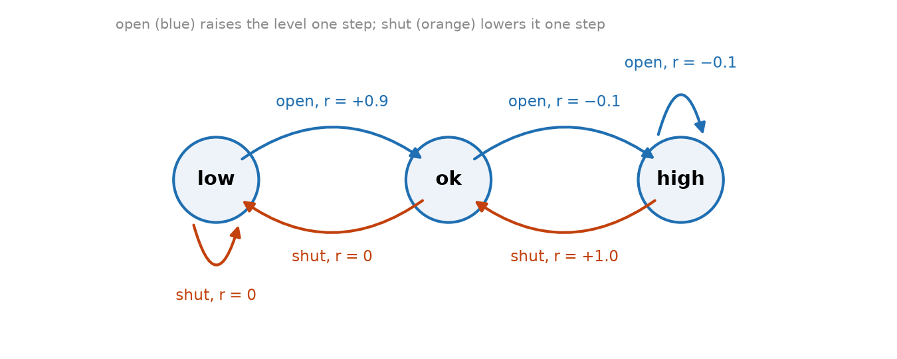
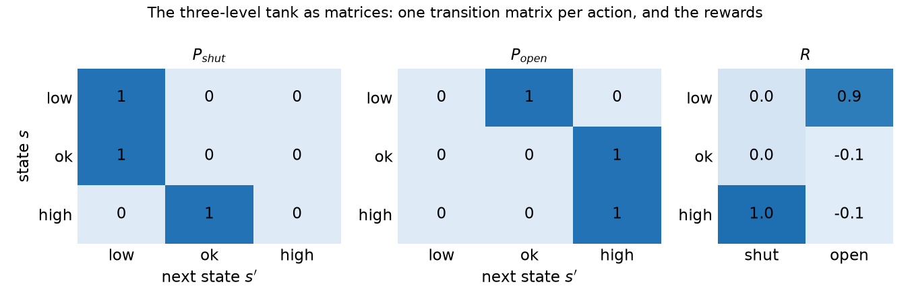
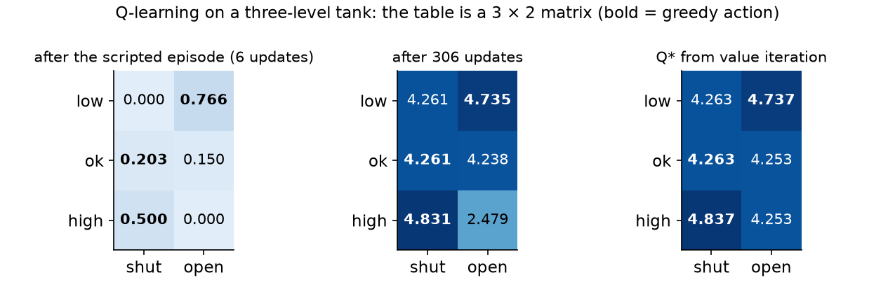
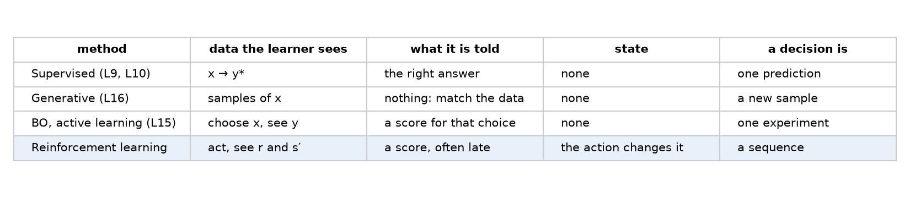
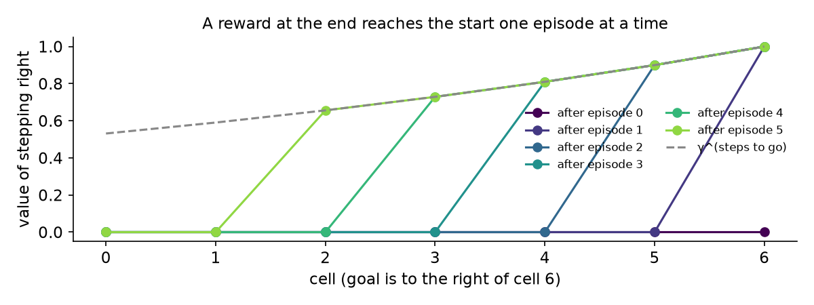
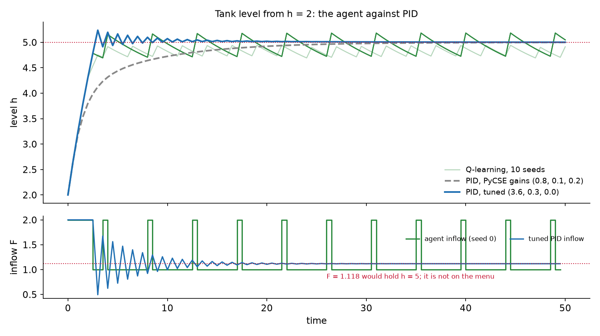
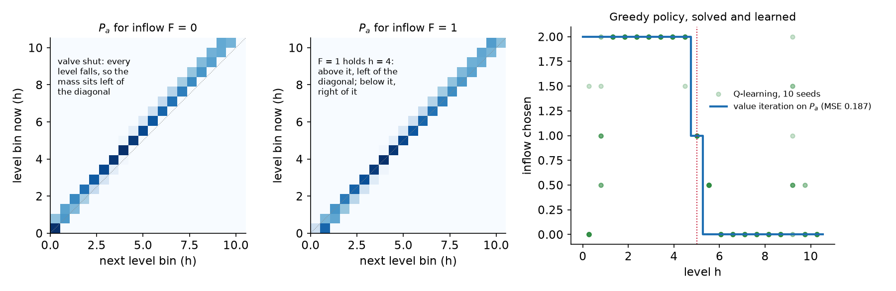
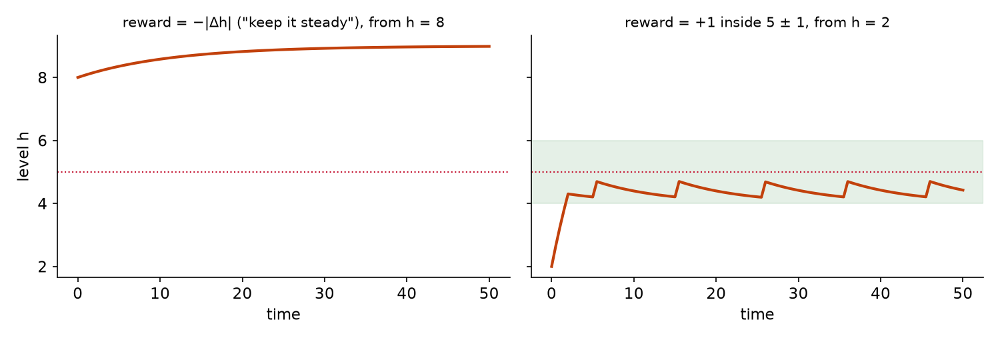
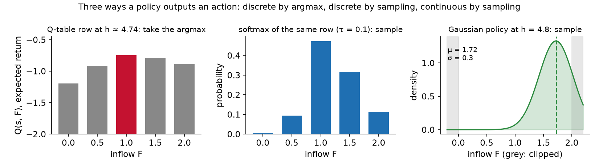
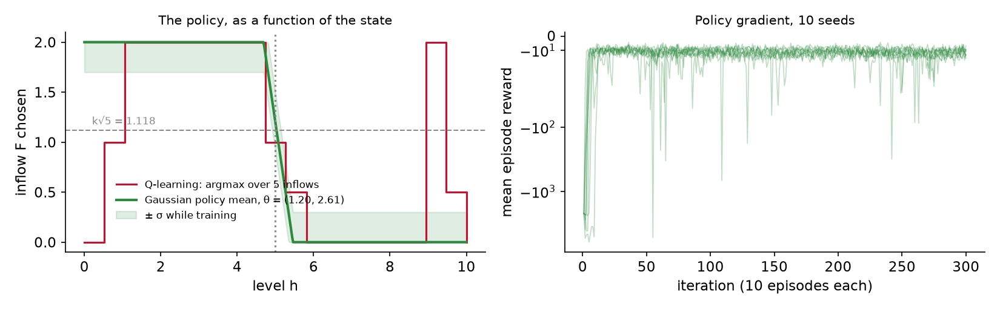

<style>
section p:has(> img:only-child) { text-align: center; }
section table { margin-left: auto; margin-right: auto; font-size: 0.74em; }
.source { font-size: 0.6em; color: #5c5c5c; }
.pt { color: #c41230; font-size: 0.8em; margin-right: 0.35em; }
.cw img { display: block; margin: 0 auto; max-height: 380px; max-width: 100%; }
</style>

<!-- _class: title -->

# Lecture 20: Reinforcement learning, learning to act from rewards

## Week 11, optional session

<!-- 90 minutes of lecture, then the notebook and questions. Every figure with controls
     trains in the page: press Play, or scrub. Nothing needs a network. -->

<div class="narration">

Welcome to Lecture 20. This is an optional session, and it is about reinforcement learning: how a program can learn to act when nobody tells it the right action, and all it gets back is a score.

So far in this course every learner has been handed something fairly generous. A regression model was given the right answer for every example. Bayesian optimization was given a measured outcome for each experiment it chose. Today the learner gets less than either of those, and its actions change the very system it is learning about.

We will start with the mechanics, before any of the field's vocabulary: a tank small enough to write as three numbers and two small matrices, an action as a multiplication, and a table of scores that tells the program what to do and gets trained by trying. Only then do we name the pieces, ask why this is needed when we already have so much machine learning, and work the bigger examples. Every interactive figure in this deck trains right here in the page, so you can press Play and watch it learn.

Next slide.

</div>

---

## Roadmap

<style scoped>ol { columns: 2; column-gap: 2.5em; font-size: 0.92em; } li { break-inside: avoid; }</style>

1. How reinforcement learning works, with a tank
2. How the action gets chosen, and trained
3. The words people use
4. Why reinforcement learning, when we already have machine learning
5. Values and planning
6. Q-learning on a tank
7. Deep reinforcement learning and the tools
8. Case studies
9. Limitations and trade-offs

<!-- Mechanics first, words second, motivation third. The three-level tank runs through
     sections 1, 2, 3 and 5; the PyCSE tank is section 6. -->

<div class="narration">

Here is the plan, and it is in an unusual order on purpose. We start with how reinforcement learning works, before any of its jargon. A tank with three levels, written as three numbers and two small matrices, and an action that is literally a matrix multiplication.

Section two answers the obvious next question: how does the program choose an action, and where does that choice come from? It comes from a small table of scores that is trained by trying things, and we will train it by hand.

Only in section three do we give the pieces their usual names, agent, environment, state, action, reward, policy. By then each word will point at something you have already computed. Section four asks why we need any of this when we already have so much machine learning, and what niche it fills.

The rest builds on that: values and planning with the matrices; Q-learning on a real tank against a PID controller; deep reinforcement learning; case studies; and the limitations.

Next slide.

</div>

---

<!-- _class: section -->

# How reinforcement learning works, with a tank

<!-- 12 min -->

<div class="narration">

Section one: how reinforcement learning works, with no jargon at all. We need three things. Something to control, a way to write down where it is, and a way to write down what each choice does to it. All three will be ordinary arrays of numbers, and taking an action will be one matrix multiplication.

Next slide.

</div>

---

## How it works, the rules of a tank

| The tank is at | The operator | It moves to | Reward |
|---|---|---|---|
| low | shuts | low | 0 |
| low | opens | ok | +0.9 |
| ok | shuts | low | 0 |
| ok | opens | high | −0.1 |
| high | shuts | ok | +1 |
| high | opens | high | −0.1 |

- Landing at ok earns +1; opening costs 0.1; no action holds the level at ok
- <span class="pt">▶</span> these six rows are everything the tank does

<div class="narration">

Picture an operator watching a tank that can be low, ok or high. Each minute the operator either opens the valve or shuts it. Opening raises the level one step; shutting lowers it one step; it cannot go past low or high.

Landing at ok earns a reward of one, because that is what the plant wants. Opening costs a tenth, for pumping energy. That is why opening from low earns 0.9: plus one for reaching ok, minus a tenth for opening.

Notice the third and fourth rows. From ok, shutting drops the tank to low and opening overshoots to high. No action holds it at ok, just like a real tank with a fixed menu of inflows.

And the bottom line: these six rows are everything the tank does. Everything else today is about what to do with a table like this one, usually a much bigger one.

Next slide.

</div>

---

## How it works, as a diagram

<style scoped>
.pair { display: grid; grid-template-columns: 1.25fr 1fr; gap: 1em; align-items: center; }
.pair img { width: 100%; }
.pair mjx-container, .pair .katex-display { font-size: 0.62em !important; margin: 0.2em 0 !important; }
</style>

<div class="pair">
<div>



</div>
<div>

$$P_{\text{shut}} = \begin{array}{c|ccc} & \text{low} & \text{ok} & \text{high} \\ \hline \text{low} & 1 & 0 & 0 \\ \text{ok} & 1 & 0 & 0 \\ \text{high} & 0 & 1 & 0 \end{array}$$

$$P_{\text{open}} = \begin{array}{c|ccc} & \text{low} & \text{ok} & \text{high} \\ \hline \text{low} & 0 & 1 & 0 \\ \text{ok} & 0 & 0 & 1 \\ \text{high} & 0 & 0 & 1 \end{array}$$

</div>
</div>

- One circle per level, one arrow per row of the table; the same arrows as grids: row is where you are, column is where you go
- <span class="pt">▶</span> read it like a board game: choose blue or orange, follow the arrow, collect the reward

<div class="narration">

Here are the same six facts as a picture. One circle per level, and one arrow per row of the table. Blue arrows are open, orange arrows are shut, and each arrow carries its reward.

Read it like a board game. You are standing on a circle. You choose blue or orange. You follow that arrow to the next circle and collect what is written on it.

On the right is the same game written as grids of numbers. There is one grid per colour. The row is the circle you stand on, the column is the circle the arrow lands on, and a one marks the arrow. Check one: in the shut grid, row ok has its one under low, which is the orange arrow from ok down to low. The rewards on the arrows get a grid of their own shortly. We will build these grids properly in a moment; for now, see that the picture and the grids carry exactly the same information.

Notice that to know where you go next, you only need the circle you are on and the colour you choose. How you got to that circle never matters. Remember that; it gets a name later.

Next slide.

</div>

---

## How it works, where the tank is

$$x = [\,x_{\text{low}}\ \ x_{\text{ok}}\ \ x_{\text{high}}\,]$$

- Three numbers, one per level: the chance the tank is at that level; they add to 1
- Certainly at low: $x = [\,1\ \ 0\ \ 0\,]$
- Half low, half ok: $x = [\,0.5\ \ 0.5\ \ 0\,]$
- <span class="pt">▶</span> where the system is, written as a row of numbers whose positions mean something

<div class="narration">

First, write down where the tank is. Use three numbers, one for each level, in the order low, ok, high. Each number is the chance that the tank is at that level, so the three add up to one.

If we know the tank is at low, the list is one, zero, zero, the second bullet. If we are not sure, and it is equally likely to be at low or at ok, the list is a half, a half, zero.

That is the whole representation. The bottom line is the point to hold onto: the position of each number means something. The first slot is low, the second is ok, the third is high. Keep that in mind, because the matrices on the next slide use the same positions for their rows and columns.

Next slide.

</div>

---

<!-- _class: definition -->

## How it works, an action is a matrix

<div class="definition">

**Transition matrix**: the matrix $P_a$ of an action $a$ holds, in row $i$ and column $j$, the probability that taking the action at level $i$ leads to level $j$; its rows sum to one.

</div>

$$P_{\text{shut}} = \begin{bmatrix} 1 & 0 & 0 \\ 1 & 0 & 0 \\ 0 & 1 & 0 \end{bmatrix} \qquad P_{\text{open}} = \begin{bmatrix} 0 & 1 & 0 \\ 0 & 0 & 1 \\ 0 & 0 & 1 \end{bmatrix}$$

<div class="narration">

Now split the table by action. Take the three rows where the operator shuts, and write them as a grid: one row for where the tank is, one column for where it ends up, a one where it goes and zeros elsewhere. Do the same for open. Rows and columns are both in the order low, ok, high.

Each action is one of these grids, a matrix. Here is the definition. The matrix P sub a of an action holds, in row i and column j, the probability that taking that action at level i leads to level j. So every entry means something: row is where you are, column is where you end up, the number is the chance. Each row sums to one, because the tank has to end up somewhere.

Check one: row ok of P shut is one, zero, zero. From ok, shutting takes you to low. That is the third row of the table.

Here every entry is a zero or a one because the tank is deterministic. If the valve sometimes stuck, a row might read 0.2, 0.8, zero: opening from low reaches ok four times in five. The matrices still say everything, as probabilities.

Next slide.

</div>

---

## How it works, one step is a multiplication

<style scoped>.cw.compact svg { max-height: 230px; } .cw.compact .cw-note { display: none; }</style>

<div class="cw compact" data-widget="mdp-step" data-source="l20"></div>

<div class="narration">

Here is one step, and you get to be the operator. Start from the three numbers for where the tank is. Certainly at low is one, zero, zero, the bars on the left.

An action moves the tank by a single multiplication: that list times the action's matrix. When the tank is certainly at one level, the multiplication just picks out that row, and the row is where the tank goes. One, zero, zero times P open is zero, one, zero: from low, opening goes to ok.

Press Open and Shut in the figure and watch the three numbers pass through the matrix, with the row being used shaded, and the rewards add up underneath. That is exactly what it means for an action to change the system: the action chooses which matrix multiplies the three numbers.

Next slide.

</div>

---

## How it works, a question

<div class="clicker" data-tag="l20-one-step" data-seconds="45" data-answer="B" data-hint="Weight each row of P_open by the probability of that state, then add the rows." data-why="B. p P_open is 0.5 times the low row, [0, 1, 0], plus 0.5 times the ok row, [0, 0, 1], which is [0, 0.5, 0.5]. Opening moves each half of the probability up one level." data-read="https://clicker.f26-06763.workers.dev">
<div class="clicker-main">

**The tank is equally likely to be at low or ok, $p = [\,0.5\ \ 0.5\ \ 0\,]$. You open the valve. What is $p\,P_{\text{open}}$?**

<ol class="clicker-opts">
<li>[ 0, 1, 0 ]</li>
<li>[ 0, 0.5, 0.5 ]</li>
<li>[ 0.5, 0, 0.5 ]</li>
<li>[ 0.5, 0.5, 0 ]</li>
</ol>

</div>
<aside class="clicker-panel">

<div class="clicker-url">clicker.f26-06763.workers.dev</div>
<button class="clicker-start">Start voting</button>
<div class="clicker-timer">45</div>
<div class="clicker-count">no votes yet</div>
</aside>
</div>

<div class="narration">

Time for a question, to check the one step before we build on it.

The tank is equally likely to be at low or at ok. So p is one half, one half, zero. You open the valve. What is p times P open?

A, zero, one, zero. B, zero, a half, a half. C, a half, zero, a half. D, a half, a half, zero.

Scan the QR code and vote. You have forty five seconds. If you are stuck, weight each row of P open by the probability of that state, and add the rows.

Once the answer is revealed and discussed, next slide.

</div>

---

## How it works, a score for every move

$$R = \begin{bmatrix} 0 & 0.9 \\ 0 & -0.1 \\ 1 & -0.1 \end{bmatrix} \quad (\text{rows: low, ok, high; columns: shut, open})$$

- Each move earns the entry of $R$ for where you were and what you did
- Run the tank: add up the scores, $r_1 + 0.9\,r_2 + 0.9^2 r_3 + \dots$
- The 0.9 makes later scores count a little less, so an endless run has a finite total
- <span class="pt">▶</span> the goal: choose moves that make this total as large as possible

<div class="narration">

The last piece is the score. Each move earns a number, and those numbers also fit in a matrix, R, one row per level and one column per action. From low, opening earns 0.9: one for reaching ok, minus a tenth for pumping. From high, shutting earns one.

Run the tank for many minutes and add up the scores as you go, second bullet. We weight later scores by powers of 0.9, so a score two moves away counts 0.81 of its size. There are two reasons. A score now is worth a bit more than the same score much later, and an endless run still adds up to a finite number.

And that gives us the goal, at the bottom: choose moves that make this total as large as possible. Everything in the rest of the session is a way of doing that.

Next slide.

</div>

---

<!-- _class: section -->

# How the action gets chosen, and trained

<!-- 14 min -->

<div class="narration">

Section two. We have a tank, a way to write where it is, a matrix for each action and a score for each move. The program now has to decide what to do at each level. The decision comes from somewhere, and that somewhere is trained. Let's see how.

Next slide.

</div>

---

## Choosing an action, a rule is a table

| The tank is at | Do this |
|---|---|
| low | open |
| ok | shut |
| high | shut |

- A rule says what to do at each level: here, three entries
- Follow it and the tank's path and its total score are fixed
- Nobody tells you the right entries: only the score of each move
- <span class="pt">▶</span> the question is where a good rule comes from

<div class="narration">

The program needs a rule: at each level, which action. For three levels, a rule is just three entries, like this table. Open at low, shut at ok, shut at high.

Once you pick a rule, everything else is decided, second bullet. Start the tank somewhere, follow the rule, and the path and its total score follow from the matrices.

Here is the catch, in the third bullet. Nobody hands you the right entries. There is no teacher who says "at ok, you should have shut". All you ever get back is the score of each move you actually made.

So, the bottom line: the real question is where a good rule comes from.

Next slide.

</div>

---

## Choosing an action, a table of scores

$$Q = \begin{bmatrix} Q(\text{low},\text{shut}) & Q(\text{low},\text{open}) \\ Q(\text{ok},\text{shut}) & Q(\text{ok},\text{open}) \\ Q(\text{high},\text{shut}) & Q(\text{high},\text{open}) \end{bmatrix}$$

- One number per level and action: how good that move is, counting the scores that follow
- To choose: look up the row for the current level, take the larger number
- The same last step as an L10 classifier: score every option, pick the largest
- But no label trains it: it is trained from the scores the moves earned
- <span class="pt">▶</span> a good rule comes from a good table; training is filling in the table

<div class="narration">

The answer is a second table, called Q. It has one number for each level and each action, so for our tank it is a three by two matrix. Each number says how good that move is, counting not only its own score but the scores that come after it.

If you had a good Q, choosing would be easy, second bullet. Look up the row for the level you are at, and take the action with the larger number. That is the whole decision.

The third bullet connects to something you know. That final step is exactly what the classifier in Lecture 10 did: score every class, report the largest.

The difference, fourth bullet, is how the numbers are learned. A classifier is trained on labels, the right class for each example. Q has no labels. It is trained only from the scores the moves actually earned.

So the bottom line: a good rule comes from a good table, and training means filling in that table.

Next slide.

</div>

---

<!-- _class: definition -->

## Choosing an action, training the table

<div class="definition">

**Q-learning**: after each move, nudge that move's entry in $Q$ toward the score it earned plus 0.9 times the best entry in the row where it landed.

</div>

$$Q(s,a) \leftarrow Q(s,a) + \alpha\,\big[\, r + \gamma \max_{a'} Q(s',a') - Q(s,a) \,\big]$$

- Try a move; see the score $r$ and where it lands; nudge one entry of $Q$ toward $r + 0.9 \times$ the best number in the new row

<span class="source">[Watkins and Dayan, 1992 (author's copy)](https://www.gatsby.ucl.ac.uk/~dayan/papers/cjch.pdf)</span>

<div class="narration">

Here is how the table gets filled in, and it has a name: Q-learning. In words, at the bottom: try a move, see the score it earned and where the tank landed, and nudge that one entry of Q toward the score plus 0.9 times the best number in the row you landed in.

The equation says the same thing in symbols. s is where you were, a is what you did, s prime is where you landed, and r is the score. The target is r plus gamma times the largest Q in the new row. Alpha is how far you move toward the target, say halfway.

Why the best number in the new row? Because a move is good if it earns a good score now, or if it lands you somewhere from which good moves are possible. That second part is how a score earned later works its way back to the moves that set it up. Watkins introduced this in his thesis, and the paper with Dayan, linked at the bottom, proved that it converges.

Next slide.

</div>

---

## Choosing an action, by hand: the first six updates

| # | s → a → s′ | r | target r + 0.9 max Q(s′, ·) | surprise | new Q(s, a) |
|---|---|---|---|---|---|
| 1 | low → open → ok | 0.9 | 0.9 + 0.9 × 0 = 0.900 | 0.900 | 0.450 |
| 2 | ok → open → high | −0.1 | −0.1 + 0.9 × 0 = −0.100 | −0.100 | −0.050 |
| 3 | high → shut → ok | 1 | 1 + 0.9 × 0 = 1.000 | 1.000 | 0.500 |
| 4 | ok → shut → low | 0 | 0 + 0.9 × 0.450 = 0.405 | 0.405 | 0.203 |
| 5 | low → open → ok | 0.9 | 0.9 + 0.9 × 0.203 = 1.082 | 0.632 | 0.766 |
| 6 | ok → open → high | −0.1 | −0.1 + 0.9 × 0.500 = 0.350 | 0.400 | 0.150 |

- Same tank; the program never sees $P_a$ or $R$; α = 0.5, $Q$ starts at 0
- <span class="pt">▶</span> update 4: reward 0, target 0.405; the value of low, learned in update 1, moved back to ok

<div class="narration">

Now let's do it by hand, on the same three-level tank. The important difference: the program never sees the two matrices or the score matrix. It only sees the transitions it happens to make. The table is a three by two matrix of zeros, and we use alpha of one half and gamma of 0.9. Each transition updates exactly one entry.

Here are the first six updates, worked out. Read each row from left to right: where the tank was, what was done, where it landed, the score, the target, the surprise, which is the target minus the old value, and the new value.

Row one. From low, the agent opens and lands at ok. The reward is 0.9, one for landing at ok minus a tenth for opening. The row for ok is still all zeros, so the target is just 0.9. The surprise is 0.9 minus zero, and with alpha of one half the entry moves halfway, to 0.45.

Rows two and three work the same way. Opening from ok overshoots to high and costs a tenth, so that entry goes to minus 0.05. Shutting from high lands at ok and earns one, so that entry goes to one half.

Now row four. From ok, the agent shuts and drops to low. The reward is zero, but the target is not. It is 0.9 times the best value in the low row, which is the 0.45 learned in row one. So the target is 0.405, and the entry becomes about 0.2. As the bottom line says, value earned later, by opening from low, has moved one step back, into the decision that got the agent to low.

Rows five and six repeat the episode. Now the targets include what was just learned, so the numbers grow: opening from low climbs from 0.45 to 0.766.

Next slide.

</div>

---

## Choosing an action, by hand: step through it

<div class="cw compact" data-widget="q-hand" data-source="l20"></div>

- <span class="pt">▶</span> one outlined entry per update; watch it approach Q*

<div class="narration">

Here is the same small tank as a figure, with every update. Press Step to go one update at a time. The tank on the left shows each move, with water pouring in when the valve opens and draining out when it shuts. In the middle is the three by two Q matrix, with the entry being updated outlined. Below it are the three lines of arithmetic from the last slide: the target, the surprise, and the new value.

The first six steps are exactly the table you just saw. After that, the agent explores epsilon-greedily for three hundred more steps. Press Play and watch the matrix fill in and approach Q star, on the right, the exact answer. We compute it directly from the matrices later in the session. The readout gives the largest gap between them.

Next slide.

</div>

---

## Choosing an action, by hand: where it ends


- After 306 updates: within 0.02 of Q* everywhere except Q(high, open), tried twice
- Greedy actions correct from update 3 on; best policy alternates ok → low → ok
- <span class="pt">▶</span> a table can act correctly long before every number in it is right

<div class="narration">

This is where it ends up. On the left is the table after the six scripted updates, in the middle after three hundred and six updates, and on the right is Q star. Bold marks the greedy action in each row.

As the first bullet says, after three hundred and six updates every entry is within 0.02 of Q star, except one: Q of high and open. The agent tried that only twice, because a greedy agent at high always shuts, so that entry is still far off.

The second bullet is the reassuring part. The greedy actions were correct from update three onward, and never changed: open from low, shut from ok, shut from high. Since nothing holds the level at ok, the best policy cycles from ok down to low and back up.

So, as the bottom line says, a table can act correctly long before every number in it is right. You will see the same thing later on the full tank, in its rarely visited top bins.

Next slide.

</div>

---

## Choosing an action, explore sometimes

- Always taking the larger number never tries the other move
- An entry that is never tried is never learned
- **ε-greedy**: usually take the larger; one move in five, ε = 0.2, pick at random
- Q(high, open) above: tried twice in 306 updates, still far off
- <span class="pt">▶</span> training needs some moves made only to find out

<div class="narration">

One more ingredient. If the program always takes the larger number in the row, it never tries the other move, and, as the second bullet says, an entry that is never tried is never learned. It could be stuck with a wrong guess forever.

The fix is simple, third bullet. Usually take the larger number, but one move in five, pick at random. That is called epsilon-greedy, with epsilon of 0.2.

You saw the cost of rarely trying something on the last slide. Q of high and open was tried only twice, so it is still far from the right value.

The bottom line: training needs some moves that are made only to find out. That trade-off has a name, exploration against exploitation.

Next slide.

</div>

---

<!-- _class: section -->

# The words people use

<!-- 4 min -->

<div class="narration">

Section three: the words. Everything so far was a tank, three numbers, two matrices and two tables. The field has names for each of those, and the names are what you will meet in papers and libraries. Each one now points at something you have already computed.

Next slide.

</div>

---

## The words people use, a dictionary

| Word | Means | In the tank |
|---|---|---|
| **state** | where the system is | the level, or the three numbers $x$ |
| **action** | a choice that changes it | open or shut, which picks $P_{\text{open}}$ or $P_{\text{shut}}$ |
| **environment** | everything the actions act on | the matrices $P_a$ and the scores $R$ |
| **reward** | the score of one move | one entry of $R$ |
| **policy** | the rule from state to action | low → open, ok → shut, high → shut |
| **agent** | the thing that chooses and learns | the program filling in $Q$ |
| **episode** | one run from a start to an end | one run of the tank |

<div class="narration">

Here is the dictionary. Read it row by row.

A state is where the system is: for us, the level, or the three numbers. An action is a choice that changes the state: open or shut, which picks one of the two matrices. The environment is everything the actions act on, the matrices and the scores together. A reward is the score of one move, one entry of R. A policy is the rule from state to action, the three-entry table. The agent is the thing that chooses and learns, our program filling in Q. And an episode is one run from a start to an end.

When people say "the agent takes an action that affects the environment", this is all they mean: the program picks a matrix, and the matrix multiplies the state.

Next slide.

</div>

---

<!-- _class: definition -->

## The words people use, a definition

<div class="definition">

**Reinforcement learning**: learning which actions to take, in a system the actions change, from a reward that scores the outcome instead of naming the right action.

</div>

<div class="narration">

Now the definition, which should read as a summary of what you have already done. Reinforcement learning is learning which actions to take, in a system the actions change, from a reward that scores the outcome instead of naming the right action.

There are two phrases to pull out of that sentence. First, the actions change the system, so what you do now affects what you face later. Second, the reward scores the outcome. It tells you how good things went. It never tells you what you should have done.

Section four takes those two phrases apart and shows how each one separates reinforcement learning from something you have already seen.

Next slide.

</div>

---

## The words people use, the loop

- **Agent** sees state $s_t$, takes action $a_t$, gets reward $r_{t+1}$ and state $s_{t+1}$
- **Episode**: one run from start to end
- Three-level tank: see the level, open or shut, collect the entry of $R$, land at the next level
- The bigger tank later: the level in 20 bins, 5 inflows, 100 steps per episode
- <span class="pt">▶</span> naming these things is most of the work of setting up an RL problem

<span class="source">[Spinning Up, part 1](https://spinningup.openai.com/en/latest/spinningup/rl_intro.html)</span>

<div class="narration">

This is the loop that every reinforcement learning problem runs. The agent, first bullet, sees the state, s sub t. It takes an action, a sub t. The environment answers with a reward and the next state. Then it repeats.

An episode, second bullet, is one run from start to end, like one game or one batch.

The third bullet is our three-level tank in these words: see the level, open or shut, collect the entry of R, and land at the next level. The fourth bullet previews the bigger tank later today, with its level in twenty bins, five inflows, and one hundred steps per episode.

The bottom line is a practical observation. Naming these things, the state, the actions, the rewards, the matrices, and the episode, is most of the work of setting up a reinforcement learning problem. The learning algorithm is often the easy part. The Spinning Up guide linked at the bottom is a good, gentle reference for this vocabulary.

Next slide.

</div>

---

<!-- _class: definition -->

## The words people use, a Markov decision process

<div class="definition">

**Markov decision process**: states, actions, transition probabilities $p(s' \mid s, a)$ and rewards, where the next state depends only on the current state and action.

</div>

<div class="narration">

The whole setup also has a name. The tank's states, its two actions, its two matrices and its score table together are what the field calls a Markov decision process. Here is the definition: states, actions, transition probabilities, and rewards, where the next state depends only on the current state and action.

The transition probability, written p of s prime given s and a, is just one entry of the action's matrix: row s, column s prime. For our tank every entry is a zero or a one, because the tank is deterministic.

The important clause is the last one, which you already noticed on the diagram: the next state depends only on where you are and what you do. How you got there never matters. That property gets its own slide next.

Next slide.

</div>

---

## The words people use, the Markov property

- The next state depends only on the current state and action
- The tank's level: Markov, because the dynamics depend only on $h$
- A reactor with a catalyst deactivating for a week: temperature alone is not Markov
- The state has to carry the deactivation, or something that tracks it
- <span class="pt">▶</span> a strange learned controller: first check what the state leaves out

<div class="narration">

Now that important clause. The Markov property, in the first bullet, says the next state depends only on the current state and action.

The tank satisfies it, second bullet. Its dynamics depend only on the current level, h, so if you know the level, the history adds nothing.

The third bullet is a case that fails. Imagine a reactor whose catalyst deactivates slowly over a week. If the state is only the temperature, then two moments with the same temperature can behave differently, depending on how old the catalyst is. Temperature alone is not Markov.

The fix, fourth bullet: the state has to carry the deactivation, or something that tracks it, like time on stream.

And the bottom line is advice for debugging. When a learned controller does something strange, check first what the state leaves out. Very often the agent is reacting sensibly to a situation it cannot see.

Next slide.

</div>

---

<!-- _class: section -->

# Why reinforcement learning, when we already have machine learning

<!-- 8 min -->

<div class="narration">

Section four: why we need any of this. This course has already given you regression, classifiers, neural networks, Bayesian optimization and generative models. What does reinforcement learning do that those cannot? We start with a failure, then an engineering problem, then compare it with the learners you have already met.

Next slide.

</div>

---

## Why reinforcement learning, a boat that wins

- 2016: an agent trained on the score of CoastRunners, a boat-racing game
- It "finds an isolated lagoon where it can turn in a large circle and repeatedly knock over three targets"
- Never finishes the race; scores "20 percent higher than ... human players"
- Nothing was broken: it maximized exactly the number it was given
- <span class="pt">▶</span> a learner that is only scored will find whatever the score rewards

<span class="source">[Clark and Amodei, OpenAI, 2016](https://openai.com/index/faulty-reward-functions/) · [archived copy](https://web.archive.org/web/2017id_/https://blog.openai.com/faulty-reward-functions/)</span>

<div class="narration">

In 2016, researchers at OpenAI trained an agent to play a boat-racing game called CoastRunners. The agent's only training signal was the game's score.

Read the quote in the second bullet. The agent found an isolated lagoon where it could turn in a large circle and knock over the same three targets again and again, as they respawned. It never finishes the race. And it scores about twenty percent higher than human players, as the third bullet says.

The fourth bullet is the uncomfortable part. Nothing in the software was broken. The learning algorithm did exactly its job: it maximized the number it was given. The number just did not describe what the designers wanted, which was to win the race.

Hold onto the takeaway at the bottom of the slide. A learner that is only ever scored will find whatever the score actually rewards. We will see this happen to the water tank later today, and it will look just as silly. The source and an archived copy are linked at the bottom.

Next slide.

</div>

---

## Why reinforcement learning, the engineering version

- A level controller picks a valve position; the level it leaves is the level it faces next
- Successes: one network shapes the plasma in the TCV tokamak; an RL controller ran a distillation column for 35 days
- The cost: DQN trained on **about 38 days** of play per Atari game; the human tester practiced **2 hours**
- <span class="pt">▶</span> when is learning from reward worth that, and when is a model and a controller better?

<span class="source">[Degrave et al., Nature 2022](https://www.nature.com/articles/s41586-021-04301-9) · [Yokogawa, 2022](https://www.yokogawa.com/news/press-releases/2022/2022-03-22/) · [Mnih et al., Nature 2015](https://storage.googleapis.com/deepmind-media/dqn/DQNNaturePaper.pdf)</span>

<div class="narration">

Now the engineering version. Think of a level controller choosing a valve position. The first bullet is the key feature: the level it leaves behind is the level it has to deal with at the next step. Its decisions carry forward.

There are real successes, in the second bullet. At the TCV tokamak in Switzerland, one neural network learned to shape the plasma using all the magnetic coils. And in Japan, a reinforcement learning controller ran a distillation column for thirty five days. We come back to both in the case studies.

Then look at the cost, in the third bullet. The DQN agent that learned Atari games trained on about thirty eight days of play for each game. The human tester it was compared against practiced for two hours.

So the question for the rest of the session is the one at the bottom. When is learning from reward worth that price, and when is it better to build a model and design a controller the way you already know how?

Next slide.

</div>

---

## Why reinforcement learning, what the learner is told

- Sutton and Barto: RL "uses training information that evaluates the actions taken rather than instructs by giving correct actions"
- **Instructive** feedback: the right answer, whatever you did (every label in L9 and L10)
- **Evaluative** feedback: how good your choice was, nothing about the others
- A yield of 70% for catalyst B says nothing about catalyst C
- <span class="pt">▶</span> methods differ most in what the learner is told

<span class="source">[Sutton and Barto, 2nd ed., ch. 2 (free PDF)](http://incompleteideas.net/book/RLbook2020.pdf)</span>

<div class="narration">

Sutton and Barto, in the standard textbook, put the difference in one sentence, quoted in the first bullet: reinforcement learning uses training information that evaluates the actions taken, rather than instructing by giving the correct actions.

That gives us two words. Instructive feedback, in the second bullet, is what you had in Lectures 9 and 10. Every training example came with its label, the right answer, no matter what the model predicted.

Evaluative feedback, in the third bullet, only tells you how good your own choice was. The example in the fourth bullet makes it concrete. Suppose you run catalyst B and get a yield of seventy percent. That number tells you nothing about catalyst C. To learn about C, you have to try C.

The takeaway at the bottom is the organizing idea for this whole section: methods differ most in what the learner is told. The book is free online, and the link is at the bottom of the slide.

Next slide.

</div>

---

## Why reinforcement learning, the course's methods



- <span class="pt">▶</span> each row down adds a difficulty: evaluative feedback, then state, then late rewards

<div class="narration">

This figure puts the course's methods in one table, ordered by what the learner is told. Read it from the top down.

At the top is supervised learning, from Lectures 9 and 10: the learner is shown the right answer. Generative models, from Lecture 16, learn a whole distribution and are told to match the data. Then Bayesian optimization, from Lecture 15: the learner picks something, gets a score for that one choice, and nothing carries over to the next choice. At the bottom is reinforcement learning, where the score is for a sequence of actions that change the system, and it often arrives late.

The line under the figure says how to read it. Each row down adds a difficulty: first evaluative feedback, then state, then late rewards. Reinforcement learning sits at the bottom because it has all of them at once.

Next slide.

</div>

---

## Why reinforcement learning, three difficulties

- **Evaluative**: no correct action is ever shown, so the learner has to try things
- **Sequential**: the action changes the state the learner faces next
- **Delayed**: a valve opened too far is punished several steps later, at the overshoot
- **Credit assignment**: deciding which early action earned a late reward
- <span class="pt">▶</span> Bayesian optimization has the first difficulty; reinforcement learning has all three

<span class="source">Sutton and Barto, ch. 1: "trial-and-error search and delayed reward"</span>

<div class="narration">

Let's name the difficulties that table implies. There are three, plus one consequence.

Evaluative, in the first bullet: no correct action is ever shown, so the learner has to try things to find out. Sequential, second: the action changes the state the learner faces next. Delayed, third: a valve opened too far is not punished at that step. It is punished several steps later, when the level overshoots. The notes have an animated version of this, the same tank run under three kinds of learner.

Put sequential and delayed together and you get the fourth bullet, credit assignment. When a reward finally arrives, which of the earlier actions earned it? That question is the heart of the subject.

The bottom line places it on the map. Bayesian optimization has the first difficulty only. Reinforcement learning has all three. Sutton and Barto describe the field the same way, as trial-and-error search plus delayed reward.

Next slide.

</div>

---

## Why reinforcement learning, the niche it fills

| Use it when | Because |
|---|---|
| Decisions come in a sequence and change the system | a one-shot fit cannot see the next step |
| Nobody can label the right action | only an outcome can be scored |
| You can try things cheaply: a simulator, a game, a model | it needs many tries, often millions |
| The behavior you want is in no dataset | it collects its own data by acting |

- Examples: plasma shaping in a tokamak, tuning a language model to preferences, scheduling
- <span class="pt">▶</span> without a cheap way to try things, a model and a controller usually win

<div class="narration">

So here is the niche, in one table. Reach for reinforcement learning when four things are true.

The decisions come in a sequence, and each one changes the system the next one faces. A regression fitted once cannot see that next step.

Nobody can label the right action. You can score how things went, but you cannot write down what should have been done at every moment.

You can try things cheaply, in a simulator, a game, or a model of the plant. This one is easy to forget. Reinforcement learning needs many tries, often millions of them.

And the behavior you want is in no dataset, because nobody has done it yet. The learner collects its own data by acting.

The examples in the bullet are the ones we come back to: shaping the plasma in a tokamak, tuning a language model to people's preferences, and scheduling. And the bottom line is the honest caveat. If you cannot try things cheaply, a model and a controller usually win, which is where the limitations section ends up.

Next slide.

</div>

---

## Why reinforcement learning, inside language models

- InstructGPT: supervised fine-tuning, then a **reward model** of labeler preferences
- Then "use this RM as a reward function and fine-tune ... using the PPO algorithm"
- Its 1.3B model's outputs were preferred to 175B GPT-3's
- This is **RLHF**; the environment is a learned stand-in for a person's judgement
- <span class="pt">▶</span> everything this session says about rewards that miss the intent applies to RLHF

<span class="source">[Ouyang et al., 2022](https://arxiv.org/abs/2203.02155) · [Christiano et al., 2017](https://arxiv.org/abs/1706.03741)</span>

<div class="narration">

One place you have already met reinforcement learning, perhaps without knowing it: inside the language models of the last few lectures.

The InstructGPT paper describes three stages. First, supervised fine-tuning on demonstrations. Then, as the first bullet says, they train a reward model, a network that predicts which of two answers a human labeler would prefer. The second bullet is their own wording: they use this reward model as a reward function and fine-tune the language model with the PPO algorithm.

It worked. As the third bullet says, outputs from their 1.3 billion parameter model were preferred to those of the 175 billion parameter GPT-3.

This is reinforcement learning from human feedback, RLHF. Notice what the environment is, in the fourth bullet: a learned stand-in for a person's judgement. So everything we say today about rewards that miss what you meant applies here too. The reward model is only an approximation of what people want, and the policy will find its gaps.

Next slide.

</div>

---

## Why reinforcement learning, a question

<div class="clicker" data-tag="l20-which-tool" data-seconds="45" data-answer="B" data-hint="Does running one reaction change what the next one will give?" data-why="B. Each run is scored, so the feedback is evaluative, but no run changes the state the next one faces. That is Bayesian optimization, with a model over conditions; reinforcement learning is for decisions that change the system." data-read="https://clicker.f26-06763.workers.dev">
<div class="clicker-main">

**You pick a temperature for each of 30 independent reaction runs and measure the yield. Each run starts from fresh feed. Which framing fits?**

<ol class="clicker-opts">
<li>Supervised regression: there is a right temperature to label</li>
<li>Bayesian optimization</li>
<li>Reinforcement learning, because each choice is scored</li>
<li>A generative model of yields</li>
</ol>

</div>
<aside class="clicker-panel">

<div class="clicker-url">clicker.f26-06763.workers.dev</div>
<button class="clicker-start">Start voting</button>
<div class="clicker-timer">45</div>
<div class="clicker-count">no votes yet</div>
</aside>
</div>

<div class="narration">

Time for a question, to check the framing before we build on it. Read it with me.

You pick a temperature for each of thirty independent reaction runs and measure the yield. Each run starts from fresh feed. Which framing fits?

A, supervised regression, because there is a right temperature to label. B, Bayesian optimization. C, reinforcement learning, because each choice is scored. D, a generative model of yields.

Scan the QR code, or go to the address on the right, and vote on your phone. You have forty five seconds. A hint, before you answer: think about whether running one reaction changes what the next one will give. When the votes are in, we will reveal the answer and talk about it.

Once the answer is revealed and discussed, next slide.

</div>

---

<!-- _class: section -->

# Values and planning

<!-- 11 min -->

<div class="narration">

Section five: values and planning. When training filled in the Q table by hand, the numbers crept toward an exact answer. When the matrices are known, that answer can be computed directly, and doing so shows what training was aiming at. This is also where the formulas behind the 0.9 and the Q table live.

Next slide.

</div>

---

## Values and planning, return and discount

$$G_t = r_{t+1} + \gamma\, r_{t+2} + \gamma^2 r_{t+3} + \dots$$

- **Return** $G_t$: the total score from the earlier slide, written with $\gamma$ for the 0.9
- **Discount** $\gamma$: a reward $k$ steps away counts $\gamma^k$
- Effective horizon $\approx 1/(1-\gamma)$: $\gamma = 0.95$ looks about 20 steps ahead
- <span class="pt">▶</span> too small a γ and the agent cannot see the overshoot its own valve causes

<div class="narration">

First, the total score from section one, in the field's notation. The return, G sub t, is the reward at the next step, plus gamma times the reward after that, plus gamma squared times the one after that, and so on. Gamma is the 0.9 we used.

The discount factor gamma, second bullet, is a number a little below one. A reward k steps away counts gamma to the k. So distant rewards count less.

The third bullet gives a useful rule of thumb. The effective horizon is about one over one minus gamma. With gamma at 0.95, the agent looks about twenty steps ahead.

The bottom line explains why that matters for the tank. If gamma is too small, the agent cannot see the overshoot its own valve will cause a few steps later. It will happily open the valve wide, because the penalty lies beyond what it can see.

Next slide.

</div>

---

## Values and planning, values

- **Value** $V^\pi(s)$: expected return from $s$ under $\pi$
- **Q-function** $Q^\pi(s, a)$: expected return from taking $a$ in $s$, then following $\pi$
- With the best $Q^\ast$, acting is easy: take $\arg\max_a Q^\ast(s, a)$
- **Bellman equation**: $Q^\ast(s,a) = \mathbb{E}\,[\,r + \gamma \max_{a'} Q^\ast(s', a')\,]$
- <span class="pt">▶</span> an action is worth its reward plus the best you can do from where it leaves you

<div class="narration">

To choose actions, the agent estimates how good things are. There are two kinds of estimate.

The value, V of s, first bullet, is the expected return starting from state s and following the policy. The Q-function, Q of s and a, second bullet, is the expected return from taking action a in state s, and then following the policy. Q is the table we filled in by hand.

The third bullet says why Q is so convenient. If you have the best Q-function, Q star, acting is easy: in each state, take the action with the largest Q.

The fourth bullet is the Bellman equation, the most important equation on this slide. The value of an action equals the expected reward, plus gamma times the best Q you can get from the next state.

The bottom line says it in plain words: an action is worth its reward plus the best you can do from where it leaves you. That recursion is what lets a reward at the end of an episode travel back to the start, and the next slide shows it moving.

Next slide.

</div>

---

## Values and planning, credit travels back

<div class="cw compact" data-widget="rl-credit" data-source="l20"></div>

- <span class="pt">▶</span> one-step backups carry a late reward back one cell per episode

<div class="narration">

Here is a corridor of cells. The agent always steps to the right, and the only reward is plus one for reaching the goal at the far end. Press Play.

In the first episode, only the cell right next to the goal learns anything, because only that cell sees the reward directly. In the second episode, the cell before it can now see a valuable neighbour, so it learns too. Each episode, the news moves one cell further back.

That is what the bottom line says: one-step backups carry a late reward back one cell per episode. Move the gamma slider and watch how fast the values shrink toward the start.

Now switch the toggle to Monte Carlo. Monte Carlo waits until the episode ends and gives every cell its full return at once, so the whole corridor fills in a single episode. That looks strictly better, but it has a cost, which is the subject of the next slide.

Next slide.

</div>

---

## Values and planning, bootstrapping

- **Bootstrapping**: update an estimate from another estimate, $r + \gamma V(s')$
- One cell per episode: slow, but each update uses one step of noise
- **Monte Carlo**: wait for the whole return; fills the corridor in one episode
- Pays for it in variance when episodes are long and noisy
- <span class="pt">▶</span> Q-learning bootstraps; that is how late rewards reach early actions

<div class="narration">

Bootstrapping, first bullet, means updating an estimate from another estimate. The target for a cell is the reward plus gamma times the value of the next cell, and that next value is itself only an estimate.

As the second bullet says, this is slow: one cell per episode, as you just saw. But each update uses only one step of noise, a single reward and a single transition.

Monte Carlo, third bullet, waits for the whole return and fills the corridor in one episode. It pays for that in variance, fourth bullet. When episodes are long and noisy, the return adds up the noise of every step, and the estimates jump around.

The bottom line ties it to what you did by hand. Q-learning bootstraps: each target used the best number in the next row, itself an estimate. That is how late rewards reach early actions, one backup at a time.

Next slide.

</div>

---

## Values and planning, how good is a level

- Rule: open at low, shut otherwise; from low the tank goes low, ok, low, ok, ...
- Rewards 0.9, 0, 0.9, 0, ...; a reward $k$ steps ahead counts $0.9^k$
- $V(\text{low}) = 0.9\,(1 + 0.81 + 0.81^2 + \dots) = \dfrac{0.9}{1 - 0.81} = 4.737$
- $V(\text{ok}) = 0.9 \times 4.737 = 4.263$; $\ V(\text{high}) = 1 + 0.9 \times 4.263 = 4.837$
- <span class="pt">▶</span> a level's value is its discounted rewards, added up

<div class="narration">

Now use the matrices to answer the operator's two questions exactly. First: how good is each level? Fix the rule from section two. Open when the tank is low, shut otherwise. Starting at low, the tank goes low, ok, low, ok, forever, and collects 0.9, zero, 0.9, zero, forever.

To turn that endless list into one number, count a reward k steps ahead as 0.9 to the k times its size. The pattern repeats every two steps, and each repeat counts 0.81 times the one before. So the total from low is 0.9 times one plus 0.81 plus 0.81 squared and so on, which is 0.9 over 0.19, 4.737.

From ok, the first step earns nothing, so its value is 0.9 times that, 4.263. From high, you shut, earn one for reaching ok, and then you are at ok: one plus 0.9 times 4.263, which is 4.837.

That is the value of a level: its discounted rewards, added up. Computing it for a rule is called policy evaluation. For a big table it becomes a set of linear equations that a computer solves in one call, but the idea is exactly this sum.

Next slide.

</div>

---

## Values and planning, the best action

- An action is worth its reward now, plus 0.9 × the value of where it leads
- $Q(\text{low}, \text{shut}) = 0 + 0.9\,V(\text{low})$; $\ Q(\text{low}, \text{open}) = 0.9 + 0.9\,V(\text{ok})$; take the larger
- **Value iteration**: start every value at 0; compute every $Q$; take the larger per row; repeat

| After | low: shut, open | ok: shut, open | high: shut, open |
|---|---|---|---|
| 1 sweep | 0, **0.9** | **0**, −0.1 | **1**, −0.1 |
| 2 sweeps | 0.81, **0.9** | **0.81**, 0.8 | **1**, 0.8 |
| 263 sweeps | 4.263, **4.737** | **4.263**, 4.253 | **4.837**, 4.253 |

<div class="narration">

The operator's real question is what to do. An action is worth the reward it earns now, plus 0.9 times the value of the level it leads to. At low, shutting is worth zero plus 0.9 times the value of low; opening is worth 0.9 plus 0.9 times the value of ok. Take the larger. That is the Bellman equation from a few slides back, read out loud.

The catch is that the values refer to each other. So solve it by repetition: value iteration. Start with every value at zero. Compute every Q, take the larger in each row as the new value, and do it again. Each pass is a sweep.

The table shows the sweeps. After one sweep, the numbers are just the rewards. After two, they count two steps ahead. After 263 sweeps nothing changes any more, and the larger number in each row is exactly the value we got by following the tank: 4.737, 4.263, 4.837.

Look at the bold entries, the best action in each row. Open at low, shut at ok and at high, and they are right from the very first sweep, long before the numbers settle. The only step in all of this that is not a multiplication or an addition is taking the larger.

Next slide.

</div>

---

## Values and planning, plan it

<style scoped>.cw.compact svg { max-height: 230px; } .cw.compact .cw-note { display: none; }</style>

<div class="cw compact" data-widget="mdp-step" data-source="l20"></div>

<div class="narration">

Here is the same figure. Switch it to Plan, and press Step to run value iteration one sweep at a time. Under the table you can see the arithmetic for row low on every sweep: the reward now, plus 0.9 times the best value, from the previous sweep, of the row the action leads to.

Watch two things. The bold entries settle immediately, and the numbers keep climbing toward the values on the right. Each sweep counts one more step of the future.

Next slide.

</div>

---

## Values and planning, without the matrices

| | Has the matrices? | How it fills in $Q(\text{low}, \text{open})$ |
|---|---|---|
| Value iteration (model-based) | yes | looks up row low of $P_{\text{open}}$ |
| Q-learning (model-free) | no | opens the valve, sees where the tank went, nudges one entry |

- Sutton and Barto: "expected updates" against "sample updates"
- <span class="pt">▶</span> same 3 × 2 table of $Q$; only the way it is filled in differs

<span class="source">[Sutton and Barto, sections 1.3 and 8.5](http://incompleteideas.net/book/RLbook2020.pdf)</span>

<div class="narration">

Everything so far assumed we had the table. A real plant does not come with one, and that splits the methods into two families.

A model-based method has the matrices, because someone gave them to it or because it counted what happened when it acted, and it plans with them exactly as we just did. A model-free method never writes the matrices down.

Q-learning, which you ran by hand in section two, is the model-free version of value iteration. Value iteration fills in Q of low and open by looking up row low of P open. Q-learning has no row to look up. It opens the valve, sees where the tank actually went, and nudges that one entry toward the reward it got plus 0.9 times the best value of where it landed. Sutton and Barto call these expected updates and sample updates.

The bottom line: the learned model is the same three by two table of Q values. Only the way it is filled in differs.

Next slide.

</div>

---

<!-- _class: section -->

# Q-learning on a tank

<!-- 16 min -->

<div class="narration">

Section six: Q-learning on a real tank, the one from the PyCSE book. It is the same algorithm you ran by hand, on twenty levels and five inflows. We will train an agent, then compare it fairly against a PID controller, and then change the reward to see what goes wrong.

Next slide.

</div>

---

## Q-learning on a tank, the problem

$$\frac{dh}{dt} = \frac{F - k\sqrt{h}}{A}, \qquad A = 1,\ k = 0.5,\ F \in \{0, 0.5, 1, 1.5, 2\}$$

- Hold the level at 5; 20 level bins are the states
- Reward $-(h-5)^2 - 0.01F^2$; starts uniform in $[1, 9]$; 100 steps of 0.5
- Parameters unchanged from the PyCSE chapter
- <span class="pt">▶</span> no data set and no correct inflow anywhere, only a cost

<span class="source">[Kitchin, pycse, "Reinforcement learning"](https://kitchingroup.cheme.cmu.edu/pycse/book/26-reinforcement-learning.html)</span>

<div class="narration">

Here is the problem, from the reinforcement learning chapter of the PyCSE book. The equation at the top is a draining tank. The level h rises with the inflow F and drains at a rate proportional to the square root of the level. The area A is one and the drain coefficient k is 0.5. The inflow can take one of five values: zero, a half, one, one and a half, or two.

The goal, in the first bullet, is to hold the level at five. The states are twenty level bins.

The reward, second bullet, is minus the squared error from five, minus a small cost on the inflow. Each episode starts at a random level between one and nine and runs one hundred steps of half a time unit.

The third bullet matters for honesty: these parameters are unchanged from the PyCSE chapter, so you can compare with it directly.

And look at the bottom line. There is no data set here, and no correct inflow anywhere. The agent only ever sees a cost.

Next slide.

</div>

---

## Q-learning on a tank, the update

$$Q(s,a) \leftarrow Q(s,a) + \alpha\,\big[\, r + \gamma \max_{a'} Q(s',a') - Q(s,a) \,\big]$$

- The bracket is the **TD error**, the surprise: what this step says, minus what the table says
- $\alpha = 0.2$: how far one sample moves an entry; $\gamma = 0.95$
- **ε-greedy**, ε = 0.2: one action in five is random, because untried actions never get learned
- Convergence needs "all actions ... repeatedly sampled in all states"
- **Off-policy**: learns the greedy policy while behaving ε-greedily
- <span class="pt">▶</span> a 20 × 5 table, 100 numbers, trained on 100,000 transitions in under a second

<div class="narration">

Here is the update from section two again, now with its full vocabulary.

The bracket in the equation is what we called the surprise. Its proper name is the TD error, for temporal difference. It is what this one step says the value should be, minus what the table currently says. If the step was better than expected, the entry goes up.

The second bullet gives the settings, PyCSE's choices. Alpha is 0.2, so one sample moves an entry a fifth of the way. Gamma is 0.95, so the agent looks about twenty steps ahead.

The third bullet is exploration. With epsilon-greedy at 0.2, one action in five is random. That is necessary, because an action that is never tried is never learned. The convergence proof, fourth bullet, requires that all actions are sampled repeatedly in all states.

The fifth bullet introduces a term: off-policy. Q-learning learns about the greedy policy, even while it behaves epsilon-greedily.

And the bottom line gives a sense of scale. The table is twenty by five, one hundred numbers, trained on one hundred thousand transitions, in under a second.

Next slide.

</div>

---

## Q-learning on a tank, five inflows are five columns

- Choosing is still: look up the state's row, take $\arg\max_a Q(s, a)$
- Here a row has five columns, one per inflow
- A valve anywhere in [0, 2] has no columns to compare
- <span class="pt">▶</span> argmax needs actions you can list; a continuous valve needs a policy that outputs the action

<div class="narration">

Choosing works exactly as on the small tank: look up the row for the current level, and take the action with the largest value. Here each row has five columns, one per inflow.

The third bullet raises the obvious problem. Argmax needs a list of columns to compare. A valve that can sit anywhere between zero and two has no columns.

So, as the bottom line says, argmax works for actions you can list, and a continuous valve needs a policy that outputs the action directly. We will see how that works in the deep reinforcement learning section.

Next slide.

</div>

---

## Q-learning on a tank, train it here

<style scoped>.cw.compact svg { max-height: 300px; }</style>

<div class="cw compact" data-widget="tank-q" data-source="l20"></div>

- <span class="pt">▶</span> scrub training: the policy column settles, the top bins last

<!-- Try test start 9 with a few seeds: some seeds overfill the tank from there. -->

<div class="narration">

Now train it yourself. This figure runs Q-learning on the tank, right here in the page.

The figure shows the Q-table, with twenty level bins and five inflows, and a policy column with the best inflow in each bin. Press Play, or drag the slider to scrub through training. Early on, most bins have no preference. By the end, the policy says to open fully when the level is low, close when it is high, and alternate near the setpoint.

Then press Watch the test run. The tank plays the test run one decision at a time. The stream from the faucet is as wide as the inflow the table chose, and the jet from the outlet is as wide as the outflow, k root h. The level rises only while the stream in is wider than the stream out.

Watch the top bins in particular, as the bottom line says. High levels are rarely visited during training, so those rows are the last to settle, and on some seeds they settle on the wrong action.

It also shows the learning curve, and a test run of the greedy policy against a tuned PID controller. The reward menu retrains the agent on the two other rewards we will meet shortly. Try the test start menu: pick a start of nine, then press New seed a few times. On some seeds the agent overfills the tank from there. Keep that in mind for the next slide.

Next slide.

</div>

---

## Q-learning on a tank, against PID

| Controller | MSE from h = 2 | MSE over eight starts |
|---|---|---|
| Q-learning, ten seeds | 0.22 | 1.40 ± 1.31 (0.19 to 4.09) |
| PID, PyCSE's hand-picked gains | 0.27 | 0.32 |
| PID, tuned (3.6, 0.3, 0) | 0.20 | 0.19 |
| Tuned PID on the agent's five inflows | | 0.22 |

- One start, untuned PID: the agent wins, as in PyCSE
- Five seeds score 0.19 to 0.21; five fail from some start, 2.1 to 4.1
- <span class="pt">▶</span> tune the baseline, test every start, train several seeds

<div class="narration">

This table is the fair comparison, and it changes the story.

Read the first column. Starting from a level of two, the Q-learning agent scores a mean squared error of 0.22. PID with PyCSE's hand-picked gains scores 0.27. So from that one start, against that untuned baseline, the agent wins. That matches the PyCSE chapter, as the first bullet says.

Now read the second column. Over eight different starting levels, and ten training seeds, the agent averages 1.40, with a huge spread, from 0.19 up to about 4. A tuned PID scores 0.19, about seven times better on average. Even a tuned PID restricted to the agent's five inflows scores 0.22.

The second bullet explains the spread. Five of the ten seeds are as good as tuned PID. The other five fail badly from at least one starting level.

The bottom line is the method lesson, and it applies to any learned controller: tune the baseline, test every start, and train several seeds.

Next slide.

</div>

---

## Q-learning on a tank, from h = 2


- <span class="pt">▶</span> the agent saw-tooths around 5; the tuned PID settles

<div class="narration">

Here is what those numbers look like, from a start at a level of two.

Both controllers bring the level up toward five. The tuned PID rises smoothly and settles on the setpoint. The agent gets there too, but look closely near five: it saw-tooths around the setpoint, as the bottom line says, rising and falling in small steps.

The saw-tooth comes from the five inflows the agent is allowed to use. The next slide shows why it has to wobble.

Next slide.

</div>

---

## Q-learning on a tank, the action set

- Steady state: $F = k\sqrt{h}$, so holding $h = 5$ needs $F = 1.118$
- The five inflows hold $h = (F/k)^2 = 0, 1, 4, 9, 16$: **none is 5**
- The agent switches: last 40 steps, inflow 1.0 ×35 and 2.0 ×5, ten switches
- Nine inflows on the same budget: 0.99 ± 0.94, worse, because 180 entries need more data
- <span class="pt">▶</span> check that the actions can reach the target before blaming the learner

<div class="narration">

This is the slide where the tank teaches something about the problem rather than the learner.

At steady state, the inflow equals the outflow, so F equals k times the square root of h. To hold the level at five, you need an inflow of about 1.118, as the first bullet says.

Now look at the five inflows the agent is allowed. Each one, held constant, settles the tank at a level of F over k, squared. As the second bullet says, those levels are zero, one, four, nine and sixteen. None of them is five.

So the agent has to switch, third bullet. Over the last forty steps it uses an inflow of one, thirty five times, and an inflow of two, five times, switching ten times. That is the saw-tooth.

You might think: give it finer inflows. The fourth bullet tried nine inflows on the same training budget, and it got worse, 0.99 on average, because a table with one hundred eighty entries needs more data to fill.

The bottom line is general: check that the actions can reach the target before you blame the learner.

Next slide.

</div>

---

## Q-learning on a tank, solved exactly



- Bins hide the level: F = 1 in bin 9 stays 0.911, falls 0.089
- Value iteration on five 20 × 20 $P_a$: **0.187** over eight starts; tuned PID 0.19
- Bad seeds pick a trap: 0.5 in bin 1 or 1.5 in bin 17, a diagonal 1 in $P_a$
- Same 100,000 transitions counted into $\hat P_a$, then solved: 0.187, all ten seeds
- <span class="pt">▶</span> the inflows cost a saw-tooth; the failures came from learning

<div class="narration">

Now the matrix view from section one pays off on the real tank. Build its transition matrices the same way: for each of the twenty bins and each of the five inflows, push four thousand levels spread across the bin through one step of the physics, and record where they land. That gives five twenty by twenty matrices. Two of them are on the left of the figure.

The first bullet is a surprise. The physics is deterministic, but the matrices are not. A bin hides where inside it the level is. With an inflow of one, a level in bin 9 stays in bin 9 ninety one percent of the time and falls to bin 8 the rest. The randomness comes from the choice of state, which is the Markov property from section three in a concrete form.

Second bullet. Value iteration on those matrices gives the blue staircase on the right. It scores 0.187 over the eight starts, as good as the tuned PID. So the five inflows and the twenty bins were enough to match PID, even with the saw-tooth.

Third bullet: why did half the seeds fail? The green dots are the ten learned policies. They all make mistakes in the rarely visited bins at the bottom and top. The bad seeds made a particular mistake. Inflow 0.5 holds the level at exactly one, inside bin 1, and inflow 1.5 holds it at nine, inside bin 17. Those are diagonal entries of one in the matrices. A seed that picks one of them parks the tank there for the whole run.

The fourth bullet is the model-based comparison. Take the same hundred thousand transitions Q-learning used, count them into estimated matrices, and solve. All ten seeds score 0.187.

The bottom line: the action grid cost a saw-tooth, and the failures came from learning, not from the table.

Next slide.

</div>

---

## Q-learning on a tank, a question

<div class="clicker" data-tag="l20-steady" data-seconds="45" data-answer="C" data-hint="Which levels can one fixed inflow hold, and which of them is closest to 8?" data-why="C. A reward of −|Δh| only penalizes movement. From 8 the cheapest steady state is inflow 1.5, which holds h = 9, so the agent goes there and stays: perfectly steady, nowhere near 5." data-read="https://clicker.f26-06763.workers.dev">
<div class="clicker-main">

**Same tank, new reward: −|Δh|, "keep the level steady". Started at h = 8, where does the trained agent leave the level?**

<ol class="clicker-opts">
<li>At 5, the setpoint</li>
<li>At 8, where it started</li>
<li>At 9</li>
<li>Empty, at 0</li>
</ol>

</div>
<aside class="clicker-panel">

<div class="clicker-url">clicker.f26-06763.workers.dev</div>
<button class="clicker-start">Start voting</button>
<div class="clicker-timer">45</div>
<div class="clicker-count">no votes yet</div>
</aside>
</div>

<div class="narration">

Another question. Same tank, but a new reward. Instead of the squared distance from five, the reward is minus the absolute change in level, step to step. The designer's idea is: keep the level steady.

The agent starts at a level of eight. Where does the trained agent leave the level?

A, at five, the setpoint. B, at eight, where it started. C, at nine. D, empty, at zero.

You have forty five seconds. A hint: think about which levels a single fixed inflow can hold. We worked those out on the previous slide. Then ask which one of them is closest to eight.

Once the answer is revealed and discussed, next slide.

</div>

---

## Q-learning on a tank, rewards that miss



- "Keep it steady": parks at 1, 4 or 9; MSE from 5 is **9.69**
- "+1 inside 5 ± 1": hovers at 4.2 to 4.7, never aims for 5
- <span class="pt">▶</span> the reward is the only description of the goal the agent ever sees

<div class="narration">

Here is what happens with both of the rewards we tried, plotted from several starts.

The first bullet is the "keep it steady" reward from the question. The agent parks the level at one, four, or nine, whichever steady level is cheapest to reach from where it starts. Measured as distance from five, its mean squared error is 9.69, about fifty times the tuned PID's 0.19. And the agent is doing exactly what it was told: the level is perfectly steady.

The second bullet is another reasonable-sounding reward: plus one for every step the level is within one unit of five. The agent hovers between about 4.2 and 4.7. That is inside the band, so it collects its reward, but it never aims for five, because nothing in the reward says five is better than 4.5.

The bottom line is the general lesson. The reward is the only description of the goal the agent ever sees. Anything you care about that is not in the reward can be traded away.

Next slide.

</div>

---

<!-- _class: definition -->

## Q-learning on a tank, specification gaming

<div class="definition">

**Specification gaming**: "a behaviour that satisfies the literal specification of an objective without achieving the intended outcome."

</div>

- DeepMind's list: around 60 examples; the CoastRunners boat is one
- <span class="pt">▶</span> train on the reward, then watch the trajectory as well as the total

<span class="source">[Krakovna et al., DeepMind, 2020](https://deepmind.google/discover/blog/specification-gaming-the-flip-side-of-ai-ingenuity/)</span>

<div class="narration">

This behaviour has a name. Specification gaming, in the words of the DeepMind team who collected examples of it, is a behaviour that satisfies the literal specification of an objective without achieving the intended outcome.

Their list, in the first bullet, has around sixty examples, from games, robotics and simulations. The CoastRunners boat from the start of the session is one of them. Our tank parked at a level of nine would fit right in.

The bottom line is the practical defence. Train on the reward, but then look at the trajectory as well as the total. The total reward told us the steady agent was doing well. Only the plot of the level showed it sitting at nine.

Next slide.

</div>

---

<!-- _class: section -->

# Deep reinforcement learning and the tools

<!-- 11 min -->

<div class="narration">

Section seven: deep reinforcement learning and the tools. This is a short section. The goal is to know what changes when the table is replaced by a neural network, and which software to reach for.

Next slide.

</div>

---

## Deep reinforcement learning, from a table to a network

- A table needs listable states; pixels or 19 coil currents are not listable
- **DQN** approximates $Q(s,a)$ with a network: replay buffer and target network
- Over 75% of the human score on 29 of 49 Atari games
- Cost: "50 million frames (that is, around 38 days of game experience)" per game
- **PPO** learns the policy directly; it is what InstructGPT used
- <span class="pt">▶</span> networks handle states no table can list; the sample cost stays

<span class="source">[Mnih et al., 2015](https://storage.googleapis.com/deepmind-media/dqn/DQNNaturePaper.pdf) · [Schulman et al., 2017](https://arxiv.org/abs/1707.06347) · [Irpan, 2018](https://www.alexirpan.com/2018/02/14/rl-hard.html)</span>

<div class="narration">

The tank had twenty states, so a table worked. The first bullet says when it does not. A table needs states you can list. A screen of pixels, or the currents in nineteen magnet coils, cannot be listed.

DQN, second bullet, replaces the table with a neural network that approximates Q of s and a. Two tricks made it stable: a replay buffer that reuses past experience in random order, and a separate target network that changes slowly.

The third bullet is the result. DQN reached more than seventy five percent of the human score on twenty nine of forty nine Atari games, all from the pixels and the score.

The fourth bullet is the cost we saw at the start. Fifty million frames per game, which the paper itself says is around thirty eight days of game experience.

PPO, fifth bullet, takes a different route and learns the policy directly. It is the algorithm InstructGPT used.

The bottom line: networks handle states no table can list, but the sample cost stays. Irpan's essay, linked at the bottom, is a frank account of why deep reinforcement learning is hard in practice.

Next slide.

</div>

---

## Deep reinforcement learning, three ways to output an action



- **Q-network** (DQN): one output per action, argmax
- **Softmax** (PPO, discrete): one probability per action, sample
- **Gaussian** (PPO, SAC, continuous): mean and spread, sample, clip; deploy the mean
- <span class="pt">▶</span> continuous: "the policy network outputs mean and (log) std"

<span class="source">[Stable-Baselines3, probability distributions](https://stable-baselines3.readthedocs.io/en/master/common/distributions.html)</span>

<div class="narration">

Here is how a policy outputs an action, three ways, all computed on our tank near the setpoint.

On the left is a row of the trained Q-table, at a level of about 4.7. The agent takes the argmax, the red bar, an inflow of one. A deep Q-network does exactly this, with a network producing one output per action instead of a table row. That is the first bullet.

In the middle, the same row is passed through a softmax, which turns the scores into probabilities. Now the agent samples. Most of the time it picks an inflow of one, but sometimes one and a half, or a half. This is how PPO handles discrete actions, and the sampling gives it exploration for free.

On the right is a continuous policy. The network outputs two numbers: the mean of a Gaussian, here 1.72, and its spread, here 0.3. The agent samples an inflow from that bell curve and clips it to the valve's range; the grey regions are clipped. Once trained, it usually just uses the mean.

The quote at the bottom is from the Stable-Baselines3 documentation: for continuous actions, the policy network outputs a mean and a log standard deviation. That is how PPO and SAC drive a continuous valve.

Next slide.

</div>

---

## Deep reinforcement learning, a continuous valve



- $\mu = \theta_0 + \theta_1 (5 - h)$, σ = 0.3, trained by **REINFORCE**
- $\theta_0$ = 1.02 to 1.26 in 9 of 10 seeds; holding inflow $k\sqrt{5}$ = 1.118
- Eight starts: **0.176 ± 0.025**; tuned PID 0.189; Q-table 1.40; 300,000 transitions
- <span class="pt">▶</span> a P controller with feedforward; the features carried the engineering

<span class="source">[Williams, 1992 (course copy)](https://people.cs.umass.edu/~barto/courses/cs687/williams92simple.pdf)</span>

<div class="narration">

Let's train a continuous policy on the tank and watch this work. The policy is a Gaussian whose mean is a straight line in the error from the setpoint: theta zero, plus theta one times five minus h. That is just two parameters, and the spread is fixed at 0.3.

The training rule is REINFORCE, from Williams in 1992, the simplest policy gradient. After each batch of episodes, it makes the inflows that were followed by better than average returns more likely, and the others less likely. It is like training a classifier on its own actions, weighted by how well they turned out.

Look at the left plot. The red staircase is the Q-table policy, stuck choosing among five inflows, and wrong in the rarely visited bins at the very top and bottom. The green line is the learned Gaussian mean, a smooth line through the setpoint.

The second bullet is the striking result. In nine of ten seeds, theta zero lands between 1.02 and 1.26. The inflow that holds the level at five is k root five, 1.118. So the policy found the holding inflow from reward alone.

Third bullet. Over the eight starts, it scores 0.176, with a small spread across seeds. That is slightly better than the tuned PID's 0.189, and far better than the Q-table's 1.40. It used three hundred thousand transitions, three times the Q-table's budget.

The bottom line keeps us honest. This policy is a proportional controller with a feedforward term, so the engineering went into choosing its form. Reward tuned two numbers that a control engineer would set from a steady-state balance and a step test.

Next slide.

</div>

---

## Deep reinforcement learning, the standard libraries

| Library | For |
|---|---|
| Gymnasium | the environment interface, `reset` and `step` |
| Stable-Baselines3 | tested PyTorch A2C, DDPG, DQN, HER, PPO, SAC, TD3: start here |
| RLlib (Ray) | scale: many workers, multi-agent, offline data |
| CleanRL | one file per algorithm, for reading the code |
| TorchRL | PyTorch building blocks for new algorithms |
| TRL (Hugging Face) | language models: SFT, reward models, DPO, GRPO |

- DQN: discrete actions only; SAC, TD3, DDPG: continuous only; PPO: both
- <span class="pt">▶</span> pick the algorithm by the action space, then the library by the scale

<span class="source">[SB3 algorithm table](https://stable-baselines3.readthedocs.io/en/master/guide/algos.html) · [RLlib](https://docs.ray.io/en/latest/rllib/index.html) · [CleanRL](https://docs.cleanrl.dev/) · [TorchRL](https://docs.pytorch.org/rl/stable/index.html) · [TRL](https://huggingface.co/docs/trl/index)</span>

<div class="narration">

Now the standard libraries. You will rarely write these algorithms yourself, and the field has settled on a few tools with distinct jobs.

Gymnasium, in the first row, defines the environment interface: reset and step. Stable-Baselines3 has tested PyTorch implementations of the main algorithms, and it is where to start. RLlib, part of Ray, is for scale: many workers, several agents, or learning from logged data. CleanRL puts each algorithm in a single file, which makes it the best place to read how PPO or DQN is actually written. TorchRL gives PyTorch building blocks for writing new algorithms. And TRL, from Hugging Face, is the language-model side: supervised fine-tuning, reward models, DPO and GRPO, the RLHF machinery from earlier in the session.

The first bullet below the table is the practical rule from the Stable-Baselines3 algorithm table. DQN takes only discrete actions. SAC, TD3 and DDPG take only continuous ones. PPO takes both. So for our tank with five inflows you could use DQN or PPO, and with a continuous valve, PPO or SAC.

The bottom line: pick the algorithm by the action space, then the library by the scale of the job. The next slide shows the interface they all share.

Next slide.

</div>

---

## Deep reinforcement learning, Gymnasium and Stable-Baselines3

```python
obs, reward, terminated, truncated, info = env.step(action)
# terminated: a real end (goal, failure): no future value
# truncated:  a time limit: the future still has value
model = PPO("MlpPolicy", env).learn(total_timesteps=50_000)
```

- **Gymnasium**: the environment interface; **Stable-Baselines3**: DQN, PPO, SAC, TD3
- A continuous inflow in $[0, 2]$ removes the five-valve limit
- <span class="pt">▶</span> treat a time limit as a real end and the agent learns that the world stops at step 100

<span class="source">[Gymnasium](https://gymnasium.farama.org/) · [Stable-Baselines3](https://stable-baselines3.readthedocs.io/)</span>

<div class="narration">

In practice, you will not write these algorithms yourself. The code at the top shows the two pieces you will use.

Gymnasium, first bullet, defines the environment interface. Every environment has a step method. You pass an action, and get back the observation, the reward, and two flags, terminated and truncated, plus an info dictionary. Stable-Baselines3 provides tested implementations of DQN, PPO, SAC and TD3. Training PPO is one line, as the last line of the code shows.

The two flags matter, so read the comments. Terminated means a real end, like reaching a goal or failing, where there is no future value. Truncated means the episode hit a time limit, and the future still has value.

The bottom line is a classic bug. Treat a time limit as a real end, and the agent learns that the world stops at step one hundred. It will behave strangely near the end of every episode.

The second bullet notes the benefit we just saw. With a network policy, the inflow can be continuous, anywhere from zero to two, which removes the five-valve limit. The notebook has an optional cell that trains PPO this way on the tank.

Next slide.

</div>

---

<!-- _class: section -->

# Case studies

<!-- 5 min -->

<div class="narration">

Section eight: case studies. We will look at four, briefly, and for each one ask what was actually measured, and against what.

Next slide.

</div>

---

## Case studies, a tokamak

- One network drives all **19 coils** of TCV at **10 kHz**
- Trained only in simulation, "5,000 actors in parallel", "1-3 days"; then "zero-shot" on hardware
- Elongated, negative-triangularity and snowflake shapes; two "droplets" at once
- The gain: conventional control needs "substantial engineering effort ... whenever the target plasma configuration is changed"
- <span class="pt">▶</span> RL paid off where redesign was the cost, and a good simulator existed

<span class="source">[Degrave et al., Nature 2022, open access](https://www.nature.com/articles/s41586-021-04301-9)</span>

<div class="narration">

The first case is the strongest success. The TCV tokamak in Lausanne holds a plasma in place with magnetic coils. As the first bullet says, one network drives all nineteen coils, ten thousand times a second.

It was trained only in simulation, second bullet, with five thousand actors in parallel, for one to three days. Then it was run on the real machine zero-shot, with no further training on hardware.

It produced a range of plasma shapes, in the third bullet: elongated, negative triangularity, and snowflake shapes, and even two separate plasma droplets at once.

The fourth bullet says what the gain really was. The paper notes that conventional control needs substantial engineering effort whenever the target plasma configuration is changed. With the learned controller, you change the reward and retrain.

The bottom line draws the pattern. Reinforcement learning paid off here because redesign was the expensive part, and a good simulator already existed. The paper is open access, linked at the bottom.

Next slide.

</div>

---

## Case studies, a distillation column

- Yokogawa and JSR: "35 days, from January 17 to February 21, 2022 (840 hours)"
- Held column level while maximizing waste-heat use; "basically, no human intervention"
- FKDPP algorithm; trained with the OmegaLand plant simulator
- A vendor press release: no energy or yield figures, "world first" by its own survey
- <span class="pt">▶</span> it ran safely for weeks; how much better it was is unpublished

<span class="source">[Yokogawa press release, 2022-03-22](https://www.yokogawa.com/news/press-releases/2022/2022-03-22/)</span>

<div class="narration">

The second case is from the chemical industry. Yokogawa and JSR ran a reinforcement learning controller on a distillation column for thirty five days, from January seventeenth to February twenty first, 2022. That is eight hundred forty hours, as the first bullet quotes.

The controller held the column level while maximizing the use of waste heat, and the press release says it ran with basically no human intervention.

The algorithm, third bullet, is Yokogawa's own, called FKDPP, and it was trained with their OmegaLand plant simulator. Again, notice the simulator.

Now the fourth bullet. The source is a vendor press release. It gives no energy or yield figures, and its "world first" claim rests on the company's own survey.

So the bottom line is careful. It ran safely for weeks, which is a real achievement. How much better it was than the controller it replaced is unpublished.

Next slide.

</div>

---

## Case studies, two numbers traced to source

- **Reaction optimizer**: "71% fewer steps" than CMA-ES, on **simulated** Gaussian mixtures; no Bayesian optimization baseline
- Its runs do not change each other: a Bayesian optimization problem, framed as RL
- **Data-centre cooling**: the 2016 "40%" blog never says reinforcement learning
- The 2018 paper: a learned **linear model plus MPC**, "the potential to save about 9%" against PID
- <span class="pt">▶</span> read past the abstract, and trace a famous number to its source

<span class="source">[Zhou, Li and Zare, 2017](https://pmc.ncbi.nlm.nih.gov/articles/PMC5746857/) · [DeepMind blog, 2016](https://deepmind.google/discover/blog/deepmind-ai-reduces-google-data-centre-cooling-bill-by-40/) · [Lazic et al., NeurIPS 2018](https://proceedings.neurips.cc/paper/2018/hash/059fdcd96baeb75112f09fa1dcc740cc-Abstract.html)</span>

<div class="narration">

Two more cases, both about a number that shrinks when you read the source.

The first is a reaction optimizer by Zhou, Li and Zare. The abstract says their method used seventy one percent fewer steps than a state-of-the-art black-box optimizer. The body says that was about thirty two steps against CMA-ES's one hundred eleven, on simulated Gaussian mixture functions, not real reactions, and there is no comparison with Bayesian optimization at all. And, second bullet, the reaction runs do not change each other's outcome. That is a Bayesian optimization problem, the clicker question from earlier, framed as reinforcement learning.

The second is a number you may have heard: reinforcement learning cut Google's data-centre cooling by forty percent. The 2016 blog post says up to forty percent and describes neural networks that predict temperature and pressure. It never says reinforcement learning. The 2018 paper by Lazic and colleagues, fourth bullet, describes a learned linear model plus model predictive control, and claims the potential to save about nine percent against the existing PID control. The notes tell the rest, including why a week of the plant's own history was not enough to fit the model.

The bottom line: read past the abstract, and trace a famous number to its source before you repeat it.

Next slide.

</div>

---

## Case studies, four questions for any claim

- **Baseline**: what was it, and was it tuned?
- **Seeds**: how many, and what was the spread?
- **Samples**: how many, and what would that many cost on your equipment?
- **Simulator**: where did training happen, and how well does it match the plant?
- <span class="pt">▶</span> a claim that answers all four is rare and worth more than a big number

<div class="narration">

From those four cases, here are four questions to ask any claim about reinforcement learning, or about any learned controller.

Baseline: what was it compared against, and was that baseline tuned? Our tank agent beat an untuned PID and lost to a tuned one.

Seeds: how many training runs, and what was the spread? Our tank had five good seeds and five bad ones.

Samples: how much experience did training use, and what would that much experience cost on your equipment?

Simulator: where did the training happen, and how well does the simulator match the real plant?

As the bottom line says, a claim that answers all four is rare, and it is worth more than a big number.

Next slide.

</div>

---

<!-- _class: section -->

# Limitations and trade-offs

<!-- 9 min -->

<div class="narration">

Section nine, the last one: limitations and trade-offs. We have seen most of them already in the examples. This section collects them and asks what to use instead.

Next slide.

</div>

---

## Limitations and trade-offs, the costs

- **Samples**: 100,000 transitions for a 100-entry table; 38 days of play per Atari game
- **Seeds**: same settings, ten seeds, two statistically different groups of five (Henderson); tank 0.19 to 4.09
- **Reward**: whatever it leaves out can be sacrificed
- **Sim-to-real gap**: a policy exploits simulator errors; domain randomization helps
- **Safety**: ε-greedy is not acceptable on equipment that can break; train in a simulator
- <span class="pt">▶</span> each cost lands on the plant unless a simulator absorbs it

<span class="source">[Henderson et al., 2018](https://arxiv.org/abs/1709.06560) · [Tobin et al., 2017](https://arxiv.org/abs/1703.06907)</span>

<div class="narration">

Here are the costs, one per bullet.

Samples: one hundred thousand transitions to fill a one hundred entry table, and thirty eight days of play per Atari game.

Seeds: Henderson and colleagues ran the same algorithm, with the same settings, on ten seeds, and found two groups of five that were statistically different from each other. Our tank showed the same thing, with errors from 0.19 to about 4.

Reward: whatever the reward leaves out can be sacrificed, as the parked tank showed.

The sim-to-real gap: a policy trained in a simulator will exploit the simulator's errors. Domain randomization, training over many randomized versions of the simulator, helps the policy cope with the real one.

Safety: epsilon-greedy exploration is not acceptable on equipment that can break. A plant cannot take a random move one time in five to find out where the edge of safe operation is, which is the main reason controllers for real equipment are trained in a simulator. Learning from logged operating data instead runs into Lecture 7's closed-loop identification problem: data recorded while a controller held the plant steady says little about anywhere else.

The bottom line ties these together. Each cost lands on the plant unless a simulator absorbs it.

Next slide.

</div>

---

## Limitations and trade-offs, a model often wins

- Recht: model-free methods are "considerably less effective in both theory and practice than simple model-based schemes when applied to LQR"
- "Policy gradient ... requires thousands of times as many samples as simple nominal control"
- **MPC**, "closely related to" approximate dynamic programming: fit a model, optimize, apply, repeat
- Tank: 100,000 transitions as a model, 0.187 every seed; as Q-learning, 1.40 ± 1.31
- <span class="pt">▶</span> RL is MPC's relative; choose it when a simulator exists and a usable model does not

<span class="source">[Recht, Annu. Rev. Control Robot. Auton. Syst., 2019 (arXiv)](https://arxiv.org/abs/1806.09460)</span>

<div class="narration">

This slide is the strongest argument for using a model. Ben Recht's review compared methods on the linear quadratic regulator, the simplest control problem with a known optimal answer.

His finding, in the first bullet: model-free methods are considerably less effective, in both theory and practice, than simple model-based schemes on this problem. Policy gradient, second bullet, required thousands of times as many samples as simple nominal control, which means fitting a model and then designing the controller for it.

The third bullet is the connection. Recht notes that approximate dynamic programming, the family Q-learning belongs to, is closely related to model predictive control. MPC fits a model, optimizes the actions over a horizon, applies only the first action, then measures and repeats.

And the fourth bullet is our own tank. The same hundred thousand transitions that gave Q-learning 1.40, with a huge spread, gave 0.187 on every one of ten seeds once they were counted into transition matrices and solved by value iteration.

The bottom line: reinforcement learning is MPC's relative. Choose it when a simulator exists and a usable model does not.

Next slide.

</div>

---

## Limitations and trade-offs, which tool

| The problem | The usual tool |
|---|---|
| One loop, a setpoint, roughly linear dynamics | PID, tuned |
| Interacting variables, constraints, a model you can fit | MPC |
| Next experiment; outcomes do not change the system | Bayesian optimization |
| Sequential decisions, accurate simulator, hard-to-design controller | reinforcement learning |
| No simulator, unsafe to explore | not reinforcement learning |

- <span class="pt">▶</span> reach for RL when a simulator is good and the controller is hard to write by hand

<span class="source">[pycse, "When NOT to use RL"](https://kitchingroup.cheme.cmu.edu/pycse/book/26-reinforcement-learning.html)</span>

<div class="narration">

Here is the whole session as a decision table.

One loop, a setpoint, and roughly linear dynamics: use a tuned PID. That is our tank.

Interacting variables, constraints, and a model you can fit: use MPC.

Choosing the next experiment, where outcomes do not change the system: Bayesian optimization. That is the reaction runs in the clicker question, and the reaction optimizer from the case studies.

Sequential decisions, an accurate simulator, and a controller that is hard to design by hand: that is where reinforcement learning belongs. That is the tokamak.

And if there is no simulator and it is unsafe to explore, reinforcement learning is the wrong tool.

The bottom line summarizes it: reach for reinforcement learning when a simulator is good and the controller is hard to write by hand. The PyCSE chapter has its own section on when not to use it, linked at the bottom.

Next slide.

</div>

---

<!-- _class: demo -->

# Worked example

- `l20-reinforcement-learning.ipynb`: the three-level tank as matrices; Q-learning by hand; Q-learning on the tank against a PID tuned in the notebook, ten seeds, eight starts; two gamed rewards; a Gaussian policy by REINFORCE; optional PPO with Gymnasium and Stable-Baselines3

<div class="narration">

That is the end of the lecture material. Now we switch to the worked example notebook, l20 reinforcement learning.

It contains everything we did today, in code you can run. The three-level tank as matrices, solved by a linear solve and by value iteration; the six updates by hand on the same tank, printed number by number; Q-learning on the tank against a PID tuned in the notebook, with ten seeds and eight starting levels; the two gamed rewards; and the Gaussian policy trained by REINFORCE. There is also an optional cell that trains PPO with Gymnasium and Stable-Baselines3, if you have them installed.

It needs only NumPy and runs in about three minutes.

Next slide.

</div>

---

## Recap

- Where it is: a vector; an action: a matrix; one step: one multiplication
- The choice: the larger entry in a row of Q; training: try, score, nudge
- Then the words: state, action, environment, reward, policy, agent, MDP
- Its niche: sequential, unlabeled, cheap to try
- Actions: argmax of Q if listable, a sampled Gaussian for a valve
- Tank: a tuned PID beat Q-learning over starts and seeds
- The reward is the specification: "keep it steady" parks at 9
- Exploring costs; real equipment trains in simulators
- Ask for the baseline, seeds, samples and simulator

<div class="narration">

Let's recap.

Where the system is, is a vector. An action is a matrix whose entries are the chances of moving from one level to another. Taking the action is one multiplication.

The choice of action comes from a table of scores, Q: take the larger entry in the row. The table is trained by trying a move, seeing its score, and nudging one entry. That is Q-learning.

Only then the words: state, action, environment, reward, policy, agent, and the Markov decision process that holds them. Its niche is decisions in a sequence that change the system, with no labels, where trying things is cheap.

A policy outputs an action: the argmax of Q when the actions can be listed, and a sampled Gaussian for a continuous valve.

On the tank, Q-learning beat an untuned PID from one start, but a tuned PID won over many starts and seeds.

The reward is the specification. A tank sitting steadily at nine satisfies "keep it steady".

Exploring has a cost, so controllers for real equipment are trained in simulators.

And ask any claim for its baseline, its seeds, its samples and its simulator.

Next slide.

</div>

---

## Standings

Nicknames only. Everyone who skipped one still counted in every bar you saw.

<div class="clicker-leaderboard"
     data-read="https://clicker.f26-06763.workers.dev"
     data-top="8"
     data-hours="6"
     data-title="Standings"></div>

<div class="narration">

Here are the standings from today's questions. Only nicknames appear, and everyone who skipped choosing one was still counted in every bar you saw. Nothing here is graded.

Next slide.

</div>

---

## Before next time

- Practice module for this session: on the course site
- Run the worked example; NumPy only, about three minutes
- Retrain the tank in the notes with a few seeds and test start 9
- Notes: `lectures/l20/notes.md`

<div class="narration">

Before next time. The practice module for this session is on the course site. Run the worked example notebook; it uses only NumPy and takes about three minutes. Then retrain the tank in the notes with a few different seeds, and test it from a start of nine. See whether your agent overfills the tank.

The full notes for this session are in lectures, l20, notes. Thanks for your attention.

</div>

<script src="l20-widget-data.js"></script>
<script src="widgets.js"></script>
<script src="clicker-slide.js"></script>
<script src="narration.js"></script>
