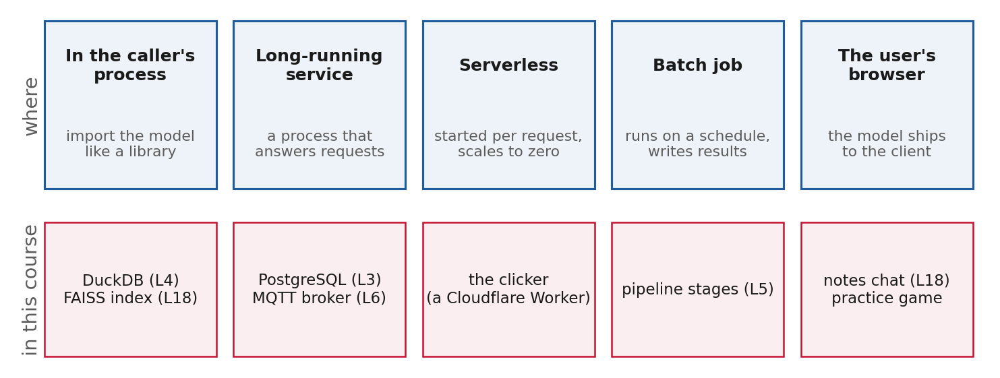
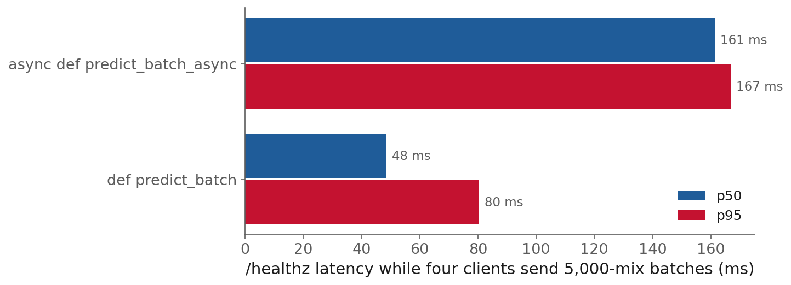
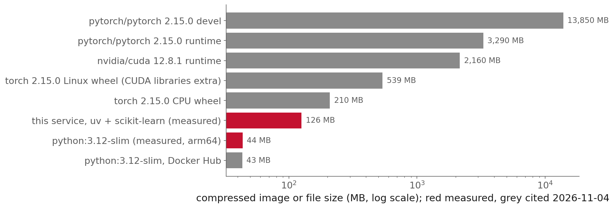
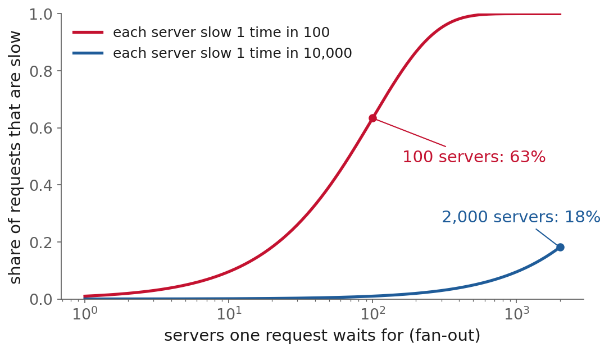
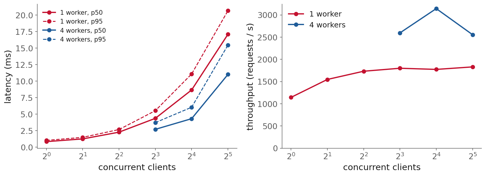
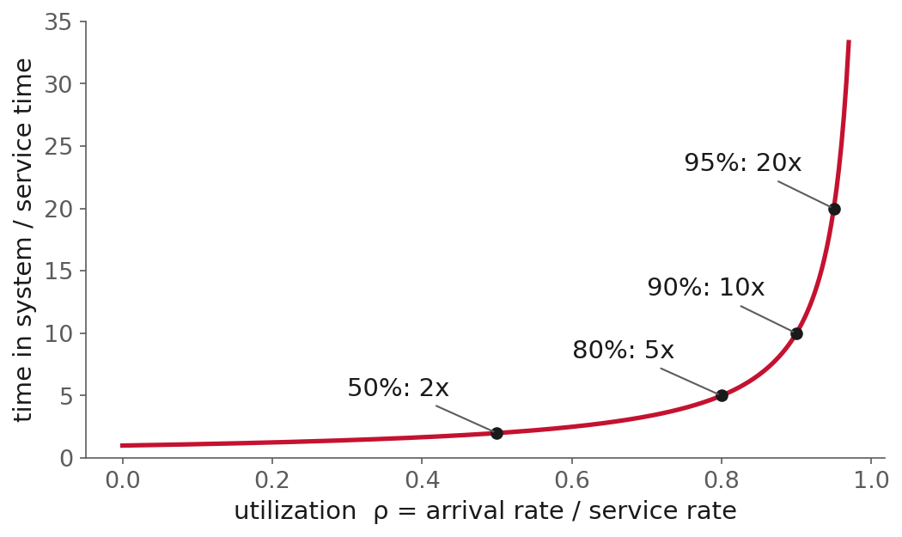
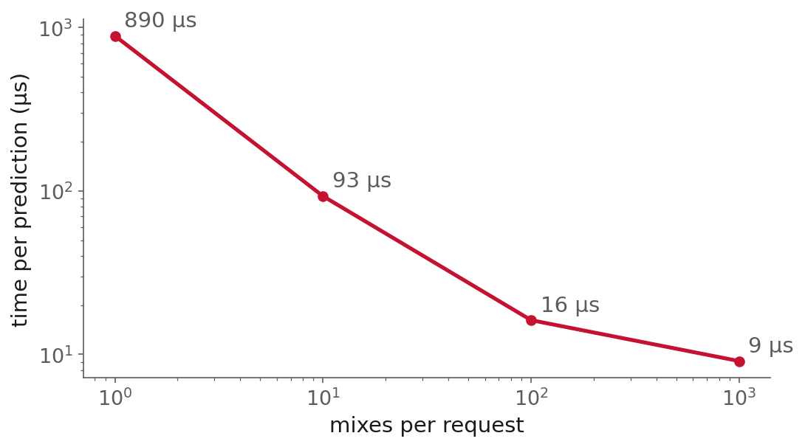

<style>
section p:has(> img:only-child) { text-align: center; }
section table { margin-left: auto; margin-right: auto; font-size: 0.72em; }
.source { font-size: 0.6em; color: #5c5c5c; }
.pt { color: #c41230; font-size: 0.8em; margin-right: 0.35em; }
section pre { font-size: 0.74em; }
section:not(.title):not(.section):not(.demo) { font-size: 26px; }
section li + li, section li > ul { margin-top: 0.1em; }
section .source { margin-top: 0.4em; }
</style>

<!-- _class: title -->

# Lecture 21: Deployment: serving models, containers, latency and cost

## Week 12, Production and responsibility (optional session)

**Systems and Toolchains for AI Engineers**

<!--
Why 5, where 12, contract 15, packaging 15, latency 15, cost 8, releasing 12, limits 5, demo
and recap 3. About 90 minutes, then the notebook and questions. Three clicker questions:
readiness (packaging), fan-out and Little's law (latency). Open the vote page before class.
-->

---

## Roadmap

1. Why this matters
2. Where a model runs
3. The service contract
4. Packaging the service
5. Latency, throughput and capacity
6. Cost
7. Releasing changes safely
8. Limitations and trade-offs

<!-- One worked example all the way through: Lecture 14's five-network ensemble on the L9
     concrete strength data, served with FastAPI from service/app.py. Every measured number
     comes from figures/make_figures.py on an Apple M4 Pro laptop. -->

---

<!-- _class: section -->

# Why this matters

<!-- 5 min -->

---

## Why this matters, Knight Capital

- 1 August 2012: new code for the eight servers of Knight's order router
- "One of Knight's technicians did not copy the new code to one of the eight SMARS computer servers"
- The new code "repurposed a flag that was formerly used to activate the Power Peg code"
- 97 automated emails before the open, not designed as alerts, generally not read
- About 45 minutes: more than 4 million executions in 154 stocks
- Uninstalling the new code from the seven good servers: "this action worsened the problem"
- More than **$460 million** lost, a **$12 million** penalty

<span class="source">[SEC order, Release 34-70694](https://www.sec.gov/files/litigation/admin/2013/34-70694.pdf) · [SEC press release](https://www.sec.gov/newsroom/press-releases/2013-222)</span>

<!-- Two minutes. Nothing here is a modelling error. The code that was meant to run was
     correct. The failure was getting it onto every machine, checking it arrived, and knowing
     what the fallback would do. -->

---

## Why this matters, this website

- 6 August 2026: the build job succeeded
- The deploy step "sat in deployment_queued for ten minutes and timed out"
- The site "silently stayed on the previous commit while the run's build job still showed green"
- Students saw yesterday's lectures for hours
- Caught by a person loading a page by hand

<span class="source">The comment in `.github/workflows/book.yml`</span>

<!-- Same failure as Knight, at the scale of a course website. We come back to the fix,
     build-info.json, in the releasing section. -->

---

## Why this matters, five questions

- L1: "Your model runs on your laptop. That is not a deliverable."
- Deployment: turning a trained model into something other people and programs can depend on
- **Where** it runs · **what contract** it offers · **how** it is packaged
- **How fast** and **at what cost** it answers · **how it changes** without hurting callers
- Already answered in this course for a database server, an embedded engine, a broker, a model registry, a browser LLM

<span class="source">[Lecture 1 notes](../../lectures/l01/notes.html)</span>

<!-- This session collects those answers, applies them to a model, and measures what they cost. -->

---

<!-- _class: section -->

# Where a model runs

<!-- 12 min -->

---

## Where a model runs, five options



- Each box names the system in this course that already runs that way

<!-- Walk left to right. DuckDB and the FAISS index in process; PostgreSQL and the MQTT broker
     as long-running services; the clicker serverless; pipeline stages as batch; the notes
     chat and the practice game in the browser. -->

---

## Where a model runs, in process or a service

| | In the caller's process | A long-running service |
|---|---|---|
| Database example | DuckDB (L4): "no server to start, no connection to manage" | PostgreSQL (L3): "a server you must run, secure, back up, monitor" |
| Network hop | none | every call |
| The caller needs | the same libraries at the same versions | an HTTP client and the contract |

- scikit-learn persistence does not support "loading a model trained with a different version of scikit-learn"
- The L6 MQTT broker is a long-running service; most of today builds this option

<span class="source">[scikit-learn, Model persistence](https://scikit-learn.org/stable/model_persistence.html) · [L3 notes](../../lectures/l03/notes.html) · [L4 notes](../../lectures/l04/notes.html)</span>

<!-- Both databases answer SQL. They differ in where the work happens, who keeps it running,
     and what the caller must install. In process is fine when the caller is your own
     pipeline; a problem when it is a colleague's MATLAB script. -->

---

<!-- _class: definition -->

## Where a model runs, serverless

<div class="definition">

A **cold start** is the delay a request sees when no instance of a service is running and one has to be started, its code imported and its model loaded, before the request can be answered.

</div>

- Cloud Run will "scale to zero when idle to reduce costs"; warm minimum instances "do incur billing costs"
- Lambda: "under 1% of invocations", "from under 100 ms to over 1 second", mostly "initialization code"
- For a model, initialization means loading weights
- The course clicker runs this way: a Cloudflare Worker with a small database

<span class="source">[Cloud Run autoscaling](https://docs.cloud.google.com/run/docs/about-instance-autoscaling) · [Lambda execution environment](https://docs.aws.amazon.com/lambda/latest/dg/lambda-runtime-environment.html) · [Cloud Run minimum instances](https://docs.cloud.google.com/run/docs/configuring/min-instances)</span>

---

## Where a model runs, batch and the browser

- **Batch**: nobody waits, so score the table on a schedule; the idempotent stages of L5
  - AWS: for when you "don't need a persistent endpoint"; nightly reports, weekly design reviews
- **Browser**: ship the model to the client; no server, data never leaves the machine
  - L18 chat: WebGPU, about 1.6 GB of GPU memory, only on HTTPS pages
  - First download "on the order of 15 to 20 minutes": a cold start in minutes, once per browser
  - ONNX Runtime Web: every operator on WebAssembly, "only a subset" on WebGL, WebGPU, WebNN

<span class="source">[SageMaker batch transform](https://docs.aws.amazon.com/sagemaker/latest/dg/batch-transform.html) · [ONNX Runtime Web](https://onnxruntime.ai/docs/tutorials/web/) · [L18 notes](../../lectures/l18/notes.html)</span>

<!-- The practice game is the other browser example: no "runtime network call of any kind"
     (CLAUDE.md). -->

---

## Where a model runs, choosing

| Where | Who waits | Who pays when idle | The caller needs | In this course |
|---|---|---|---|---|
| In process | the calling code, microseconds | nobody | same libraries and versions | DuckDB (L4) |
| Service | a client over the network | you, always | HTTP client and contract | PostgreSQL (L3), broker (L6) |
| Serverless | a client, sometimes a cold start | nobody, unless kept warm | an HTTP client | the clicker |
| Batch | nobody; read later | nobody | the output table | pipeline stages (L5) |
| Browser | the user, after a first load | nobody | a capable browser | notes chat (L18), the game |

- A service can become the others: run it over a table for batch, put it on Cloud Run for serverless

<!-- Most decisions live in the second row, which is why the rest of the session builds it. -->

---

<!-- _class: section -->

# The service contract

<!-- 15 min -->

---

## The service contract, types as the contract

- L1: FastAPI exposes "your model as an HTTP endpoint with typed request and response schemas"
- L6: a data contract is "the written-down shape of the data"; here it is code
- Annotations → Pydantic validates each request → an OpenAPI schema
- One set of types: validation, documentation and the client's specification
- Example: L14's five-network ensemble on L9's concrete data, `service/app.py`, about 140 lines
  - seven mix proportions and an age in; strength in MPa and a 90% interval out

<span class="source">[FastAPI, First steps](https://fastapi.tiangolo.com/tutorial/first-steps/) · [L14 notes](../../lectures/l14/notes.html)</span>

---

## The service contract, range checks

- L3: "A typed column is still not a validated column"; a float accepts −50 kg/m³ of cement

```python
class Mix(BaseModel):
    cement: float = Field(gt=0, le=1000)     # kg per m3 of mixture
    slag: float = Field(ge=0, le=1000)
    water: float = Field(gt=0, le=1000)
    age_days: float = Field(ge=1, le=3650)
    # ... four more fields
```

- A broken bound raises `RequestValidationError`: status **422** before your code runs

<span class="source">[FastAPI, Handling errors](https://fastapi.tiangolo.com/tutorial/handling-errors/) · [L3 notes](../../lectures/l03/notes.html)</span>

---

## The service contract, a useful error

Measured against the running service, `cement = -50`:

```json
{"detail": [{"type": "greater_than", "loc": ["body", "cement"],
             "msg": "Input should be greater than 0", "input": -50.0, "ctx": {"gt": 0.0}}]}
```

- Names the field, the rule and the value: what the caller needs to fix it
- Instead of a stack trace and a 500
- Bounds reject the **impossible**; an unusual mix gets an answer and a flag
  - L9: outside its data a tree "stays flat at its last leaf"
  - L14: "The guarantee did not fail. Its condition was not met."

<!-- So the service answers an unusual request and says it is out of domain. The manifest
     stores the min and max of each feature over the training mixes. -->

---

## The service contract, the response

```python
class Prediction(BaseModel):
    strength_mpa: float
    interval_90: tuple[float, float]
    in_domain: bool
    outside: list[str]
    model_version: str
```

| Mix | Prediction | 90% interval | Width |
|---|---|---|---|
| inside the training ranges | 48.3 MPa | 30.0 to 66.6 | 37 |
| slag 400 kg/m³, age 730 days | 58.9 MPa | 41.8 to 76.0 | 34 |

- Narrower off the data: only the explicit `in_domain` check catches it

<!-- The ensemble's members agree with each other off the data as readily as on it. The model
     version lets a caller who logs it find out later which model produced a number. FastAPI
     also validates the response: wrong shape is a server error, not incorrect data. -->

---

## The service contract, loading once

```python
@asynccontextmanager
async def lifespan(app: FastAPI):
    manifest = json.loads((MODEL_DIR / "manifest.json").read_text())
    if sha256(MODEL_DIR / "ensemble.joblib") != manifest["sha256"]:
        raise RuntimeError("artifact does not match its manifest")
    if sklearn.__version__ != manifest["sklearn"]:
        raise RuntimeError("model saved with a different scikit-learn")
    STATE["nets"] = joblib.load(MODEL_DIR / "ensemble.joblib")
    yield
```

- Runs "once, before the application starts receiving requests"; `on_event` is deprecated
- Launch to first ready answer 0.81 s; model load 0.058 s; the other 93% is imports

<span class="source">[FastAPI, Lifespan events](https://fastapi.tiangolo.com/advanced/events/)</span>

<!-- The docs use this exact case: "loading the model can take quite some time ... So you
     don't want to do it for every request." For a large model the load dominates. -->

---

## The service contract, workers

- FastAPI: a 1 GB model with "4 processes (4 workers), each will consume 1 GB of RAM"
- Uvicorn "does not use pre-fork, but uses spawn": workers share nothing loaded earlier
- Measured: 1 worker **200 MB** resident, 4 workers **665 MB**, for a **46 kB** model file
- <span class="pt">▶</span> the interpreter and libraries are duplicated with the weights

<span class="source">[FastAPI, Deployments concepts](https://fastapi.tiangolo.com/deployment/concepts/) · [Uvicorn, Deployment](https://uvicorn.dev/deployment/)</span>

---

## The service contract, def and async def



- p50 and p95: `def` 48 and 80 ms; `async def` 161 and 167 ms, 19 answers in 4 s against 42
- FastAPI: "If you just don't know, use normal `def`"

<span class="source">[FastAPI, Concurrency and async / await](https://fastapi.tiangolo.com/async/)</span>

<!-- A plain def endpoint "is run in an external threadpool that is then awaited". The docs
     frame blocking as I/O; a CPU-bound predict blocks the loop the same way. def is not free,
     the threads share the GIL, but the server keeps answering. -->

---

## The service contract, what to save

- pickle, joblib, cloudpickle: "Loading can execute arbitrary code"
  - `skops.io` "More secure"; ONNX "Most secure option", though "not all models are supported"
  - Load a pickle only if you produced it: the SHA-256 check before `joblib.load`
- PyTorch: save the `state_dict` and rebuild the module in code (L12's checkpoints)
  - Since 2.6, `torch.load` uses `weights_only=True` by default
  - "TorchScript is deprecated, please use torch.export instead"; or ONNX, named in L13

<span class="source">[scikit-learn, Model persistence](https://scikit-learn.org/stable/model_persistence.html) · [PyTorch, Serialization](https://docs.pytorch.org/docs/2.15/notes/serialization.html) · [PyTorch 2.10, TorchScript](https://docs.pytorch.org/docs/2.10/jit.html) · [PyTorch, ONNX](https://docs.pytorch.org/docs/2.15/onnx.html)</span>

<!-- A whole pickled PyTorch model is "bound to the specific classes and the exact directory
     structure used when the model is saved". Older code that loaded whole models now fails
     until someone opts into the unsafe path, which is the intended effect. -->

---

## The service contract, the manifest

- L2: "The thing worth saving is the recipe that produced the model, more than the weights"
- Rebuilt L14's ensemble with the same split, network and seeds
  - Calibration factor **2.09**, where L14 reports **1.66**; L14's own script now gives 2.09
  - All five networks stop at the 5,000-iteration cap without converging
  - With 2.09 the intervals covered **95.9%** of test mixes, against a 90% target
- Ship the artifact with a manifest: library versions, data hash, the file's own hash

<span class="source">[L2 notes](../../lectures/l02/notes.html) · [L14 notes](../../lectures/l14/notes.html)</span>

<!-- The recipe was saved and it did not reproduce the model. Final weights depend on
     floating-point details that a library build can move. The manifest lets you show the
     tested file and the served file are the same. -->

---

<!-- _class: definition -->

## The service contract, training-serving skew

<div class="definition">

**Training-serving skew** is a difference between a model's performance in training and in serving, caused by the inputs being computed or distributed differently in the two.

</div>

- Rules of ML #29, log the serving features; #32, "Re-use code between your training pipeline and your serving pipeline"
- L8's `Pipeline`: the scaler ships with each network, so requests use training means
- L7: "the 2:03 PM reading" "has not happened yet"; the service cannot compute it
- L18: a query embedded with a different model "silently ruins retrieval"

<span class="source">[Google, Rules of Machine Learning](https://developers.google.com/machine-learning/guides/rules-of-ml)</span>

<!-- L1 named the commonest form: "a feature computed one way in training and another way in
     serving." The course chat embeds index and query with the same runtime for this reason. -->

---

<!-- _class: section -->

# Packaging the service

<!-- 15 min -->

---

## Packaging the service, the build stage

- L2: "When you need to freeze the entire stack down to the system libraries, the tool is a container"
- An image: read-only layers over a base OS; L3 ran `postgres:16` this way

```dockerfile
FROM python:3.12-slim AS build
COPY --from=ghcr.io/astral-sh/uv:0.10.3 /uv /uvx /bin/
ENV UV_COMPILE_BYTECODE=1 UV_LINK_MODE=copy
WORKDIR /app
RUN --mount=type=cache,target=/root/.cache/uv \
    --mount=type=bind,source=uv.lock,target=uv.lock \
    --mount=type=bind,source=pyproject.toml,target=pyproject.toml \
    uv sync --locked --no-dev --no-install-project
```

<span class="source">[Astral, Using uv in Docker](https://docs.astral.sh/uv/guides/integration/docker/)</span>

<!-- uv binary pinned, because tags can be moved. uv sync --locked fails the build if uv.lock
     has fallen out of step with pyproject.toml: L2's lockfile discipline inside the image. -->

---

## Packaging the service, the final stage

```dockerfile
FROM python:3.12-slim
RUN useradd --create-home --uid 10001 app
WORKDIR /app
COPY --from=build /app/.venv /app/.venv
COPY app.py ./
COPY model/ ./model/
ENV PATH="/app/.venv/bin:$PATH"
USER app
CMD ["uvicorn", "app:app", "--host", "0.0.0.0", "--port", "8000"]
```

- Multi-stage: copy only the environment, the code and the model
- Non-root `USER`: the running container reported its user as `app`
- Exec-form `CMD` "to ensure that FastAPI can shutdown gracefully and lifespan events are triggered"

<span class="source">[Docker, Building best practices](https://docs.docker.com/build/building/best-practices/) · [FastAPI in containers](https://fastapi.tiangolo.com/deployment/docker/)</span>

<!-- Shell form runs under /bin/sh, which does not pass on the stop signal. A .dockerignore
     keeps the local .venv out of the build context. -->

---

## Packaging the service, layer cache

- "Once a layer changes, then all downstream layers need to be rebuilt as well"
- So dependencies install before the code is copied, in their own layer
- Measured: full build **11.7 s** (base images cached); rebuild after editing `app.py` **2.9 s**
- Two sources disagree on the install step
  - FastAPI: export `requirements.txt`, install with pip
  - uv: `uv sync` in the image; the notes use this, so one lockfile describes the environment
- FastAPI's Gunicorn image "is now deprecated"; under Kubernetes, "a single (Uvicorn) process per container"

<span class="source">[Docker, Build cache](https://docs.docker.com/build/cache/) · [FastAPI in containers](https://fastapi.tiangolo.com/deployment/docker/)</span>

<!-- The measuring machine runs Docker without BuildKit, so make_figures.py built an
     equivalent image with plain COPY in place of the mounts; the final stage is the same. -->

---

## Packaging the service, image size



- This service: **126 MB** compressed (461 MB unpacked) on a 44 MB base, with a 46 kB model
- Linux `torch` wheel 539 MB, plus cuDNN 519 MB; the CPU-only wheel about 210 MB

<span class="source">Docker Hub and PyPI listings read 2026-11-04 · [uv, PyTorch guide](https://docs.astral.sh/uv/guides/integration/pytorch/)</span>

<!-- Red bars measured here, grey bars cited. These numbers change with every release. -->

---

## Packaging the service, the GPU you do not need

- PyPI hosts "CPU-only wheels for Windows and macOS, and GPU-accelerated wheels on Linux"
  - a `uv add torch` that is small on your Mac is large in a Linux container
- `nvidia/cuda` runtime 2.2 GB; `pytorch/pytorch` devel 13.9 GB; `python:3.12-slim` 43 MB
- Size is paid as a cold start, as storage, and as limits
  - AWS Lambda: "10 GB (maximum uncompressed image size, including all layers)"
- L11: "For a model the size of this session's, the CPU is the correct choice"

<span class="source">[uv, PyTorch guide](https://docs.astral.sh/uv/guides/integration/pytorch/) · [Lambda quotas](https://docs.aws.amazon.com/lambda/latest/dg/gettingstarted-limits.html) · [L11 notes](../../lectures/l11/notes.html)</span>

<!-- L11: "A GPU is a throughput device with a large fixed cost per kernel launch." Many
     engineering surrogates, this one included, are that size. -->

---

## Packaging the service, secrets

- Twelve-factor: config lives in the environment; could the code go open source "without compromising any credentials"?
- Docker: build args and env vars "are inappropriate for passing secrets ... they persist in the final image"
- Tested with a fake key
  - `ARG API_KEY` appeared in `docker history --no-trunc`
  - A key file copied in and deleted next step: still readable in the earlier layer
- Layers are immutable; deleting a file adds a layer that hides it

<span class="source">[Twelve-Factor, Config](https://12factor.net/config) · [Docker, Build secrets](https://docs.docker.com/build/building/secrets/) · [Docker, Image layers](https://docs.docker.com/get-started/docker-concepts/building-images/understanding-image-layers/)</span>

<!-- The history line was |1 API_KEY=demo-not-a-real-key-7f3a /bin/sh -c rm /app/key.txt.
     This is the course's first treatment of secrets. -->

---

## Packaging the service, secrets, the fixes

- Build time: `RUN --mount=type=secret`, exposed to one step, written to no layer
- Run time: environment variables or files supplied at start, never baked in
- Leaked: "rotate the affected credential immediately"
- In this course
  - L3 compose: password `demo`, "for a local teaching database only"
  - Plant stream: a secret file on the Pi, "mode 640, root:tepstream"
  - Practice game: signing key from a GitHub Actions secret; refuses the dev key

<span class="source">[GitHub, Secret scanning](https://docs.github.com/en/code-security/concepts/secret-security/secret-scanning) · `stream/README.md`</span>

<!-- GitHub: removing a secret from history "is time-intensive and often unnecessary if you've
     already revoked the credential". -->

---

## Packaging the service, health checks

- A running process may still be unable to answer; L3 asked `pg_isready` every five seconds
- Docker `HEALTHCHECK`: a server "stuck in an infinite loop ... even though the server process is still running"
- The image declares one: `healthy` within 12 s of starting

| Probe | Question | On failure |
|---|---|---|
| Liveness `/healthz` | is the process alive? | restart the container |
| Readiness `/readyz` | can it serve now? model loaded, returns version | remove from traffic, keep running |
| Startup | has a slow start finished? | hold off the other two |

<span class="source">[Dockerfile reference](https://docs.docker.com/reference/dockerfile/) · [Kubernetes, Probes](https://kubernetes.io/docs/concepts/workloads/pods/probes/)</span>

---

<!-- _class: definition -->

## Packaging the service, readiness

<div class="definition">

A **readiness probe** asks whether an instance can serve requests now, for example whether its model is loaded; failing it removes the instance from traffic without restarting it.

</div>

- Liveness probes "determine when to restart a container"
- With `lifespan`, no connections until the model loads, so readiness matters later
  - a database or downstream model unavailable, or shutting down: not ready, still alive
- "Incorrect implementation of liveness probes can lead to cascading failures"; keep liveness trivial

<span class="source">[Kubernetes, Probes](https://kubernetes.io/docs/concepts/workloads/pods/probes/)</span>

<!-- A liveness check that calls the model or a database fails when that dependency is slow;
     restarting every instance at once turns a slow dependency into an outage. -->

---

## Packaging the service, a question

<div class="clicker" data-tag="l21-readiness" data-seconds="45" data-answer="B" data-hint="Which of the two probes decides restarts, and which one decides traffic?" data-why="B. Readiness decides traffic and liveness decides restarts. A failing readiness probe takes the instance out of the load balancer and leaves it running until it reports ready again." data-read="https://clicker.f26-06763.workers.dev">
<div class="clicker-main">

**The service's database goes down. `/readyz` starts failing; `/healthz` still answers. What does Kubernetes do with the container?**

<ol class="clicker-opts">
<li>Restarts it</li>
<li>Stops sending it traffic and leaves it running</li>
<li>Restarts every instance of the service</li>
<li>Nothing, until the liveness probe fails too</li>
</ol>

</div>
<aside class="clicker-panel">

<div class="clicker-url">clicker.f26-06763.workers.dev</div>
<button class="clicker-start">Start voting</button>
<div class="clicker-timer">45</div>
<div class="clicker-count">no votes yet</div>
</aside>
</div>

<!-- C is the cascading failure the docs warn about, which is what happens when the database
     check is put in liveness instead. -->

---

<!-- _class: section -->

# Latency, throughput and capacity

<!-- 15 min -->

---

## Latency, two numbers

- **Latency**: how long one request takes, from the caller's point of view
- **Throughput**: how many requests the service completes per second
- Excellent throughput and unacceptable latency can coexist
- SRE book: "We generally prefer to work with percentiles rather than the mean"
  - "a high-order percentile, such as the 99th or 99.9th, shows you a plausible worst-case value"
- p50 the median request · p95 the latency 95% beat · p99 where the slowest 1 in 100 begins

<span class="source">[SRE book, Service level objectives](https://sre.google/sre-book/service-level-objectives/)</span>

---

<!-- _class: definition -->

## Latency, the tail

<div class="definition">

**Tail latency** is the latency of the slowest requests, reported as a high percentile such as the p95 or p99, which is what a user waiting on a slow request experiences.

</div>

- L11 reported "the *minimum* over repeated trials rather than the mean"
  - right for a kernel: how fast can it go with interference removed?
- A service is judged on the opposite question: how slow for requests that meet interference
- Report a percentile **and the concurrency** it was measured at

<span class="source">[L11 notes](../../lectures/l11/notes.html)</span>

---

## Latency, the tail at scale

- Each server typically responds in 10 ms, with a 99th-percentile latency of one second
- One server per request: "one user request in 100 will be slow"
- A request that waits for all of $n$ servers, each slow with probability $p$
  - is slow with probability $1-(1-p)^n$

<span class="source">[Dean and Barroso, The Tail at Scale (CACM 2013, author's copy)](https://www.barroso.org/publications/TheTailAtScale.pdf)</span>

<!-- Ask before showing the curve. -->

---

## Latency, a question

<div class="clicker" data-tag="l21-fanout" data-seconds="45" data-answer="C" data-hint="What is the chance that none of the 100 servers is slow?" data-why="C. Each server is fast with probability 0.99, so all 100 are fast with probability 0.99 to the 100th, about 0.37. The other 63% of requests wait on at least one slow server." data-read="https://clicker.f26-06763.workers.dev">
<div class="clicker-main">

**Each server is slow (over one second) one time in 100. A user request must wait for all 100 such servers. About what share of user requests take more than one second?**

<ol class="clicker-opts">
<li>1%</li>
<li>10%</li>
<li>63%</li>
<li>99%</li>
</ol>

</div>
<aside class="clicker-panel">

<div class="clicker-url">clicker.f26-06763.workers.dev</div>
<button class="clicker-start">Start voting</button>
<div class="clicker-timer">45</div>
<div class="clicker-count">no votes yet</div>
</aside>
</div>

---

## Latency, the tail at scale, fan-out



- A Google service: p99 of 10 ms for one random request, 140 ms for all of them
- Hedged requests sent after 10 ms: p99.9 from 1,800 ms to 74 ms, for 2% more requests

<span class="source">[Dean and Barroso, The Tail at Scale](https://www.barroso.org/publications/TheTailAtScale.pdf)</span>

<!-- Engineering pipelines fan out too. L18's pipeline runs a search, a re-ranker that cost "a
     thousand times the cost of the search itself", then a language model: as slow as the sum
     of its stages, and as unlucky as its unluckiest one. -->

---

<!-- _class: definition -->

## Latency, Little's law

<div class="definition">

**Little's law** says that in steady state the average number of requests in a system equals their arrival rate times the average time each one spends there, $L = \lambda W$.

</div>

- Holds for any queue in steady state, whatever the distributions
- A check on any load test: concurrency ÷ throughput should equal mean latency
- Closed loop: each client sends a request, waits for the answer, sends the next

<span class="source">[Little and Graves, 2008 (book chapter, course mirror)](https://www.ic.unicamp.br/~nfonseca/MO648/doc/Little%27s%20Law-Published.pdf)</span>

---

## Latency, a question

<div class="clicker" data-tag="l21-littles-law" data-seconds="45" data-answer="B" data-hint="L is the number of requests in the system. Which of the three numbers is W, and how do you get it from the other two?" data-why="B. W = L / λ = 8 / 1,799 per second, about 4.4 ms, and the load test measured a mean latency of 4.43 ms." data-read="https://clicker.f26-06763.workers.dev">
<div class="clicker-main">

**8 clients each send a request, wait for the answer, and send the next. The service completes 1,799 requests per second. What is the mean latency?**

<ol class="clicker-opts">
<li>About 0.5 ms</li>
<li>About 4.4 ms</li>
<li>About 44 ms</li>
<li>About 225 ms</li>
</ol>

</div>
<aside class="clicker-panel">

<div class="clicker-url">clicker.f26-06763.workers.dev</div>
<button class="clicker-start">Start voting</button>
<div class="clicker-timer">45</div>
<div class="clicker-count">no votes yet</div>
</aside>
</div>

<!-- D is 1,799 / 8, the most common slip: dividing the wrong way. -->

---

## Latency, Little's law as a check

- This service, one worker, 8 clients: 1,799 requests/s at a mean of 4.43 ms
  - $1799 \times 0.00443 = 7.97$, the 8 clients
- NVIDIA Triton's documentation: 8 concurrent requests at 272 inferences/s
  - mean latency must be about 29 ms; the reported p95 is 36 ms
- With throughput fixed at capacity $X$, the latency of $N$ clients is $W = N/X$

<span class="source">[Triton, Optimization](https://docs.nvidia.com/deeplearning/triton-inference-server/user-guide/docs/user_guide/optimization.html)</span>

---

## Latency, saturation



- One worker flattens near 1,800 requests/s; p50 4.4 → 8.7 → 17.1 ms at 8, 16, 32 clients
- Four workers: 2,560 to 3,140 requests/s, noisier as clients and workers share 14 cores

<!-- Same laptop for client and server, so latency is a floor; a real network adds to every
     point. Little's law: throughput fixed, so latency doubles with the clients.
     Say this: the first load test drove every client from one Python process, and its
     throughput fell from about 1,570 to 321 requests/s between 8 and 32 clients, p95 327 ms.
     Four server workers did not change it (319 requests/s), which put the limit in the load generator. L5: "A
     benchmark measures one workload on one machine"; a load test also measures the machine
     that sends the load. One process per client gave this figure. -->

---

## Latency, utilization



- M/M/1: time in system is $1/(1-\rho)$ service times; 50% → 2×, 90% → 10×, 95% → 20×
- Over capacity, answer 429 or 503, which is L6's backpressure over HTTP

<span class="source">[Bertsekas and Gallager, ch. 3](https://web.mit.edu/dimitrib/www/Queueing_Data_Nets.pdf) · [Harchol-Balter, ch. 1](https://www.cs.cmu.edu/~harchol/PerformanceModeling/chpt1.pdf)</span>

<!-- T = 1/(mu - lambda), eq. 3.26. Variability in service time makes it worse
     (Pollaczek-Khinchine, same chapter). Harchol-Balter's corollary is the counterintuitive
     one: when the arrival rate doubles, keeping the same mean response time takes a server
     that is "Less than double" as fast. -->

---

## Latency, batching



- Per prediction: 1 mix 0.89 ms; 10 mixes 93 µs; 100 mixes 16 µs; 1,000 mixes 9.1 µs
- The same trade as L3's `COPY`, L5's vectorized column and L15's `q=4`

<span class="source">[L15 notes](../../lectures/l15/notes.html)</span>

<!-- A thousand-mix batch is a hundred times cheaper per prediction: almost all of a single
     request's cost was overhead, not the five small networks. -->

---

## Latency, batching costs latency

- A request that waits to be grouped waits
- Triton's dynamic batching: "trade off increased latency for increased throughput"
  - a larger maximum batch, or a nonzero `max_queue_delay_microseconds`
- Triton's example: about 73 inferences/s without batching, 272 with it, "without increasing latency"
  - NVIDIA's measurement of NVIDIA's server; read it as an illustration
- A design loop that asks one point at a time pays the overhead on every point

<span class="source">[Triton, Dynamic batcher](https://docs.nvidia.com/deeplearning/triton-inference-server/user-guide/docs/user_guide/batcher.html)</span>

---

## Latency, language models

- **Time to first token**: "from when the prompt was sent"; then the inter-token latency
- Total ≈ first token + inter-token × tokens; "cutting 50% of your output tokens may cut ~50% of your latency"
- Streaming over server-sent events; one-way, "a very low number (6)" per site without HTTP/2
  - the last token arrives no sooner
- Serving one yourself is dominated by batching
  - vLLM: KV cache "20.4% - 38.2%" used; paged memory "2-4×" throughput
  - Orca, continuous batching: "36.9× throughput improvement at the same level of latency"

<span class="source">[Anthropic, Reducing latency](https://platform.claude.com/docs/en/test-and-evaluate/strengthen-guardrails/reduce-latency) · [OpenAI, Latency](https://developers.openai.com/api/docs/guides/latency-optimization) · [MDN, SSE](https://developer.mozilla.org/en-US/docs/Web/API/Server-sent_events/Using_server-sent_events) · [Kwon et al. 2023](https://arxiv.org/pdf/2309.06180) · [Yu et al. 2022](https://www.usenix.org/conference/osdi22/presentation/yu)</span>

<!-- L17: "Cost and time are counted in tokens." Inter-token latency per NVIDIA NIM is "the
     average time between consecutive tokens". -->

---

## Latency, the numbers that circulate

| Claim | Source | What it shows |
|---|---|---|
| Google: +500 ms, −20% traffic | Linden 2006, a Mayer talk | 30 results took 0.9 s vs 0.4 s; the experiment changed the result count |
| Amazon: +100 ms, −1% sales | one slide bullet, "+100 ms @ Amazon -1% sales" | no method, no sample size, no "every" |
| Google, controlled, 2009 | Brutlag | 100 to 400 ms cost 0.2% to 0.6% of daily searches; 50 ms no measurable effect |

- Kohavi et al. 2007 cited the slide and turned "traffic" into "revenues"
- Per millisecond, twenty to thirty times smaller than the 500 ms story

<span class="source">[Linden 2006](https://glinden.blogspot.com/2006/11/marissa-mayer-at-web-20.html) · [Linden slides](https://glinden.blogspot.com/2006/12/slides-from-my-talk-at-stanford.html) · [Kohavi et al. 2007](https://exp-platform.com/Documents/GuideControlledExperiments.pdf) · [Brutlag 2009](https://services.google.com/fh/files/blogs/google_delayexp.pdf)</span>

<!-- For a surrogate in a design loop the target is arithmetic you can do: calls the optimizer
     makes times latency per call, against how long the engineer will wait. Same habit as L1's
     "10% of the code" figure. -->

---

<!-- _class: section -->

# Cost

<!-- 8 min -->

---

## Cost, per request

- Price of what does the work ÷ how much work it does
- One worker, about 1,800 single-mix requests/s: about **6.5 million** predictions per core-hour
- 1,000-mix batches at 9.1 µs: about **400 million**, a factor of sixty from the request pattern
- An ensemble of $M$ models costs $M$ times one (L14); idle time is paid unless scaled to zero
- LLM, 2026-11-04: Claude Sonnet 5.5, $2 per million input tokens, $10 per million output
  - L18-style answer, 3,000 in, 300 out: $3000 \times 2/10^6 + 300 \times 10/10^6 = \$0.009$

<span class="source">[Anthropic, Pricing](https://platform.claude.com/docs/en/about-claude/pricing) · [Prompt caching](https://platform.claude.com/docs/en/build-with-claude/prompt-caching)</span>

<!-- Nine dollars per thousand answers. Batch API: "a 50 percent discount on both input and
     output tokens". Cache write 1.25x base input, pays "after one cache read for the 5-minute
     duration". Prices change: record the date with the estimate. -->

---

## Cost, retries

- "Retries are 'selfish.'"; when overloaded "retries can make the overload worse"
- A five-deep stack, three attempts per layer: database load "243x"; retry at a single point
- **Retry storm**: a slow service getting several times its load from clients trying to help
- Timeout every call · cap retries · exponential backoff, plus jitter: "It's to add jitter"
- "APIs with side effects aren't safe to retry unless they provide idempotency"
  - L5: idempotent "when running it twice has the same effect as running it once"; L6: "Assume at-least-once"

<span class="source">[Brooker, Timeouts, retries, and backoff with jitter](https://builder.aws.com/content/3EumjoZascWd1oZiEgL8ORlv3qE/timeouts-retries-and-backoff-with-jitter) · [Brooker, Exponential backoff and jitter](https://aws.amazon.com/blogs/architecture/exponential-backoff-and-jitter/)</span>

<!-- A prediction endpoint is idempotent by nature; one that writes a result, places an order or
     starts an experiment is not unless you make it so. The clicker budgets "a 40-person class
     near 24k requests a session against a 100k/day budget"; 160 students would come within a
     few percent of it in one session. -->

---

<!-- _class: section -->

# Releasing changes safely

<!-- 12 min -->

---

## Releasing changes safely, CrowdStrike

- 19 July 2024, 04:09 UTC: "a content configuration update for the Windows sensor", a data file
- "21 input parameter fields, but ... supplied only 20 input values": out-of-bounds read
- Tests used a wildcard for the 21st field, so never exercised the mismatch
- Reverted 78 minutes after release; remedy: "Each Template Instance should be deployed in a staged rollout"
- 8.5 million machines is **Microsoft's** estimate, "less than one percent of all Windows machines"
- <span class="pt">▶</span> new weights, a feature schema or a calibration factor are content updates in this sense

<span class="source">[CrowdStrike, Root cause analysis](https://www.crowdstrike.com/wp-content/uploads/2024/08/Channel-File-291-Incident-Root-Cause-Analysis-08.06.2024.pdf) · [Microsoft, 20 July 2024](https://blogs.microsoft.com/blog/2024/07/20/helping-our-customers-through-the-crowdstrike-outage/)</span>

<!-- Postmortem, SRE book: "a written record of an incident, its impact, the actions taken...",
     written "without indicting any individual or team". Test the interface between new content
     and consuming code with real values; make the consumer reject malformed input, as the
     manifest check does. -->

---

<!-- _class: definition -->

## Releasing changes safely, canaries

<div class="definition">

A **canary release** sends a change to a small, time-limited share of traffic and compares it with the current version before deciding whether to roll it out further.

</div>

- SRE workbook: "a partial and time-limited deployment of a change in a service and its evaluation"
- **Staged rollout**: widening rings, a check at each step
- **Rollback**: return to the previous version if the check fails
- L1 promised a "staged rollout so a bad model does not reach everyone at once, and the ability to roll back"

<span class="source">[SRE workbook, Canarying releases](https://sre.google/workbook/canarying-releases/)</span>

---

## Releasing changes safely, the number to check

- **SLI**: "a carefully defined quantitative measure of some aspect of the level of service"
  - the p95 latency, the share of requests that succeed
- **SLO**: "a target value or range of values for a service level that is measured by an SLI"
- **Error budget**: 99.999% per quarter "means that the service's error budget is a failure rate of 0.001%"
- A canary that spends the budget faster than the old version is rolled back
- "a user on a 99% reliable smartphone cannot tell the difference between 99.99% and 99.999%"

<span class="source">[SRE book, Service level objectives](https://sre.google/sre-book/service-level-objectives/) · [SRE book, Embracing risk](https://sre.google/sre-book/embracing-risk/)</span>

---

## Releasing changes safely, verify what is running

- Knight: new code on seven of eight servers; nobody checked the eighth
  - the rollback removed it from the seven good ones and "worsened the problem"
  - 97 warning emails that nobody had designed to be alerts
- This site: every build writes `build-info.json` with its commit; a job reads it back off the live site
  - polls about three minutes, "Pages reports success slightly before the CDN serves the new build"
  - a cache-busting query string, so a cache cannot answer with the old file
- For a model: `/readyz` returns the version; check it from outside the service

<span class="source">[SEC order](https://www.sec.gov/files/litigation/admin/2013/34-70694.pdf) · CLAUDE.md section 8</span>

<!-- CLAUDE.md: "The run is green. That does not tell you the site updated." and "The page
     returns 200. That does not tell you it rendered." A deploy is complete when you have
     confirmed on every instance that the tested artifact is the one running. -->

---

## Releasing changes safely, GitLab

- 31 January 2017: a command meant for the secondary database ran on the primary
  - stopped "a second or two" later; "around 300 GB of data had already been removed"
- "The backup procedure was using pg_dump 9.2, while our database is running PostgreSQL 9.6"
- Failure emails were rejected: "we were never aware of the backups failing, until it was too late"
- Restored from a snapshot taken six hours earlier; about 18 hours down
  - lost "roughly 5,000 projects, 5,000 comments and 700 new user accounts"
- Why untested? "Because there was no ownership"

<span class="source">[GitLab, Postmortem](https://about.gitlab.com/blog/postmortem-of-database-outage-of-january-31/)</span>

<!-- L3 described PostgreSQL as a server you must "back up". "Five of five backup methods
     failed" is not in the postmortem; it comes from posts made on the day. The pg_dump
     mismatch is the same failure as the service's scikit-learn check: two components that
     must agree on a version, and nothing checking. -->

---

## Releasing changes safely, AWS S3 and Cloudflare

| | AWS S3, 28 Feb 2017 | Cloudflare, 2 July 2019 |
|---|---|---|
| The change | a playbook command; "one of the inputs ... was entered incorrectly" | "a minor change to the rules for XSS detection" |
| Why it spread | two subsystems needed "a full restart", not done "for many years" | a system that "can push changes globally in seconds" |
| Duration | about four hours | 27 minutes |
| Also | the status dashboard depended on S3 | a regex that "backtracked enormously"; simulate mode still ran it |
| In the postmortem | the tool now removes capacity more slowly, with minimum-capacity safeguards | no staged rollout under the SOP; a CPU protection removed in a refactor weeks prior |

<span class="source">[AWS, S3 service disruption](https://aws.amazon.com/message/41926/) · [Cloudflare, Details of the outage](https://blog.cloudflare.com/details-of-the-cloudflare-outage-on-july-2-2019/)</span>

<!-- Model analogues: a deploy script that refuses to take the last ready instance out of
     service; monitoring that does not run on the system it monitors; a shadow deployment costs
     what the model costs, on the machines serving real traffic. Cloudflare: "The SOP allowed a
     non-emergency rule change to go globally into production without a staged rollout." -->

---

## Releasing changes safely, this course's incidents

- Plant stream: "Debian's `mosquitto` package is built without WebSocket support"
  - its log named the symptom: "`Unable to start any listening sockets`"
- nginx's default `proxy_read_timeout` of 60 s would have cut every connection; now 3600
- The broker's version is pinned against an unattended mid-semester upgrade
- Clicker: "Forgetting `--remote` is the classic D1 mistake", then "no such table"
- A new hostname: "no certificate for the first minute or several"
- Each found by running the real service on the real network

<span class="source">`stream/README.md` · `clicker/README.md`</span>

---

<!-- _class: section -->

# Limitations and trade-offs

<!-- 5 min -->

---

## Limitations and trade-offs

- **You often do not need a service**: import it, or run a batch job; L5, "Exhaust one good machine before adding a cluster"
- **FastAPI is a request router**: "heavy background computation" goes to "bigger tools like Celery"
- **Inference servers** (Triton, vLLM) earn their place at scale; for a small CPU surrogate they add little
- **Kubernetes** asks for a cluster, a team, and a configuration larger than the service
- **Serverless** trades idle cost for cold starts; **the browser** is free to serve and hard to control

<span class="source">[FastAPI, Background tasks](https://fastapi.tiangolo.com/tutorial/background-tasks/)</span>

<!-- CPU-bound Python shares one interpreter lock per process, so throughput scales with
     processes, and each process holds its own copy of the model. A managed container platform
     or one VM serves many engineering workloads at a fraction of the operating cost. -->

---

## Limitations and trade-offs, which option

| Option | Good for | Bad at | Reach for something else when |
|---|---|---|---|
| In process | one caller in the same language | callers with other environments | more than one program needs the model |
| FastAPI service | a typed contract, several callers | heavy compute per request | requests run for minutes (use a job queue) |
| Inference server | GPU batching across clients | small CPU models | the model fits on a CPU and traffic is modest |
| Serverless | bursty or rare traffic | first-request latency | the p95 target is below the cold start |
| Batch | nobody waits | freshness | a person or program needs the answer now |
| Browser | privacy, zero serving cost | large models, old hardware | users cannot download or run the model |

---

<!-- _class: demo -->

# Worked example

## `l21-deployment.ipynb`

- Fit L14's ensemble, save it with a manifest; the endpoints in process, including the 422
- uvicorn in the background under load: p50, p95, Little's law; one request against a batch
- The `async def` stall; an L15-style loop counting its calls; Docker cells only where Docker exists

<!-- Runs in Colab or locally, no cloud account, no Docker required. -->

---

## Recap

- Where: in process, service, serverless, batch, browser; the course has used each
- Contract: bounds that 422 the impossible, a domain flag, an interval, a version
- Load once, check the hash and versions; each worker holds its own copy
- Package from the lockfile, CPU-only, non-root, no secrets in any layer
- Report percentiles at a stated concurrency; check load tests with $L = \lambda W$
- Batch for throughput; retry at one point, with backoff and jitter
- Release in stages, verify what is running, restore your backups

---

## Standings

Nicknames only. Everyone who skipped one still counted in every bar you saw.

<div class="clicker-leaderboard"
     data-read="https://clicker.f26-06763.workers.dev"
     data-top="8"
     data-hours="6"
     data-title="Standings"></div>

---

## Before next time

- No assignment for this optional session
- Practice module for this session: on the course site
- Run the worked example; the Docker cells are optional
- Read: FastAPI's lifespan and concurrency pages, Kubernetes probes, one of the postmortems
- Notes: `lectures/l21/notes.md`

<script src="clicker-slide.js"></script>
