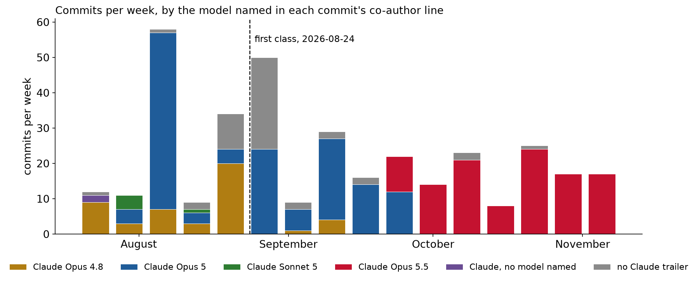
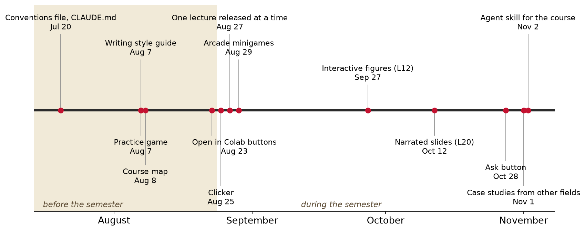
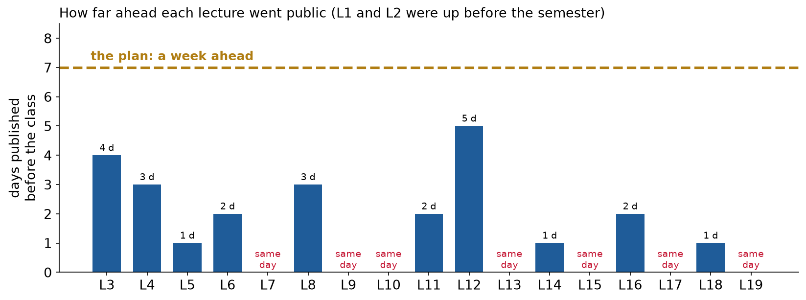
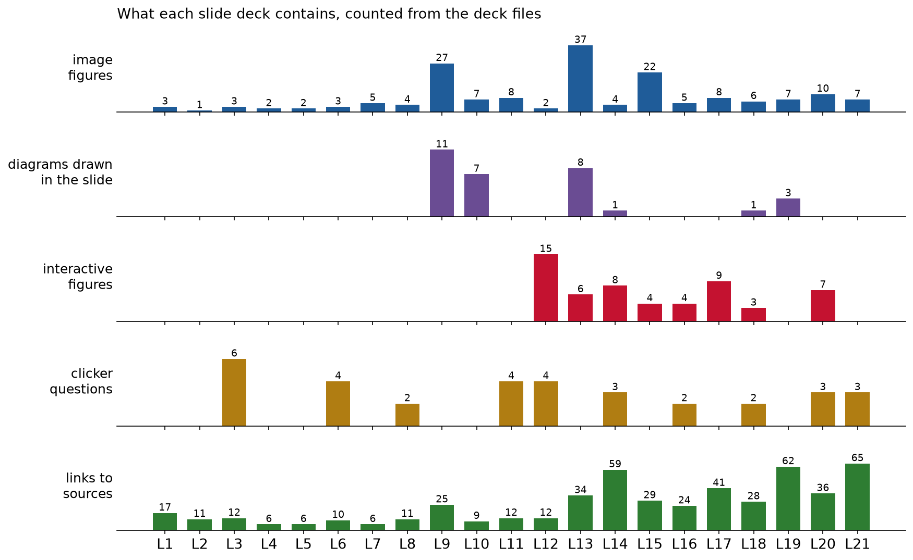
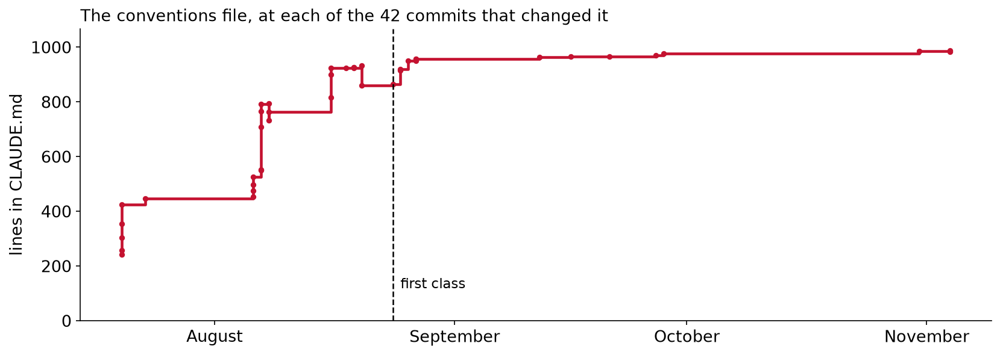
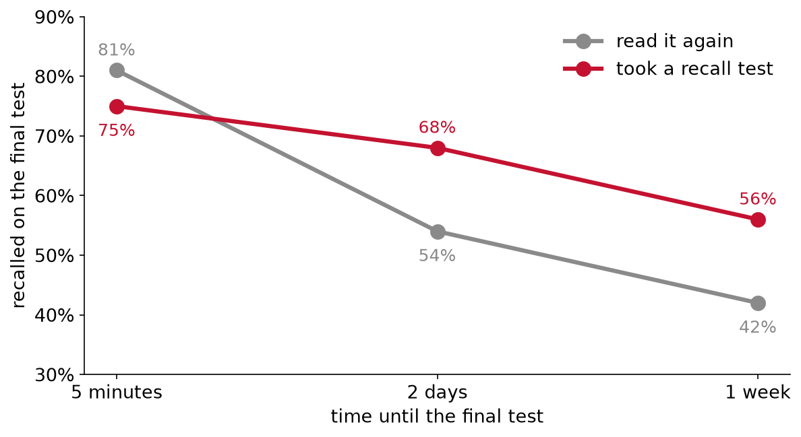
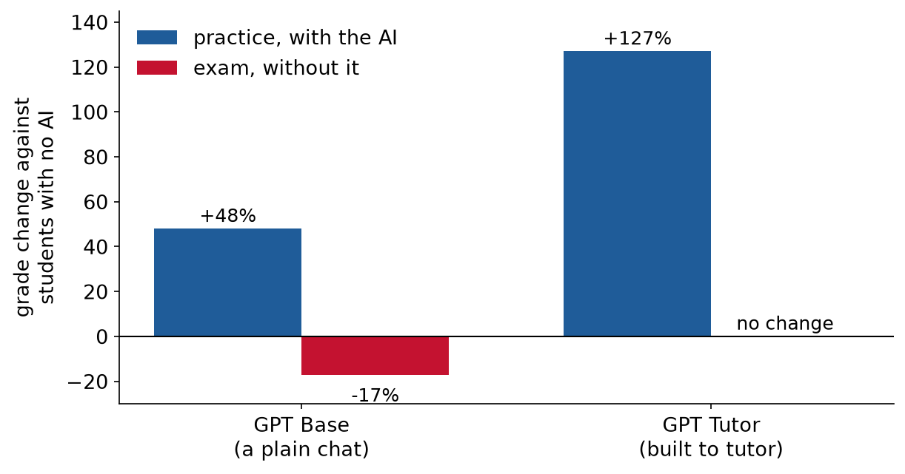
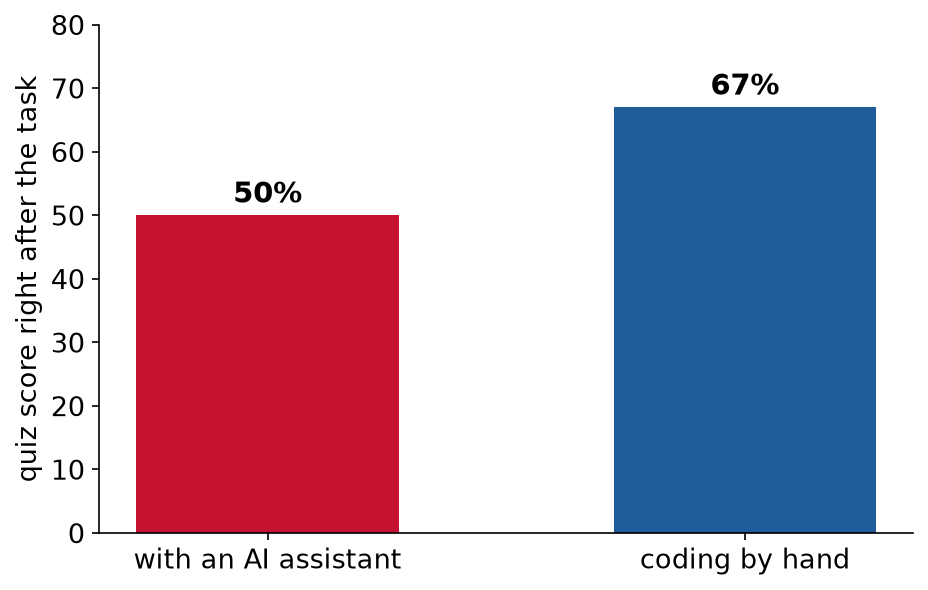

<!-- _class: title -->

# Lecture 22: Course overview and how this course was built

## Week 12, Course wrap-up

**Systems and Toolchains for AI Engineers**

<!--
Map 3, the course 15, how it was built 35, learning a new field 15, generating is not learning
15, limits 4, recap 3. About 90 minutes, then the git-history notebook on your own project.
Two scored clicker questions (splits, using an assistant to learn) and two prediction polls
(CLAUDE.md growth, the AI tutor's exam effect). Open the vote page before class.
-->

---

## The whole course, where we are

<svg id="course-map" viewBox="0 0 1180 500" width="100%" role="img" aria-label="A map of the whole course as a journey: a trail through the data lowlands (lectures 1 to 7), the machine-learning highlands (lectures 8 to 16) and along the language coast (lectures 17 to 19). The optional lectures 20 and 21 make a loop off the trail that rejoins it at lecture 22, marked you are here. Beyond it are two days of project presentations and, at the summit, a week of guest speakers. Side paths lead from some lectures to case studies in other fields" style="font-family: Georgia, 'Times New Roman', serif; display:block; margin: 0 auto;">
<defs><radialGradient id="jm-p" cx="50%" cy="45%" r="75%"><stop offset="0%" stop-color="#f8f1df"/><stop offset="100%" stop-color="#e6d6b0"/></radialGradient></defs>
<rect x="4" y="4" width="1172" height="492" rx="14" fill="url(#jm-p)" stroke="#5b4a32" stroke-width="2"/>
<rect x="12" y="12" width="1156" height="476" rx="10" fill="none" stroke="#a89878" stroke-width="1" stroke-dasharray="2 4"/>
<ellipse cx="205" cy="398" rx="200" ry="76" fill="#7d9a5c" opacity="0.18"/>
<ellipse cx="600" cy="220" rx="240" ry="92" fill="#b49a6a" opacity="0.18"/>
<path d="M630,488 C670,436 730,402 790,394 C840,388 870,372 920,380 C990,392 1080,376 1166,370 L1166,478 Q1166,488 1156,488 Z" fill="#6f93b3" opacity="0.22"/>
<path d="M742,404 l6,-12 l6,12" fill="none" stroke="#5b4a32" stroke-width="1.2"/>
<path d="M758,400 l6,-12 l6,12" fill="none" stroke="#5b4a32" stroke-width="1.2"/>
<path d="M774,397 l6,-12 l6,12" fill="none" stroke="#5b4a32" stroke-width="1.2"/>
<path d="M860,380 l6,-12 l6,12" fill="none" stroke="#5b4a32" stroke-width="1.2"/>
<path d="M876,376 l6,-12 l6,12" fill="none" stroke="#5b4a32" stroke-width="1.2"/>
<path d="M892,377 l6,-12 l6,12" fill="none" stroke="#5b4a32" stroke-width="1.2"/>
<path d="M812,392 L814,366 L822,366 L824,392 Z" fill="#fbf7ec" stroke="#5b4a32" stroke-width="1.2"/><rect x="813" y="374" width="10" height="5" fill="#c41230"/><rect x="813" y="384" width="11" height="5" fill="#c41230"/><path d="M812,366 L818,359 L824,366 Z" fill="#5b4a32"/><path d="M826,363 L852,354 L852,370 Z" fill="#f2d27a" opacity="0.7"/>
<path d="M960,468 q8,-6 16,0 t16,0" fill="none" stroke="#6f93b3" stroke-width="1.6"/>
<path d="M1010,468 q8,-6 16,0 t16,0" fill="none" stroke="#6f93b3" stroke-width="1.6"/>
<path d="M1060,468 q8,-6 16,0 t16,0" fill="none" stroke="#6f93b3" stroke-width="1.6"/>
<path d="M1110,468 q8,-6 16,0 t16,0" fill="none" stroke="#6f93b3" stroke-width="1.6"/>
<path d="M140,452 L133,468 L147,468 Z" fill="#7d9a5c" stroke="#5b4a32" stroke-width="0.8"/><line x1="140" y1="468" x2="140" y2="472" stroke="#5b4a32" stroke-width="1.2"/>
<path d="M60,344 L53,360 L67,360 Z" fill="#7d9a5c" stroke="#5b4a32" stroke-width="0.8"/><line x1="60" y1="360" x2="60" y2="364" stroke="#5b4a32" stroke-width="1.2"/>
<path d="M30,234 L23,250 L37,250 Z" fill="#7d9a5c" stroke="#5b4a32" stroke-width="0.8"/><line x1="30" y1="250" x2="30" y2="254" stroke="#5b4a32" stroke-width="1.2"/>
<path d="M210,448 L203,464 L217,464 Z" fill="#7d9a5c" stroke="#5b4a32" stroke-width="0.8"/><line x1="210" y1="464" x2="210" y2="468" stroke="#5b4a32" stroke-width="1.2"/>
<path d="M402,380 L395,396 L409,396 Z" fill="#7d9a5c" stroke="#5b4a32" stroke-width="0.8"/><line x1="402" y1="396" x2="402" y2="400" stroke="#5b4a32" stroke-width="1.2"/>
<path d="M465.5,196 L488,166 L510.5,196 Z" fill="#cbbd9a" stroke="#5b4a32" stroke-width="1.2"/><path d="M480.5,176 L488,166 L495.5,176 Z" fill="#fbf7ec"/>
<path d="M357,214 L372,194 L387,214 Z" fill="#cbbd9a" stroke="#5b4a32" stroke-width="1.2"/><path d="M367,200.7 L372,194 L377,200.7 Z" fill="#fbf7ec"/>
<path d="M583.5,290 L600,268 L616.5,290 Z" fill="#cbbd9a" stroke="#5b4a32" stroke-width="1.2"/><path d="M594.5,275.3 L600,268 L605.5,275.3 Z" fill="#fbf7ec"/>
<path d="M686.5,286 L700,268 L713.5,286 Z" fill="#cbbd9a" stroke="#5b4a32" stroke-width="1.2"/><path d="M695.5,274 L700,268 L704.5,274 Z" fill="#fbf7ec"/>
<path d="M982,150 L1000,126 L1018,150 Z" fill="#cbbd9a" stroke="#5b4a32" stroke-width="1.2"/><path d="M994,134 L1000,126 L1006,134 Z" fill="#fbf7ec"/>
<path d="M1101,108 L1134,64 L1167,108 Z" fill="#cbbd9a" stroke="#5b4a32" stroke-width="1.2"/><path d="M1123,78.7 L1134,64 L1145,78.7 Z" fill="#fbf7ec"/>
<text x="60" y="490" font-size="21" font-style="italic" fill="#5b4a32">The data lowlands</text>
<text x="60" y="318" font-size="13" fill="#5b4a32" opacity="0.85">L1 to L7: toolchain, databases,</text>
<text x="60" y="334" font-size="13" fill="#5b4a32" opacity="0.85">pipelines, streams, features</text>
<text x="400" y="66" font-size="21" font-style="italic" fill="#5b4a32">The machine-learning highlands</text>
<text x="400" y="86" font-size="13" fill="#5b4a32" opacity="0.85">L8 to L16: the ML workflow, deep learning, scientific ML, uncertainty, design, generative models</text>
<text x="652" y="460" font-size="21" font-style="italic" fill="#5b4a32">The language coast</text>
<text x="652" y="480" font-size="13" fill="#5b4a32" opacity="0.85">L17 to L19: language models, context, agents</text>
<text x="1000" y="380" font-size="13" text-anchor="middle" font-style="italic" fill="#5b4a32">optional, AIChE week</text>
<g class="jm-tie"><title>Same mistake, different unit: split by patient in MIT-BIH, by bearing in CWRU (L12 splits by engine)</title><line x1="540" y1="334" x2="262" y2="300" stroke="transparent" stroke-width="12"/><line class="jm-tie-line" x1="540" y1="334" x2="262" y2="300" stroke="#6f93b3" stroke-width="1.6" stroke-dasharray="1 5" stroke-linecap="round"/></g>
<g class="jm-tie"><title>Both looked strong where they were built and weaker at another hospital: validate on the population you deploy to</title><line x1="540" y1="132" x2="668" y2="138" stroke="transparent" stroke-width="12"/><line class="jm-tie-line" x1="540" y1="132" x2="668" y2="138" stroke="#6f93b3" stroke-width="1.6" stroke-dasharray="1 5" stroke-linecap="round"/></g>
<g class="jm-tie"><title>Temperature drives both signals, so both models put temperature in first and judge what is left</title><line x1="330" y1="462" x2="452" y2="404" stroke="transparent" stroke-width="12"/><line class="jm-tie-line" x1="330" y1="462" x2="452" y2="404" stroke="#6f93b3" stroke-width="1.6" stroke-dasharray="1 5" stroke-linecap="round"/></g>
<g class="jm-tie"><title>The alloy search took its uncertainty from a bootstrap ensemble, one of the methods in L14</title><line x1="790" y1="128" x2="696" y2="214" stroke="transparent" stroke-width="12"/><line class="jm-tie-line" x1="790" y1="128" x2="696" y2="214" stroke="#6f93b3" stroke-width="1.6" stroke-dasharray="1 5" stroke-linecap="round"/></g>
<path id="trail" d="M50,420 C58,415.7 81.7,394 98,394 C114.3,394 131.3,420.7 148,420 C164.7,419.3 181.3,391.3 198,390 C214.7,388.7 231.3,413.7 248,412 C264.7,410.3 282.3,392.3 298,380 C313.7,367.7 327.7,351.3 342,338 C356.3,324.7 369.7,311 384,300 C398.3,289 413,280 428,272 C443,264 458.7,259.3 474,252 C489.3,244.7 504.7,235.3 520,228 C535.3,220.7 550.7,212.7 566,208 C581.3,203.3 597.3,197.7 612,200 C626.7,202.3 640,219.7 654,222 C668,224.3 681.3,218.3 696,214 C710.7,209.7 726.3,196 742,196 C757.7,196 774,203 790,214 C806,225 822.3,244.7 838,262 C853.7,279.3 868.7,312.3 884,318 C899.3,323.7 904,308.3 930,296 C956,283.7 1014.3,260.7 1040,244 C1065.7,227.3 1072.7,210.7 1084,196 C1095.3,181.3 1101.3,168.3 1108,156 C1114.7,143.7 1119.7,134.3 1124,122 C1128.3,109.7 1132.3,88.7 1134,82" fill="none" stroke="#8a5a2b" stroke-width="4" stroke-linecap="round" stroke-dasharray="10 6"/>
<path d="M930,296 C936.3,305 951.3,344.3 968,350 C984.7,355.7 1018,347.7 1030,330 C1042,312.3 1038.3,258.3 1040,244" fill="none" stroke="#8a5a2b" stroke-width="2.5" stroke-linecap="round" stroke-dasharray="2 6" opacity="0.8"/>
<path d="M643,224 L654,208 L665,224 Z" fill="#d9a441" stroke="#5b4a32" stroke-width="1.2"/><path d="M654,208 L652,224 L656,224 Z" fill="#5b4a32"/>
<text x="654" y="242" font-size="11" text-anchor="middle" fill="#5b4a32" font-style="italic">fall break</text>
<path d="M1115,124 L1124,111 L1133,124 Z" fill="#d9a441" stroke="#5b4a32" stroke-width="1.1"/>
<text x="1110" y="124" font-size="11" text-anchor="end" fill="#5b4a32" font-style="italic">Thanksgiving</text>
<a class="jm-side" href="../../case-studies/bridge-health-monitoring.html" target="_blank"><title>Civil and environmental engineering: Separating temperature from damage on the Z24 bridge
Cold weather moved the natural frequencies more than early damage did, so detection had to model temperature first
Opens the case study, which links back to the lectures</title><path d="M298,380 L330,462" fill="none" stroke="#8a5a2b" stroke-width="2" stroke-dasharray="1 4" stroke-linecap="round"/><ellipse class="jm-lm" cx="330" cy="462" rx="26" ry="11" fill="#6f93b3" fill-opacity="0.55" stroke="#5b4a32" stroke-width="1.2"/><path d="M318,462 q4,-3 8,0 t8,0" fill="none" stroke="#fbf7ec" stroke-width="1.2"/><text x="360" y="467" font-size="13" font-style="italic" text-anchor="start" fill="#5b4a32">Civil</text></a>
<a class="jm-side" href="../../case-studies/bearing-fault-benchmark.html" target="_blank"><title>Mechanical and electrical engineering: Near-perfect bearing fault classifiers on the CWRU benchmark
Accuracy near 100% fell sharply once no bearing appeared in both training and test
Opens the case study, which links back to the lectures</title><path d="M342,338 L262,300" fill="none" stroke="#8a5a2b" stroke-width="2" stroke-dasharray="1 4" stroke-linecap="round"/><path class="jm-lm" d="M246,308 C244,296 254,288 262,289 C272,288 279,298 277,308 Z" fill="#cbbd9a" stroke="#5b4a32" stroke-width="1.2"/><path d="M274,308 C274,302 280,300 286,303 L287,308 Z" fill="#cbbd9a" stroke="#5b4a32" stroke-width="1"/><text x="230" y="305" font-size="13" font-style="italic" text-anchor="end" fill="#5b4a32">Mechanical</text></a>
<a class="jm-side" href="../../case-studies/electric-load-forecasting.html" target="_blank"><title>Energy systems and policy: Forecasting electricity demand
GEFCom2014: lagged temperature features, weather scenarios, and quantile forecasts scored by pinball loss
Opens the case study, which links back to the lectures</title><path d="M384,300 L452,404" fill="none" stroke="#8a5a2b" stroke-width="2" stroke-dasharray="1 4" stroke-linecap="round"/><ellipse class="jm-lm" cx="452" cy="404" rx="26" ry="11" fill="#6f93b3" fill-opacity="0.55" stroke="#5b4a32" stroke-width="1.2"/><path d="M440,404 q4,-3 8,0 t8,0" fill="none" stroke="#fbf7ec" stroke-width="1.2"/><text x="482" y="409" font-size="13" font-style="italic" text-anchor="start" fill="#5b4a32">Energy</text></a>
<a class="jm-side" href="../../case-studies/ecg-patient-splits.html" target="_blank"><title>Biomedical engineering: Heartbeat classification and the patient split
Splitting MIT-BIH by heartbeat instead of by patient inflated the reported sensitivity
Opens the case study, which links back to the lectures</title><path d="M474,252 L540,334" fill="none" stroke="#8a5a2b" stroke-width="2" stroke-dasharray="1 4" stroke-linecap="round"/><path class="jm-lm" d="M510,344 L525,320 L536,336 Q540,339 544,336 L555,318 L570,344 Z" fill="#cbbd9a" stroke="#5b4a32" stroke-width="1.2"/><path d="M536,336 Q540,339 544,336" fill="none" stroke="#8a5a2b" stroke-width="2"/><text x="572" y="339" font-size="13" font-style="italic" text-anchor="start" fill="#5b4a32">Biomedical</text></a>
<a class="jm-side" href="../../case-studies/chest-xray-shortcuts.html" target="_blank"><title>Biomedical imaging: Chest X-ray models that learned the hospital
A pneumonia CNN scored well on the pooled test set and worse at a hospital it had not trained on
Opens the case study, which links back to the lectures</title><path d="M566,208 L540,132" fill="none" stroke="#8a5a2b" stroke-width="2" stroke-dasharray="1 4" stroke-linecap="round"/><path class="jm-lm" d="M518,146 L540,114 L562,146 Z" fill="#cbbd9a" stroke="#5b4a32" stroke-width="1.2"/><path d="M533,124 L540,114 L547,124 Z" fill="#fbf7ec"/><line x1="540" y1="114" x2="540" y2="100" stroke="#5b4a32" stroke-width="1.5"/><path d="M540,100 L551,104 L540,108 Z" fill="#c41230"/><text x="508" y="137" font-size="13" font-style="italic" text-anchor="end" fill="#5b4a32">Imaging</text></a>
<a class="jm-side" href="../../case-studies/sepsis-alert-validation.html" target="_blank"><title>Health care analytics: Validating a deployed sepsis alert
An external check of a widely used proprietary alert found AUC 0.63 and sensitivity 33%
Opens the case study, which links back to the lectures</title><path d="M696,214 L668,138" fill="none" stroke="#8a5a2b" stroke-width="2" stroke-dasharray="1 4" stroke-linecap="round"/><path class="jm-lm" d="M644,150 L662,122 L672,132 L680,124 L694,150 Z" fill="#dfe8ee" stroke="#5b4a32" stroke-width="1.2"/><path d="M658,150 L664,138 M674,150 L678,140" stroke="#6f93b3" stroke-width="1.2"/><text x="636" y="143" font-size="13" font-style="italic" text-anchor="end" fill="#5b4a32">Health care</text></a>
<a class="jm-side" href="../../case-studies/alloy-adaptive-design.html" target="_blank"><title>Materials science and engineering: Searching 800,000 shape memory alloys with expected improvement
Expected improvement on a bootstrap ensemble found low-hysteresis alloys in 36 syntheses
Opens the case study, which links back to the lectures</title><path d="M742,196 L790,128" fill="none" stroke="#8a5a2b" stroke-width="2" stroke-dasharray="1 4" stroke-linecap="round"/><path class="jm-lm" d="M768,142 L790,110 L812,142 Z" fill="#cbbd9a" stroke="#5b4a32" stroke-width="1.2"/><path d="M783,120 L790,110 L797,120 Z" fill="#fbf7ec"/><line x1="790" y1="110" x2="790" y2="96" stroke="#5b4a32" stroke-width="1.5"/><path d="M790,96 L801,100 L790,104 Z" fill="#c41230"/><text x="822" y="133" font-size="13" font-style="italic" text-anchor="start" fill="#5b4a32">Materials</text></a>
<a class="jm-stop" href="../../lectures/l01/notes.html" target="_blank"><title>L1: The AI-engineering landscape and the modern toolchain
The system view of ML, why engineering data is different, and the course stack: Python, uv, Git, notebooks</title><circle cx="50" cy="420" r="11" fill="#8a5a2b" stroke="#fbf7ec" stroke-width="2"/><text x="50" y="424" font-size="11" text-anchor="middle" fill="#fbf7ec" font-family="sans-serif" font-weight="700">1</text></a>
<a class="jm-stop" href="../../lectures/l02/notes.html" target="_blank"><title>L2: Reproducible environments, version control, and experiment hygiene
uv lockfiles, project layout, Git for code and DVC for data, notebook to module, MLflow run logging</title><circle cx="98" cy="394" r="11" fill="#8a5a2b" stroke="#fbf7ec" stroke-width="2"/><text x="98" y="398" font-size="11" text-anchor="middle" fill="#fbf7ec" font-family="sans-serif" font-weight="700">2</text></a>
<a class="jm-stop" href="../../lectures/l03/notes.html" target="_blank"><title>L3: Relational databases and SQL for engineering time-series
PostgreSQL over the Intel Lab sensor data: schemas, indexes, GROUP BY and window functions</title><circle cx="148" cy="420" r="11" fill="#8a5a2b" stroke="#fbf7ec" stroke-width="2"/><text x="148" y="424" font-size="11" text-anchor="middle" fill="#fbf7ec" font-family="sans-serif" font-weight="700">3</text></a>
<a class="jm-stop" href="../../lectures/l04/notes.html" target="_blank"><title>L4: Columnar storage, Parquet, and DuckDB
Row vs column stores, Parquet row groups and predicate pushdown, DuckDB for OLAP queries</title><circle cx="198" cy="390" r="11" fill="#8a5a2b" stroke="#fbf7ec" stroke-width="2"/><text x="198" y="394" font-size="11" text-anchor="middle" fill="#fbf7ec" font-family="sans-serif" font-weight="700">4</text></a>
<a class="jm-stop" href="../../lectures/l05/notes.html" target="_blank"><title>L5: Dataframes and batch pipelines
The Tennessee Eastman plant in pandas and Polars: lazy plans and pipelines that are safe to rerun</title><circle cx="248" cy="412" r="11" fill="#8a5a2b" stroke="#fbf7ec" stroke-width="2"/><text x="248" y="416" font-size="11" text-anchor="middle" fill="#fbf7ec" font-family="sans-serif" font-weight="700">5</text></a>
<a class="jm-stop" href="../../lectures/l06/notes.html" target="_blank"><title>L6: Streaming concepts and data validation
Event time, windows and watermarks for late data; pandera schemas as a gate that fails loudly</title><circle cx="298" cy="380" r="11" fill="#8a5a2b" stroke="#fbf7ec" stroke-width="2"/><text x="298" y="384" font-size="11" text-anchor="middle" fill="#fbf7ec" font-family="sans-serif" font-weight="700">6</text></a>
<a class="jm-stop" href="../../lectures/l07/notes.html" target="_blank"><title>L7: Features for time-series models
Lags, rolling windows and ARX regressors in Polars, fit with numpy.linalg.lstsq</title><circle cx="342" cy="338" r="11" fill="#8a5a2b" stroke="#fbf7ec" stroke-width="2"/><text x="342" y="342" font-size="11" text-anchor="middle" fill="#fbf7ec" font-family="sans-serif" font-weight="700">7</text></a>
<a class="jm-stop" href="../../lectures/l08/notes.html" target="_blank"><title>L8: The machine learning workflow I, time series
Forecasting reactor pressure at several horizons, time-ordered splits and honest baselines in scikit-learn</title><circle cx="384" cy="300" r="11" fill="#8a5a2b" stroke="#fbf7ec" stroke-width="2"/><text x="384" y="304" font-size="11" text-anchor="middle" fill="#fbf7ec" font-family="sans-serif" font-weight="700">8</text></a>
<a class="jm-stop" href="../../lectures/l09/notes.html" target="_blank"><title>L9: The machine learning workflow II, regression
Model families, cross-validation, capacity and learning curves on concrete strength; NARX forecasts</title><circle cx="428" cy="272" r="11" fill="#8a5a2b" stroke="#fbf7ec" stroke-width="2"/><text x="428" y="276" font-size="11" text-anchor="middle" fill="#fbf7ec" font-family="sans-serif" font-weight="700">9</text></a>
<a class="jm-stop" href="../../lectures/l10/notes.html" target="_blank"><title>L10: The machine learning workflow III, classification, tracking and search
A plant fault classifier in scikit-learn, Optuna hyperparameter search, runs recorded in MLflow</title><circle cx="474" cy="252" r="11" fill="#8a5a2b" stroke="#fbf7ec" stroke-width="2"/><text x="474" y="256" font-size="11" text-anchor="middle" fill="#fbf7ec" font-family="sans-serif" font-weight="700">10</text></a>
<a class="jm-stop" href="../../lectures/l11/notes.html" target="_blank"><title>L11: Tensors, autodiff, training loops, and GPUs
PyTorch tensors and autograd, a training loop by hand, devices and dtypes, four models that looked fine</title><circle cx="520" cy="228" r="11" fill="#8a5a2b" stroke="#fbf7ec" stroke-width="2"/><text x="520" y="232" font-size="11" text-anchor="middle" fill="#fbf7ec" font-family="sans-serif" font-weight="700">11</text></a>
<a class="jm-stop" href="../../lectures/l12/notes.html" target="_blank"><title>L12: Architectures for engineering data: MLP, CNN, and sequence models
Matching architecture to structure: CNNs, RNNs and attention; a 1D-CNN for turbofan RUL vs a tabular baseline</title><circle cx="566" cy="208" r="11" fill="#8a5a2b" stroke="#fbf7ec" stroke-width="2"/><text x="566" y="212" font-size="11" text-anchor="middle" fill="#fbf7ec" font-family="sans-serif" font-weight="700">12</text></a>
<a class="jm-stop" href="../../lectures/l13/notes.html" target="_blank"><title>L13: Scientific machine learning: PINNs, neural ODEs and neural DAEs
A PINN in JAX and Optax, a neural ODE in Diffrax and Equinox, a neural DAE with SiNDAE and Pyomo</title><circle cx="612" cy="200" r="11" fill="#8a5a2b" stroke="#fbf7ec" stroke-width="2"/><text x="612" y="204" font-size="11" text-anchor="middle" fill="#fbf7ec" font-family="sans-serif" font-weight="700">13</text></a>
<a class="jm-stop" href="../../lectures/l14/notes.html" target="_blank"><title>L14: Uncertainty quantification in machine learning
Ensembles, calibration and recalibration, conformal prediction, models with uncertainty built in</title><circle cx="696" cy="214" r="11" fill="#8a5a2b" stroke="#fbf7ec" stroke-width="2"/><text x="696" y="218" font-size="11" text-anchor="middle" fill="#fbf7ec" font-family="sans-serif" font-weight="700">14</text></a>
<a class="jm-stop" href="../../lectures/l15/notes.html" target="_blank"><title>L15: Bayesian optimization
A Gaussian-process surrogate and an acquisition function choose the next experiment, in BoTorch</title><circle cx="742" cy="196" r="11" fill="#8a5a2b" stroke="#fbf7ec" stroke-width="2"/><text x="742" y="200" font-size="11" text-anchor="middle" fill="#fbf7ec" font-family="sans-serif" font-weight="700">15</text></a>
<a class="jm-stop" href="../../lectures/l16/notes.html" target="_blank"><title>L16: Generative AI, learning a distribution and sampling from it
A Gaussian mixture and flow matching that find every root of a cubic by conditional sampling</title><circle cx="790" cy="214" r="11" fill="#8a5a2b" stroke="#fbf7ec" stroke-width="2"/><text x="790" y="218" font-size="11" text-anchor="middle" fill="#fbf7ec" font-family="sans-serif" font-weight="700">16</text></a>
<a class="jm-stop" href="../../lectures/l17/notes.html" target="_blank"><title>L17: Large language models, what they are and how they are trained
A tiny GPT: tokens, a transformer that only looks back, next-token training, sampling with temperature</title><circle cx="838" cy="262" r="11" fill="#8a5a2b" stroke="#fbf7ec" stroke-width="2"/><text x="838" y="266" font-size="11" text-anchor="middle" fill="#fbf7ec" font-family="sans-serif" font-weight="700">17</text></a>
<a class="jm-stop" href="../../lectures/l18/notes.html" target="_blank"><title>L18: Context engineering, tools, search and retrieval
What the model gets to see: tools, keyword and semantic search, re-ranking</title><circle cx="884" cy="318" r="11" fill="#8a5a2b" stroke="#fbf7ec" stroke-width="2"/><text x="884" y="322" font-size="11" text-anchor="middle" fill="#fbf7ec" font-family="sans-serif" font-weight="700">18</text></a>
<a class="jm-stop" href="../../lectures/l19/notes.html" target="_blank"><title>L19: LLM agents: tools, loops, harnesses and coding agents
The agent loop, the harness around it, coding agents, and how this course was built with one</title><circle cx="930" cy="296" r="11" fill="#8a5a2b" stroke="#fbf7ec" stroke-width="2"/><text x="930" y="300" font-size="11" text-anchor="middle" fill="#fbf7ec" font-family="sans-serif" font-weight="700">19</text></a>
<a class="jm-stop" href="../../lectures/l20/notes.html" target="_blank"><title>L20: Reinforcement learning, learning to act from rewards (optional)
An MDP written out as a table and two matrices, value iteration, Q-learning on the tank</title><circle cx="968" cy="350" r="11" fill="#fbf7ec" stroke="#8a5a2b" stroke-width="2"/><text x="968" y="354" font-size="11" text-anchor="middle" fill="#8a5a2b" font-family="sans-serif" font-weight="700">20</text></a>
<a class="jm-stop" href="../../lectures/l21/notes.html" target="_blank"><title>L21: Deployment: serving models, containers, latency and cost (optional)
FastAPI, Docker with uv, percentiles and the tail, batching, and five production incidents</title><circle cx="1030" cy="330" r="11" fill="#fbf7ec" stroke="#8a5a2b" stroke-width="2"/><text x="1030" y="334" font-size="11" text-anchor="middle" fill="#8a5a2b" font-family="sans-serif" font-weight="700">21</text></a>
<a class="jm-stop" href="../../lectures/l22/notes.html" target="_blank"><title>L22: Course overview and how this course was built
The course in a few slides, its git history, and how to learn the next field yourself</title><circle cx="1040" cy="244" r="11" fill="#c41230" stroke="#fbf7ec" stroke-width="2"/><text x="1040" y="248" font-size="11" text-anchor="middle" fill="#fbf7ec" font-family="sans-serif" font-weight="700">22</text></a>
<g><title>Presentations, day 1, Wednesday 11-18</title><line x1="1084" y1="204" x2="1084" y2="182" stroke="#5b4a32" stroke-width="2"/><path d="M1084,182 L1100,187 L1084,192 Z" fill="#c41230"/><circle cx="1084" cy="204" r="3" fill="#5b4a32"/></g>
<g><title>Presentations, day 2, Monday 11-23</title><line x1="1108" y1="164" x2="1108" y2="142" stroke="#5b4a32" stroke-width="2"/><path d="M1108,142 L1124,147 L1108,152 Z" fill="#c41230"/><circle cx="1108" cy="164" r="3" fill="#5b4a32"/></g>
<text x="1160" y="232" font-size="13" text-anchor="end" fill="#5b4a32" font-weight="700">project</text>
<text x="1160" y="247" font-size="13" text-anchor="end" fill="#5b4a32" font-weight="700">presentations</text>
<g><title>Guest speakers, Monday 11-30 and Wednesday 12-02</title><line x1="1134" y1="64" x2="1134" y2="34" stroke="#5b4a32" stroke-width="2.5"/><path d="M1134,34 L1160,42 L1134,50 Z" fill="#c41230"/></g>
<text x="1100" y="50" font-size="14" text-anchor="end" fill="#5b4a32" font-weight="700">guest speakers</text>
<circle cx="1040" cy="244" r="22" fill="#c41230" opacity="0.18"/>
<rect x="858" y="160" width="160" height="50" rx="8" fill="#fbf7ec" stroke="#c41230" stroke-width="2"/>
<text x="938" y="181" font-size="16" text-anchor="middle" fill="#c41230" font-weight="700">You are here: L22</text>
<text x="938" y="200" font-size="13" text-anchor="middle" fill="#5b4a32">looking back</text>
<line x1="1018" y1="200" x2="1028" y2="236" stroke="#c41230" stroke-width="1.5"/>
<circle cx="1120" cy="440" r="22" fill="#fbf7ec" stroke="#5b4a32" stroke-width="1.2"/>
<path d="M1120,420 L1125,440 L1120,460 L1115,440 Z" fill="#5b4a32"/>
<path d="M1100,440 L1120,435 L1140,440 L1120,445 Z" fill="#a89878"/>
<text x="1120" y="414" font-size="12" text-anchor="middle" fill="#5b4a32" font-weight="700">N</text>
<line x1="36" y1="36" x2="76" y2="36" stroke="#8a5a2b" stroke-width="4" stroke-dasharray="10 6"/>
<text x="86" y="41" font-size="13" fill="#5b4a32">the trail, walked</text>
<line x1="36" y1="58" x2="76" y2="58" stroke="#8a5a2b" stroke-width="2.5" stroke-dasharray="2 6" stroke-linecap="round"/>
<circle cx="56" cy="58" r="6" fill="#fbf7ec" stroke="#8a5a2b" stroke-width="2"/>
<text x="86" y="63" font-size="13" fill="#5b4a32">optional sessions</text>
<line x1="36" y1="80" x2="76" y2="80" stroke="#8a5a2b" stroke-width="2" stroke-dasharray="1 4" stroke-linecap="round"/>
<text x="86" y="85" font-size="13" fill="#5b4a32">side path to a case study in another field</text>
<line x1="36" y1="102" x2="76" y2="102" stroke="#6f93b3" stroke-width="1.6" stroke-dasharray="1 5" stroke-linecap="round"/>
<text x="86" y="107" font-size="13" fill="#5b4a32">related cases, hover for what they share</text>
</svg>

<svg viewBox="0 0 160 100" aria-hidden="true"><path d="M24,42 L12,6 L33,36 Z" fill="#1b1b1b"/><rect class="leg b" x="28" y="60" width="12" height="28" rx="5" fill="#1b1b1b"/><rect class="leg" x="44" y="60" width="12" height="28" rx="5" fill="#1b1b1b"/><rect class="leg" x="92" y="60" width="12" height="28" rx="5" fill="#1b1b1b"/><rect class="leg b" x="106" y="60" width="12" height="28" rx="5" fill="#1b1b1b"/><rect x="20" y="32" width="98" height="38" rx="15" fill="#1b1b1b"/><path d="M22,62 l6,12 l6,-10 l6,12 l6,-10 l6,12 l6,-10 l6,12 l6,-10 l6,12 l6,-10 l6,12 l6,-10 l6,12 l6,-14 Z" fill="#1b1b1b"/><path d="M102,26 L134,20 Q150,22 154,34 L157,44 Q150,54 136,56 L116,62 L104,52 Z" fill="#1b1b1b"/><path d="M106,28 L109,2 L121,24 Z M119,23 L126,0 L132,21 Z" fill="#1b1b1b"/><path d="M136,46 L157,44 L151,64 L139,60 Z" fill="#1b1b1b"/><path d="M104,34 L116,30 L121,60 L108,62 Z" fill="#c41230"/><path d="M107,36 L118,33 M108,44 L119,41 M109,52 L120,49 M110,34 L113,61" stroke="#f2d27a" stroke-width="1.6"/><circle cx="133" cy="31" r="2.6" fill="#fbf7ec"/><circle cx="156" cy="38" r="3.6" fill="#000"/></svg>

<!--
Two minutes. The fog from Lecture 18's map has lifted. L19 on the coast, the optional loop of L20
and L21 on the AIChE dates, and we are at L22. Ahead: two days of presentations, Thanksgiving,
and a week of guest speakers at the top. Hover any stop for the lecture; the side paths are the
case studies from other fields. Scotty walks the trail from L1 to the summit once when the slide
opens; he is not a question.
-->

---

## Roadmap

1. The course in one picture
2. How this course was built
3. Learning a new field quickly
4. Generating is not learning
5. Limitations and trade-offs

<!-- Every number about the course's history comes from figures/make_figures.py, which reads
     this repository's git log up to 2026-11-04. -->

---

<!-- _class: section -->

# The course in one picture

<!-- 15 min -->

---

## The course in one picture, three arcs

L1–L7<b>The data lowlands</b>Where does the data live, and how does it reach a model in a state you can trust?

L8–L16<b>The machine-learning highlands</b>How do you fit a model, and how do you know whether to believe it?

L17–L19<b>The language coast</b>What changes when the model reads and writes text, and acts with tools?

L20, L21<b>The optional loop</b>Learning to act from rewards; serving a model and measuring its cost

<!-- One question per region. The lectures are the answers, in order. -->

---

## The course in one picture, the data lowlands

L1the system view: the model is a small box; the toolchain

L2reproducible environments: <code>uv</code> lockfiles, Git, run logging

L3, L4PostgreSQL, then Parquet and DuckDB: row and column stores

L5batch pipelines over the Tennessee Eastman plant, safe to rerun

L6streams, late data, and validation gates that fail loudly

L7features that exist at the moment of prediction

---

## The course in one picture, the machine-learning highlands

L8–L10the workflow three times: time series, regression, classification

L11tensors, autodiff, a training loop by hand, CPU against GPU

L12architectures matched to the structure of the data

L13physics back in: PINNs, neural ODEs and DAEs

L14, L15how wrong might it be, and using that to choose the next experiment

L16learning a whole distribution and sampling from it

---

## The course in one picture, the language coast

L17a tiny GPT: tokens, next-token training, temperature

L18what the model gets to see: tools, keyword and semantic search

L19the model in a loop with tools, inside a harness of checks

L20optional: an MDP as a table and two matrices; Q-learning on the tank

L21optional: FastAPI, Docker with <code>uv</code>, percentiles, batching, incidents

---

## The course in one picture, the ideas that recur

| Idea | Where you met it |
|---|---|
| Make the result reproducible | L1's broken notebook, L2's lockfile, L21's image built from it |
| Split the way the model meets the world | L7 features, L8 time order, L9 groups, L12 by engine, the case studies |
| Measure rather than assume | L11 GPU 2.5 times slower, L21 the `async def` stall |
| Say how wrong you might be | L14 intervals that cover, L15 choosing where to measure |
| The model is a small part of the system | L1 Sculley, L6 gates, L18 context, L19 harness, L21 service |
| Fear the output that looks fine | L11 Adam hides unscaled inputs, leaky splits, fluent wrong answers |

<!-- These transfer to the next field. The tools will not. -->

---

## The course in one picture, a question

**A heartbeat classifier scores far higher on a random split of beats than on patients it has never seen. Which idea from the course does the first number break?**

<ol class="clicker-opts">
<li>Make the result reproducible</li>
<li>Split the way the model meets the world</li>
<li>Say how wrong you might be</li>
<li>The model is a small part of the system</li>
</ol>

<aside class="clicker-panel">

clicker.f26-06763.workers.dev

<button class="clicker-start">Start voting</button>

45

no votes yet

</aside>

<!-- The ECG case study from L10's side path: MIT-BIH split by heartbeat instead of by patient. -->

---

## The course in one picture, what is left

<b>Wed 11-18</b>Project presentations, day 1

→

<b>Mon 11-23</b>Project presentations, day 2

→

<b>Wed 11-25</b>Thanksgiving, no class

→

<b>Mon 11-30, Wed 12-02</b>Guest speakers

<!-- Logistics only. Presentation order and length are on the final project page. -->

---

<!-- _class: section -->

# How this course was built

<!-- 35 min -->

---

## How this course was built, why look

21sets of notes, about 169,000 words, and 21 decks

56interactive figures, and 173 image figures, in the decks

309practice questions in 21 banks

33clicker questions

7case studies from other fields

15weeks, two instructors, one AI coding assistant

- Every change is a commit, so the history is data, and the mistakes are in it too

<!-- You will do this again: a new tool, a new field, no course to teach it. This is one record of
     how it went, with the mistakes left in. -->

---

## How this course was built, the record

354commits, 2026-07-20 to 2026-11-04, not counting merges

133pull requests, each reviewed and merged by an instructor

86%of commits carry a trailer naming a Claude model

196 · 144commits by the two instructors; 13 by cloud sessions of the assistant

4model versions: Opus 4.8, Opus 5, Sonnet 5, Opus 5.5

124commits before the first class

All from `git log`, read by `lectures/l22/figures/make_figures.py`

---

<!-- _class: definition -->

## Commit trailer

**Commit trailer**: a `Key: value` line at the end of a commit message, such as
`Co-Authored-By: Claude Opus 5.5`, that tools can read back.

<!-- This is how the history knows which model co-wrote what. A trailer is only as honest as
     whoever left it in. -->

---

## How this course was built, commits per week

<!-- Peak of 58 in the first week of August, drafting. The gray week after the first class is the
     instructors editing by hand. From late September it is all Opus 5.5, 8 to 25 a week. The
     model changed generation twice under the project. -->

---

## How this course was built, before the semester

- 07-20: the specifications, one file per week, written by the instructors
- Within two weeks: a draft of most lectures, one pull request each
- The first drafts were not good enough
  - L1 rewritten the same day around verified case studies
  - An unsupported statistic removed from the specification itself
  - L3 set a depth L2 had not met; L2 rewritten
- 08-07 a style guide; 08-08 to 08-17 every deck restyled
- A pull request closed unmerged and redone: branched off unmerged work

<!-- The "less than 10% of the code is the model" claim. It is not in Sculley's paper. L1 uses it
     as the first example of checking a claim against its source. -->

---

## How this course was built, the ambition

<b>Planned on 07-20</b>26lectures, two mini-project days, a capstone studio 12assignments: A1 to A11 and the miniproject

<b>Taught</b>22lectures, two of them optional; MLOps and evaluation moved off the schedule 5 + 2A1 to A5, the miniproject and the final project

- The cut was deliberate: depth in the lectures before breadth in the assessments
- A6, A8, A9 and A10 are written and on hold; A11 left with the evaluation lecture

<!-- We were ambitious. The record shows us dialing it back to put the effort into content. -->

---

## How this course was built, the tools built for you

<!-- The date each piece first appeared, from the first commit that added its file. Most of it in
     the five weeks around the first class. -->

---

## How this course was built, the clicker

<b>The slide</b>holds the question, the options and the answer

→

<b>Your phone</b>A B C D no sign-in, no question

→

<b>A small Worker</b>stores (time, option, device); knows nothing about lectures

→

<b>The slide again</b>counts its window, draws the bars, reveals

- First design, GitHub's anonymous download counter: **a measurement killed it**, unchanged for
  about 14 minutes while gaining downloads
- A key-value store rejected too: up to a minute of eventual consistency
- Then an opt-in leaderboard (08-26); every room sees the explanation (09-12)

The commit that added the clicker, 2026-08-25, records each decision

---

## How this course was built, the practice game, map and arcade

08-07<b>Practice game</b>seeded questions that quote the notes; CI fails if a quote disappears

08-08<b>Course map</b>rooms and corridors built from the cross-references

08-23<b>Open in Colab</b>every notebook runs without a local install

08-25<b>Clicker</b>the room's pulse, mid-lecture

08-27<b>One lecture at a time</b>each release its own pull request, in order

08-29<b>Arcade</b>one-minute games over the same question banks

<!-- One place where a claim is written down, one check that it matches the notes. -->

---

## How this course was built, adapting during the semester

09-27<b>Interactive figures</b>sliders and play buttons over L12's own data

10-12<b>L20 changes topic</b>to reinforcement learning, with narrated slides

10-28<b>Ask button</b>searches the course notes from any page

11-01<b>Seven case studies</b>from other fields, the day before L18

11-02<b>An agent skill</b>the course, installable in your own assistant

11-04<b>Schedule again</b>deployment moves to the optional L21

- Each fitted between one class and the next

<!-- The case studies: biomedical, imaging, health care, energy, mechanical, civil, materials. You
     come from many fields. Without an assistant each of these is days of one person's work. -->

---

## How this course was built, a week ahead

- The plan: publish each lecture a week before its class. **7 of 17** went public the same day

<!-- From the commit that uncommented each lecture in _toc.yml. L19 was released at 12:34 on the
     day it was taught. -->

---

## How this course was built, a week ahead, as it felt

<svg id="race-comic" data-when-active viewBox="0 0 1200 350" width="100%" role="img" aria-label="A four-panel comic. July 20: two cartoon instructors, John and Victor, relax beside a plan of 26 lectures, eleven assignments plus a miniproject, and staying a week ahead. August: they walk comfortably ahead of a small boulder labelled L+7. October: they run, worried, as a larger boulder labelled L+1 closes in and a note says A6, A8 and A9 are on hold. November 4: they sprint, shouting, with a robot named Claude carrying a laptop, as a huge boulder labelled L19 rolls at their heels; the caption says Release Lecture 19 at 12:34 pm, and seven of seventeen lectures went out the same day." style="font-family: 'Comic Sans MS', 'Comic Neue', 'Chalkboard SE', sans-serif; display:block; margin: 0 auto;"><g transform="translate(10,10)"><rect x="0" y="0" width="285" height="330" rx="10" fill="#fbf7ec" stroke="#2b2b2b" stroke-width="2.5"/><text x="142" y="26" font-size="16" text-anchor="middle" font-weight="700" fill="#c41230">July 20</text><line x1="10" y1="250" x2="275" y2="250" stroke="#2b2b2b" stroke-width="1.5"/><rect x="30" y="42" width="150" height="104" rx="4" fill="#ffffff" stroke="#2b2b2b" stroke-width="2"/><text x="40" y="64" font-size="12" fill="#2b2b2b">THE PLAN</text><text x="40" y="84" font-size="12" fill="#1f5c99">26 lectures</text><text x="40" y="102" font-size="12" fill="#1f5c99">A1 to A11 + miniproject</text><text x="40" y="120" font-size="12" fill="#1f5c99">2 mini-project days</text><text x="40" y="138" font-size="12" fill="#1f5c99">stay a week ahead</text><line x1="205.0" y1="212" x2="197" y2="250" stroke="#2b2b2b" stroke-width="6" stroke-linecap="round"/><line x1="205.0" y1="212" x2="213" y2="250" stroke="#2b2b2b" stroke-width="6" stroke-linecap="round"/><path d="M192.0,214 L191.0,180 Q205.0,172 219.0,180 L218.0,214 Z" fill="#c41230" stroke="#2b2b2b" stroke-width="2"/><line x1="205.0" y1="186" x2="185.0" y2="204" stroke="#2b2b2b" stroke-width="5" stroke-linecap="round"/><line x1="205.0" y1="186" x2="225.0" y2="204" stroke="#2b2b2b" stroke-width="5" stroke-linecap="round"/><circle cx="205" cy="158" r="17" fill="#f1c9a5" stroke="#2b2b2b" stroke-width="2"/><path d="M205,158 m-17,-3 q1,-17 17,-17 q16,0 17,15 q-8,-8 -17,-7 q-9,-1 -17,9 Z" fill="#2b2b2b"/><circle cx="199" cy="157" r="5" fill="none" stroke="#2b2b2b" stroke-width="1.6"/><circle cx="212" cy="157" r="5" fill="none" stroke="#2b2b2b" stroke-width="1.6"/><line x1="204" y1="157" x2="207" y2="157" stroke="#2b2b2b" stroke-width="1.6"/><circle cx="199" cy="157" r="1.8" fill="#2b2b2b"/><circle cx="212" cy="157" r="1.8" fill="#2b2b2b"/><path d="M199,165 Q206,171 213,165" fill="none" stroke="#2b2b2b" stroke-width="1.8"/><text x="205" y="270" font-size="13" text-anchor="middle" font-weight="700" fill="#2b2b2b">John</text><line x1="250.0" y1="212" x2="242" y2="250" stroke="#2b2b2b" stroke-width="6" stroke-linecap="round"/><line x1="250.0" y1="212" x2="258" y2="250" stroke="#2b2b2b" stroke-width="6" stroke-linecap="round"/><path d="M237.0,214 L236.0,180 Q250.0,172 264.0,180 L263.0,214 Z" fill="#1f5c99" stroke="#2b2b2b" stroke-width="2"/><line x1="250.0" y1="186" x2="230.0" y2="204" stroke="#2b2b2b" stroke-width="5" stroke-linecap="round"/><line x1="250.0" y1="186" x2="270.0" y2="204" stroke="#2b2b2b" stroke-width="5" stroke-linecap="round"/><circle cx="250" cy="158" r="17" fill="#f1c9a5" stroke="#2b2b2b" stroke-width="2"/><path d="M250,158 m-17,-2 q-1,-19 18,-19 q17,1 16,18 q-5,-10 -10,-9 q-2,-6 -12,-4 q-8,0 -12,14 Z" fill="#2b2b2b"/><circle cx="244" cy="157" r="1.8" fill="#2b2b2b"/><circle cx="257" cy="157" r="1.8" fill="#2b2b2b"/><path d="M244,165 Q251,171 258,165" fill="none" stroke="#2b2b2b" stroke-width="1.8"/><text x="250" y="270" font-size="13" text-anchor="middle" font-weight="700" fill="#2b2b2b">Victor</text><rect x="96" y="210" width="28" height="24" rx="6" fill="#d9773c" stroke="#2b2b2b" stroke-width="2"/><circle cx="104" cy="221" r="3" fill="#fbf7ec"/><circle cx="116" cy="221" r="3" fill="#fbf7ec"/><line x1="110" y1="210" x2="110" y2="200" stroke="#2b2b2b" stroke-width="2"/><circle cx="110" cy="198" r="3" fill="#b07d12"/><rect x="100" y="234" width="20" height="12" rx="3" fill="#d9773c" stroke="#2b2b2b" stroke-width="2"/><line x1="104" y1="246" x2="102" y2="254" stroke="#2b2b2b" stroke-width="3"/><line x1="116" y1="246" x2="118" y2="254" stroke="#2b2b2b" stroke-width="3"/><text x="110" y="270" font-size="12" text-anchor="middle" fill="#2b2b2b">Claude</text><text x="230" y="70" font-size="20" fill="#b07d12">☀</text><text x="142" y="294" font-size="13" text-anchor="middle" fill="#2b2b2b">Twelve assignments!</text><text x="142" y="312" font-size="13" text-anchor="middle" fill="#2b2b2b">What could go wrong?</text></g><g transform="translate(307,10)"><rect x="0" y="0" width="285" height="330" rx="10" fill="#fbf7ec" stroke="#2b2b2b" stroke-width="2.5"/><text x="142" y="26" font-size="16" text-anchor="middle" font-weight="700" fill="#c41230">August</text><line x1="10" y1="250" x2="275" y2="250" stroke="#2b2b2b" stroke-width="1.5"/><line x1="201.33333333333334" y1="212" x2="186" y2="250" stroke="#2b2b2b" stroke-width="6" stroke-linecap="round"/><line x1="201.33333333333334" y1="212" x2="212" y2="250" stroke="#2b2b2b" stroke-width="6" stroke-linecap="round"/><path d="M188.33333333333334,214 L189.0,180 Q203.0,172 217.0,180 L214.33333333333334,214 Z" fill="#c41230" stroke="#2b2b2b" stroke-width="2"/><line x1="203.0" y1="186" x2="185.0" y2="198" stroke="#2b2b2b" stroke-width="5" stroke-linecap="round"/><line x1="203.0" y1="186" x2="223.0" y2="206" stroke="#2b2b2b" stroke-width="5" stroke-linecap="round"/><circle cx="204" cy="158" r="17" fill="#f1c9a5" stroke="#2b2b2b" stroke-width="2"/><path d="M204,158 m-17,-3 q1,-17 17,-17 q16,0 17,15 q-8,-8 -17,-7 q-9,-1 -17,9 Z" fill="#2b2b2b"/><circle cx="198" cy="157" r="5" fill="none" stroke="#2b2b2b" stroke-width="1.6"/><circle cx="211" cy="157" r="5" fill="none" stroke="#2b2b2b" stroke-width="1.6"/><line x1="203" y1="157" x2="206" y2="157" stroke="#2b2b2b" stroke-width="1.6"/><circle cx="198" cy="157" r="1.8" fill="#2b2b2b"/><circle cx="211" cy="157" r="1.8" fill="#2b2b2b"/><path d="M198,165 Q205,171 212,165" fill="none" stroke="#2b2b2b" stroke-width="1.8"/><text x="200" y="270" font-size="13" text-anchor="middle" font-weight="700" fill="#2b2b2b">John</text><line x1="246.33333333333334" y1="212" x2="231" y2="250" stroke="#2b2b2b" stroke-width="6" stroke-linecap="round"/><line x1="246.33333333333334" y1="212" x2="257" y2="250" stroke="#2b2b2b" stroke-width="6" stroke-linecap="round"/><path d="M233.33333333333334,214 L234.0,180 Q248.0,172 262.0,180 L259.33333333333337,214 Z" fill="#1f5c99" stroke="#2b2b2b" stroke-width="2"/><line x1="248.0" y1="186" x2="230.0" y2="198" stroke="#2b2b2b" stroke-width="5" stroke-linecap="round"/><line x1="248.0" y1="186" x2="268.0" y2="206" stroke="#2b2b2b" stroke-width="5" stroke-linecap="round"/><circle cx="249" cy="158" r="17" fill="#f1c9a5" stroke="#2b2b2b" stroke-width="2"/><path d="M249,158 m-17,-2 q-1,-19 18,-19 q17,1 16,18 q-5,-10 -10,-9 q-2,-6 -12,-4 q-8,0 -12,14 Z" fill="#2b2b2b"/><circle cx="243" cy="157" r="1.8" fill="#2b2b2b"/><circle cx="256" cy="157" r="1.8" fill="#2b2b2b"/><path d="M243,165 Q250,171 257,165" fill="none" stroke="#2b2b2b" stroke-width="1.8"/><text x="245" y="270" font-size="13" text-anchor="middle" font-weight="700" fill="#2b2b2b">Victor</text><rect x="136" y="210" width="28" height="24" rx="6" fill="#d9773c" stroke="#2b2b2b" stroke-width="2"/><circle cx="144" cy="221" r="3" fill="#fbf7ec"/><circle cx="156" cy="221" r="3" fill="#fbf7ec"/><line x1="150" y1="210" x2="150" y2="200" stroke="#2b2b2b" stroke-width="2"/><circle cx="150" cy="198" r="3" fill="#b07d12"/><rect x="140" y="234" width="20" height="12" rx="3" fill="#d9773c" stroke="#2b2b2b" stroke-width="2"/><line x1="144" y1="246" x2="142" y2="254" stroke="#2b2b2b" stroke-width="3"/><line x1="156" y1="246" x2="158" y2="254" stroke="#2b2b2b" stroke-width="3"/><text x="150" y="270" font-size="12" text-anchor="middle" fill="#2b2b2b">Claude</text><g class="comic-roll" style="transform-origin:45px 226px"><circle cx="45" cy="226" r="24" fill="#b49a6a" stroke="#2b2b2b" stroke-width="2.5"/><path d="M33.0,216.4 q7.199999999999999,4.800000000000001 4.800000000000001,14.399999999999999 M49.8,235.6 q7.199999999999999,-2.4000000000000004 9.600000000000001,7.199999999999999" fill="none" stroke="#2b2b2b" stroke-width="1.5"/></g><text x="45" y="231" font-size="14" text-anchor="middle" font-weight="700" fill="#fbf7ec">L+7</text><text x="100" y="80" font-size="13" fill="#8a8a8a" font-style="italic">a comfortable week</text><text x="142" y="294" font-size="13" text-anchor="middle" fill="#2b2b2b">A week ahead, as planned.</text><text x="142" y="312" font-size="13" text-anchor="middle" fill="#2b2b2b">L3 went up 4 days early</text></g><g transform="translate(604,10)"><rect x="0" y="0" width="285" height="330" rx="10" fill="#fbf7ec" stroke="#2b2b2b" stroke-width="2.5"/><text x="142" y="26" font-size="16" text-anchor="middle" font-weight="700" fill="#c41230">October</text><line x1="10" y1="250" x2="275" y2="250" stroke="#2b2b2b" stroke-width="1.5"/><line x1="194.0" y1="212" x2="166" y2="244" stroke="#2b2b2b" stroke-width="6" stroke-linecap="round"/><line x1="194.0" y1="212" x2="210" y2="250" stroke="#2b2b2b" stroke-width="6" stroke-linecap="round"/><path d="M181.0,214 L185.0,180 Q199.0,172 213.0,180 L207.0,214 Z" fill="#c41230" stroke="#2b2b2b" stroke-width="2"/><line x1="199.0" y1="186" x2="173.0" y2="186" stroke="#2b2b2b" stroke-width="5" stroke-linecap="round"/><line x1="199.0" y1="186" x2="223.0" y2="194" stroke="#2b2b2b" stroke-width="5" stroke-linecap="round"/><circle cx="202" cy="158" r="17" fill="#f1c9a5" stroke="#2b2b2b" stroke-width="2"/><path d="M202,158 m-17,-3 q1,-17 17,-17 q16,0 17,15 q-8,-8 -17,-7 q-9,-1 -17,9 Z" fill="#2b2b2b"/><circle cx="196" cy="157" r="5" fill="none" stroke="#2b2b2b" stroke-width="1.6"/><circle cx="209" cy="157" r="5" fill="none" stroke="#2b2b2b" stroke-width="1.6"/><line x1="201" y1="157" x2="204" y2="157" stroke="#2b2b2b" stroke-width="1.6"/><circle cx="196" cy="157" r="1.8" fill="#2b2b2b"/><circle cx="209" cy="157" r="1.8" fill="#2b2b2b"/><path d="M197,168 Q203,164 209,168" fill="none" stroke="#2b2b2b" stroke-width="1.8"/><path d="M219,146 q4,7 0,10 q-4,-3 0,-10" fill="#6f93b3"/><text x="190" y="270" font-size="13" text-anchor="middle" font-weight="700" fill="#2b2b2b">John</text><line x1="244.0" y1="212" x2="216" y2="244" stroke="#2b2b2b" stroke-width="6" stroke-linecap="round"/><line x1="244.0" y1="212" x2="260" y2="250" stroke="#2b2b2b" stroke-width="6" stroke-linecap="round"/><path d="M231.0,214 L235.0,180 Q249.0,172 263.0,180 L257.0,214 Z" fill="#1f5c99" stroke="#2b2b2b" stroke-width="2"/><line x1="249.0" y1="186" x2="223.0" y2="186" stroke="#2b2b2b" stroke-width="5" stroke-linecap="round"/><line x1="249.0" y1="186" x2="273.0" y2="194" stroke="#2b2b2b" stroke-width="5" stroke-linecap="round"/><circle cx="252" cy="158" r="17" fill="#f1c9a5" stroke="#2b2b2b" stroke-width="2"/><path d="M252,158 m-17,-2 q-1,-19 18,-19 q17,1 16,18 q-5,-10 -10,-9 q-2,-6 -12,-4 q-8,0 -12,14 Z" fill="#2b2b2b"/><circle cx="246" cy="157" r="1.8" fill="#2b2b2b"/><circle cx="259" cy="157" r="1.8" fill="#2b2b2b"/><path d="M247,168 Q253,164 259,168" fill="none" stroke="#2b2b2b" stroke-width="1.8"/><path d="M269,146 q4,7 0,10 q-4,-3 0,-10" fill="#6f93b3"/><text x="240" y="270" font-size="13" text-anchor="middle" font-weight="700" fill="#2b2b2b">Victor</text><rect x="126" y="210" width="28" height="24" rx="6" fill="#d9773c" stroke="#2b2b2b" stroke-width="2"/><circle cx="134" cy="221" r="3" fill="#fbf7ec"/><circle cx="146" cy="221" r="3" fill="#fbf7ec"/><line x1="140" y1="210" x2="140" y2="200" stroke="#2b2b2b" stroke-width="2"/><circle cx="140" cy="198" r="3" fill="#b07d12"/><rect x="130" y="234" width="20" height="12" rx="3" fill="#d9773c" stroke="#2b2b2b" stroke-width="2"/><line x1="134" y1="246" x2="132" y2="254" stroke="#2b2b2b" stroke-width="3"/><line x1="146" y1="246" x2="148" y2="254" stroke="#2b2b2b" stroke-width="3"/><rect x="120" y="226" width="40" height="5" fill="#8a8a8a" stroke="#2b2b2b" stroke-width="1.5"/><rect x="122" y="206" width="36" height="20" fill="#dbe8f5" stroke="#2b2b2b" stroke-width="1.5" transform="rotate(-8 140 216)"/><text x="140" y="270" font-size="12" text-anchor="middle" fill="#2b2b2b">Claude</text><g class="comic-roll" style="transform-origin:70px 214px"><circle cx="70" cy="214" r="36" fill="#b49a6a" stroke="#2b2b2b" stroke-width="2.5"/><path d="M52.0,199.6 q10.799999999999999,7.2 7.2,21.599999999999998 M77.2,228.4 q10.799999999999999,-3.6 14.4,10.799999999999999" fill="none" stroke="#2b2b2b" stroke-width="1.5"/></g><text x="70" y="219" font-size="14" text-anchor="middle" font-weight="700" fill="#fbf7ec">L+1</text><rect x="196" y="48" width="72" height="56" fill="#ffffff" stroke="#2b2b2b" stroke-width="1.5" transform="rotate(10 232 76)"/><text x="204" y="72" font-size="11" fill="#c41230" transform="rotate(10 232 76)">A6, A8, A9</text><text x="210" y="90" font-size="11" fill="#c41230" transform="rotate(10 232 76)">on hold</text><text x="142" y="294" font-size="13" text-anchor="middle" fill="#2b2b2b">A day or two ahead.</text><text x="142" y="312" font-size="13" text-anchor="middle" fill="#2b2b2b">Content first; assignments wait</text></g><g transform="translate(901,10)"><rect x="0" y="0" width="285" height="330" rx="10" fill="#fbf7ec" stroke="#2b2b2b" stroke-width="2.5"/><text x="142" y="26" font-size="16" text-anchor="middle" font-weight="700" fill="#c41230">November 4</text><line x1="10" y1="250" x2="275" y2="250" stroke="#2b2b2b" stroke-width="1.5"/><line x1="196.66666666666666" y1="212" x2="158" y2="236" stroke="#2b2b2b" stroke-width="6" stroke-linecap="round"/><line x1="196.66666666666666" y1="212" x2="216" y2="250" stroke="#2b2b2b" stroke-width="6" stroke-linecap="round"/><path d="M183.66666666666666,214 L191.0,180 Q205.0,172 219.0,180 L209.66666666666666,214 Z" fill="#c41230" stroke="#2b2b2b" stroke-width="2"/><line x1="205.0" y1="186" x2="175.0" y2="176" stroke="#2b2b2b" stroke-width="5" stroke-linecap="round"/><line x1="205.0" y1="186" x2="235.0" y2="182" stroke="#2b2b2b" stroke-width="5" stroke-linecap="round"/><circle cx="210" cy="158" r="17" fill="#f1c9a5" stroke="#2b2b2b" stroke-width="2"/><path d="M210,158 m-17,-3 q1,-17 17,-17 q16,0 17,15 q-8,-8 -17,-7 q-9,-1 -17,9 Z" fill="#2b2b2b"/><circle cx="204" cy="157" r="5" fill="none" stroke="#2b2b2b" stroke-width="1.6"/><circle cx="217" cy="157" r="5" fill="none" stroke="#2b2b2b" stroke-width="1.6"/><line x1="209" y1="157" x2="212" y2="157" stroke="#2b2b2b" stroke-width="1.6"/><circle cx="204" cy="157" r="1.8" fill="#2b2b2b"/><circle cx="217" cy="157" r="1.8" fill="#2b2b2b"/><ellipse cx="212" cy="167" rx="4" ry="5" fill="#2b2b2b"/><path d="M227,144 q4,7 0,10 q-4,-3 0,-10 M190,148 q4,7 0,10 q-4,-3 0,-10" fill="#6f93b3"/><text x="190" y="270" font-size="13" text-anchor="middle" font-weight="700" fill="#2b2b2b">John</text><line x1="238.66666666666666" y1="212" x2="200" y2="236" stroke="#2b2b2b" stroke-width="6" stroke-linecap="round"/><line x1="238.66666666666666" y1="212" x2="258" y2="250" stroke="#2b2b2b" stroke-width="6" stroke-linecap="round"/><path d="M225.66666666666666,214 L233.0,180 Q247.0,172 261.0,180 L251.66666666666666,214 Z" fill="#1f5c99" stroke="#2b2b2b" stroke-width="2"/><line x1="247.0" y1="186" x2="217.0" y2="176" stroke="#2b2b2b" stroke-width="5" stroke-linecap="round"/><line x1="247.0" y1="186" x2="277.0" y2="182" stroke="#2b2b2b" stroke-width="5" stroke-linecap="round"/><circle cx="252" cy="158" r="17" fill="#f1c9a5" stroke="#2b2b2b" stroke-width="2"/><path d="M252,158 m-17,-2 q-1,-19 18,-19 q17,1 16,18 q-5,-10 -10,-9 q-2,-6 -12,-4 q-8,0 -12,14 Z" fill="#2b2b2b"/><circle cx="246" cy="157" r="1.8" fill="#2b2b2b"/><circle cx="259" cy="157" r="1.8" fill="#2b2b2b"/><ellipse cx="254" cy="167" rx="4" ry="5" fill="#2b2b2b"/><path d="M269,144 q4,7 0,10 q-4,-3 0,-10 M232,148 q4,7 0,10 q-4,-3 0,-10" fill="#6f93b3"/><text x="232" y="270" font-size="13" text-anchor="middle" font-weight="700" fill="#2b2b2b">Victor</text><rect x="136" y="210" width="28" height="24" rx="6" fill="#d9773c" stroke="#2b2b2b" stroke-width="2"/><circle cx="144" cy="221" r="3" fill="#fbf7ec"/><circle cx="156" cy="221" r="3" fill="#fbf7ec"/><line x1="150" y1="210" x2="150" y2="200" stroke="#2b2b2b" stroke-width="2"/><circle cx="150" cy="198" r="3" fill="#b07d12"/><rect x="140" y="234" width="20" height="12" rx="3" fill="#d9773c" stroke="#2b2b2b" stroke-width="2"/><line x1="144" y1="246" x2="142" y2="254" stroke="#2b2b2b" stroke-width="3"/><line x1="156" y1="246" x2="158" y2="254" stroke="#2b2b2b" stroke-width="3"/><rect x="130" y="226" width="40" height="5" fill="#8a8a8a" stroke="#2b2b2b" stroke-width="1.5"/><rect x="132" y="206" width="36" height="20" fill="#dbe8f5" stroke="#2b2b2b" stroke-width="1.5" transform="rotate(-8 150 216)"/><text x="150" y="270" font-size="12" text-anchor="middle" fill="#2b2b2b">Claude</text><g class="comic-roll" style="transform-origin:78px 200px"><circle cx="78" cy="200" r="50" fill="#b49a6a" stroke="#2b2b2b" stroke-width="2.5"/><path d="M53.0,180.0 q15.0,10.0 10.0,30.0 M88.0,220.0 q15.0,-5.0 20.0,15.0" fill="none" stroke="#2b2b2b" stroke-width="1.5"/></g><text x="78" y="205" font-size="14" text-anchor="middle" font-weight="700" fill="#fbf7ec">L19</text><path d="M212,108 l10,-14 l4,8 l12,-10" fill="none" stroke="#b07d12" stroke-width="3"/><text x="20" y="60" font-size="13" fill="#2b2b2b" font-weight="700">12:34 pm</text><text x="20" y="76" font-size="12" fill="#2b2b2b">"Release Lecture 19"</text><text x="142" y="294" font-size="13" text-anchor="middle" fill="#2b2b2b">Published the day of.</text><text x="142" y="312" font-size="13" text-anchor="middle" fill="#2b2b2b">7 of 17 lectures: same day</text></g></svg>

<!-- The boulders roll while the slide is up. Captions are the real numbers from the previous
     slide; the characters are cartoons. -->

---

## How this course was built, what the decks contain

<!-- L1 has 3 figures, L2 has 1, no interactive pieces. Interactive figures from L12 and they stay.
     Links rise from 6 to 17 to between 24 and 65. -->

---

## How this course was built, presenter tools

08-25<b>Clicker on the slide</b>a timer, live bars, the reveal, the leaderboard

09-27<b>Interactive figures</b>sliders and play buttons, with a still image where scripts do not run

10-12<b>Narration</b>a spoken script per slide, read in the browser, shown beside the speaker notes

10-21<b><code>presenter: true</code></b>pen, highlighter, laser pointer, spotlight and notes drawn on the live slide (first in L16)

11-01<b>Ask in the deck</b>the course-notes search inside an L18 slide

Markdown<b>Still one text file</b>every deck is plain MARP, diffable and checked like the notes

<!-- The slides grew their own tools as we needed them in the room. -->

---

## How this course was built, planned and measured

| Planned for this lecture | Measured |
|---|---|
| The decks got steadily more interactive | Interactive figures from L12 on, yes |
| Clicker questions grew with them | No: peak of 6 at L3, about half the decks have none |

- A clicker question works only where the slide before states the fact it needs

<!-- Even this lecture's story was checked against the data, and the data changed it. -->

---

## How this course was built, predict first

**`CLAUDE.md` holds the rules the assistant reads every session. When was most of it written?**

<ol class="clicker-opts">
<li>In the first week</li>
<li>In the two weeks before the first class</li>
<li>Steadily through the semester</li>
<li>In the last month</li>
</ol>

<aside class="clicker-panel">

clicker.f26-06763.workers.dev

<button class="clicker-start">Start voting</button>

40

no votes yet

</aside>

<!-- A poll, not scored: a prediction. Write yours down before the next slide. -->

---

<!-- _class: definition -->

## Conventions file

**Conventions file**: a file at the root of a project that records its rules and decisions, read
by every person and every assistant that works on it, so a decision is made once.

---

## How this course was built, the conventions file

- 241 lines on 07-20, **859** before the first class, 984 now; once 33 days with no change

<!-- B. Most of the growth came with the game, the style guide and the map, before you arrived.
     The semester ran on rules already written. -->

---

## How this course was built, rules written after a mistake

| Rule | The mistake behind it |
|---|---|
| Branch from an up-to-date main | Links to merged lectures downgraded to plain text to pass the build |
| Re-check a quoted section when it changes | A question can test text that no longer exists |
| Never judge past work by present content | Old answers graded against a newer question bank |
| Verify every number in two steps | A famous statistic not in the paper cited for it |

<!-- A rule that carries its reason survives. A fix that leaves no trace gets undone. -->

---

## How this course was built, who did what

<b>Instructors</b>write the spec: topics, data, demos, readings

→

<b>Assistant</b>researches, measures, writes figure scripts and drafts

→

<b>Checks</b>strict build, quotes match notes, figures exist, nothing private

→

<b>Instructors</b>read, send back, merge every change

- The standards were set mostly by rejecting output that was not good enough
- "Claude wrote the course" is not what the record shows

<!-- L19 showed this pipeline. Today is its history. -->

---

## How this course was built, steering

| Sent back | Why |
|---|---|
| A fluent draft resting on an unchecked number | Find the source, or cut the number |
| A crowded slide | Made readable |
| A correct explanation that was not introductory | Rewritten story first, math second (L20, this month) |
| L21's latency numbers | Measured on a busy machine; remeasured on an idle one |
| L21's image size | Labelled unpacked; it was the compressed size |

<!-- Each of these would have shipped if the output had been read for fluency. -->

---

## How this course was built, the failures behind the checks

| The assistant will | The check |
|---|---|
| Write fluent, confident prose that is wrong | Research first, write second |
| Treat a link that resolves as support for the claim | Verify in two steps |
| Report a measurement without asking how it was taken | Every figure from a committed script |
| Produce faster than anyone can read | Every check in CI; a person merges |

<!-- L19 showed the pipeline these checks run in. This is why each one is there. -->

---

<!-- _class: section -->

# Learning a new field quickly

<!-- 15 min -->

---

## Learning a new field quickly, why

<b>The tools will change</b>a publishing tool's major version, a scikit-learn splitter, the assistant's own model: all changed while this course was written

<b>You will change fields</b>batteries, medical devices, a plant you have never seen: new vocabulary, data and failure modes

<b>No course will teach it</b>you will learn it on the job, quickly, from sources and measurements

<b>The method travels</b>the way this course was built does not depend on its tools

---

## Learning a new field quickly, the method

1<b>Write a spec</b>what you must decide; what a good answer looks like

2<b>Research first</b>primary sources before any draft

3<b>Verify twice</b>the source exists, and it says what you cite

4<b>Predict</b>write the number down before you run it

5<b>Generate</b>every number and figure from code

6<b>Write the rule</b>the first time something goes wrong

7<b>Automate the check</b>a rule nobody must remember

8<b>Steer</b>read the plan, watch the first minute, review for truth

---

## Learning a new field quickly, specification and sources

- An assistant given a vague request writes a confident survey
- Given a specification, it answers your question, and you can see it drift
- Primary sources: the paper, the documentation, the standard, the dataset's own description
- A draft written from memory, then supported with links, is how invented statistics spread
- A widely repeated claim is only more likely to be repeated

---

## Learning a new field quickly, predict and measure

- Write down the number you expect, then run the code
- A disagreement marks the place your understanding was wrong
- Without the written prediction, every result looks unsurprising afterwards
- The course: GPU slower than CPU (L11), `async def` stalls (L21), clickers peak at L3 (today)
- Then make the number come from a script, so it can be rerun

---

## Learning a new field quickly, checks and steering

- "Give Claude something it can run that comes back pass or fail"
- Ask for evidence, "the command it ran and its output"
- "'All tests pass' on its own tells you very little"
- Watch the first minute; after two failed corrections, start fresh with a better prompt
- Review it like a capable new colleague's work: fluent, so check it is right

[Best practices for Claude Code](https://code.claude.com/docs/en/best-practices)

---

<!-- _class: section -->

# Generating is not learning

<!-- 15 min -->

---

## Generating is not learning, what got cheap

15 weeks<b>to produce the course</b>notes, decks, notebooks, figures, games, with an assistant

169,000 words<b>to learn it</b>more than ten hours just to read the notes once; many times that to work through them

- Production got much faster; learning did not
- A folder of correct material nobody has worked through feels like progress

---

<!-- _class: definition -->

## Testing effect

**Testing effect**: trying to recall material improves long-term retention more than studying it
again, even though rereading feels more effective.

---

## Generating is not learning, testing beats rereading

- Reading four times: most recalled at 5 minutes, least at a week, and **most confident**
- An assistant's clear explanation is rereading with the fluency turned up

[Roediger and Karpicke, Psychological Science 2006](https://psychology.ecu.edu/wp-content/pv-uploads/sites/216/2019/03/Roediger-Karpicke-2006.pdf) · [Bjork and Bjork 2011](https://bjorklab.psych.ucla.edu/wp-content/uploads/sites/13/2016/04/EBjork_RBjork_2011.pdf)

<!-- Bjork: "current performance can be a highly unreliable index of whether learning has
     occurred". Desirable difficulties: testing, spacing, interleaving. -->

---

## Generating is not learning, explain it to find the gaps

- Rate how well you understand a zipper; write the mechanism step by step; rate again
- "Nearly all participants showed drops in estimates of what they knew"
- The ten-minute test: close the notes, explain a mechanism in full sentences, stop where you stall
- Read only the part you stalled on
- Teaching it helps on a delayed test; only expecting to teach does not

[Rozenblit and Keil 2002](https://cogdevlab.yale.edu/sites/default/files/files/rozenblit%20&%20keil%20%202002.pdf) · [Fiorella 2023](https://www.unh.edu/teaching-learning-resource-hub/sites/default/files/media/2023-06/itow-learning-by-teaching-fiorella.pdf)

<!-- Try one now: why does a random split leak on time series? Thirty seconds, to your neighbour. -->

---

## Generating is not learning, predict the exam

**High school students practise mathematics with a plain AI chat assistant, and their practice grades rise 48%. On the exam without it, compared with students who never had it, they score:**

<ol class="clicker-opts">
<li>Much higher</li>
<li>A little higher</li>
<li>About the same</li>
<li>Lower</li>
</ol>

<aside class="clicker-panel">

clicker.f26-06763.workers.dev

<button class="clicker-start">Start voting</button>

40

no votes yet

</aside>

<!-- A prediction poll, not scored. -->

---

## Generating is not learning, the AI tutor trial

- Nearly a thousand high school students; GPT Tutor's students **believed** they did better
- The assistant raised the task score and lowered what was left without it

[Bastani et al., PNAS 2025](https://pmc.ncbi.nlm.nih.gov/articles/PMC12232635/)

<!-- D. Lower, by 17%. The tutor-style prompt removed the harm but added no gain on the exam. -->

---

## Generating is not learning, learning a library

- 52 mostly junior engineers learn Trio, a Python library new to them
- Not significantly faster with the assistant
- Asked it only conceptual questions: scored well
- Handed it the code, or leaned on it to debug: scored lowest

[Anthropic 2026](https://www.anthropic.com/research/AI-assistance-coding-skills) · [Shen and Tamkin, arXiv:2601.20245](https://arxiv.org/abs/2601.20245)

---

## Generating is not learning, a question

**Your new job uses a library you have never seen. Which way of using an assistant does the evidence favour for learning it?**

<ol class="clicker-opts">
<li>Have it write the code, and paste errors back until it runs</li>
<li>Ask it conceptual questions, and write the code yourself</li>
<li>Have it write the whole module, then move on</li>
<li>Reread its explanation until it feels familiar</li>
</ol>

<aside class="clicker-panel">

clicker.f26-06763.workers.dev

<button class="clicker-start">Start voting</button>

45

no votes yet

</aside>

---

## Generating is not learning, using an assistant to learn

<b>Have it quiz you</b>on the paper you just read, and grade your answer

<b>Explain first</b>write your version, then ask it to find the gaps

<b>Ask why</b>not only what; then apply it yourself

<b>Do the problem</b>keep the attempt that failed

- Measure your own speed-up too: METR's developers felt 20% faster and were 19% slower

[Becker et al., arXiv:2507.09089](https://arxiv.org/abs/2507.09089), from L19

---

<!-- _class: section -->

# Limitations and trade-offs

<!-- 4 min -->

---

## Limitations and trade-offs, building with an assistant

| Cost | What it looked like here |
|---|---|
| Review is the bottleneck | A draft in hours; a careful read still most of a day |
| Fluent errors outpace casual review | Most corrections were claims, not code; no test would catch them |
| The collaborator changes | Four model versions; written rules survived, session habits did not |
| Money, and more than anyone can read | Paid API calls for the LLM figures; 169,000 words of notes |
| Wrong tool when you cannot check | At the start of a new field, which is why the method starts with sources |

---

<!-- _class: demo -->

# Demo: `l22-git-history.ipynb`

- Commits per week, the co-author trailers, merged pull requests, one file's growth
- First on this repository, then on **your final-project repository**
- When did the work happen? Where did it change direction? Which fix should be a rule?

<!-- Set REPO, or REPO_URL to clone. FILE = README.md on most projects. -->

---

## Recap

- Three arcs, a few ideas that transfer: reproduce, split honestly, measure, quantify doubt
- The course: 354 commits, 133 pull requests, two instructors, one assistant, four models
- The instructors decided and reviewed; the assistant researched, measured, drafted, checked
- Most rules were written before the semester, each after a mistake
- The method: specification, sources, two-step checks, predictions, scripts, rules, CI
- Generating is not learning: use the assistant to test you, not to skip the attempt

---

## Standings

Nicknames only. Everyone who skipped one still counted in every bar you saw.

---

## Before the presentations

<i class="spark" style="--a:0.0deg"></i><i class="spark" style="--a:22.5deg"></i><i class="spark" style="--a:45.0deg"></i><i class="spark" style="--a:67.5deg"></i><i class="spark" style="--a:90.0deg"></i><i class="spark" style="--a:112.5deg"></i><i class="spark" style="--a:135.0deg"></i><i class="spark" style="--a:157.5deg"></i><i class="spark" style="--a:180.0deg"></i><i class="spark" style="--a:202.5deg"></i><i class="spark" style="--a:225.0deg"></i><i class="spark" style="--a:247.5deg"></i><i class="spark" style="--a:270.0deg"></i><i class="spark" style="--a:292.5deg"></i><i class="spark" style="--a:315.0deg"></i><i class="spark" style="--a:337.5deg"></i>

<i class="spark" style="--a:0.0deg"></i><i class="spark" style="--a:22.5deg"></i><i class="spark" style="--a:45.0deg"></i><i class="spark" style="--a:67.5deg"></i><i class="spark" style="--a:90.0deg"></i><i class="spark" style="--a:112.5deg"></i><i class="spark" style="--a:135.0deg"></i><i class="spark" style="--a:157.5deg"></i><i class="spark" style="--a:180.0deg"></i><i class="spark" style="--a:202.5deg"></i><i class="spark" style="--a:225.0deg"></i><i class="spark" style="--a:247.5deg"></i><i class="spark" style="--a:270.0deg"></i><i class="spark" style="--a:292.5deg"></i><i class="spark" style="--a:315.0deg"></i><i class="spark" style="--a:337.5deg"></i>

<i class="spark" style="--a:0.0deg"></i><i class="spark" style="--a:22.5deg"></i><i class="spark" style="--a:45.0deg"></i><i class="spark" style="--a:67.5deg"></i><i class="spark" style="--a:90.0deg"></i><i class="spark" style="--a:112.5deg"></i><i class="spark" style="--a:135.0deg"></i><i class="spark" style="--a:157.5deg"></i><i class="spark" style="--a:180.0deg"></i><i class="spark" style="--a:202.5deg"></i><i class="spark" style="--a:225.0deg"></i><i class="spark" style="--a:247.5deg"></i><i class="spark" style="--a:270.0deg"></i><i class="spark" style="--a:292.5deg"></i><i class="spark" style="--a:315.0deg"></i><i class="spark" style="--a:337.5deg"></i>

<i class="spark" style="--a:0.0deg"></i><i class="spark" style="--a:22.5deg"></i><i class="spark" style="--a:45.0deg"></i><i class="spark" style="--a:67.5deg"></i><i class="spark" style="--a:90.0deg"></i><i class="spark" style="--a:112.5deg"></i><i class="spark" style="--a:135.0deg"></i><i class="spark" style="--a:157.5deg"></i><i class="spark" style="--a:180.0deg"></i><i class="spark" style="--a:202.5deg"></i><i class="spark" style="--a:225.0deg"></i><i class="spark" style="--a:247.5deg"></i><i class="spark" style="--a:270.0deg"></i><i class="spark" style="--a:292.5deg"></i><i class="spark" style="--a:315.0deg"></i><i class="spark" style="--a:337.5deg"></i>

<i class="spark" style="--a:0.0deg"></i><i class="spark" style="--a:22.5deg"></i><i class="spark" style="--a:45.0deg"></i><i class="spark" style="--a:67.5deg"></i><i class="spark" style="--a:90.0deg"></i><i class="spark" style="--a:112.5deg"></i><i class="spark" style="--a:135.0deg"></i><i class="spark" style="--a:157.5deg"></i><i class="spark" style="--a:180.0deg"></i><i class="spark" style="--a:202.5deg"></i><i class="spark" style="--a:225.0deg"></i><i class="spark" style="--a:247.5deg"></i><i class="spark" style="--a:270.0deg"></i><i class="spark" style="--a:292.5deg"></i><i class="spark" style="--a:315.0deg"></i><i class="spark" style="--a:337.5deg"></i>

<i class="spark" style="--a:0.0deg"></i><i class="spark" style="--a:22.5deg"></i><i class="spark" style="--a:45.0deg"></i><i class="spark" style="--a:67.5deg"></i><i class="spark" style="--a:90.0deg"></i><i class="spark" style="--a:112.5deg"></i><i class="spark" style="--a:135.0deg"></i><i class="spark" style="--a:157.5deg"></i><i class="spark" style="--a:180.0deg"></i><i class="spark" style="--a:202.5deg"></i><i class="spark" style="--a:225.0deg"></i><i class="spark" style="--a:247.5deg"></i><i class="spark" style="--a:270.0deg"></i><i class="spark" style="--a:292.5deg"></i><i class="spark" style="--a:315.0deg"></i><i class="spark" style="--a:337.5deg"></i>

<i class="spark" style="--a:0.0deg"></i><i class="spark" style="--a:22.5deg"></i><i class="spark" style="--a:45.0deg"></i><i class="spark" style="--a:67.5deg"></i><i class="spark" style="--a:90.0deg"></i><i class="spark" style="--a:112.5deg"></i><i class="spark" style="--a:135.0deg"></i><i class="spark" style="--a:157.5deg"></i><i class="spark" style="--a:180.0deg"></i><i class="spark" style="--a:202.5deg"></i><i class="spark" style="--a:225.0deg"></i><i class="spark" style="--a:247.5deg"></i><i class="spark" style="--a:270.0deg"></i><i class="spark" style="--a:292.5deg"></i><i class="spark" style="--a:315.0deg"></i><i class="spark" style="--a:337.5deg"></i>

- No assignment for this session
- Presentations: Wednesday 11-18 and Monday 11-23; the final project page has what to bring
- Run the notebook on your project repository and read its history before you present
- Read: [Roediger and Karpicke, 2006](https://psychology.ecu.edu/wp-content/pv-uploads/sites/216/2019/03/Roediger-Karpicke-2006.pdf), and the AI tutor trial, [Bastani et al., 2025](https://pmc.ncbi.nlm.nih.gov/articles/PMC12232635/)
- Notes: `lectures/l22/notes.md`

