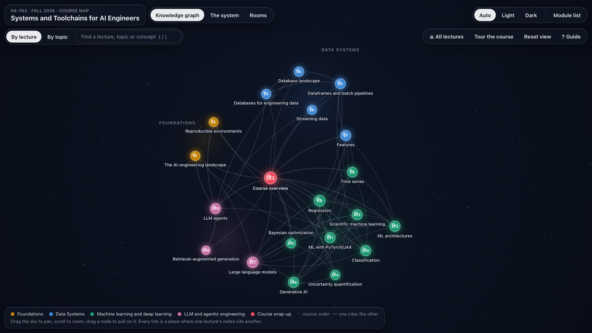
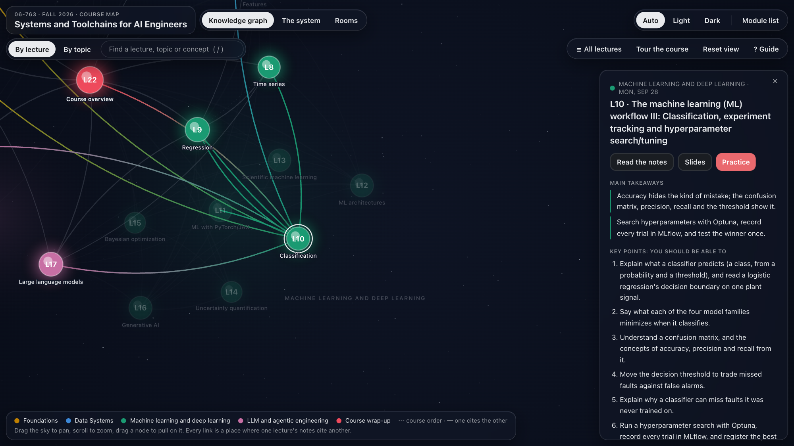
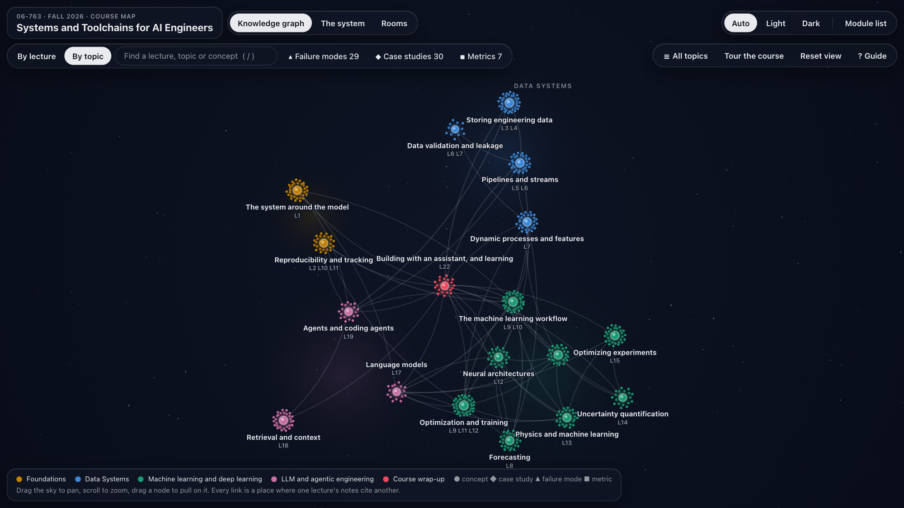
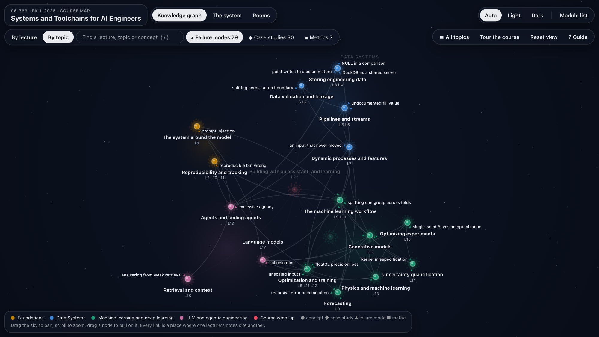
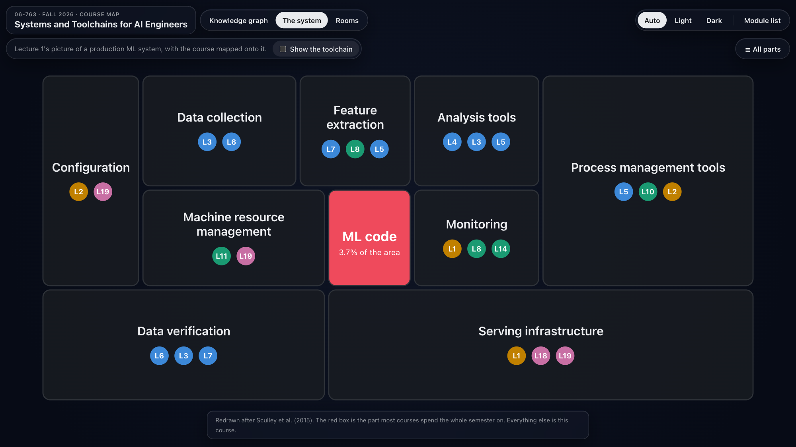
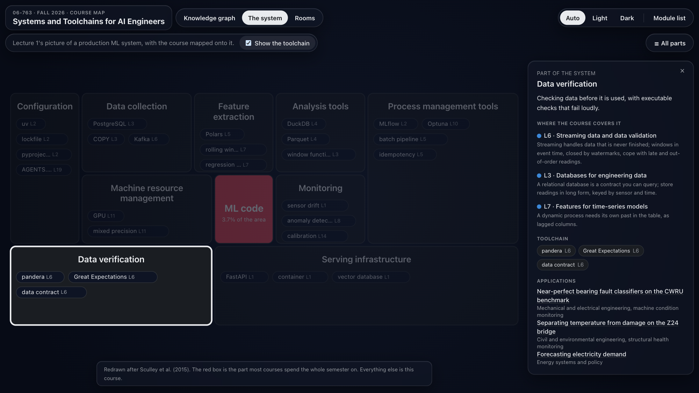
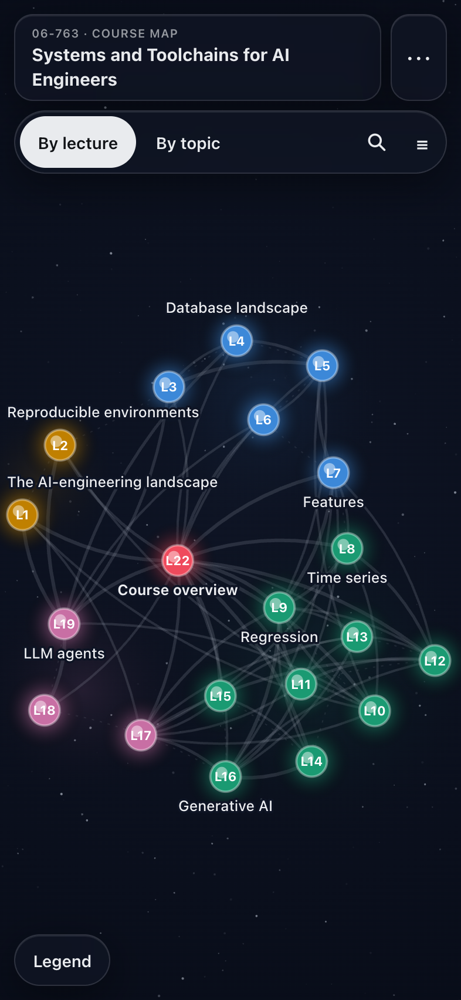
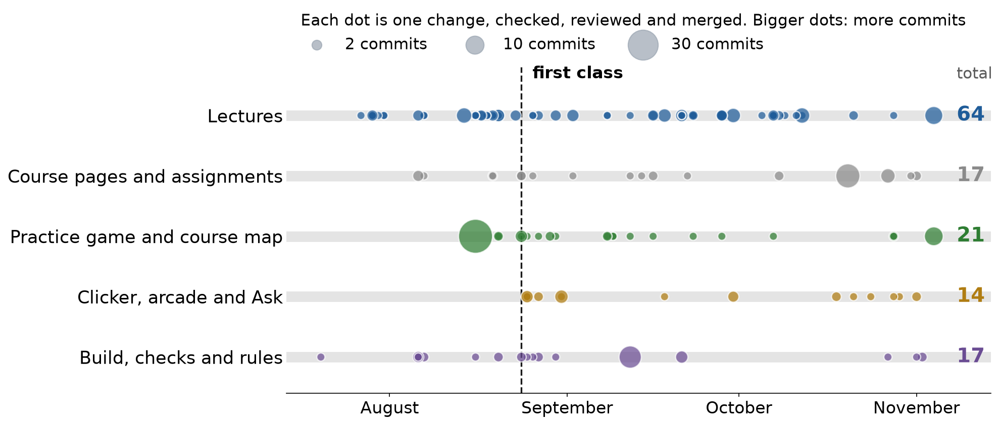
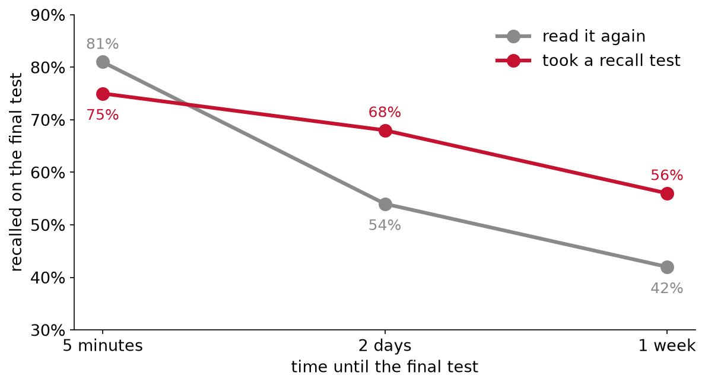

<!-- _class: title -->

# Lecture 22: Course overview and how this course was built

## Week 12, Course wrap-up

**Systems and Toolchains for AI Engineers**

<!--
The course 8. Applications 20. The interactive reviews 15, I open them live myself.
How it was built 15. Learning a new field 15. Limits and close 5.
-->

---
## The whole course, where we are

<svg id="course-map" viewBox="0 0 1180 500" width="100%" role="img" aria-label="A map of the whole course as a journey: a trail through the data lowlands (lectures 1 to 7), the machine-learning highlands (lectures 8 to 16) and along the language coast (lectures 17 to 19). The optional lectures 20 and 21 make a loop off the trail that rejoins it at lecture 22, marked you are here. Beyond it are two days of project presentations and, at the summit, a week of guest speakers. Side paths lead from some lectures to case studies in other fields" style="font-family: Georgia, 'Times New Roman', serif; display:block; margin: 0 auto;">
<defs><radialGradient id="jm-p" cx="50%" cy="45%" r="75%"><stop offset="0%" stop-color="#f8f1df"/><stop offset="100%" stop-color="#e6d6b0"/></radialGradient></defs>
<rect x="4" y="4" width="1172" height="492" rx="14" fill="url(#jm-p)" stroke="#5b4a32" stroke-width="2"/>
<rect x="12" y="12" width="1156" height="476" rx="10" fill="none" stroke="#a89878" stroke-width="1" stroke-dasharray="2 4"/>
<ellipse cx="205" cy="398" rx="200" ry="76" fill="#7d9a5c" opacity="0.18"/>
<ellipse cx="600" cy="220" rx="240" ry="92" fill="#b49a6a" opacity="0.18"/>
<path d="M630,488 C670,436 730,402 790,394 C840,388 870,372 920,380 C990,392 1080,376 1166,370 L1166,478 Q1166,488 1156,488 Z" fill="#6f93b3" opacity="0.22"/>
<path d="M742,404 l6,-12 l6,12" fill="none" stroke="#5b4a32" stroke-width="1.2"/>
<path d="M758,400 l6,-12 l6,12" fill="none" stroke="#5b4a32" stroke-width="1.2"/>
<path d="M774,397 l6,-12 l6,12" fill="none" stroke="#5b4a32" stroke-width="1.2"/>
<path d="M860,380 l6,-12 l6,12" fill="none" stroke="#5b4a32" stroke-width="1.2"/>
<path d="M876,376 l6,-12 l6,12" fill="none" stroke="#5b4a32" stroke-width="1.2"/>
<path d="M892,377 l6,-12 l6,12" fill="none" stroke="#5b4a32" stroke-width="1.2"/>
<path d="M812,392 L814,366 L822,366 L824,392 Z" fill="#fbf7ec" stroke="#5b4a32" stroke-width="1.2"/><rect x="813" y="374" width="10" height="5" fill="#c41230"/><rect x="813" y="384" width="11" height="5" fill="#c41230"/><path d="M812,366 L818,359 L824,366 Z" fill="#5b4a32"/><path d="M826,363 L852,354 L852,370 Z" fill="#f2d27a" opacity="0.7"/>
<path d="M960,468 q8,-6 16,0 t16,0" fill="none" stroke="#6f93b3" stroke-width="1.6"/>
<path d="M1010,468 q8,-6 16,0 t16,0" fill="none" stroke="#6f93b3" stroke-width="1.6"/>
<path d="M1060,468 q8,-6 16,0 t16,0" fill="none" stroke="#6f93b3" stroke-width="1.6"/>
<path d="M1110,468 q8,-6 16,0 t16,0" fill="none" stroke="#6f93b3" stroke-width="1.6"/>
<path d="M140,452 L133,468 L147,468 Z" fill="#7d9a5c" stroke="#5b4a32" stroke-width="0.8"/><line x1="140" y1="468" x2="140" y2="472" stroke="#5b4a32" stroke-width="1.2"/>
<path d="M60,344 L53,360 L67,360 Z" fill="#7d9a5c" stroke="#5b4a32" stroke-width="0.8"/><line x1="60" y1="360" x2="60" y2="364" stroke="#5b4a32" stroke-width="1.2"/>
<path d="M30,234 L23,250 L37,250 Z" fill="#7d9a5c" stroke="#5b4a32" stroke-width="0.8"/><line x1="30" y1="250" x2="30" y2="254" stroke="#5b4a32" stroke-width="1.2"/>
<path d="M210,448 L203,464 L217,464 Z" fill="#7d9a5c" stroke="#5b4a32" stroke-width="0.8"/><line x1="210" y1="464" x2="210" y2="468" stroke="#5b4a32" stroke-width="1.2"/>
<path d="M402,380 L395,396 L409,396 Z" fill="#7d9a5c" stroke="#5b4a32" stroke-width="0.8"/><line x1="402" y1="396" x2="402" y2="400" stroke="#5b4a32" stroke-width="1.2"/>
<path d="M465.5,196 L488,166 L510.5,196 Z" fill="#cbbd9a" stroke="#5b4a32" stroke-width="1.2"/><path d="M480.5,176 L488,166 L495.5,176 Z" fill="#fbf7ec"/>
<path d="M357,214 L372,194 L387,214 Z" fill="#cbbd9a" stroke="#5b4a32" stroke-width="1.2"/><path d="M367,200.7 L372,194 L377,200.7 Z" fill="#fbf7ec"/>
<path d="M583.5,290 L600,268 L616.5,290 Z" fill="#cbbd9a" stroke="#5b4a32" stroke-width="1.2"/><path d="M594.5,275.3 L600,268 L605.5,275.3 Z" fill="#fbf7ec"/>
<path d="M686.5,286 L700,268 L713.5,286 Z" fill="#cbbd9a" stroke="#5b4a32" stroke-width="1.2"/><path d="M695.5,274 L700,268 L704.5,274 Z" fill="#fbf7ec"/>
<path d="M982,150 L1000,126 L1018,150 Z" fill="#cbbd9a" stroke="#5b4a32" stroke-width="1.2"/><path d="M994,134 L1000,126 L1006,134 Z" fill="#fbf7ec"/>
<path d="M1101,108 L1134,64 L1167,108 Z" fill="#cbbd9a" stroke="#5b4a32" stroke-width="1.2"/><path d="M1123,78.7 L1134,64 L1145,78.7 Z" fill="#fbf7ec"/>
<text x="60" y="490" font-size="21" font-style="italic" fill="#5b4a32">The data lowlands</text>
<text x="60" y="318" font-size="13" fill="#5b4a32" opacity="0.85">L1 to L7: toolchain, databases,</text>
<text x="60" y="334" font-size="13" fill="#5b4a32" opacity="0.85">pipelines, streams, features</text>
<text x="400" y="66" font-size="21" font-style="italic" fill="#5b4a32">The machine-learning highlands</text>
<text x="400" y="86" font-size="13" fill="#5b4a32" opacity="0.85">L8 to L16: the ML workflow, deep learning, scientific ML, uncertainty, design, generative models</text>
<text x="652" y="460" font-size="21" font-style="italic" fill="#5b4a32">The language coast</text>
<text x="652" y="480" font-size="13" fill="#5b4a32" opacity="0.85">L17 to L19: language models, context, agents</text>
<text x="1000" y="380" font-size="13" text-anchor="middle" font-style="italic" fill="#5b4a32">optional, AIChE week</text>
<g class="jm-tie"><title>Same mistake, different unit: split by patient in MIT-BIH, by bearing in CWRU (L12 splits by engine)</title><line x1="540" y1="334" x2="262" y2="300" stroke="transparent" stroke-width="12"/><line class="jm-tie-line" x1="540" y1="334" x2="262" y2="300" stroke="#6f93b3" stroke-width="1.6" stroke-dasharray="1 5" stroke-linecap="round"/></g>
<g class="jm-tie"><title>Both looked strong where they were built and weaker at another hospital: validate on the population you deploy to</title><line x1="540" y1="132" x2="668" y2="138" stroke="transparent" stroke-width="12"/><line class="jm-tie-line" x1="540" y1="132" x2="668" y2="138" stroke="#6f93b3" stroke-width="1.6" stroke-dasharray="1 5" stroke-linecap="round"/></g>
<g class="jm-tie"><title>Temperature drives both signals, so both models put temperature in first and judge what is left</title><line x1="330" y1="462" x2="452" y2="404" stroke="transparent" stroke-width="12"/><line class="jm-tie-line" x1="330" y1="462" x2="452" y2="404" stroke="#6f93b3" stroke-width="1.6" stroke-dasharray="1 5" stroke-linecap="round"/></g>
<g class="jm-tie"><title>The alloy search took its uncertainty from a bootstrap ensemble, one of the methods in L14</title><line x1="790" y1="128" x2="696" y2="214" stroke="transparent" stroke-width="12"/><line class="jm-tie-line" x1="790" y1="128" x2="696" y2="214" stroke="#6f93b3" stroke-width="1.6" stroke-dasharray="1 5" stroke-linecap="round"/></g>
<path id="trail" d="M50,420 C58,415.7 81.7,394 98,394 C114.3,394 131.3,420.7 148,420 C164.7,419.3 181.3,391.3 198,390 C214.7,388.7 231.3,413.7 248,412 C264.7,410.3 282.3,392.3 298,380 C313.7,367.7 327.7,351.3 342,338 C356.3,324.7 369.7,311 384,300 C398.3,289 413,280 428,272 C443,264 458.7,259.3 474,252 C489.3,244.7 504.7,235.3 520,228 C535.3,220.7 550.7,212.7 566,208 C581.3,203.3 597.3,197.7 612,200 C626.7,202.3 640,219.7 654,222 C668,224.3 681.3,218.3 696,214 C710.7,209.7 726.3,196 742,196 C757.7,196 774,203 790,214 C806,225 822.3,244.7 838,262 C853.7,279.3 868.7,312.3 884,318 C899.3,323.7 904,308.3 930,296 C956,283.7 1014.3,260.7 1040,244 C1065.7,227.3 1072.7,210.7 1084,196 C1095.3,181.3 1101.3,168.3 1108,156 C1114.7,143.7 1119.7,134.3 1124,122 C1128.3,109.7 1132.3,88.7 1134,82" fill="none" stroke="#8a5a2b" stroke-width="4" stroke-linecap="round" stroke-dasharray="10 6"/>
<path d="M930,296 C936.3,305 951.3,344.3 968,350 C984.7,355.7 1018,347.7 1030,330 C1042,312.3 1038.3,258.3 1040,244" fill="none" stroke="#8a5a2b" stroke-width="2.5" stroke-linecap="round" stroke-dasharray="2 6" opacity="0.8"/>
<path d="M643,224 L654,208 L665,224 Z" fill="#d9a441" stroke="#5b4a32" stroke-width="1.2"/><path d="M654,208 L652,224 L656,224 Z" fill="#5b4a32"/>
<text x="654" y="242" font-size="11" text-anchor="middle" fill="#5b4a32" font-style="italic">fall break</text>
<path d="M1115,124 L1124,111 L1133,124 Z" fill="#d9a441" stroke="#5b4a32" stroke-width="1.1"/>
<text x="1110" y="124" font-size="11" text-anchor="end" fill="#5b4a32" font-style="italic">Thanksgiving</text>
<a class="jm-side" href="../../case-studies/bridge-health-monitoring.html" target="_blank"><title>Civil and environmental engineering: Separating temperature from damage on the Z24 bridge
Cold weather moved the natural frequencies more than early damage did, so detection had to model temperature first
Opens the case study, which links back to the lectures</title><path d="M298,380 L330,462" fill="none" stroke="#8a5a2b" stroke-width="2" stroke-dasharray="1 4" stroke-linecap="round"/><ellipse class="jm-lm" cx="330" cy="462" rx="26" ry="11" fill="#6f93b3" fill-opacity="0.55" stroke="#5b4a32" stroke-width="1.2"/><path d="M318,462 q4,-3 8,0 t8,0" fill="none" stroke="#fbf7ec" stroke-width="1.2"/><text x="360" y="467" font-size="13" font-style="italic" text-anchor="start" fill="#5b4a32">Civil</text></a>
<a class="jm-side" href="../../case-studies/bearing-fault-benchmark.html" target="_blank"><title>Mechanical and electrical engineering: Near-perfect bearing fault classifiers on the CWRU benchmark
Accuracy near 100% fell sharply once no bearing appeared in both training and test
Opens the case study, which links back to the lectures</title><path d="M342,338 L262,300" fill="none" stroke="#8a5a2b" stroke-width="2" stroke-dasharray="1 4" stroke-linecap="round"/><path class="jm-lm" d="M246,308 C244,296 254,288 262,289 C272,288 279,298 277,308 Z" fill="#cbbd9a" stroke="#5b4a32" stroke-width="1.2"/><path d="M274,308 C274,302 280,300 286,303 L287,308 Z" fill="#cbbd9a" stroke="#5b4a32" stroke-width="1"/><text x="230" y="305" font-size="13" font-style="italic" text-anchor="end" fill="#5b4a32">Mechanical</text></a>
<a class="jm-side" href="../../case-studies/electric-load-forecasting.html" target="_blank"><title>Energy systems and policy: Forecasting electricity demand
GEFCom2014: lagged temperature features, weather scenarios, and quantile forecasts scored by pinball loss
Opens the case study, which links back to the lectures</title><path d="M384,300 L452,404" fill="none" stroke="#8a5a2b" stroke-width="2" stroke-dasharray="1 4" stroke-linecap="round"/><ellipse class="jm-lm" cx="452" cy="404" rx="26" ry="11" fill="#6f93b3" fill-opacity="0.55" stroke="#5b4a32" stroke-width="1.2"/><path d="M440,404 q4,-3 8,0 t8,0" fill="none" stroke="#fbf7ec" stroke-width="1.2"/><text x="482" y="409" font-size="13" font-style="italic" text-anchor="start" fill="#5b4a32">Energy</text></a>
<a class="jm-side" href="../../case-studies/ecg-patient-splits.html" target="_blank"><title>Biomedical engineering: Heartbeat classification and the patient split
Splitting MIT-BIH by heartbeat instead of by patient inflated the reported sensitivity
Opens the case study, which links back to the lectures</title><path d="M474,252 L540,334" fill="none" stroke="#8a5a2b" stroke-width="2" stroke-dasharray="1 4" stroke-linecap="round"/><path class="jm-lm" d="M510,344 L525,320 L536,336 Q540,339 544,336 L555,318 L570,344 Z" fill="#cbbd9a" stroke="#5b4a32" stroke-width="1.2"/><path d="M536,336 Q540,339 544,336" fill="none" stroke="#8a5a2b" stroke-width="2"/><text x="572" y="339" font-size="13" font-style="italic" text-anchor="start" fill="#5b4a32">Biomedical</text></a>
<a class="jm-side" href="../../case-studies/chest-xray-shortcuts.html" target="_blank"><title>Biomedical imaging: Chest X-ray models that learned the hospital
A pneumonia CNN scored well on the pooled test set and worse at a hospital it had not trained on
Opens the case study, which links back to the lectures</title><path d="M566,208 L540,132" fill="none" stroke="#8a5a2b" stroke-width="2" stroke-dasharray="1 4" stroke-linecap="round"/><path class="jm-lm" d="M518,146 L540,114 L562,146 Z" fill="#cbbd9a" stroke="#5b4a32" stroke-width="1.2"/><path d="M533,124 L540,114 L547,124 Z" fill="#fbf7ec"/><line x1="540" y1="114" x2="540" y2="100" stroke="#5b4a32" stroke-width="1.5"/><path d="M540,100 L551,104 L540,108 Z" fill="#c41230"/><text x="508" y="137" font-size="13" font-style="italic" text-anchor="end" fill="#5b4a32">Imaging</text></a>
<a class="jm-side" href="../../case-studies/sepsis-alert-validation.html" target="_blank"><title>Health care analytics: Validating a deployed sepsis alert
An external check of a widely used proprietary alert found AUC 0.63 and sensitivity 33%
Opens the case study, which links back to the lectures</title><path d="M696,214 L668,138" fill="none" stroke="#8a5a2b" stroke-width="2" stroke-dasharray="1 4" stroke-linecap="round"/><path class="jm-lm" d="M644,150 L662,122 L672,132 L680,124 L694,150 Z" fill="#dfe8ee" stroke="#5b4a32" stroke-width="1.2"/><path d="M658,150 L664,138 M674,150 L678,140" stroke="#6f93b3" stroke-width="1.2"/><text x="636" y="143" font-size="13" font-style="italic" text-anchor="end" fill="#5b4a32">Health care</text></a>
<a class="jm-side" href="../../case-studies/alloy-adaptive-design.html" target="_blank"><title>Materials science and engineering: Searching 800,000 shape memory alloys with expected improvement
Expected improvement on a bootstrap ensemble found low-hysteresis alloys in 36 syntheses
Opens the case study, which links back to the lectures</title><path d="M742,196 L790,128" fill="none" stroke="#8a5a2b" stroke-width="2" stroke-dasharray="1 4" stroke-linecap="round"/><path class="jm-lm" d="M768,142 L790,110 L812,142 Z" fill="#cbbd9a" stroke="#5b4a32" stroke-width="1.2"/><path d="M783,120 L790,110 L797,120 Z" fill="#fbf7ec"/><line x1="790" y1="110" x2="790" y2="96" stroke="#5b4a32" stroke-width="1.5"/><path d="M790,96 L801,100 L790,104 Z" fill="#c41230"/><text x="822" y="133" font-size="13" font-style="italic" text-anchor="start" fill="#5b4a32">Materials</text></a>
<a class="jm-stop" href="../../lectures/l01/notes.html" target="_blank"><title>L1: The AI-engineering landscape and the modern toolchain
The system view of ML, why engineering data is different, and the course stack: Python, uv, Git, notebooks</title><circle cx="50" cy="420" r="11" fill="#8a5a2b" stroke="#fbf7ec" stroke-width="2"/><text x="50" y="424" font-size="11" text-anchor="middle" fill="#fbf7ec" font-family="sans-serif" font-weight="700">1</text></a>
<a class="jm-stop" href="../../lectures/l02/notes.html" target="_blank"><title>L2: Reproducible environments, version control, and experiment hygiene
uv lockfiles, project layout, Git for code and DVC for data, notebook to module, MLflow run logging</title><circle cx="98" cy="394" r="11" fill="#8a5a2b" stroke="#fbf7ec" stroke-width="2"/><text x="98" y="398" font-size="11" text-anchor="middle" fill="#fbf7ec" font-family="sans-serif" font-weight="700">2</text></a>
<a class="jm-stop" href="../../lectures/l03/notes.html" target="_blank"><title>L3: Relational databases and SQL for engineering time-series
PostgreSQL over the Intel Lab sensor data: schemas, indexes, GROUP BY and window functions</title><circle cx="148" cy="420" r="11" fill="#8a5a2b" stroke="#fbf7ec" stroke-width="2"/><text x="148" y="424" font-size="11" text-anchor="middle" fill="#fbf7ec" font-family="sans-serif" font-weight="700">3</text></a>
<a class="jm-stop" href="../../lectures/l04/notes.html" target="_blank"><title>L4: Columnar storage, Parquet, and DuckDB
Row vs column stores, Parquet row groups and predicate pushdown, DuckDB for OLAP queries</title><circle cx="198" cy="390" r="11" fill="#8a5a2b" stroke="#fbf7ec" stroke-width="2"/><text x="198" y="394" font-size="11" text-anchor="middle" fill="#fbf7ec" font-family="sans-serif" font-weight="700">4</text></a>
<a class="jm-stop" href="../../lectures/l05/notes.html" target="_blank"><title>L5: Dataframes and batch pipelines
The Tennessee Eastman plant in pandas and Polars: lazy plans and pipelines that are safe to rerun</title><circle cx="248" cy="412" r="11" fill="#8a5a2b" stroke="#fbf7ec" stroke-width="2"/><text x="248" y="416" font-size="11" text-anchor="middle" fill="#fbf7ec" font-family="sans-serif" font-weight="700">5</text></a>
<a class="jm-stop" href="../../lectures/l06/notes.html" target="_blank"><title>L6: Streaming concepts and data validation
Event time, windows and watermarks for late data; pandera schemas as a gate that fails loudly</title><circle cx="298" cy="380" r="11" fill="#8a5a2b" stroke="#fbf7ec" stroke-width="2"/><text x="298" y="384" font-size="11" text-anchor="middle" fill="#fbf7ec" font-family="sans-serif" font-weight="700">6</text></a>
<a class="jm-stop" href="../../lectures/l07/notes.html" target="_blank"><title>L7: Features for time-series models
Lags, rolling windows and ARX regressors in Polars, fit with numpy.linalg.lstsq</title><circle cx="342" cy="338" r="11" fill="#8a5a2b" stroke="#fbf7ec" stroke-width="2"/><text x="342" y="342" font-size="11" text-anchor="middle" fill="#fbf7ec" font-family="sans-serif" font-weight="700">7</text></a>
<a class="jm-stop" href="../../lectures/l08/notes.html" target="_blank"><title>L8: The machine learning workflow I, time series
Forecasting reactor pressure at several horizons, time-ordered splits and honest baselines in scikit-learn</title><circle cx="384" cy="300" r="11" fill="#8a5a2b" stroke="#fbf7ec" stroke-width="2"/><text x="384" y="304" font-size="11" text-anchor="middle" fill="#fbf7ec" font-family="sans-serif" font-weight="700">8</text></a>
<a class="jm-stop" href="../../lectures/l09/notes.html" target="_blank"><title>L9: The machine learning workflow II, regression
Model families, cross-validation, capacity and learning curves on concrete strength; NARX forecasts</title><circle cx="428" cy="272" r="11" fill="#8a5a2b" stroke="#fbf7ec" stroke-width="2"/><text x="428" y="276" font-size="11" text-anchor="middle" fill="#fbf7ec" font-family="sans-serif" font-weight="700">9</text></a>
<a class="jm-stop" href="../../lectures/l10/notes.html" target="_blank"><title>L10: The machine learning workflow III, classification, tracking and search
A plant fault classifier in scikit-learn, Optuna hyperparameter search, runs recorded in MLflow</title><circle cx="474" cy="252" r="11" fill="#8a5a2b" stroke="#fbf7ec" stroke-width="2"/><text x="474" y="256" font-size="11" text-anchor="middle" fill="#fbf7ec" font-family="sans-serif" font-weight="700">10</text></a>
<a class="jm-stop" href="../../lectures/l11/notes.html" target="_blank"><title>L11: Tensors, autodiff, training loops, and GPUs
PyTorch tensors and autograd, a training loop by hand, devices and dtypes, four models that looked fine</title><circle cx="520" cy="228" r="11" fill="#8a5a2b" stroke="#fbf7ec" stroke-width="2"/><text x="520" y="232" font-size="11" text-anchor="middle" fill="#fbf7ec" font-family="sans-serif" font-weight="700">11</text></a>
<a class="jm-stop" href="../../lectures/l12/notes.html" target="_blank"><title>L12: Architectures for engineering data: MLP, CNN, and sequence models
Matching architecture to structure: CNNs, RNNs and attention; a 1D-CNN for turbofan RUL vs a tabular baseline</title><circle cx="566" cy="208" r="11" fill="#8a5a2b" stroke="#fbf7ec" stroke-width="2"/><text x="566" y="212" font-size="11" text-anchor="middle" fill="#fbf7ec" font-family="sans-serif" font-weight="700">12</text></a>
<a class="jm-stop" href="../../lectures/l13/notes.html" target="_blank"><title>L13: Scientific machine learning: PINNs, neural ODEs and neural DAEs
A PINN in JAX and Optax, a neural ODE in Diffrax and Equinox, a neural DAE with SiNDAE and Pyomo</title><circle cx="612" cy="200" r="11" fill="#8a5a2b" stroke="#fbf7ec" stroke-width="2"/><text x="612" y="204" font-size="11" text-anchor="middle" fill="#fbf7ec" font-family="sans-serif" font-weight="700">13</text></a>
<a class="jm-stop" href="../../lectures/l14/notes.html" target="_blank"><title>L14: Uncertainty quantification in machine learning
Ensembles, calibration and recalibration, conformal prediction, models with uncertainty built in</title><circle cx="696" cy="214" r="11" fill="#8a5a2b" stroke="#fbf7ec" stroke-width="2"/><text x="696" y="218" font-size="11" text-anchor="middle" fill="#fbf7ec" font-family="sans-serif" font-weight="700">14</text></a>
<a class="jm-stop" href="../../lectures/l15/notes.html" target="_blank"><title>L15: Bayesian optimization
A Gaussian-process surrogate and an acquisition function choose the next experiment, in BoTorch</title><circle cx="742" cy="196" r="11" fill="#8a5a2b" stroke="#fbf7ec" stroke-width="2"/><text x="742" y="200" font-size="11" text-anchor="middle" fill="#fbf7ec" font-family="sans-serif" font-weight="700">15</text></a>
<a class="jm-stop" href="../../lectures/l16/notes.html" target="_blank"><title>L16: Generative AI, learning a distribution and sampling from it
A Gaussian mixture and flow matching that find every root of a cubic by conditional sampling</title><circle cx="790" cy="214" r="11" fill="#8a5a2b" stroke="#fbf7ec" stroke-width="2"/><text x="790" y="218" font-size="11" text-anchor="middle" fill="#fbf7ec" font-family="sans-serif" font-weight="700">16</text></a>
<a class="jm-stop" href="../../lectures/l17/notes.html" target="_blank"><title>L17: Large language models, what they are and how they are trained
A tiny GPT: tokens, a transformer that only looks back, next-token training, sampling with temperature</title><circle cx="838" cy="262" r="11" fill="#8a5a2b" stroke="#fbf7ec" stroke-width="2"/><text x="838" y="266" font-size="11" text-anchor="middle" fill="#fbf7ec" font-family="sans-serif" font-weight="700">17</text></a>
<a class="jm-stop" href="../../lectures/l18/notes.html" target="_blank"><title>L18: Context engineering, tools, search and retrieval
What the model gets to see: tools, keyword and semantic search, re-ranking</title><circle cx="884" cy="318" r="11" fill="#8a5a2b" stroke="#fbf7ec" stroke-width="2"/><text x="884" y="322" font-size="11" text-anchor="middle" fill="#fbf7ec" font-family="sans-serif" font-weight="700">18</text></a>
<a class="jm-stop" href="../../lectures/l19/notes.html" target="_blank"><title>L19: LLM agents: tools, loops, harnesses and coding agents
The agent loop, the harness around it, coding agents, and how this course was built with one</title><circle cx="930" cy="296" r="11" fill="#8a5a2b" stroke="#fbf7ec" stroke-width="2"/><text x="930" y="300" font-size="11" text-anchor="middle" fill="#fbf7ec" font-family="sans-serif" font-weight="700">19</text></a>
<a class="jm-stop" href="../../lectures/l20/notes.html" target="_blank"><title>L20: Reinforcement learning, learning to act from rewards (optional)
An MDP written out as a table and two matrices, value iteration, Q-learning on the tank</title><circle cx="968" cy="350" r="11" fill="#fbf7ec" stroke="#8a5a2b" stroke-width="2"/><text x="968" y="354" font-size="11" text-anchor="middle" fill="#8a5a2b" font-family="sans-serif" font-weight="700">20</text></a>
<a class="jm-stop" href="../../lectures/l21/notes.html" target="_blank"><title>L21: Deployment: serving models, containers, latency and cost (optional)
FastAPI, Docker with uv, percentiles and the tail, batching, and five production incidents</title><circle cx="1030" cy="330" r="11" fill="#fbf7ec" stroke="#8a5a2b" stroke-width="2"/><text x="1030" y="334" font-size="11" text-anchor="middle" fill="#8a5a2b" font-family="sans-serif" font-weight="700">21</text></a>
<a class="jm-stop" href="../../lectures/l22/notes.html" target="_blank"><title>L22: Course overview and how this course was built
The course in a few slides, its git history, and how to learn the next field yourself</title><circle cx="1040" cy="244" r="11" fill="#c41230" stroke="#fbf7ec" stroke-width="2"/><text x="1040" y="248" font-size="11" text-anchor="middle" fill="#fbf7ec" font-family="sans-serif" font-weight="700">22</text></a>
<g><title>Presentations, day 1, Wednesday 11-18</title><line x1="1084" y1="204" x2="1084" y2="182" stroke="#5b4a32" stroke-width="2"/><path d="M1084,182 L1100,187 L1084,192 Z" fill="#c41230"/><circle cx="1084" cy="204" r="3" fill="#5b4a32"/></g>
<g><title>Presentations, day 2, Monday 11-23</title><line x1="1108" y1="164" x2="1108" y2="142" stroke="#5b4a32" stroke-width="2"/><path d="M1108,142 L1124,147 L1108,152 Z" fill="#c41230"/><circle cx="1108" cy="164" r="3" fill="#5b4a32"/></g>
<text x="1160" y="232" font-size="13" text-anchor="end" fill="#5b4a32" font-weight="700">project</text>
<text x="1160" y="247" font-size="13" text-anchor="end" fill="#5b4a32" font-weight="700">presentations</text>
<g><title>Guest speakers, Monday 11-30 and Wednesday 12-02</title><line x1="1134" y1="64" x2="1134" y2="34" stroke="#5b4a32" stroke-width="2.5"/><path d="M1134,34 L1160,42 L1134,50 Z" fill="#c41230"/></g>
<text x="1100" y="50" font-size="14" text-anchor="end" fill="#5b4a32" font-weight="700">guest speakers</text>
<circle cx="1040" cy="244" r="22" fill="#c41230" opacity="0.18"/>
<rect x="858" y="160" width="160" height="50" rx="8" fill="#fbf7ec" stroke="#c41230" stroke-width="2"/>
<text x="938" y="181" font-size="16" text-anchor="middle" fill="#c41230" font-weight="700">You are here: L22</text>
<text x="938" y="200" font-size="13" text-anchor="middle" fill="#5b4a32">looking back</text>
<line x1="1018" y1="200" x2="1028" y2="236" stroke="#c41230" stroke-width="1.5"/>
<circle cx="1120" cy="440" r="22" fill="#fbf7ec" stroke="#5b4a32" stroke-width="1.2"/>
<path d="M1120,420 L1125,440 L1120,460 L1115,440 Z" fill="#5b4a32"/>
<path d="M1100,440 L1120,435 L1140,440 L1120,445 Z" fill="#a89878"/>
<text x="1120" y="414" font-size="12" text-anchor="middle" fill="#5b4a32" font-weight="700">N</text>
<line x1="36" y1="36" x2="76" y2="36" stroke="#8a5a2b" stroke-width="4" stroke-dasharray="10 6"/>
<text x="86" y="41" font-size="13" fill="#5b4a32">the trail, walked</text>
<line x1="36" y1="58" x2="76" y2="58" stroke="#8a5a2b" stroke-width="2.5" stroke-dasharray="2 6" stroke-linecap="round"/>
<circle cx="56" cy="58" r="6" fill="#fbf7ec" stroke="#8a5a2b" stroke-width="2"/>
<text x="86" y="63" font-size="13" fill="#5b4a32">optional sessions</text>
<line x1="36" y1="80" x2="76" y2="80" stroke="#8a5a2b" stroke-width="2" stroke-dasharray="1 4" stroke-linecap="round"/>
<text x="86" y="85" font-size="13" fill="#5b4a32">side path to a case study in another field</text>
<line x1="36" y1="102" x2="76" y2="102" stroke="#6f93b3" stroke-width="1.6" stroke-dasharray="1 5" stroke-linecap="round"/>
<text x="86" y="107" font-size="13" fill="#5b4a32">related cases, hover for what they share</text>
</svg>

<svg viewBox="0 0 160 100" aria-hidden="true"><path d="M24,42 L12,6 L33,36 Z" fill="#1b1b1b"/><rect class="leg b" x="28" y="60" width="12" height="28" rx="5" fill="#1b1b1b"/><rect class="leg" x="44" y="60" width="12" height="28" rx="5" fill="#1b1b1b"/><rect class="leg" x="92" y="60" width="12" height="28" rx="5" fill="#1b1b1b"/><rect class="leg b" x="106" y="60" width="12" height="28" rx="5" fill="#1b1b1b"/><rect x="20" y="32" width="98" height="38" rx="15" fill="#1b1b1b"/><path d="M22,62 l6,12 l6,-10 l6,12 l6,-10 l6,12 l6,-10 l6,12 l6,-10 l6,12 l6,-10 l6,12 l6,-10 l6,12 l6,-14 Z" fill="#1b1b1b"/><path d="M102,26 L134,20 Q150,22 154,34 L157,44 Q150,54 136,56 L116,62 L104,52 Z" fill="#1b1b1b"/><path d="M106,28 L109,2 L121,24 Z M119,23 L126,0 L132,21 Z" fill="#1b1b1b"/><path d="M136,46 L157,44 L151,64 L139,60 Z" fill="#1b1b1b"/><path d="M104,34 L116,30 L121,60 L108,62 Z" fill="#c41230"/><path d="M107,36 L118,33 M108,44 L119,41 M109,52 L120,49 M110,34 L113,61" stroke="#f2d27a" stroke-width="1.6"/><circle cx="133" cy="31" r="2.6" fill="#fbf7ec"/><circle cx="156" cy="38" r="3.6" fill="#000"/></svg>

Twenty-two lectures in twelve weeks. Today we look back over all of them.

<!--
Two minutes. The fog from Lecture 18's map has lifted. L19 on the coast, the optional loop of L20
and L21 on the AIChE dates, and we are at L22. Ahead: two days of presentations, Thanksgiving,
and a week of guest speakers at the top. Hover any stop for the lecture; the side paths are the
case studies from other fields. Scotty walks the trail from L1 to the summit once when the slide
opens; he is not a question.
-->

---
## Roadmap

1<b>The course in one picture:</b> the four parts, and the ideas that come back

2<b>Applications across fields:</b> seven cases outside chemical engineering

3<b>The interactive reviews:</b> the knowledge graph and the system figure

4<b>How this course was built:</b> with an artificial intelligence (AI) assistant, guided by us

5<b>Learning a new field quickly:</b> a method, and how to keep learning it yourself

What you learned, where it is used, how to review it, and how to learn the next field.

---
<!-- _class: section -->

# The course in one picture

<!-- 8 min -->

---
## The course in one picture, four parts

L1 to L2<b>Foundations</b><ul><li>The system around the model</li><li>Reproducible environments</li></ul>

L3 to L7<b>Data systems</b><ul><li>Databases and file formats</li><li>Pipelines and streams</li><li>Features for models</li></ul>

L8 to L16<b>Machine learning</b><ul><li>The workflow: split, fit, score</li><li>Deep learning and scientific machine learning</li><li>Uncertainty and design of experiments</li><li>Generative models</li></ul>

L17 to L19<b>Language models</b><ul><li>How large language models work</li><li>Tools and retrieval</li><li>Agents</li><li>Optional L20: reinforcement learning</li></ul>

Each part builds on the one before. The colors are the same as in the knowledge graph.

<!-- Arrows: what each part needs from the one before it. -->

---
## The course in one picture, the ideas that come back

- **Make results reproducible:** lock the software versions and keep the code in Git <a class="lec a0" href="../../lectures/l01/notes.html" target="_blank">L1</a><a class="lec a0" href="../../lectures/l02/notes.html" target="_blank">L2</a>
* **Split the data the way the model will be used:** never let one unit sit on both sides <a class="lec a2" href="../../lectures/l08/notes.html" target="_blank">L8</a><a class="lec a2" href="../../lectures/l09/notes.html" target="_blank">L9</a><a class="lec a2" href="../../lectures/l12/notes.html" target="_blank">L12</a>
* **Measure, do not assume:** time it and test it, because rules of thumb can be wrong <a class="lec a2" href="../../lectures/l11/notes.html" target="_blank">L11</a>
* **Report the uncertainty:** give a range with every prediction <a class="lec a2" href="../../lectures/l14/notes.html" target="_blank">L14</a><a class="lec a2" href="../../lectures/l15/notes.html" target="_blank">L15</a>
* **The model is a small part of the system:** most of the work is in data, checks and serving <a class="lec a0" href="../../lectures/l01/notes.html" target="_blank">L1</a><a class="lec a3" href="../../lectures/l19/notes.html" target="_blank">L19</a>
* **Check results that look right:** a high score or a fluent answer can still be wrong <a class="lec a2" href="../../lectures/l09/notes.html" target="_blank">L9</a><a class="lec a3" href="../../lectures/l17/notes.html" target="_blank">L17</a>

These ideas work in any field. The tools will change.

---
<!-- _class: section -->

# Applications across fields

<!-- 20 min. One template slide per case: problem, what happened, why, what from our course applies. -->

---
## Applications across fields, the seven cases ahead

- A preview: each row is one published case study, and the next seven slides take them one at a time

<b>Biomedical engineering</b>Label each heartbeat in electrocardiogram (ECG) recordingsL9L10L12

<b>Medical imaging</b>Find pneumonia in chest X-raysL1L7L12

<b>Health care</b>Warn hospital staff early that a patient may have sepsisL1L10L14

<b>Energy</b>Forecast electricity demand for each hourL7L8L14

<b>Mechanical and electrical</b>Detect a failing bearing from its vibrationL7L10L12

<b>Civil</b>Detect damage in a bridge from how it vibratesL1L6L8

<b>Materials</b>Choose which new alloy to make and test nextL9L14L15

Seven fields outside chemical engineering, each using methods from this course.

---
## Applications across fields, biomedical engineering

<a href="https://kitchingroup.cheme.cmu.edu/f26-06763/case-studies/ecg-patient-splits.html">Heartbeat classification ↗</a>

<svg viewBox="0 0 640 205" width="100%" role="img" aria-label="Twenty heartbeats from four patients. Split by beat: the test beats, outlined, come from all four patients. Split by patient: all of patient D is the test set.">
<text x="0" y="16" font-size="15" fill="#5c5c5c">Each bar is one heartbeat, colored by patient. Outlined bars are the test set.</text>
<text x="0" y="62" font-size="18" font-weight="700" fill="#1a1a1a">Split by beat</text>
<rect x="150" y="34" width="20" height="42" rx="4" fill="#0072b2" opacity="0.5"/>
<rect x="174" y="34" width="20" height="42" rx="4" fill="#0072b2" opacity="0.5"/>
<rect x="198" y="34" width="20" height="42" rx="4" fill="#0072b2" opacity="1" stroke="#1a1a1a" stroke-width="4"/>
<rect x="222" y="34" width="20" height="42" rx="4" fill="#0072b2" opacity="0.5"/>
<rect x="246" y="34" width="20" height="42" rx="4" fill="#0072b2" opacity="0.5"/>
<rect x="270" y="34" width="20" height="42" rx="4" fill="#c98500" opacity="0.5"/>
<rect x="294" y="34" width="20" height="42" rx="4" fill="#c98500" opacity="0.5"/>
<rect x="318" y="34" width="20" height="42" rx="4" fill="#c98500" opacity="1" stroke="#1a1a1a" stroke-width="4"/>
<rect x="342" y="34" width="20" height="42" rx="4" fill="#c98500" opacity="0.5"/>
<rect x="366" y="34" width="20" height="42" rx="4" fill="#c98500" opacity="0.5"/>
<rect x="390" y="34" width="20" height="42" rx="4" fill="#009e73" opacity="0.5"/>
<rect x="414" y="34" width="20" height="42" rx="4" fill="#009e73" opacity="1" stroke="#1a1a1a" stroke-width="4"/>
<rect x="438" y="34" width="20" height="42" rx="4" fill="#009e73" opacity="0.5"/>
<rect x="462" y="34" width="20" height="42" rx="4" fill="#009e73" opacity="0.5"/>
<rect x="486" y="34" width="20" height="42" rx="4" fill="#009e73" opacity="0.5"/>
<rect x="510" y="34" width="20" height="42" rx="4" fill="#cc79a7" opacity="0.5"/>
<rect x="534" y="34" width="20" height="42" rx="4" fill="#cc79a7" opacity="1" stroke="#1a1a1a" stroke-width="4"/>
<rect x="558" y="34" width="20" height="42" rx="4" fill="#cc79a7" opacity="0.5"/>
<rect x="582" y="34" width="20" height="42" rx="4" fill="#cc79a7" opacity="0.5"/>
<rect x="606" y="34" width="20" height="42" rx="4" fill="#cc79a7" opacity="0.5"/>
<text x="0" y="150" font-size="18" font-weight="700" fill="#1a1a1a">Split by patient</text>
<rect x="150" y="122" width="20" height="42" rx="4" fill="#0072b2" opacity="0.5"/>
<rect x="174" y="122" width="20" height="42" rx="4" fill="#0072b2" opacity="0.5"/>
<rect x="198" y="122" width="20" height="42" rx="4" fill="#0072b2" opacity="0.5"/>
<rect x="222" y="122" width="20" height="42" rx="4" fill="#0072b2" opacity="0.5"/>
<rect x="246" y="122" width="20" height="42" rx="4" fill="#0072b2" opacity="0.5"/>
<rect x="270" y="122" width="20" height="42" rx="4" fill="#c98500" opacity="0.5"/>
<rect x="294" y="122" width="20" height="42" rx="4" fill="#c98500" opacity="0.5"/>
<rect x="318" y="122" width="20" height="42" rx="4" fill="#c98500" opacity="0.5"/>
<rect x="342" y="122" width="20" height="42" rx="4" fill="#c98500" opacity="0.5"/>
<rect x="366" y="122" width="20" height="42" rx="4" fill="#c98500" opacity="0.5"/>
<rect x="390" y="122" width="20" height="42" rx="4" fill="#009e73" opacity="0.5"/>
<rect x="414" y="122" width="20" height="42" rx="4" fill="#009e73" opacity="0.5"/>
<rect x="438" y="122" width="20" height="42" rx="4" fill="#009e73" opacity="0.5"/>
<rect x="462" y="122" width="20" height="42" rx="4" fill="#009e73" opacity="0.5"/>
<rect x="486" y="122" width="20" height="42" rx="4" fill="#009e73" opacity="0.5"/>
<rect x="510" y="122" width="20" height="42" rx="4" fill="#cc79a7" opacity="1" stroke="#1a1a1a" stroke-width="4"/>
<rect x="534" y="122" width="20" height="42" rx="4" fill="#cc79a7" opacity="1" stroke="#1a1a1a" stroke-width="4"/>
<rect x="558" y="122" width="20" height="42" rx="4" fill="#cc79a7" opacity="1" stroke="#1a1a1a" stroke-width="4"/>
<rect x="582" y="122" width="20" height="42" rx="4" fill="#cc79a7" opacity="1" stroke="#1a1a1a" stroke-width="4"/>
<rect x="606" y="122" width="20" height="42" rx="4" fill="#cc79a7" opacity="1" stroke="#1a1a1a" stroke-width="4"/>
<text x="208" y="102" text-anchor="middle" font-size="15" fill="#5c5c5c">Patient A</text>
<text x="328" y="102" text-anchor="middle" font-size="15" fill="#5c5c5c">Patient B</text>
<text x="448" y="102" text-anchor="middle" font-size="15" fill="#5c5c5c">Patient C</text>
<text x="568" y="102" text-anchor="middle" font-size="15" fill="#5c5c5c">Patient D</text>
<text x="150" y="196" font-size="16" font-weight="700" fill="#c41230">Patient D is new to the model, like a real new patient</text>
</svg>

<b>Problem:</b> Software labels each heartbeat in an electrocardiogram (ECG) as normal or abnormal.

<b>What happened:</b> A method scored 98.7% on patients it had already seen, but 76.3% on new patients.

<b>Why:</b> Each person's heartbeats look alike, so testing on known patients inflated the score.

Concepts from our course

<ul><li>L9 Split by patient: grouped cross-validation</li><li>L10 Precision and recall for rare classes</li><li>L12 Neural networks for signals</li></ul>

Course tools that apply here

scikit-learnPyTorch

References

<a href="https://web.archive.org/web/20220624180052/https://www.repositorio.ufop.br/bitstream/123456789/7011/1/ARTIGO_ECGHeartBeat.pdf">Luz et al., 2016 ↗</a><a href="https://web.archive.org/web/20060514090303/http://dsp.ucd.ie:80/dspfiles/main_files/pdf_files/PdeC_HeartBeatjuly04.pdf">de Chazal et al., 2004 ↗</a>

Test on new patients, the way the model will be used.

---
## Applications across fields, medical imaging

<a href="https://kitchingroup.cheme.cmu.edu/f26-06763/case-studies/chest-xray-shortcuts.html">Chest X-rays and the hospital they came from ↗</a>

<svg viewBox="0 0 640 210" width="100%" role="img" aria-label="Two hospitals. At hospital A about a third of X-rays show pneumonia, at hospital B about one in a hundred. Each hospital marks its images in its own way, so the model can tell the hospitals apart.">
<rect x="10" y="0" width="300" height="150" rx="14" fill="#f6f6f7" stroke="#d8d8d8"/>
<text x="160" y="26" text-anchor="middle" font-size="19" font-weight="700" fill="#1a1a1a">Hospital A</text>
<text x="160" y="47" text-anchor="middle" font-size="15" fill="#5c5c5c">34% labeled pneumonia</text>
<rect x="32" y="62" width="38" height="50" rx="6" fill="#2b2b2b" stroke="#c41230" stroke-width="4"/>
<ellipse cx="45" cy="89" rx="7" ry="15" fill="#6b6b6b"/><ellipse cx="58" cy="89" rx="7" ry="15" fill="#6b6b6b"/>
<text x="65" y="73" text-anchor="end" font-size="11" font-weight="700" fill="#f1c40f">L</text>
<rect x="77" y="62" width="38" height="50" rx="6" fill="#2b2b2b" stroke="#c41230" stroke-width="4"/>
<ellipse cx="90" cy="89" rx="7" ry="15" fill="#6b6b6b"/><ellipse cx="103" cy="89" rx="7" ry="15" fill="#6b6b6b"/>
<text x="110" y="73" text-anchor="end" font-size="11" font-weight="700" fill="#f1c40f">L</text>
<rect x="122" y="62" width="38" height="50" rx="6" fill="#2b2b2b" stroke="#c41230" stroke-width="4"/>
<ellipse cx="135" cy="89" rx="7" ry="15" fill="#6b6b6b"/><ellipse cx="148" cy="89" rx="7" ry="15" fill="#6b6b6b"/>
<text x="155" y="73" text-anchor="end" font-size="11" font-weight="700" fill="#f1c40f">L</text>
<rect x="167" y="62" width="38" height="50" rx="6" fill="#2b2b2b" stroke="#9aa5b1" stroke-width="2"/>
<ellipse cx="180" cy="89" rx="7" ry="15" fill="#6b6b6b"/><ellipse cx="193" cy="89" rx="7" ry="15" fill="#6b6b6b"/>
<text x="200" y="73" text-anchor="end" font-size="11" font-weight="700" fill="#f1c40f">L</text>
<rect x="212" y="62" width="38" height="50" rx="6" fill="#2b2b2b" stroke="#9aa5b1" stroke-width="2"/>
<ellipse cx="225" cy="89" rx="7" ry="15" fill="#6b6b6b"/><ellipse cx="238" cy="89" rx="7" ry="15" fill="#6b6b6b"/>
<text x="245" y="73" text-anchor="end" font-size="11" font-weight="700" fill="#f1c40f">L</text>
<rect x="257" y="62" width="38" height="50" rx="6" fill="#2b2b2b" stroke="#9aa5b1" stroke-width="2"/>
<ellipse cx="270" cy="89" rx="7" ry="15" fill="#6b6b6b"/><ellipse cx="283" cy="89" rx="7" ry="15" fill="#6b6b6b"/>
<text x="290" y="73" text-anchor="end" font-size="11" font-weight="700" fill="#f1c40f">L</text>
<text x="160" y="136" text-anchor="middle" font-size="13" fill="#5c5c5c">red outline: pneumonia</text>
<rect x="330" y="0" width="300" height="150" rx="14" fill="#f6f6f7" stroke="#d8d8d8"/>
<text x="480" y="26" text-anchor="middle" font-size="19" font-weight="700" fill="#1a1a1a">Hospital B</text>
<text x="480" y="47" text-anchor="middle" font-size="15" fill="#5c5c5c">about 1% labeled pneumonia</text>
<rect x="352" y="62" width="38" height="50" rx="6" fill="#2b2b2b" stroke="#9aa5b1" stroke-width="2"/>
<ellipse cx="365" cy="89" rx="7" ry="15" fill="#6b6b6b"/><ellipse cx="378" cy="89" rx="7" ry="15" fill="#6b6b6b"/>
<text x="385" y="73" text-anchor="end" font-size="11" font-weight="700" fill="#f1c40f">R</text>
<rect x="397" y="62" width="38" height="50" rx="6" fill="#2b2b2b" stroke="#9aa5b1" stroke-width="2"/>
<ellipse cx="410" cy="89" rx="7" ry="15" fill="#6b6b6b"/><ellipse cx="423" cy="89" rx="7" ry="15" fill="#6b6b6b"/>
<text x="430" y="73" text-anchor="end" font-size="11" font-weight="700" fill="#f1c40f">R</text>
<rect x="442" y="62" width="38" height="50" rx="6" fill="#2b2b2b" stroke="#9aa5b1" stroke-width="2"/>
<ellipse cx="455" cy="89" rx="7" ry="15" fill="#6b6b6b"/><ellipse cx="468" cy="89" rx="7" ry="15" fill="#6b6b6b"/>
<text x="475" y="73" text-anchor="end" font-size="11" font-weight="700" fill="#f1c40f">R</text>
<rect x="487" y="62" width="38" height="50" rx="6" fill="#2b2b2b" stroke="#9aa5b1" stroke-width="2"/>
<ellipse cx="500" cy="89" rx="7" ry="15" fill="#6b6b6b"/><ellipse cx="513" cy="89" rx="7" ry="15" fill="#6b6b6b"/>
<text x="520" y="73" text-anchor="end" font-size="11" font-weight="700" fill="#f1c40f">R</text>
<rect x="532" y="62" width="38" height="50" rx="6" fill="#2b2b2b" stroke="#9aa5b1" stroke-width="2"/>
<ellipse cx="545" cy="89" rx="7" ry="15" fill="#6b6b6b"/><ellipse cx="558" cy="89" rx="7" ry="15" fill="#6b6b6b"/>
<text x="565" y="73" text-anchor="end" font-size="11" font-weight="700" fill="#f1c40f">R</text>
<rect x="577" y="62" width="38" height="50" rx="6" fill="#2b2b2b" stroke="#9aa5b1" stroke-width="2"/>
<ellipse cx="590" cy="89" rx="7" ry="15" fill="#6b6b6b"/><ellipse cx="603" cy="89" rx="7" ry="15" fill="#6b6b6b"/>
<text x="610" y="73" text-anchor="end" font-size="11" font-weight="700" fill="#f1c40f">R</text>
<text x="480" y="136" text-anchor="middle" font-size="13" fill="#5c5c5c">red outline: pneumonia</text>
<text x="320" y="176" text-anchor="middle" font-size="14" fill="#5c5c5c">Yellow letter: the metal left/right token, placed differently by each hospital</text>
<text x="320" y="201" text-anchor="middle" font-size="16" font-weight="700" fill="#c41230">A model can read the hospital from the image, and the hospital predicts pneumonia</text>
</svg>

<b>Problem:</b> A neural network learned to find pneumonia in chest X-rays from two hospitals, then was tested at a third.

<b>What happened:</b> It did worse at the new hospital. Another network could tell which hospital took an X-ray almost every time.

<b>Why:</b> One hospital had far more pneumonia (34% against about 1%). Clues to the hospital, like a metal marker in the corner, can become a shortcut to the answer.

Concepts from our course

<ul><li>L12 Neural networks for images</li><li>L7 Leakage: an input that gives away the answer</li><li>L1 Test on data from a new source</li></ul>

Course tools that apply here

PyTorchscikit-learn

References

<a href="https://doi.org/10.1371/journal.pmed.1002683">Zech et al., 2018 ↗</a>

Test on a new source: a new hospital, lab or plant.

---
## Applications across fields, health care

<a href="https://kitchingroup.cheme.cmu.edu/f26-06763/case-studies/sepsis-alert-validation.html">A sepsis alert already in use ↗</a>

<svg viewBox="0 0 640 170" width="100%" role="img" aria-label="Three patients who developed sepsis. The alert fired for one, in red, and missed two, in gray.">
<circle cx="70" cy="34" r="22" fill="#c41230"/><path d="M32,126 q0,-58 38,-58 q38,0 38,58 z" fill="#c41230"/>
<text x="70" y="158" text-anchor="middle" font-size="18" font-weight="700" fill="#c41230">Alert sent</text>
<circle cx="190" cy="34" r="22" fill="#9aa5b1"/><path d="M152,126 q0,-58 38,-58 q38,0 38,58 z" fill="#9aa5b1"/>
<text x="190" y="158" text-anchor="middle" font-size="18" font-weight="700" fill="#9aa5b1">Missed</text>
<circle cx="310" cy="34" r="22" fill="#9aa5b1"/><path d="M272,126 q0,-58 38,-58 q38,0 38,58 z" fill="#9aa5b1"/>
<text x="310" y="158" text-anchor="middle" font-size="18" font-weight="700" fill="#9aa5b1">Missed</text>
<text x="420" y="66" font-size="19" fill="#1a1a1a">Of every three patients</text>
<text x="420" y="92" font-size="19" fill="#1a1a1a">who had sepsis, the alert</text>
<text x="420" y="118" font-size="19" font-weight="700" fill="#c41230">warned about one</text>
</svg>

<b>Problem:</b> A commercial model, used in hundreds of hospitals, warns staff that a patient may be developing sepsis, a dangerous reaction to infection.

<b>What happened:</b> In an independent test, it missed 2 of every 3 sepsis cases. Only 1 in 8 flagged patients had sepsis.

<b>Why:</b> Sepsis is rare (7% of hospital stays), so false alarms outnumber real cases. No independent test had been published before.

Concepts from our course

<ul><li>L10 Recall, precision and the alert threshold</li><li>L14 Calibration: does a 30% risk mean 30%?</li><li>L1 Good results on the developer's data are not proof</li></ul>

Course tools that apply here

scikit-learn metricscalibration plots

References

<a href="https://pmc.ncbi.nlm.nih.gov/articles/PMC8218233/">Wong et al., 2021 ↗</a>

Measure a model on your own data before you trust it.

---
## Applications across fields, energy

<a href="https://kitchingroup.cheme.cmu.edu/f26-06763/case-studies/electric-load-forecasting.html">Forecasting electricity demand ↗</a>

<svg viewBox="0 0 640 270" width="100%" role="img" aria-label="Schematic of one day of electricity demand: a line for the most likely demand with morning and evening peaks, inside a shaded range that is widest in the late afternoon.">
<line x1="60" y1="236" x2="620" y2="236" stroke="#5c5c5c"/><line x1="60" y1="236" x2="60" y2="16" stroke="#5c5c5c"/>
<polygon points="60.0,160.3 71.5,160.3 83.0,160.3 94.5,160.3 106.0,160.3 117.5,160.2 129.0,160.0 140.5,159.6 152.0,158.8 163.5,157.2 175.0,154.6 186.5,150.3 198.0,144.1 209.5,136.0 221.0,126.4 232.5,116.4 244.0,107.5 255.5,101.3 267.0,99.0 278.5,101.1 290.0,107.2 301.5,115.9 313.0,125.5 324.5,134.6 336.0,141.9 347.5,147.0 359.0,149.8 370.5,150.5 382.0,149.4 393.5,146.6 405.0,141.8 416.5,134.7 428.0,124.6 439.5,111.5 451.0,95.8 462.5,79.2 474.0,64.6 485.5,55.0 497.0,52.8 508.5,58.9 520.0,72.1 531.5,89.6 543.0,108.2 554.5,124.9 566.0,138.1 577.5,147.5 589.0,153.5 600.5,156.9 612.0,158.7 612.0,183.2 600.5,181.8 589.0,179.1 577.5,174.2 566.0,166.4 554.5,155.2 543.0,141.2 531.5,125.9 520.0,112.2 508.5,103.1 497.0,101.2 485.5,107.1 474.0,119.7 462.5,136.3 451.0,153.6 439.5,168.6 428.0,179.8 416.5,186.8 405.0,190.1 393.5,190.8 382.0,189.5 370.5,186.8 359.0,182.8 347.5,177.3 336.0,170.1 324.5,161.3 313.0,151.1 301.5,140.8 290.0,131.6 278.5,125.3 267.0,123.0 255.5,125.2 244.0,131.3 232.5,140.2 221.0,150.2 209.5,159.8 198.0,167.9 186.5,174.1 175.0,178.4 163.5,181.0 152.0,182.6 140.5,183.4 129.0,183.8 117.5,184.0 106.0,184.1 94.5,184.1 83.0,184.1 71.5,184.1 60.0,184.1" fill="#c98500" opacity="0.25"/>
<polyline points="60.0,172.2 71.5,172.2 83.0,172.2 94.5,172.2 106.0,172.2 117.5,172.1 129.0,171.9 140.5,171.5 152.0,170.7 163.5,169.1 175.0,166.5 186.5,162.2 198.0,156.0 209.5,147.9 221.0,138.3 232.5,128.3 244.0,119.4 255.5,113.2 267.0,111.0 278.5,113.2 290.0,119.4 301.5,128.3 313.0,138.3 324.5,147.9 336.0,156.0 347.5,162.1 359.0,166.3 370.5,168.6 382.0,169.4 393.5,168.7 405.0,166.0 416.5,160.7 428.0,152.2 439.5,140.0 451.0,124.7 462.5,107.8 474.0,92.2 485.5,81.0 497.0,77.0 508.5,81.0 520.0,92.2 531.5,107.8 543.0,124.7 554.5,140.0 566.0,152.2 577.5,160.8 589.0,166.3 600.5,169.4 612.0,171.0" fill="none" stroke="#c98500" stroke-width="3.5"/>
<text x="340" y="262" text-anchor="middle" font-size="16" fill="#1a1a1a">Hour of the day</text>
<text x="22" y="130" text-anchor="middle" font-size="16" fill="#1a1a1a" transform="rotate(-90 22 130)">Demand</text>
<text x="244" y="77" text-anchor="middle" font-size="15" fill="#1a1a1a">Line: the most likely demand</text>
<text x="612" y="41" text-anchor="end" font-size="15" font-weight="700" fill="#b07d12">Shaded: the range to plan for</text>
<text x="618" y="12" text-anchor="end" font-size="11" fill="#8a8a8a" letter-spacing="1">SCHEMATIC</text>
</svg>

<b>Problem:</b> Grid operators must predict electricity demand to decide which power plants to run.

<b>What happened:</b> In the Global Energy Forecasting Competition 2014, teams predicted a range of demand for every hour of the next month, and were scored on the whole range.

<b>Why:</b> Underestimating demand means too little power, so planners need to know how high demand could go.

Concepts from our course

<ul><li>L7 Lagged features: past temperature and demand</li><li>L8 Forecast horizons and simple baselines</li><li>L14 Prediction intervals</li></ul>

Course tools that apply here

pandasPolarsscikit-learn

References

<a href="https://robjhyndman.com/papers/gefcom2014.pdf">Hong et al., 2016 ↗</a><a href="https://robjhyndman.com/papers/peak_electricity_demand.pdf">Hyndman and Fan, 2010 ↗</a><a href="https://www.nerc.com/globalassets/programs/rapa/ra/nerc_sra_2025.pdf">North American Electric Reliability Corporation, 2025 ↗</a>

When the extremes matter, forecast the range of possible outcomes.

---
## Applications across fields, mechanical and electrical engineering

<a href="https://kitchingroup.cheme.cmu.edu/f26-06763/case-studies/bearing-fault-benchmark.html">Bearing faults on a public dataset ↗</a>

<svg viewBox="0 0 640 255" width="100%" role="img" aria-label="Score of the same bearing fault classifier: 100% when tested on the bearings it trained on, 63% when tested on bearings it never saw.">
<line x1="70" y1="200" x2="590" y2="200" stroke="#5c5c5c" stroke-width="1.5"/>
<rect x="120" y="50" width="160" height="150" rx="8" fill="#9aa5b1"/>
<text x="200" y="42" text-anchor="middle" font-size="22" font-weight="700" fill="#1a1a1a">100%</text>
<text x="200" y="224" text-anchor="middle" font-size="16" fill="#1a1a1a">Tested on the bearings</text>
<text x="200" y="244" text-anchor="middle" font-size="16" fill="#1a1a1a">it trained on</text>
<rect x="360" y="106" width="160" height="94" rx="8" fill="#c41230"/>
<text x="440" y="98" text-anchor="middle" font-size="22" font-weight="700" fill="#1a1a1a">63%</text>
<text x="440" y="224" text-anchor="middle" font-size="16" fill="#1a1a1a">Tested on bearings</text>
<text x="440" y="244" text-anchor="middle" font-size="16" fill="#1a1a1a">it never saw</text>
<text x="10" y="16" font-size="15" fill="#5c5c5c">Score of one network, tested two ways (50% is a coin flip)</text>
</svg>

<b>Problem:</b> Spot damaged motor bearings from their vibration, using a popular public dataset.

<b>What happened:</b> Recent papers report scores over 94%. One network scored 100% on bearings it had seen, and 63% on new ones (50% is a coin flip).

<b>Why:</b> The usual splits put the same bearing in training and testing, so models can learn the bearing instead of the fault.

Concepts from our course

<ul><li>L7 Features from vibration signals</li><li>L12 Split by bearing; compare with simple models</li><li>L10 Accuracy can hide missed faults</li></ul>

Course tools that apply here

scikit-learnPyTorch

References

<a href="https://arxiv.org/abs/2509.22267">Vieira et al., 2026 ↗</a><a href="https://engineering.case.edu/bearingdatacenter">The dataset: Bearing Data Center ↗</a>

When a score looks near perfect, check that the test data is really new.

---
## Applications across fields, civil engineering

<a href="https://kitchingroup.cheme.cmu.edu/f26-06763/case-studies/bridge-health-monitoring.html">Damage or a cold night? The Z24 bridge ↗</a>

<svg viewBox="0 0 620 300" width="100%" role="img" aria-label="Schematic: the natural frequency of a bridge against temperature. Healthy measurements follow a curve that rises steeply below freezing. A model of the healthy bridge runs through them as a band. Measurements after damage sit below the band.">
<line x1="70" y1="250" x2="600" y2="250" stroke="#5c5c5c"/><line x1="70" y1="250" x2="70" y2="16" stroke="#5c5c5c"/>
<text x="335" y="284" text-anchor="middle" font-size="16" fill="#1a1a1a">Temperature, from −10 °C to 35 °C</text>
<text x="24" y="135" text-anchor="middle" font-size="16" fill="#1a1a1a" transform="rotate(-90 24 135)">Natural frequency</text>
<polygon points="70.0,26.0 81.5,48.5 93.0,68.6 104.5,86.3 116.0,101.7 127.5,114.8 139.0,125.4 150.5,133.7 162.0,139.6 173.5,143.2 185.0,144.4 196.5,145.8 208.0,147.3 219.5,148.8 231.0,150.3 242.5,151.8 254.0,153.2 265.5,154.7 277.0,156.2 288.5,157.7 300.0,159.2 311.5,160.6 323.0,162.1 334.5,163.6 346.0,165.1 357.5,166.6 369.0,168.0 380.5,169.5 392.0,171.0 403.5,172.5 415.0,174.0 426.5,175.4 438.0,176.9 449.5,178.4 461.0,179.9 472.5,181.4 484.0,182.8 495.5,184.3 507.0,185.8 518.5,187.3 530.0,188.8 541.5,190.2 553.0,191.7 564.5,193.2 576.0,194.7 587.5,196.2 587.5,212.4 576.0,211.0 564.5,209.5 553.0,208.0 541.5,206.5 530.0,205.0 518.5,203.6 507.0,202.1 495.5,200.6 484.0,199.1 472.5,197.6 461.0,196.2 449.5,194.7 438.0,193.2 426.5,191.7 415.0,190.2 403.5,188.8 392.0,187.3 380.5,185.8 369.0,184.3 357.5,182.8 346.0,181.4 334.5,179.9 323.0,178.4 311.5,176.9 300.0,175.4 288.5,174.0 277.0,172.5 265.5,171.0 254.0,169.5 242.5,168.0 231.0,166.6 219.5,165.1 208.0,163.6 196.5,162.1 185.0,160.6 173.5,159.5 162.0,155.9 150.5,150.0 139.0,141.7 127.5,131.0 116.0,118.0 104.5,102.6 93.0,84.9 81.5,64.7 70.0,42.2" fill="#0072b2" opacity="0.15"/>
<polyline points="70.0,34.1 81.5,56.6 93.0,76.7 104.5,94.5 116.0,109.9 127.5,122.9 139.0,133.6 150.5,141.8 162.0,147.8 173.5,151.3 185.0,152.5 196.5,154.0 208.0,155.5 219.5,156.9 231.0,158.4 242.5,159.9 254.0,161.4 265.5,162.9 277.0,164.3 288.5,165.8 300.0,167.3 311.5,168.8 323.0,170.3 334.5,171.7 346.0,173.2 357.5,174.7 369.0,176.2 380.5,177.7 392.0,179.1 403.5,180.6 415.0,182.1 426.5,183.6 438.0,185.1 449.5,186.5 461.0,188.0 472.5,189.5 484.0,191.0 495.5,192.5 507.0,193.9 518.5,195.4 530.0,196.9 541.5,198.4 553.0,199.9 564.5,201.3 576.0,202.8 587.5,204.3" fill="none" stroke="#0072b2" stroke-width="3"/>
<circle cx="81.5" cy="52.2" r="5" fill="#5c5c5c"/>
<circle cx="104.5" cy="98.2" r="5" fill="#5c5c5c"/>
<circle cx="116.0" cy="107.7" r="5" fill="#5c5c5c"/>
<circle cx="139.0" cy="136.5" r="5" fill="#5c5c5c"/>
<circle cx="150.5" cy="137.8" r="5" fill="#5c5c5c"/>
<circle cx="173.5" cy="153.2" r="5" fill="#5c5c5c"/>
<circle cx="185.0" cy="149.5" r="5" fill="#5c5c5c"/>
<circle cx="208.0" cy="159.2" r="5" fill="#5c5c5c"/>
<circle cx="231.0" cy="156.9" r="5" fill="#5c5c5c"/>
<circle cx="242.5" cy="162.1" r="5" fill="#5c5c5c"/>
<circle cx="265.5" cy="159.5" r="5" fill="#5c5c5c"/>
<circle cx="288.5" cy="167.3" r="5" fill="#5c5c5c"/>
<circle cx="311.5" cy="166.6" r="5" fill="#5c5c5c"/>
<circle cx="323.0" cy="173.6" r="5" fill="#5c5c5c"/>
<circle cx="346.0" cy="172.1" r="5" fill="#5c5c5c"/>
<circle cx="369.0" cy="173.2" r="5" fill="#5c5c5c"/>
<circle cx="392.0" cy="181.7" r="5" fill="#5c5c5c"/>
<circle cx="403.5" cy="178.8" r="5" fill="#5c5c5c"/>
<circle cx="426.5" cy="184.7" r="5" fill="#5c5c5c"/>
<circle cx="449.5" cy="183.9" r="5" fill="#5c5c5c"/>
<circle cx="472.5" cy="192.5" r="5" fill="#5c5c5c"/>
<circle cx="495.5" cy="191.0" r="5" fill="#5c5c5c"/>
<circle cx="518.5" cy="197.3" r="5" fill="#5c5c5c"/>
<circle cx="541.5" cy="196.2" r="5" fill="#5c5c5c"/>
<circle cx="564.5" cy="202.1" r="5" fill="#5c5c5c"/>
<circle cx="357.5" cy="193.2" r="7" fill="#c41230"/>
<circle cx="392.0" cy="200.6" r="7" fill="#c41230"/>
<circle cx="426.5" cy="203.9" r="7" fill="#c41230"/>
<circle cx="461.0" cy="211.7" r="7" fill="#c41230"/>
<text x="231" y="36" font-size="15" fill="#5c5c5c">Gray: healthy bridge, much stiffer below freezing</text>
<text x="605" y="150" text-anchor="end" font-size="15" fill="#0072b2">Blue: model and its confidence interval</text>
<text x="404" y="234" text-anchor="middle" font-size="15" font-weight="700" fill="#c41230">Red: after damage, below the band</text>
<text x="598" y="12" text-anchor="end" font-size="11" fill="#8a8a8a" letter-spacing="1">SCHEMATIC</text>
</svg>

<b>Problem:</b> Spot damage in a bridge from how it vibrates.

<b>What happened:</b> The Z24 bridge was monitored for a year, then damaged on purpose. Temperature changed its vibration more than the damage did.

<b>Why:</b> Freezing made the bridge much stiffer. So the team predicted how fast the healthy bridge should vibrate at each temperature. After the damage, it vibrated slower than predicted.

Concepts from our course

<ul><li>L1 Seasons and drift change the data</li><li>L6 Checks on incoming sensor data</li><li>L8 Model normal behavior, flag what is left over</li></ul>

Course tools that apply here

panderascikit-learn

References

<a href="https://doi.org/10.1002/1096-9845(200102)30:2%3C149::AID-EQE1%3E3.0.CO;2-Z">Peeters and De Roeck, 2001 ↗</a><a href="https://arxiv.org/abs/2209.05484">Gowdridge et al., 2022 ↗</a><a href="https://bwk.kuleuven.be/bwm/z24">KU Leuven Z24 bridge page ↗</a>

Model what the environment does, then look for what it cannot explain.

<!--
Inputs and outputs, before and after the fix.
Before: the input is the measured frequency, and the output is damage or no damage, from a fixed limit. Temperature moves the frequency more than damage does, so the limit misses the damage or raises alarms on warm days.
After: the input is the temperature, and the output is the frequency the healthy bridge should have at that temperature. Damage is flagged when the measured frequency falls below that prediction (the red dots).
The model is trained on the healthy bridge only, so damage is never one of its inputs or outputs.
-->

---
## Applications across fields, materials science

<a href="https://kitchingroup.cheme.cmu.edu/f26-06763/case-studies/alloy-adaptive-design.html">Searching for a new alloy ↗</a>

<svg viewBox="0 0 640 230" width="100%" role="img" aria-label="A funnel. 797,504 possible alloy compositions; 36 made in the lab, four per round over nine rounds; 14 better than every alloy the team had made before.">
<rect x="5.0" y="6" width="630" height="62" rx="10" fill="#9aa5b1"/>
<text x="320" y="45" text-anchor="middle" font-size="21" font-weight="700" fill="#fff">797,504 possible compositions</text>
<rect x="85.0" y="80" width="470" height="62" rx="10" fill="#0072b2"/>
<text x="320" y="119" text-anchor="middle" font-size="21" font-weight="700" fill="#fff">36 made in the lab, 4 per round</text>
<rect x="110.0" y="154" width="420" height="62" rx="10" fill="#009e73"/>
<text x="320" y="193" text-anchor="middle" font-size="21" font-weight="700" fill="#fff">14 better than all earlier alloys</text>
</svg>

<b>Problem:</b> Find the best new metal alloy among about 800,000 options, each made and tested in a lab.

<b>What happened:</b> A model picked 4 alloys per round. After 9 rounds, 14 of the 36 new alloys beat the team's best earlier one.

<b>Why:</b> The model predicted how good each alloy would be and how sure it was, and each round picked a mix of promising and uncertain options.

Concepts from our course

<ul><li>L14 Models that report their uncertainty</li><li>L15 Bayesian optimization picks the next experiment</li><li>L9 Regression on composition</li></ul>

Course tools that apply here

scikit-learnBoTorch

References

<a href="https://www.nature.com/articles/ncomms11241">Xue et al., 2016 ↗</a>

When experiments are expensive, let the model choose the next one.

---
<!-- _class: section -->

# The interactive reviews

<!-- 15 min. I open them live. -->

---
## The interactive reviews, the knowledge graph

<figure><figcaption>By lecture: each circle is a lecture; a line means one lecture's notes link to the other</figcaption></figure>
<figure data-marpit-fragment><figcaption>Click a lecture: its takeaways, learning objectives and applications open on the right</figcaption></figure>
<figure data-marpit-fragment><figcaption>By topic: each theme of the course, with its concepts around it</figcaption></figure>
<figure data-marpit-fragment><figcaption>One click lights every failure mode in the course</figcaption></figure>

- Every lecture, topic and concept in one picture
- Click anything to see what it is and where it is taught
- Runs in your browser, also on a phone

<a class="open" href="https://kitchingroup.cheme.cmu.edu/f26-06763/game/#/map">Open it ↗</a>

Review the whole course in minutes, and find the lecture to go back to.

---
## The interactive reviews, the system figure

<figure><figcaption>Lecture 1's figure: each box is sized by the code it needs</figcaption></figure>
<figure data-marpit-fragment><figcaption>Click a box: the lectures, the tools and the case studies for that part</figcaption></figure>

- Lecture 1's figure, now interactive
- The model, in red, is 3.7% of the area
- Every other box is a part of the course

<a class="open" href="https://kitchingroup.cheme.cmu.edu/f26-06763/game/#/map/system">Open it ↗</a>

The model is the small red box. Most of this course, and most of the work, is around it.

---
## The interactive reviews, how they are built

<b>The course notes</b>Text files, one per lecture

↓

<b>A Python script</b>Turns the notes into a list of lectures, links and concepts

↓

<b>A web page</b>React and d3-force, in your browser, no server needed

The map is rebuilt from the notes on every change, so it always matches the course.

---
<!-- _class: section -->

# How this course was built

<!-- 15 min. Each slide ends with a lesson for their own projects. -->

---
## How this course was built, the process

<svg class="pl-anim" viewBox="0 0 1200 500" width="100%" style="max-height:455px" role="img" aria-label="How the course was made. The instructors designed the course, chose every dataset and example, wrote a spec for every lecture, set the standards and rules, planned the extra materials, edited every draft, and reviewed and merged every change. Claude Code researched sources and drafted additional notes, slides, figures and extra materials. Automatic checks ran on every change. The result: lecture notes and slides, plus extra materials for a better class.">
<defs>
<linearGradient id="pl-spec" x1="0" x2="1"><stop offset="0" stop-color="#1f5c99"/><stop offset="1" stop-color="#c41230"/></linearGradient>
<marker id="pl-red" viewBox="0 0 10 10" refX="7" refY="5" markerWidth="5" markerHeight="5" orient="auto-start-reverse"><path d="M0,0 L10,5 L0,10 z" fill="#c41230"/></marker>
<marker id="pl-navy" viewBox="0 0 10 10" refX="7" refY="5" markerWidth="5" markerHeight="5" orient="auto-start-reverse"><path d="M0,0 L10,5 L0,10 z" fill="#1f5c99"/></marker>
<marker id="pl-green" viewBox="0 0 10 10" refX="7" refY="5" markerWidth="5" markerHeight="5" orient="auto-start-reverse"><path d="M0,0 L10,5 L0,10 z" fill="#2e7d32"/></marker>
<filter id="pl-sh" x="-10%" y="-10%" width="120%" height="140%"><feDropShadow dx="0" dy="3" stdDeviation="4" flood-opacity="0.18"/></filter>
</defs>
<rect x="10" y="30" width="400" height="340" rx="16" fill="#e6eef7" stroke="#1f5c99" stroke-width="2.5" filter="url(#pl-sh)"/><text x="210.0" y="62" text-anchor="middle" font-size="22" font-weight="800" fill="#1f5c99">Instructors</text><circle cx="30" cy="87" r="3.5" fill="#1f5c99"/><text x="42" y="92" font-size="17" fill="#1a1a1a">Designed the course and its order</text><circle cx="30" cy="113" r="3.5" fill="#1f5c99"/><text x="42" y="118" font-size="17" fill="#1a1a1a">Chose every dataset and example</text><circle cx="30" cy="139" r="3.5" fill="#1f5c99"/><text x="42" y="144" font-size="17" fill="#1a1a1a">Wrote a spec for every lecture</text><circle cx="30" cy="165" r="3.5" fill="#1f5c99"/><text x="42" y="170" font-size="17" fill="#1a1a1a">Set the standards and the rules</text><circle cx="30" cy="191" r="3.5" fill="#1f5c99"/><text x="42" y="196" font-size="17" fill="#1a1a1a">Planned the extra materials</text><circle cx="30" cy="217" r="3.5" fill="#1f5c99"/><text x="42" y="222" font-size="17" fill="#1a1a1a">Edited every draft, directly or via Claude</text><circle cx="30" cy="243" r="3.5" fill="#1f5c99"/><text x="42" y="248" font-size="17" fill="#1a1a1a">Reviewed every change, sent work back</text><circle cx="30" cy="269" r="3.5" fill="#1f5c99"/><text x="42" y="274" font-size="17" fill="#1a1a1a">Merged every change you saw</text>
<g data-marpit-fragment><path d="M412,150 C445,92 482,92 516,150" fill="none" stroke="url(#pl-spec)" stroke-width="5" stroke-linecap="round" marker-end="url(#pl-red)"/><text x="464" y="90" text-anchor="middle" font-size="15" font-style="italic" fill="#1f5c99">the spec</text><rect x="520" y="115" width="240" height="160" rx="16" fill="#fbeef0" stroke="#c41230" stroke-width="2.5" filter="url(#pl-sh)"/><text x="640.0" y="147" text-anchor="middle" font-size="22" font-weight="800" fill="#c41230">Claude Code</text><text x="640.0" y="177" text-anchor="middle" font-size="16" fill="#1a1a1a">Researches the sources</text><text x="640.0" y="202" text-anchor="middle" font-size="16" fill="#1a1a1a">Drafts additional notes,</text><text x="640.0" y="227" text-anchor="middle" font-size="16" fill="#1a1a1a">slides, figures and extras</text></g>
<g data-marpit-fragment><path d="M516,245 C482,300 445,300 412,245" fill="none" stroke="#c41230" stroke-width="3" stroke-dasharray="2 7" stroke-linecap="round" marker-end="url(#pl-navy)"/><text x="464" y="316" text-anchor="middle" font-size="15" font-style="italic" fill="#5c5c5c">questions</text></g>
<g data-marpit-fragment><path d="M762,195 L816,195" stroke="#c41230" stroke-width="5" stroke-linecap="round" marker-end="url(#pl-navy)"/><rect x="820" y="115" width="190" height="160" rx="16" fill="#f6f6f7" stroke="#5c5c5c" stroke-width="2.5" filter="url(#pl-sh)"/><text x="915.0" y="147" text-anchor="middle" font-size="22" font-weight="800" fill="#5c5c5c">Checks</text><text x="915.0" y="177" text-anchor="middle" font-size="16" fill="#1a1a1a">Run on every change:</text><text x="915.0" y="202" text-anchor="middle" font-size="16" fill="#1a1a1a">build, links, figures</text><text x="915.0" y="227" text-anchor="middle" font-size="16" fill="#1a1a1a">and quiz quotes</text><path d="M915,113 C905,76 720,76 690,112" fill="none" stroke="#5c5c5c" stroke-width="3" stroke-linecap="round" marker-end="url(#pl-red)"/><text x="805" y="72" text-anchor="middle" font-size="15" font-style="italic" fill="#5c5c5c">a check fails: fix it</text></g>
<g data-marpit-fragment><path d="M1012,195 L1046,195" stroke="#5c5c5c" stroke-width="5" stroke-linecap="round" marker-end="url(#pl-navy)"/><rect x="1050" y="115" width="140" height="160" rx="16" fill="#e6eef7" stroke="#1f5c99" stroke-width="2.5" filter="url(#pl-sh)"/><text x="1120.0" y="147" text-anchor="middle" font-size="22" font-weight="800" fill="#1f5c99">Merge</text><text x="1120.0" y="177" text-anchor="middle" font-size="16" fill="#1a1a1a">Only after an</text><text x="1120.0" y="202" text-anchor="middle" font-size="16" fill="#1a1a1a">instructor</text><text x="1120.0" y="227" text-anchor="middle" font-size="16" fill="#1a1a1a">approves</text><path d="M1120,113 C1100,18 680,18 640,112" fill="none" stroke="#1f5c99" stroke-width="3" stroke-linecap="round" marker-end="url(#pl-red)"/><text x="900" y="28" text-anchor="middle" font-size="15" font-style="italic" fill="#1f5c99">instructor asks for changes</text></g>
<g data-marpit-fragment><path d="M1120,277 L1120,372" stroke="#5c5c5c" stroke-width="5" stroke-linecap="round" marker-end="url(#pl-green)"/><rect x="440" y="378" width="750" height="118" rx="16" fill="#dcefdc" stroke="#2e7d32" stroke-width="2.5" filter="url(#pl-sh)"/><text x="460" y="408" font-size="21" font-weight="800" fill="#2e7d32">The course you used</text><text x="460" y="436" font-size="17" fill="#1a1a1a">Lecture notes and slides, plus extra materials for a better class:</text><text x="460" y="460" font-size="17" fill="#1a1a1a">a practice game, a course map, a clicker, case studies,</text><text x="460" y="484" font-size="17" fill="#1a1a1a">narrated slides and interactive figures</text></g>
</svg>

<b>For your own projects:</b> an AI assistant drafts fast, but the design, the standards and the final review stay with you.

---
## How this course was built, the history

Every change was built, tested and reviewed before it reached you.

<b>For your own projects:</b> automatic checks that build and test every change before it goes live, for example GitHub Actions.

<!-- 133 pull requests to November 4. Most were lectures; the big green dot in August is the practice game. -->

---
## How this course was built, what we added along the way

<svg viewBox="0 0 1200 430" width="100%" role="img" aria-label="Timeline from July to November 2026 of what was built around the lectures, colored by kind: the rules file; practice and review tools (practice game, course map, knowledge graph); in-class tools (clicker, interactive figures, narrated slides); reading and help (Ask button, case studies). The first class was on August 24.">
<rect x="60" y="4" width="18" height="18" rx="4" fill="#009e73"/>
<text x="86" y="19" font-size="16" fill="#1a1a1a">Practice and review</text>
<rect x="283.4" y="4" width="18" height="18" rx="4" fill="#c98500"/>
<text x="309.4" y="19" font-size="16" fill="#1a1a1a">In class</text>
<rect x="412.2" y="4" width="18" height="18" rx="4" fill="#0072b2"/>
<text x="438.2" y="19" font-size="16" fill="#1a1a1a">Reading and help</text>
<rect x="609.8" y="4" width="18" height="18" rx="4" fill="#5c5c5c"/>
<text x="635.8" y="19" font-size="16" fill="#1a1a1a">Rules</text>
<rect x="60" y="217" width="1080" height="10" rx="5" fill="#e3e3e3"/>
<line x1="216" y1="212" x2="216" y2="232" stroke="#8a8a8a" stroke-width="2"/>
<text x="222" y="249" font-size="15" fill="#5c5c5c">Aug</text>
<line x1="499" y1="212" x2="499" y2="232" stroke="#8a8a8a" stroke-width="2"/>
<text x="505" y="249" font-size="15" fill="#5c5c5c">Sep</text>
<line x1="774" y1="212" x2="774" y2="232" stroke="#8a8a8a" stroke-width="2"/>
<text x="780" y="249" font-size="15" fill="#5c5c5c">Oct</text>
<line x1="1058" y1="212" x2="1058" y2="232" stroke="#8a8a8a" stroke-width="2"/>
<text x="1064" y="249" font-size="15" fill="#5c5c5c">Nov</text>
<text x="64" y="249" font-size="15" fill="#5c5c5c">Jul</text>
<circle cx="426" cy="222" r="11" fill="#fff" stroke="#1a1a1a" stroke-width="4"/>
<text x="410" y="250" text-anchor="end" font-size="15" font-weight="700" fill="#1a1a1a">First class</text>
<line x1="106" y1="214" x2="120" y2="170" stroke="#5c5c5c" stroke-width="2.5" opacity="0.8"/>
<circle cx="106" cy="222" r="8" fill="#5c5c5c"/>
<rect x="27.0" y="112" width="186" height="58" rx="12" fill="#ececec" stroke="#5c5c5c" stroke-width="2.5"/>
<text x="120" y="138" text-anchor="middle" font-size="18" font-weight="700" fill="#1a1a1a">Rules file</text>
<text x="120" y="159" text-anchor="middle" font-size="14" fill="#5c5c5c">Jul 20</text>
<line x1="271" y1="214" x2="250" y2="98" stroke="#009e73" stroke-width="2.5" opacity="0.8"/>
<circle cx="271" cy="222" r="8" fill="#009e73"/>
<rect x="157.0" y="40" width="186" height="58" rx="12" fill="#dcefe6" stroke="#009e73" stroke-width="2.5"/>
<text x="250" y="66" text-anchor="middle" font-size="18" font-weight="700" fill="#1a1a1a">Practice game</text>
<text x="250" y="87" text-anchor="middle" font-size="14" fill="#5c5c5c">Aug 7</text>
<line x1="280" y1="230" x2="230" y2="276" stroke="#009e73" stroke-width="2.5" opacity="0.8"/>
<circle cx="280" cy="222" r="8" fill="#009e73"/>
<rect x="137.0" y="276" width="186" height="58" rx="12" fill="#dcefe6" stroke="#009e73" stroke-width="2.5"/>
<text x="230" y="302" text-anchor="middle" font-size="18" font-weight="700" fill="#1a1a1a">Course map</text>
<text x="230" y="323" text-anchor="middle" font-size="14" fill="#5c5c5c">Aug 8</text>
<line x1="435" y1="214" x2="430" y2="170" stroke="#c98500" stroke-width="2.5" opacity="0.8"/>
<circle cx="435" cy="222" r="8" fill="#c98500"/>
<rect x="337.0" y="112" width="186" height="58" rx="12" fill="#f7e9cf" stroke="#c98500" stroke-width="2.5"/>
<text x="430" y="138" text-anchor="middle" font-size="18" font-weight="700" fill="#1a1a1a">Clicker</text>
<text x="430" y="159" text-anchor="middle" font-size="14" fill="#5c5c5c">Aug 25</text>
<line x1="737" y1="214" x2="640" y2="98" stroke="#c98500" stroke-width="2.5" opacity="0.8"/>
<circle cx="737" cy="222" r="8" fill="#c98500"/>
<rect x="547.0" y="40" width="186" height="58" rx="12" fill="#f7e9cf" stroke="#c98500" stroke-width="2.5"/>
<text x="640" y="66" text-anchor="middle" font-size="18" font-weight="700" fill="#1a1a1a">Interactive figures</text>
<text x="640" y="87" text-anchor="middle" font-size="14" fill="#5c5c5c">Sep 27</text>
<line x1="875" y1="230" x2="790" y2="276" stroke="#c98500" stroke-width="2.5" opacity="0.8"/>
<circle cx="875" cy="222" r="8" fill="#c98500"/>
<rect x="697.0" y="276" width="186" height="58" rx="12" fill="#f7e9cf" stroke="#c98500" stroke-width="2.5"/>
<text x="790" y="302" text-anchor="middle" font-size="18" font-weight="700" fill="#1a1a1a">Narrated slides</text>
<text x="790" y="323" text-anchor="middle" font-size="14" fill="#5c5c5c">Oct 12</text>
<line x1="1021" y1="214" x2="900" y2="170" stroke="#0072b2" stroke-width="2.5" opacity="0.8"/>
<circle cx="1021" cy="222" r="8" fill="#0072b2"/>
<rect x="807.0" y="112" width="186" height="58" rx="12" fill="#dbe8f5" stroke="#0072b2" stroke-width="2.5"/>
<text x="900" y="138" text-anchor="middle" font-size="18" font-weight="700" fill="#1a1a1a">Ask button</text>
<text x="900" y="159" text-anchor="middle" font-size="14" fill="#5c5c5c">Oct 28</text>
<line x1="1058" y1="230" x2="1010" y2="352" stroke="#0072b2" stroke-width="2.5" opacity="0.8"/>
<circle cx="1058" cy="222" r="8" fill="#0072b2"/>
<rect x="917.0" y="352" width="186" height="58" rx="12" fill="#dbe8f5" stroke="#0072b2" stroke-width="2.5"/>
<text x="1010" y="378" text-anchor="middle" font-size="18" font-weight="700" fill="#1a1a1a">Case studies</text>
<text x="1010" y="399" text-anchor="middle" font-size="14" fill="#5c5c5c">Nov 1</text>
<line x1="1094" y1="214" x2="1080" y2="98" stroke="#009e73" stroke-width="2.5" opacity="0.8"/>
<circle cx="1094" cy="222" r="8" fill="#009e73"/>
<rect x="987.0" y="40" width="186" height="58" rx="12" fill="#dcefe6" stroke="#009e73" stroke-width="2.5"/>
<text x="1080" y="66" text-anchor="middle" font-size="18" font-weight="700" fill="#1a1a1a">Knowledge graph</text>
<text x="1080" y="87" text-anchor="middle" font-size="14" fill="#5c5c5c">Nov 5</text>
</svg>

- The extra materials kept coming all semester, added as the class needed them
* **For your own projects:** ship a first version early, then improve it with feedback

---
## How this course was built, a week ahead, as it felt

<svg id="race-comic" data-when-active viewBox="0 0 1200 350" width="100%" role="img" aria-label="A four-panel comic. July 20: two cartoon instructors, John and Victor, relax beside a plan of 26 lectures, eleven assignments plus a miniproject, and staying a week ahead. August: they walk comfortably ahead of a small boulder labeled L+7. October: they run, worried, as a larger boulder labeled L+1 closes in and a note says A6, A8 and A9 are on hold. November 4: they sprint, shouting, with a robot named Claude carrying a laptop, as a huge boulder labeled L19 rolls at their heels; the caption says Release Lecture 19 at 12:34 pm, and seven of seventeen lectures went out the same day." style="font-family: 'Comic Sans MS', 'Comic Neue', 'Chalkboard SE', sans-serif; display:block; margin: 0 auto;"><g transform="translate(10,10)"><rect x="0" y="0" width="285" height="330" rx="10" fill="#fbf7ec" stroke="#2b2b2b" stroke-width="2.5"/><text x="142" y="26" font-size="16" text-anchor="middle" font-weight="700" fill="#c41230">July 20</text><line x1="10" y1="250" x2="275" y2="250" stroke="#2b2b2b" stroke-width="1.5"/><rect x="30" y="42" width="150" height="104" rx="4" fill="#ffffff" stroke="#2b2b2b" stroke-width="2"/><text x="40" y="64" font-size="12" fill="#2b2b2b">THE PLAN</text><text x="40" y="84" font-size="12" fill="#1f5c99">26 lectures</text><text x="40" y="102" font-size="12" fill="#1f5c99">A1 to A11 + miniproject</text><text x="40" y="120" font-size="12" fill="#1f5c99">2 mini-project days</text><text x="40" y="138" font-size="12" fill="#1f5c99">stay a week ahead</text><line x1="205.0" y1="212" x2="197" y2="250" stroke="#2b2b2b" stroke-width="6" stroke-linecap="round"/><line x1="205.0" y1="212" x2="213" y2="250" stroke="#2b2b2b" stroke-width="6" stroke-linecap="round"/><path d="M192.0,214 L191.0,180 Q205.0,172 219.0,180 L218.0,214 Z" fill="#c41230" stroke="#2b2b2b" stroke-width="2"/><line x1="205.0" y1="186" x2="185.0" y2="204" stroke="#2b2b2b" stroke-width="5" stroke-linecap="round"/><line x1="205.0" y1="186" x2="225.0" y2="204" stroke="#2b2b2b" stroke-width="5" stroke-linecap="round"/><circle cx="205" cy="158" r="17" fill="#f1c9a5" stroke="#2b2b2b" stroke-width="2"/><path d="M205,158 m-17,-3 q1,-17 17,-17 q16,0 17,15 q-8,-8 -17,-7 q-9,-1 -17,9 Z" fill="#2b2b2b"/><circle cx="199" cy="157" r="5" fill="none" stroke="#2b2b2b" stroke-width="1.6"/><circle cx="212" cy="157" r="5" fill="none" stroke="#2b2b2b" stroke-width="1.6"/><line x1="204" y1="157" x2="207" y2="157" stroke="#2b2b2b" stroke-width="1.6"/><circle cx="199" cy="157" r="1.8" fill="#2b2b2b"/><circle cx="212" cy="157" r="1.8" fill="#2b2b2b"/><path d="M199,165 Q206,171 213,165" fill="none" stroke="#2b2b2b" stroke-width="1.8"/><text x="205" y="270" font-size="13" text-anchor="middle" font-weight="700" fill="#2b2b2b">John</text><line x1="250.0" y1="212" x2="242" y2="250" stroke="#2b2b2b" stroke-width="6" stroke-linecap="round"/><line x1="250.0" y1="212" x2="258" y2="250" stroke="#2b2b2b" stroke-width="6" stroke-linecap="round"/><path d="M237.0,214 L236.0,180 Q250.0,172 264.0,180 L263.0,214 Z" fill="#1f5c99" stroke="#2b2b2b" stroke-width="2"/><line x1="250.0" y1="186" x2="230.0" y2="204" stroke="#2b2b2b" stroke-width="5" stroke-linecap="round"/><line x1="250.0" y1="186" x2="270.0" y2="204" stroke="#2b2b2b" stroke-width="5" stroke-linecap="round"/><circle cx="250" cy="158" r="17" fill="#f1c9a5" stroke="#2b2b2b" stroke-width="2"/><path d="M250,158 m-17,-2 q-1,-19 18,-19 q17,1 16,18 q-5,-10 -10,-9 q-2,-6 -12,-4 q-8,0 -12,14 Z" fill="#2b2b2b"/><circle cx="244" cy="157" r="1.8" fill="#2b2b2b"/><circle cx="257" cy="157" r="1.8" fill="#2b2b2b"/><path d="M244,165 Q251,171 258,165" fill="none" stroke="#2b2b2b" stroke-width="1.8"/><text x="250" y="270" font-size="13" text-anchor="middle" font-weight="700" fill="#2b2b2b">Victor</text><rect x="96" y="210" width="28" height="24" rx="6" fill="#d9773c" stroke="#2b2b2b" stroke-width="2"/><circle cx="104" cy="221" r="3" fill="#fbf7ec"/><circle cx="116" cy="221" r="3" fill="#fbf7ec"/><line x1="110" y1="210" x2="110" y2="200" stroke="#2b2b2b" stroke-width="2"/><circle cx="110" cy="198" r="3" fill="#b07d12"/><rect x="100" y="234" width="20" height="12" rx="3" fill="#d9773c" stroke="#2b2b2b" stroke-width="2"/><line x1="104" y1="246" x2="102" y2="254" stroke="#2b2b2b" stroke-width="3"/><line x1="116" y1="246" x2="118" y2="254" stroke="#2b2b2b" stroke-width="3"/><text x="110" y="270" font-size="12" text-anchor="middle" fill="#2b2b2b">Claude</text><text x="230" y="70" font-size="20" fill="#b07d12">☀</text><text x="142" y="294" font-size="13" text-anchor="middle" fill="#2b2b2b">Twelve assignments!</text><text x="142" y="312" font-size="13" text-anchor="middle" fill="#2b2b2b">What could go wrong?</text></g><g transform="translate(307,10)"><rect x="0" y="0" width="285" height="330" rx="10" fill="#fbf7ec" stroke="#2b2b2b" stroke-width="2.5"/><text x="142" y="26" font-size="16" text-anchor="middle" font-weight="700" fill="#c41230">August</text><line x1="10" y1="250" x2="275" y2="250" stroke="#2b2b2b" stroke-width="1.5"/><line x1="201.33333333333334" y1="212" x2="186" y2="250" stroke="#2b2b2b" stroke-width="6" stroke-linecap="round"/><line x1="201.33333333333334" y1="212" x2="212" y2="250" stroke="#2b2b2b" stroke-width="6" stroke-linecap="round"/><path d="M188.33333333333334,214 L189.0,180 Q203.0,172 217.0,180 L214.33333333333334,214 Z" fill="#c41230" stroke="#2b2b2b" stroke-width="2"/><line x1="203.0" y1="186" x2="185.0" y2="198" stroke="#2b2b2b" stroke-width="5" stroke-linecap="round"/><line x1="203.0" y1="186" x2="223.0" y2="206" stroke="#2b2b2b" stroke-width="5" stroke-linecap="round"/><circle cx="204" cy="158" r="17" fill="#f1c9a5" stroke="#2b2b2b" stroke-width="2"/><path d="M204,158 m-17,-3 q1,-17 17,-17 q16,0 17,15 q-8,-8 -17,-7 q-9,-1 -17,9 Z" fill="#2b2b2b"/><circle cx="198" cy="157" r="5" fill="none" stroke="#2b2b2b" stroke-width="1.6"/><circle cx="211" cy="157" r="5" fill="none" stroke="#2b2b2b" stroke-width="1.6"/><line x1="203" y1="157" x2="206" y2="157" stroke="#2b2b2b" stroke-width="1.6"/><circle cx="198" cy="157" r="1.8" fill="#2b2b2b"/><circle cx="211" cy="157" r="1.8" fill="#2b2b2b"/><path d="M198,165 Q205,171 212,165" fill="none" stroke="#2b2b2b" stroke-width="1.8"/><text x="200" y="270" font-size="13" text-anchor="middle" font-weight="700" fill="#2b2b2b">John</text><line x1="246.33333333333334" y1="212" x2="231" y2="250" stroke="#2b2b2b" stroke-width="6" stroke-linecap="round"/><line x1="246.33333333333334" y1="212" x2="257" y2="250" stroke="#2b2b2b" stroke-width="6" stroke-linecap="round"/><path d="M233.33333333333334,214 L234.0,180 Q248.0,172 262.0,180 L259.33333333333337,214 Z" fill="#1f5c99" stroke="#2b2b2b" stroke-width="2"/><line x1="248.0" y1="186" x2="230.0" y2="198" stroke="#2b2b2b" stroke-width="5" stroke-linecap="round"/><line x1="248.0" y1="186" x2="268.0" y2="206" stroke="#2b2b2b" stroke-width="5" stroke-linecap="round"/><circle cx="249" cy="158" r="17" fill="#f1c9a5" stroke="#2b2b2b" stroke-width="2"/><path d="M249,158 m-17,-2 q-1,-19 18,-19 q17,1 16,18 q-5,-10 -10,-9 q-2,-6 -12,-4 q-8,0 -12,14 Z" fill="#2b2b2b"/><circle cx="243" cy="157" r="1.8" fill="#2b2b2b"/><circle cx="256" cy="157" r="1.8" fill="#2b2b2b"/><path d="M243,165 Q250,171 257,165" fill="none" stroke="#2b2b2b" stroke-width="1.8"/><text x="245" y="270" font-size="13" text-anchor="middle" font-weight="700" fill="#2b2b2b">Victor</text><rect x="136" y="210" width="28" height="24" rx="6" fill="#d9773c" stroke="#2b2b2b" stroke-width="2"/><circle cx="144" cy="221" r="3" fill="#fbf7ec"/><circle cx="156" cy="221" r="3" fill="#fbf7ec"/><line x1="150" y1="210" x2="150" y2="200" stroke="#2b2b2b" stroke-width="2"/><circle cx="150" cy="198" r="3" fill="#b07d12"/><rect x="140" y="234" width="20" height="12" rx="3" fill="#d9773c" stroke="#2b2b2b" stroke-width="2"/><line x1="144" y1="246" x2="142" y2="254" stroke="#2b2b2b" stroke-width="3"/><line x1="156" y1="246" x2="158" y2="254" stroke="#2b2b2b" stroke-width="3"/><text x="150" y="270" font-size="12" text-anchor="middle" fill="#2b2b2b">Claude</text><g class="comic-roll" style="transform-origin:45px 226px"><circle cx="45" cy="226" r="24" fill="#b49a6a" stroke="#2b2b2b" stroke-width="2.5"/><path d="M33.0,216.4 q7.199999999999999,4.800000000000001 4.800000000000001,14.399999999999999 M49.8,235.6 q7.199999999999999,-2.4000000000000004 9.600000000000001,7.199999999999999" fill="none" stroke="#2b2b2b" stroke-width="1.5"/></g><text x="45" y="231" font-size="14" text-anchor="middle" font-weight="700" fill="#fbf7ec">L+7</text><text x="100" y="80" font-size="13" fill="#8a8a8a" font-style="italic">a comfortable week</text><text x="142" y="294" font-size="13" text-anchor="middle" fill="#2b2b2b">A week ahead, as planned.</text><text x="142" y="312" font-size="13" text-anchor="middle" fill="#2b2b2b">L3 went up 4 days early</text></g><g transform="translate(604,10)"><rect x="0" y="0" width="285" height="330" rx="10" fill="#fbf7ec" stroke="#2b2b2b" stroke-width="2.5"/><text x="142" y="26" font-size="16" text-anchor="middle" font-weight="700" fill="#c41230">October</text><line x1="10" y1="250" x2="275" y2="250" stroke="#2b2b2b" stroke-width="1.5"/><line x1="194.0" y1="212" x2="166" y2="244" stroke="#2b2b2b" stroke-width="6" stroke-linecap="round"/><line x1="194.0" y1="212" x2="210" y2="250" stroke="#2b2b2b" stroke-width="6" stroke-linecap="round"/><path d="M181.0,214 L185.0,180 Q199.0,172 213.0,180 L207.0,214 Z" fill="#c41230" stroke="#2b2b2b" stroke-width="2"/><line x1="199.0" y1="186" x2="173.0" y2="186" stroke="#2b2b2b" stroke-width="5" stroke-linecap="round"/><line x1="199.0" y1="186" x2="223.0" y2="194" stroke="#2b2b2b" stroke-width="5" stroke-linecap="round"/><circle cx="202" cy="158" r="17" fill="#f1c9a5" stroke="#2b2b2b" stroke-width="2"/><path d="M202,158 m-17,-3 q1,-17 17,-17 q16,0 17,15 q-8,-8 -17,-7 q-9,-1 -17,9 Z" fill="#2b2b2b"/><circle cx="196" cy="157" r="5" fill="none" stroke="#2b2b2b" stroke-width="1.6"/><circle cx="209" cy="157" r="5" fill="none" stroke="#2b2b2b" stroke-width="1.6"/><line x1="201" y1="157" x2="204" y2="157" stroke="#2b2b2b" stroke-width="1.6"/><circle cx="196" cy="157" r="1.8" fill="#2b2b2b"/><circle cx="209" cy="157" r="1.8" fill="#2b2b2b"/><path d="M197,168 Q203,164 209,168" fill="none" stroke="#2b2b2b" stroke-width="1.8"/><path d="M219,146 q4,7 0,10 q-4,-3 0,-10" fill="#6f93b3"/><text x="190" y="270" font-size="13" text-anchor="middle" font-weight="700" fill="#2b2b2b">John</text><line x1="244.0" y1="212" x2="216" y2="244" stroke="#2b2b2b" stroke-width="6" stroke-linecap="round"/><line x1="244.0" y1="212" x2="260" y2="250" stroke="#2b2b2b" stroke-width="6" stroke-linecap="round"/><path d="M231.0,214 L235.0,180 Q249.0,172 263.0,180 L257.0,214 Z" fill="#1f5c99" stroke="#2b2b2b" stroke-width="2"/><line x1="249.0" y1="186" x2="223.0" y2="186" stroke="#2b2b2b" stroke-width="5" stroke-linecap="round"/><line x1="249.0" y1="186" x2="273.0" y2="194" stroke="#2b2b2b" stroke-width="5" stroke-linecap="round"/><circle cx="252" cy="158" r="17" fill="#f1c9a5" stroke="#2b2b2b" stroke-width="2"/><path d="M252,158 m-17,-2 q-1,-19 18,-19 q17,1 16,18 q-5,-10 -10,-9 q-2,-6 -12,-4 q-8,0 -12,14 Z" fill="#2b2b2b"/><circle cx="246" cy="157" r="1.8" fill="#2b2b2b"/><circle cx="259" cy="157" r="1.8" fill="#2b2b2b"/><path d="M247,168 Q253,164 259,168" fill="none" stroke="#2b2b2b" stroke-width="1.8"/><path d="M269,146 q4,7 0,10 q-4,-3 0,-10" fill="#6f93b3"/><text x="240" y="270" font-size="13" text-anchor="middle" font-weight="700" fill="#2b2b2b">Victor</text><rect x="126" y="210" width="28" height="24" rx="6" fill="#d9773c" stroke="#2b2b2b" stroke-width="2"/><circle cx="134" cy="221" r="3" fill="#fbf7ec"/><circle cx="146" cy="221" r="3" fill="#fbf7ec"/><line x1="140" y1="210" x2="140" y2="200" stroke="#2b2b2b" stroke-width="2"/><circle cx="140" cy="198" r="3" fill="#b07d12"/><rect x="130" y="234" width="20" height="12" rx="3" fill="#d9773c" stroke="#2b2b2b" stroke-width="2"/><line x1="134" y1="246" x2="132" y2="254" stroke="#2b2b2b" stroke-width="3"/><line x1="146" y1="246" x2="148" y2="254" stroke="#2b2b2b" stroke-width="3"/><rect x="120" y="226" width="40" height="5" fill="#8a8a8a" stroke="#2b2b2b" stroke-width="1.5"/><rect x="122" y="206" width="36" height="20" fill="#dbe8f5" stroke="#2b2b2b" stroke-width="1.5" transform="rotate(-8 140 216)"/><text x="140" y="270" font-size="12" text-anchor="middle" fill="#2b2b2b">Claude</text><g class="comic-roll" style="transform-origin:70px 214px"><circle cx="70" cy="214" r="36" fill="#b49a6a" stroke="#2b2b2b" stroke-width="2.5"/><path d="M52.0,199.6 q10.799999999999999,7.2 7.2,21.599999999999998 M77.2,228.4 q10.799999999999999,-3.6 14.4,10.799999999999999" fill="none" stroke="#2b2b2b" stroke-width="1.5"/></g><text x="70" y="219" font-size="14" text-anchor="middle" font-weight="700" fill="#fbf7ec">L+1</text><rect x="196" y="48" width="72" height="56" fill="#ffffff" stroke="#2b2b2b" stroke-width="1.5" transform="rotate(10 232 76)"/><text x="204" y="72" font-size="11" fill="#c41230" transform="rotate(10 232 76)">A6, A8, A9</text><text x="210" y="90" font-size="11" fill="#c41230" transform="rotate(10 232 76)">on hold</text><text x="142" y="294" font-size="13" text-anchor="middle" fill="#2b2b2b">A day or two ahead.</text><text x="142" y="312" font-size="13" text-anchor="middle" fill="#2b2b2b">Content first; assignments wait</text></g><g transform="translate(901,10)"><rect x="0" y="0" width="285" height="330" rx="10" fill="#fbf7ec" stroke="#2b2b2b" stroke-width="2.5"/><text x="142" y="26" font-size="16" text-anchor="middle" font-weight="700" fill="#c41230">November 4</text><line x1="10" y1="250" x2="275" y2="250" stroke="#2b2b2b" stroke-width="1.5"/><line x1="196.66666666666666" y1="212" x2="158" y2="236" stroke="#2b2b2b" stroke-width="6" stroke-linecap="round"/><line x1="196.66666666666666" y1="212" x2="216" y2="250" stroke="#2b2b2b" stroke-width="6" stroke-linecap="round"/><path d="M183.66666666666666,214 L191.0,180 Q205.0,172 219.0,180 L209.66666666666666,214 Z" fill="#c41230" stroke="#2b2b2b" stroke-width="2"/><line x1="205.0" y1="186" x2="175.0" y2="176" stroke="#2b2b2b" stroke-width="5" stroke-linecap="round"/><line x1="205.0" y1="186" x2="235.0" y2="182" stroke="#2b2b2b" stroke-width="5" stroke-linecap="round"/><circle cx="210" cy="158" r="17" fill="#f1c9a5" stroke="#2b2b2b" stroke-width="2"/><path d="M210,158 m-17,-3 q1,-17 17,-17 q16,0 17,15 q-8,-8 -17,-7 q-9,-1 -17,9 Z" fill="#2b2b2b"/><circle cx="204" cy="157" r="5" fill="none" stroke="#2b2b2b" stroke-width="1.6"/><circle cx="217" cy="157" r="5" fill="none" stroke="#2b2b2b" stroke-width="1.6"/><line x1="209" y1="157" x2="212" y2="157" stroke="#2b2b2b" stroke-width="1.6"/><circle cx="204" cy="157" r="1.8" fill="#2b2b2b"/><circle cx="217" cy="157" r="1.8" fill="#2b2b2b"/><ellipse cx="212" cy="167" rx="4" ry="5" fill="#2b2b2b"/><path d="M227,144 q4,7 0,10 q-4,-3 0,-10 M190,148 q4,7 0,10 q-4,-3 0,-10" fill="#6f93b3"/><text x="190" y="270" font-size="13" text-anchor="middle" font-weight="700" fill="#2b2b2b">John</text><line x1="238.66666666666666" y1="212" x2="200" y2="236" stroke="#2b2b2b" stroke-width="6" stroke-linecap="round"/><line x1="238.66666666666666" y1="212" x2="258" y2="250" stroke="#2b2b2b" stroke-width="6" stroke-linecap="round"/><path d="M225.66666666666666,214 L233.0,180 Q247.0,172 261.0,180 L251.66666666666666,214 Z" fill="#1f5c99" stroke="#2b2b2b" stroke-width="2"/><line x1="247.0" y1="186" x2="217.0" y2="176" stroke="#2b2b2b" stroke-width="5" stroke-linecap="round"/><line x1="247.0" y1="186" x2="277.0" y2="182" stroke="#2b2b2b" stroke-width="5" stroke-linecap="round"/><circle cx="252" cy="158" r="17" fill="#f1c9a5" stroke="#2b2b2b" stroke-width="2"/><path d="M252,158 m-17,-2 q-1,-19 18,-19 q17,1 16,18 q-5,-10 -10,-9 q-2,-6 -12,-4 q-8,0 -12,14 Z" fill="#2b2b2b"/><circle cx="246" cy="157" r="1.8" fill="#2b2b2b"/><circle cx="259" cy="157" r="1.8" fill="#2b2b2b"/><ellipse cx="254" cy="167" rx="4" ry="5" fill="#2b2b2b"/><path d="M269,144 q4,7 0,10 q-4,-3 0,-10 M232,148 q4,7 0,10 q-4,-3 0,-10" fill="#6f93b3"/><text x="232" y="270" font-size="13" text-anchor="middle" font-weight="700" fill="#2b2b2b">Victor</text><rect x="136" y="210" width="28" height="24" rx="6" fill="#d9773c" stroke="#2b2b2b" stroke-width="2"/><circle cx="144" cy="221" r="3" fill="#fbf7ec"/><circle cx="156" cy="221" r="3" fill="#fbf7ec"/><line x1="150" y1="210" x2="150" y2="200" stroke="#2b2b2b" stroke-width="2"/><circle cx="150" cy="198" r="3" fill="#b07d12"/><rect x="140" y="234" width="20" height="12" rx="3" fill="#d9773c" stroke="#2b2b2b" stroke-width="2"/><line x1="144" y1="246" x2="142" y2="254" stroke="#2b2b2b" stroke-width="3"/><line x1="156" y1="246" x2="158" y2="254" stroke="#2b2b2b" stroke-width="3"/><rect x="130" y="226" width="40" height="5" fill="#8a8a8a" stroke="#2b2b2b" stroke-width="1.5"/><rect x="132" y="206" width="36" height="20" fill="#dbe8f5" stroke="#2b2b2b" stroke-width="1.5" transform="rotate(-8 150 216)"/><text x="150" y="270" font-size="12" text-anchor="middle" fill="#2b2b2b">Claude</text><g class="comic-roll" style="transform-origin:78px 200px"><circle cx="78" cy="200" r="50" fill="#b49a6a" stroke="#2b2b2b" stroke-width="2.5"/><path d="M53.0,180.0 q15.0,10.0 10.0,30.0 M88.0,220.0 q15.0,-5.0 20.0,15.0" fill="none" stroke="#2b2b2b" stroke-width="1.5"/></g><text x="78" y="205" font-size="14" text-anchor="middle" font-weight="700" fill="#fbf7ec">L19</text><path d="M212,108 l10,-14 l4,8 l12,-10" fill="none" stroke="#b07d12" stroke-width="3"/><text x="20" y="60" font-size="13" fill="#2b2b2b" font-weight="700">12:34 pm</text><text x="20" y="76" font-size="12" fill="#2b2b2b">"Release Lecture 19"</text><text x="142" y="294" font-size="13" text-anchor="middle" fill="#2b2b2b">Published the day of.</text><text x="142" y="312" font-size="13" text-anchor="middle" fill="#2b2b2b">7 of 17 lectures: same day</text></g></svg>

<b>For your own projects:</b> building with AI at high quality is more work, not less. Aim for very good, ship it, then keep improving.

<!-- The boulders roll while the slide is up. Captions are the real numbers from the previous
     slide; the characters are cartoons. -->

---
## How this course was built, the rules file

**Conventions file**: a project's rules, read by every person and AI that works on it. Ours is `CLAUDE.md`.

<svg viewBox="0 0 1200 270" width="100%" style="max-height:190px" role="img" aria-label="A loop: something goes wrong; find the cause; write a rule with its reason; automate the check; so the same mistake does not come back.">
<defs><marker id="rl-a" viewBox="0 0 10 10" refX="7" refY="5" markerWidth="5" markerHeight="5" orient="auto-start-reverse"><path d="M0,0 L10,5 L0,10 z" fill="#5c5c5c"/></marker>
<marker id="rl-g" viewBox="0 0 10 10" refX="7" refY="5" markerWidth="5" markerHeight="5" orient="auto-start-reverse"><path d="M0,0 L10,5 L0,10 z" fill="#2e7d32"/></marker>
<filter id="rl-sh" x="-10%" y="-10%" width="120%" height="140%"><feDropShadow dx="0" dy="3" stdDeviation="4" flood-opacity="0.16"/></filter></defs>
<circle cx="140" cy="120" r="86" fill="#fff" stroke="#c41230" stroke-width="5" filter="url(#rl-sh)"/>
<circle cx="140" cy="50" r="20" fill="#c41230"/><text x="140" y="57" text-anchor="middle" font-size="20" font-weight="800" fill="#fff">1</text>
<text x="140" y="120" text-anchor="middle" font-size="18" font-weight="700" fill="#1a1a1a">Something</text>
<text x="140" y="144" text-anchor="middle" font-size="18" font-weight="700" fill="#1a1a1a">goes wrong</text>
<circle cx="440" cy="120" r="86" fill="#fff" stroke="#c98500" stroke-width="5" filter="url(#rl-sh)"/>
<circle cx="440" cy="50" r="20" fill="#c98500"/><text x="440" y="57" text-anchor="middle" font-size="20" font-weight="800" fill="#fff">2</text>
<text x="440" y="120" text-anchor="middle" font-size="18" font-weight="700" fill="#1a1a1a">Find</text>
<text x="440" y="144" text-anchor="middle" font-size="18" font-weight="700" fill="#1a1a1a">the cause</text>
<circle cx="760" cy="120" r="86" fill="#fff" stroke="#1f5c99" stroke-width="5" filter="url(#rl-sh)"/>
<circle cx="760" cy="50" r="20" fill="#1f5c99"/><text x="760" y="57" text-anchor="middle" font-size="20" font-weight="800" fill="#fff">3</text>
<text x="760" y="120" text-anchor="middle" font-size="18" font-weight="700" fill="#1a1a1a">Write a rule,</text>
<text x="760" y="144" text-anchor="middle" font-size="18" font-weight="700" fill="#1a1a1a">with the reason</text>
<circle cx="1060" cy="120" r="86" fill="#fff" stroke="#009e73" stroke-width="5" filter="url(#rl-sh)"/>
<circle cx="1060" cy="50" r="20" fill="#009e73"/><text x="1060" y="57" text-anchor="middle" font-size="20" font-weight="800" fill="#fff">4</text>
<text x="1060" y="120" text-anchor="middle" font-size="18" font-weight="700" fill="#1a1a1a">Automate</text>
<text x="1060" y="144" text-anchor="middle" font-size="18" font-weight="700" fill="#1a1a1a">the check</text>
<path d="M232,120 L346,120" stroke="#5c5c5c" stroke-width="4" stroke-linecap="round" marker-end="url(#rl-a)"/>
<path d="M532,120 L666,120" stroke="#5c5c5c" stroke-width="4" stroke-linecap="round" marker-end="url(#rl-a)"/>
<path d="M852,120 L966,120" stroke="#5c5c5c" stroke-width="4" stroke-linecap="round" marker-end="url(#rl-a)"/>
<path d="M1060,210 C1000,266 200,266 140,212" fill="none" stroke="#2e7d32" stroke-width="4" stroke-dasharray="9 7" stroke-linecap="round" marker-end="url(#rl-g)"/>
<rect x="440" y="234" width="320" height="30" rx="15" fill="#fff"/>
<text x="600" y="255" text-anchor="middle" font-size="17" font-weight="700" fill="#2e7d32">the same mistake does not come back</text>
</svg>

- A deploy reported success, but the site still showed the old version → every deploy now checks the live site
* Slides had text cut off at the bottom → a check now renders every deck and fails if anything overflows

<b>For your own projects:</b> keep a rules file, and turn each rule into an automatic check where you can.

---
<!-- _class: section -->

# Learning a new field quickly

<!-- 15 min. The way the course was built, as a method you can use. -->

---
## Learning a new field quickly, the method

Before you start

1Write down what you need to know, and what a good answer looks like

2Start from original sources: papers, documentation, data descriptions

While you work

3Confirm each fact at its source before you build on it

4Predict the result, then run it: a surprise shows what you got wrong

5Make every number and figure with code you keep

When something goes wrong

6Write down a rule, with the reason

7Automate the check, so it runs on every change

<b>For your own projects:</b> an AI assistant makes each step faster. It does not let you skip any of them.

---
<!-- _class: section -->

# Generating is not learning

<!-- An assistant can write the material for you. It cannot learn it for you. -->

---
## Generating is not learning, test yourself

**Testing effect**: you remember more by trying to recall something than by reading it again.

- Students read two short texts. They read one again, and wrote down what they remembered of the other
* After 5 minutes, the text they read again was remembered better
* After 2 days and after 1 week, the text they recalled was remembered better

[Roediger and Karpicke, 2006](https://psychology.ecu.edu/wp-content/pv-uploads/sites/216/2019/03/Roediger-Karpicke-2006.pdf)

Reading an AI's explanation feels like learning. Recalling it yourself is what lasts.

---
## Generating is not learning, an AI tutor study

<figure><svg viewBox="0 0 660 330" width="100%" role="img" aria-label="Change in grade compared with students who had no AI. Chat assistant that gives answers: practice +48%. Tutor that gives hints: practice +127%.">
<line x1="70" y1="235" x2="640" y2="235" stroke="#5c5c5c" stroke-width="1.5"/>
<text x="66" y="240" text-anchor="end" font-size="13" fill="#5c5c5c">no AI</text>
<rect x="110" y="170" width="88" height="65" rx="6" fill="#1f5c99"/>
<text x="154" y="162" text-anchor="middle" font-size="19" font-weight="700" fill="#1a1a1a">+48%</text>
<rect x="390" y="64" width="88" height="171" rx="6" fill="#1f5c99"/>
<text x="434" y="56" text-anchor="middle" font-size="19" font-weight="700" fill="#1a1a1a">+127%</text>
<text x="204" y="297" text-anchor="middle" font-size="16" font-weight="700" fill="#1a1a1a">Group 1: chat assistant</text>
<text x="204" y="317" text-anchor="middle" font-size="15" fill="#5c5c5c">it gives answers</text>
<text x="484" y="297" text-anchor="middle" font-size="16" font-weight="700" fill="#1a1a1a">Group 2: AI tutor</text>
<text x="484" y="317" text-anchor="middle" font-size="15" fill="#5c5c5c">it gives hints, not answers</text>
<rect x="80" y="6" width="16" height="16" rx="3" fill="#1f5c99"/><text x="104" y="20" font-size="15" fill="#1a1a1a">Practice problems, with the AI</text>
<text x="640" y="20" text-anchor="end" font-size="13" fill="#5c5c5c">Change in grade compared</text>
<text x="640" y="37" text-anchor="end" font-size="13" fill="#5c5c5c">with students without AI</text>
</svg><figcaption>Step 1: practice, with the AI. Both groups do much better than students without AI</figcaption></figure>
<figure data-marpit-fragment><svg viewBox="0 0 660 330" width="100%" role="img" aria-label="Change in grade compared with students who had no AI. Chat assistant that gives answers: practice +48%, exam -17%. Tutor that gives hints: practice +127%, exam about the same.">
<line x1="70" y1="235" x2="640" y2="235" stroke="#5c5c5c" stroke-width="1.5"/>
<text x="66" y="240" text-anchor="end" font-size="13" fill="#5c5c5c">no AI</text>
<rect x="110" y="170" width="88" height="65" rx="6" fill="#1f5c99"/>
<text x="154" y="162" text-anchor="middle" font-size="19" font-weight="700" fill="#1a1a1a">+48%</text>
<rect x="210" y="235" width="88" height="23" rx="6" fill="#c41230"/>
<text x="254" y="279" text-anchor="middle" font-size="19" font-weight="700" fill="#c41230">-17%</text>
<rect x="390" y="64" width="88" height="171" rx="6" fill="#1f5c99"/>
<text x="434" y="56" text-anchor="middle" font-size="19" font-weight="700" fill="#1a1a1a">+127%</text>
<rect x="490" y="235" width="88" height="3" rx="6" fill="#c41230"/>
<text x="534" y="225" text-anchor="middle" font-size="15" font-weight="700" fill="#c41230">about the same</text>
<text x="204" y="297" text-anchor="middle" font-size="16" font-weight="700" fill="#1a1a1a">Group 1: chat assistant</text>
<text x="204" y="317" text-anchor="middle" font-size="15" fill="#5c5c5c">it gives answers</text>
<text x="484" y="297" text-anchor="middle" font-size="16" font-weight="700" fill="#1a1a1a">Group 2: AI tutor</text>
<text x="484" y="317" text-anchor="middle" font-size="15" fill="#5c5c5c">it gives hints, not answers</text>
<rect x="80" y="6" width="16" height="16" rx="3" fill="#1f5c99"/><text x="104" y="20" font-size="15" fill="#1a1a1a">Practice problems, with the AI</text>
<rect x="80" y="30" width="16" height="16" rx="3" fill="#c41230"/><text x="104" y="44" font-size="15" fill="#1a1a1a">Exam, without the AI</text>
<text x="640" y="20" text-anchor="end" font-size="13" fill="#5c5c5c">Change in grade compared</text>
<text x="640" y="37" text-anchor="end" font-size="13" fill="#5c5c5c">with students without AI</text>
</svg><figcaption>Step 2: the exam, without the AI. The answers group does worse; the hints group the same</figcaption></figure>

- Nearly 1,000 high school students practiced math in three groups: no AI, a chat assistant, or an AI tutor
- Then everyone took the same exam without AI

[Bastani et al., 2025](https://pmc.ncbi.nlm.nih.gov/articles/PMC12232635/)

With answers on demand, exam grades fell 17%. With hints only, they did not fall, but did not rise either.

<!-- The tutor group rated their exam performance higher than the no-AI group did; their scores were the same. The tutor had the teachers' solutions in its prompt. -->

---
## Generating is not learning, ways to study

<svg viewBox="0 0 760 410" width="100%" role="img" aria-label="Eight ways to study, from least to most effective, drawn as bars that grow from 0 to 7: read about it; predict the result; work an example by hand; break working code; change one assumption; explain it from memory; teach it; fix a bug in open-source code or tackle an open problem.">
<defs><linearGradient id="st-g" x1="0" x2="1"><stop offset="0" stop-color="#9aa5b1"/><stop offset="1" stop-color="#009e73"/></linearGradient>
<marker id="st-a" viewBox="0 0 10 10" refX="7" refY="5" markerWidth="5" markerHeight="5" orient="auto"><path d="M0,0 L10,5 L0,10 z" fill="#009e73"/></marker></defs>
<rect x="40" y="6" width="666" height="42" rx="8" fill="url(#st-g)" opacity="0.98"/>
<text x="20" y="35" text-anchor="middle" font-size="21" font-weight="800" fill="#1a1a1a">7</text>
<text x="54" y="34" font-size="19" fill="#1a1a1a" font-weight="700">Fix a bug in open-source code, or tackle an open problem</text>
<rect x="40" y="56" width="618" height="42" rx="8" fill="url(#st-g)" opacity="0.90"/>
<text x="20" y="85" text-anchor="middle" font-size="21" font-weight="800" fill="#1a1a1a">6</text>
<text x="54" y="84" font-size="19" fill="#1a1a1a" font-weight="700">Teach it to someone</text>
<rect x="40" y="106" width="570" height="42" rx="8" fill="url(#st-g)" opacity="0.82"/>
<text x="20" y="135" text-anchor="middle" font-size="21" font-weight="800" fill="#1a1a1a">5</text>
<text x="54" y="134" font-size="19" fill="#1a1a1a" font-weight="700">Explain it from memory, in writing</text>
<rect x="40" y="156" width="522" height="42" rx="8" fill="url(#st-g)" opacity="0.75"/>
<text x="20" y="185" text-anchor="middle" font-size="21" font-weight="800" fill="#1a1a1a">4</text>
<text x="54" y="184" font-size="19" fill="#1a1a1a" font-weight="500">Change one assumption, predict what moves</text>
<rect x="40" y="206" width="474" height="42" rx="8" fill="url(#st-g)" opacity="0.68"/>
<text x="20" y="235" text-anchor="middle" font-size="21" font-weight="800" fill="#1a1a1a">3</text>
<text x="54" y="234" font-size="19" fill="#1a1a1a" font-weight="500">Break working code on purpose, predict the error</text>
<rect x="40" y="256" width="426" height="42" rx="8" fill="url(#st-g)" opacity="0.60"/>
<text x="20" y="285" text-anchor="middle" font-size="21" font-weight="800" fill="#1a1a1a">2</text>
<text x="54" y="284" font-size="19" fill="#1a1a1a" font-weight="500">Work one example by hand</text>
<rect x="40" y="306" width="378" height="42" rx="8" fill="url(#st-g)" opacity="0.53"/>
<text x="20" y="335" text-anchor="middle" font-size="21" font-weight="800" fill="#1a1a1a">1</text>
<text x="54" y="334" font-size="19" fill="#1a1a1a" font-weight="500">Predict the result before you look</text>
<rect x="40" y="356" width="330" height="42" rx="8" fill="url(#st-g)" opacity="0.45"/>
<text x="20" y="385" text-anchor="middle" font-size="21" font-weight="800" fill="#1a1a1a">0</text>
<text x="54" y="384" font-size="19" fill="#1a1a1a" font-weight="500">Read about it</text>
<path d="M748,395 L748,20" stroke="#009e73" stroke-width="4" marker-end="url(#st-a)"/>
<text x="733" y="210" text-anchor="middle" font-size="17" font-weight="700" fill="#009e73" transform="rotate(-90 733 210)">more effort, more learning</text>
</svg>

**With an AI assistant**

- Ask it to quiz you, and to grade your answer
* Explain first, then ask it for the gaps
* Ask why, not only what
* Solve the problem yourself

Higher levels take more effort and teach more. Use the assistant to move up, not to skip levels.

---
## Limitations and trade-offs, AI assistants

<h4>✓Good at</h4>

- Drafting from a clear plan
* Code you can run and test
* Finding sources, which you then read
* Repetitive work: figures, formatting, checks

<h4>!Watch out for</h4>

- Confident answers that are wrong
* Numbers and quotes with no real source
* More text than anyone can read and check
* Doing the practice for you

You plan<i>→</i>The assistant drafts<i>→</i>You check: run, test, read the source<i>→</i>You decide

Use it where you can check the result, and check what it gives you.

---
## Recap

1<b>The course:</b> four parts, and a few ideas that work in any field

2<b>Applications:</b> the same methods in medicine, energy, machines, bridges and materials

3<b>Review:</b> the knowledge graph and the system figure, on any device

4<b>How it was built:</b> an AI assistant, with the course designed, edited and checked by us

5<b>Learning:</b> use the assistant to test you, not to do the work for you

You can now learn the next field yourself, with the same method.

---
## Before the presentations

<i class="spark" style="--a:0.0deg"></i><i class="spark" style="--a:22.5deg"></i><i class="spark" style="--a:45.0deg"></i><i class="spark" style="--a:67.5deg"></i><i class="spark" style="--a:90.0deg"></i><i class="spark" style="--a:112.5deg"></i><i class="spark" style="--a:135.0deg"></i><i class="spark" style="--a:157.5deg"></i><i class="spark" style="--a:180.0deg"></i><i class="spark" style="--a:202.5deg"></i><i class="spark" style="--a:225.0deg"></i><i class="spark" style="--a:247.5deg"></i><i class="spark" style="--a:270.0deg"></i><i class="spark" style="--a:292.5deg"></i><i class="spark" style="--a:315.0deg"></i><i class="spark" style="--a:337.5deg"></i>

<i class="spark" style="--a:0.0deg"></i><i class="spark" style="--a:22.5deg"></i><i class="spark" style="--a:45.0deg"></i><i class="spark" style="--a:67.5deg"></i><i class="spark" style="--a:90.0deg"></i><i class="spark" style="--a:112.5deg"></i><i class="spark" style="--a:135.0deg"></i><i class="spark" style="--a:157.5deg"></i><i class="spark" style="--a:180.0deg"></i><i class="spark" style="--a:202.5deg"></i><i class="spark" style="--a:225.0deg"></i><i class="spark" style="--a:247.5deg"></i><i class="spark" style="--a:270.0deg"></i><i class="spark" style="--a:292.5deg"></i><i class="spark" style="--a:315.0deg"></i><i class="spark" style="--a:337.5deg"></i>

<i class="spark" style="--a:0.0deg"></i><i class="spark" style="--a:22.5deg"></i><i class="spark" style="--a:45.0deg"></i><i class="spark" style="--a:67.5deg"></i><i class="spark" style="--a:90.0deg"></i><i class="spark" style="--a:112.5deg"></i><i class="spark" style="--a:135.0deg"></i><i class="spark" style="--a:157.5deg"></i><i class="spark" style="--a:180.0deg"></i><i class="spark" style="--a:202.5deg"></i><i class="spark" style="--a:225.0deg"></i><i class="spark" style="--a:247.5deg"></i><i class="spark" style="--a:270.0deg"></i><i class="spark" style="--a:292.5deg"></i><i class="spark" style="--a:315.0deg"></i><i class="spark" style="--a:337.5deg"></i>

<i class="spark" style="--a:0.0deg"></i><i class="spark" style="--a:22.5deg"></i><i class="spark" style="--a:45.0deg"></i><i class="spark" style="--a:67.5deg"></i><i class="spark" style="--a:90.0deg"></i><i class="spark" style="--a:112.5deg"></i><i class="spark" style="--a:135.0deg"></i><i class="spark" style="--a:157.5deg"></i><i class="spark" style="--a:180.0deg"></i><i class="spark" style="--a:202.5deg"></i><i class="spark" style="--a:225.0deg"></i><i class="spark" style="--a:247.5deg"></i><i class="spark" style="--a:270.0deg"></i><i class="spark" style="--a:292.5deg"></i><i class="spark" style="--a:315.0deg"></i><i class="spark" style="--a:337.5deg"></i>

<i class="spark" style="--a:0.0deg"></i><i class="spark" style="--a:22.5deg"></i><i class="spark" style="--a:45.0deg"></i><i class="spark" style="--a:67.5deg"></i><i class="spark" style="--a:90.0deg"></i><i class="spark" style="--a:112.5deg"></i><i class="spark" style="--a:135.0deg"></i><i class="spark" style="--a:157.5deg"></i><i class="spark" style="--a:180.0deg"></i><i class="spark" style="--a:202.5deg"></i><i class="spark" style="--a:225.0deg"></i><i class="spark" style="--a:247.5deg"></i><i class="spark" style="--a:270.0deg"></i><i class="spark" style="--a:292.5deg"></i><i class="spark" style="--a:315.0deg"></i><i class="spark" style="--a:337.5deg"></i>

<i class="spark" style="--a:0.0deg"></i><i class="spark" style="--a:22.5deg"></i><i class="spark" style="--a:45.0deg"></i><i class="spark" style="--a:67.5deg"></i><i class="spark" style="--a:90.0deg"></i><i class="spark" style="--a:112.5deg"></i><i class="spark" style="--a:135.0deg"></i><i class="spark" style="--a:157.5deg"></i><i class="spark" style="--a:180.0deg"></i><i class="spark" style="--a:202.5deg"></i><i class="spark" style="--a:225.0deg"></i><i class="spark" style="--a:247.5deg"></i><i class="spark" style="--a:270.0deg"></i><i class="spark" style="--a:292.5deg"></i><i class="spark" style="--a:315.0deg"></i><i class="spark" style="--a:337.5deg"></i>

<i class="spark" style="--a:0.0deg"></i><i class="spark" style="--a:22.5deg"></i><i class="spark" style="--a:45.0deg"></i><i class="spark" style="--a:67.5deg"></i><i class="spark" style="--a:90.0deg"></i><i class="spark" style="--a:112.5deg"></i><i class="spark" style="--a:135.0deg"></i><i class="spark" style="--a:157.5deg"></i><i class="spark" style="--a:180.0deg"></i><i class="spark" style="--a:202.5deg"></i><i class="spark" style="--a:225.0deg"></i><i class="spark" style="--a:247.5deg"></i><i class="spark" style="--a:270.0deg"></i><i class="spark" style="--a:292.5deg"></i><i class="spark" style="--a:315.0deg"></i><i class="spark" style="--a:337.5deg"></i>

1No assignment for this session

2Presentations: Wednesday 11-18 and Monday 11-23; the final project page has what to bring

3Review with the <a href="https://kitchingroup.cheme.cmu.edu/f26-06763/game/#/map">course map</a> before you present

